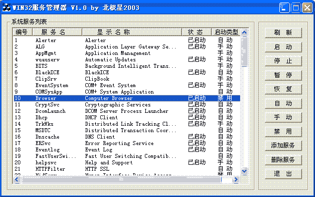

# Windows 系统程序设计之系统服务

> 原文：[`www.pediy.com/kssd/pediy08/pediy8-739.htm`](https://www.pediy.com/kssd/pediy08/pediy8-739.htm)

Windows 系统程序设计之系统服务  
  
【作者】北极星 2003  
【来源】看雪技术论坛（bbs.pediy.com）  
【时间】2006-7-18   
【附件】servicemanager.rar   
  
WIN32 服务管理器  
1.设计目标  
  设计简易的 Win32 服务管理器，实现基本的 WIN32 服务管理功能，包括启动、停止、添加、删除、暂停、恢复和设置自动、手动、禁用启动类型。  
  
2.设计思路  
  
   
设计思路比较简单：  
  （1）枚举服务  
  （2）服务控制（启动、停止……）  
  （3）排序（枚举出来的服务的以服务名排序的，而系统默认的服务管理是以显示名称排序的）  
3.难点  
  （1）需要注意 OpenSCManager 时权限设置  
  （2）在对 ENUM\_SERVICE\_STATUS 结构数组进行排序时并不能直接对其本身进行排序，需要建立一个相应的索引数组。（这里使用插入排序算法）  
  
4.详细设计  
// CSM.h  

>  
> 
> ```
> 代码:
> 
> * * *
> 
> #ifndef \_CSM\_H
> #define \_CSM\_H
> 
> #ifndef \_WINSVC\_H
> #include <Winsvc.h>
> #define \_WINSVC\_H
> #endif
> 
> #include <stdlib.h>
> 
> const int MAX\_SERVICE\_NUM = 512 ;
> 
> class CSM {
> public:
>   DWORD    dwSerNum ;
>   UINT    nSerIndex\[MAX\_SERVICE\_NUM\];
>   ENUM\_SERVICE\_STATUS SerStatus\[MAX\_SERVICE\_NUM\] ;
> 
> public:
>   CSM () {}
>   ~CSM () {}
>   
> public:
>   // 枚举服务
>   BOOL EnumWin32Service ( ) ;
>   
>   // 启动服务
>   BOOL StartWin32Service ( UINT nIndex ) ;
>   
>   // 停止服务
>   BOOL StopWin32Service ( UINT nIndex ) ;
>   
>   // 暂停服务
>   BOOL PauseWin32Service ( UINT nIndex ) ;
>   
>   //恢复服务
>   BOOL ContinueWin32Service ( UINT nIndex ) ;
>   
>   // 服务启动类型--自动
>   BOOL SetAutoStartType ( UINT nIndex ) ;
> 
>   // 服务启动类型--手动
>   BOOL SetManualStartType ( UINT nIndex ) ;
> 
>   // 服务启动类型--禁用
>   BOOL SetDisableStartType ( UINT nIndex ) ;
> 
>   // 取得服务的启动类型
>   UINT GetServiceStartType ( UINT nIndex ) ;
>   
>   // 加载服务
>   BOOL AddWin32Service ( LPCSTR lpServiceName, LPCSTR lpDisplayName, LPSTR lpPathName ) ;
> 
>   // 卸载服务
>   BOOL DeleteWin32Service ( UINT nIndex ) ;
>   
> protected:
>   // 取得指定索引的服务的句柄
>   SC\_HANDLE GetServiceByIndex ( UINT nIndex ) ;
> 
>   // 以显示名称排序
>   void SortByDisplayName () ;
> 
>   // 自定义字符串比较
>   int MyStrCmp ( LPSTR FirStr, LPSTR SecStr ) ;
> } ;
> 
> #endif
> 
> * * *
> 
> 
> ```

  
  
//CSM.cpp  

>  
> 
> ```
> 代码:
> 
> * * *
> 
> #include "stdafx.h"
> #include "CSM.h"
> 
> // 枚举服务
> BOOL CSM::EnumWin32Service ( )
> {
>   SC\_HANDLE hSCManager = OpenSCManager ( NULL, NULL, SC\_MANAGER\_ENUMERATE\_SERVICE|GENERIC\_READ ) ;
>   if ( hSCManager == NULL )
>   {
>     return FALSE ;
>   }  
>   
>   DWORD dwBufSize = 512 \* sizeof(ENUM\_SERVICE\_STATUS) ;  
>   DWORD dwBytesNeeded, lpResumeHandle = 0 ;
>   if ( !EnumServicesStatus(hSCManager, SERVICE\_WIN32, SERVICE\_STATE\_ALL, \\
>     SerStatus, dwBufSize, &dwBytesNeeded, &dwSerNum, &lpResumeHandle ) )
>   {
>     return FALSE ;
>   }
>   
>   SortByDisplayName () ;
>   CloseServiceHandle ( hSCManager ) ;
>   return TRUE ;
> }
> 
> // 启动服务
> BOOL CSM::StartWin32Service ( UINT nIndex )
> {
>   SC\_HANDLE hSCService = GetServiceByIndex ( nSerIndex\[nIndex\] ) ;
>   if ( !StartService ( hSCService, 0, NULL ) )
>   {
>     CloseServiceHandle ( hSCService ) ; 
>     return FALSE ;
>   }
>   
>   CloseServiceHandle ( hSCService ) ; 
>   return TRUE ;
> }
> 
> // 停止服务
> BOOL CSM::StopWin32Service ( UINT nIndex )
> {
>   SC\_HANDLE hSCService = GetServiceByIndex ( nSerIndex\[nIndex\] ) ;
>   if ( !ControlService ( hSCService, SERVICE\_CONTROL\_STOP, &(SerStatus\[nIndex\].ServiceStatus) ) )
>   {
>     CloseServiceHandle ( hSCService ) ; 
>     return FALSE ;
>   }
>   
>   CloseServiceHandle ( hSCService ) ; 
>   return TRUE ;
> }
> 
> // 暂停服务
> BOOL CSM::PauseWin32Service ( UINT nIndex )
> {
>   SC\_HANDLE hSCService = GetServiceByIndex ( nSerIndex\[nIndex\] ) ;
>   if ( !ControlService ( hSCService, SERVICE\_CONTROL\_PAUSE, &(SerStatus\[nIndex\].ServiceStatus) ) )
>   {
>     CloseServiceHandle ( hSCService ) ; 
>     return FALSE ;
>   }
>   
>   CloseServiceHandle ( hSCService ) ; 
>   return TRUE ;
> }
> 
> //恢复服务
> BOOL CSM::ContinueWin32Service ( UINT nIndex )
> {
>   SC\_HANDLE hSCService = GetServiceByIndex ( nSerIndex\[nIndex\] ) ;
>   if ( !ControlService ( hSCService, SERVICE\_CONTROL\_CONTINUE, &(SerStatus\[nIndex\].ServiceStatus) ) )
>   {
>     CloseServiceHandle ( hSCService ) ; 
>     return FALSE ;
>   }
>   
>   CloseServiceHandle ( hSCService ) ; 
>   return TRUE ;
> }
> 
> // 服务启动类型--自动
> BOOL CSM::SetAutoStartType ( UINT nIndex )
> {
>   SC\_HANDLE hSCService = GetServiceByIndex ( nSerIndex\[nIndex\] ) ;
>   if ( !ChangeServiceConfig( hSCService, SERVICE\_NO\_CHANGE, \\
>     SERVICE\_AUTO\_START, SERVICE\_NO\_CHANGE, NULL, NULL, NULL, NULL, NULL, NULL, NULL)  )
>   {
>     CloseServiceHandle ( hSCService ) ; 
>     return FALSE ;
>   }
>   
>   CloseServiceHandle ( hSCService ) ; 
>   return TRUE ;
> }
> 
> // 服务启动类型--手动
> BOOL CSM::SetManualStartType ( UINT nIndex )
> {
>   SC\_HANDLE hSCService = GetServiceByIndex ( nSerIndex\[nIndex\] ) ;
>   if ( !ChangeServiceConfig( hSCService, SERVICE\_NO\_CHANGE, \\
>     SERVICE\_DEMAND\_START, SERVICE\_NO\_CHANGE, NULL, NULL, NULL, NULL, NULL, NULL, NULL)  )
>   {
>     CloseServiceHandle ( hSCService ) ; 
>     return FALSE ;
>   }
>   
>   CloseServiceHandle ( hSCService ) ; 
>   return TRUE ;
> }
> 
> // 服务启动类型--禁用
> BOOL CSM::SetDisableStartType ( UINT nIndex )
> {
>   SC\_HANDLE hSCService = GetServiceByIndex ( nSerIndex\[nIndex\] ) ;
>   if ( !ChangeServiceConfig( hSCService, SERVICE\_NO\_CHANGE, \\
>     SERVICE\_DISABLED, SERVICE\_NO\_CHANGE, NULL, NULL, NULL, NULL, NULL, NULL, NULL)  )
>   {
>     CloseServiceHandle ( hSCService ) ; 
>     return FALSE ;
>   }
>   
>   CloseServiceHandle ( hSCService ) ; 
>   return TRUE ;
> }  
> 
> // 取得服务的启动类型
> UINT CSM::GetServiceStartType ( UINT nIndex )
> {
>   SC\_HANDLE hSCService = GetServiceByIndex ( nSerIndex\[nIndex\] ) ;
>   
>   LPQUERY\_SERVICE\_CONFIG lpServiceConfig = (LPQUERY\_SERVICE\_CONFIG)new BYTE\[1024\] ;
>   DWORD dwByteNeeded ;
>   if ( !QueryServiceConfig ( hSCService, lpServiceConfig, 1024, &dwByteNeeded ) )
>   {
>     CloseServiceHandle ( hSCService ) ; 
>     return 0 ;
>   }
>   
>   UINT nServiceType = 0 ;
>   switch ( lpServiceConfig->dwStartType )
>   {
>   case SERVICE\_AUTO\_START:  nServiceType = 1 ;  break ;
>   case SERVICE\_DEMAND\_START:  nServiceType = 2 ;  break ;
>   case SERVICE\_DISABLED:    nServiceType = 3 ;  break ;
>   default:          nServiceType = 4 ;
>   }
>   
>   CloseServiceHandle ( hSCService ) ; 
>   delete lpServiceConfig ;
>   return nServiceType ;
> }
> 
> // 加载服务
> BOOL CSM::AddWin32Service ( LPCSTR lpServiceName, LPCSTR lpDisplayName, LPSTR lpPathName )
> {
>   SC\_HANDLE hSCManager = OpenSCManager ( NULL, NULL, SC\_MANAGER\_CREATE\_SERVICE ) ;
>   if ( hSCManager == NULL )
>   {
>     return FALSE ;
>   }
>   
>   SC\_HANDLE hSCService =  CreateService ( hSCManager, lpServiceName, lpDisplayName, \\
>     SERVICE\_ALL\_ACCESS, SERVICE\_WIN32\_OWN\_PROCESS, SERVICE\_DEMAND\_START, \\
>     SERVICE\_ERROR\_NORMAL, lpPathName, NULL, NULL, NULL, NULL, NULL );
>   if ( hSCService == NULL )
>   {
>     DWORD dwErrorCode = GetLastError () ;
>     CloseServiceHandle ( hSCManager ) ;
>     return FALSE ;
>   }
>   
>   CloseServiceHandle ( hSCService ) ;
>   CloseServiceHandle ( hSCManager ) ;
>   return TRUE ;
> }
> 
> // 卸载服务
> BOOL CSM::DeleteWin32Service ( UINT nIndex )
> {
>   SC\_HANDLE  hSCService = GetServiceByIndex ( nSerIndex\[nIndex\] ) ;
>   BOOL    bRet = DeleteService ( hSCService ) ;
>   DWORD    dwErrorCode = GetLastError () ;
>   CloseServiceHandle ( hSCService ) ;
>   return bRet ;
> }
> 
> // 取得指定索引的服务的句柄
> SC\_HANDLE CSM::GetServiceByIndex ( UINT nIndex )
> {
>   SC\_HANDLE hSCManager = OpenSCManager ( NULL, NULL, SC\_MANAGER\_ENUMERATE\_SERVICE|GENERIC\_READ ) ;
>   if ( hSCManager == NULL )
>   {
>     return NULL ;
>   }
>   
>   SC\_HANDLE hSCService = OpenService ( hSCManager, SerStatus\[nIndex\].lpServiceName, SERVICE\_ALL\_ACCESS ) ;
>   CloseServiceHandle ( hSCManager ) ;
>   return hSCService ;  
> }
> 
> // 以显示名称排序
> void CSM::SortByDisplayName ()
> {
>   memset ( nSerIndex, 0, sizeof(nSerIndex) ) ;
>   
>   for ( int i = 1; i < dwSerNum; i++ )
>   {
>     for ( int j = i-1; j >= 0; j-- )
>     {
>       if ( MyStrCmp ( SerStatus\[i\].lpDisplayName, SerStatus\[nSerIndex\[j\]\].lpDisplayName ) > 0 )
>         break ;
>       else
>         nSerIndex\[j+1\] = nSerIndex\[j\] ;
>     }
>     nSerIndex\[j+1\] = i ;
>   }
> }
> 
> // 自定义字符串比较
> int CSM::MyStrCmp ( LPSTR FirStr, LPSTR SecStr )
> {
>   char ChA, ChB ;
>   UINT nIndex = 0 ;
>   
>   while ( true )
>   {
>     ChA = FirStr\[nIndex\] > 'Z' ? ( FirStr\[nIndex\] - 0x20 ) : FirStr\[nIndex\] ;
>     ChB = SecStr\[nIndex\] > 'Z' ? ( SecStr\[nIndex\] - 0x20 ) : SecStr\[nIndex\] ;
>     
>     if ( ChA == '\\0' && ChB == '\\0' )
>       return 0 ;
>     else if ( ChA == '\\0' )
>       return -1 ;
>     else if ( ChB == '\\0' )
>       return 1 ;
>     
>     if ( ChA > ChB )
>       return 1 ;
>     else if ( ChA < ChB )
>       return -1 ;
>     
>     nIndex++ ;
>   }   
> }
> 
> * * *
> 
> 
> ```

  
  
5.遇到的困难  
  这个软件相对比较简单，需要注意的是建立索引后的排序。  
  
6.总结(心得)  
  增进对 WIN32 服务管理方式的了解。原本还想写个服务，由于最近较忙且资料实在太多就不写了。在参考文献中列举了一些关于服务的比较优秀的文章，其中还有相应的源代码可以下载。  
  
【参考文献】  
\[1\]. Beginner’s introductory guide to writing, installing, starting, stopping NT services  
     http://www.codeproject.com/system/serviceskeleton.asp  
\[2\]. CServiceHelper  
     http://www.codeproject.com/system/cservicehelper.asp  
\[3\]. Kmd 教程 2-服务  
     http://211.90.241.130:22366/view.asp?file=321  
\[4\]. Wind32 位程序设计初步之服务  
     http://www.webstudy8.com/web/net/209/0651108404367523.asp  
  
【版权声明】必须注明原创于看雪技术论坛(bbs.pediy.com) 及作者，并保持文章的完整性。 

 4dd466d0e1e0cc123afbe504da2462ca