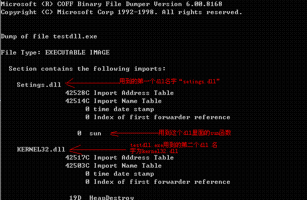
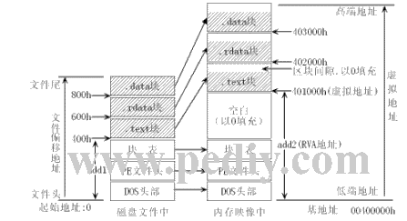
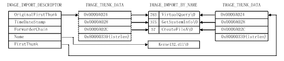
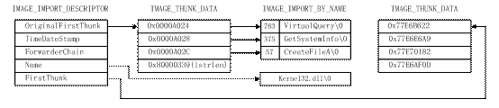

# Windows 系统程序设计之 DLL 基础

> 原文：[`www.pediy.com/kssd/pediy08/pediy8-744.htm`](https://www.pediy.com/kssd/pediy08/pediy8-744.htm)

Windows 系统程序设计之 DLL 基础  
  
【作者】condor  
【来源】看雪技术论坛（www.pediy.com）   
【时间】2006.07.01   
【附件】testdll.rar  

  
 说明：  
  1 例子程序在 vc6.0 +windows xp 编译测试过  
  2 需要阅读者对程序进程空间，编译，pe 结构有一定的理解  
  3 这里根据自己认识加上对其他资料整理而成，对 dll 简单的介绍   
  4 还有就是多动手咯：）  
  
1 前言：  
  
  有一些程序由很多模块组成，这些模块分别完成相对独立的功能，它们彼此协作来完成整个软件系统的工作。这些  
模块就可以是一个 DLL 文件，比如 WindowsAPI 中的所有函数都包含在 DLL 中。3 个重要的 DLL 是 Kernel32.dll；User32.dll，GDI32.dll。  
一般来说，DLL 是一种磁盘文件，以.dll、.drv、.ocx、.sys 和许多以.exe 为扩展名的系统文件都可以是 DLL。  
比如：Windows 操作系统中的一些作为 DLL 实现的文件：  
•ActiveX 控件(.ocx)文件  
ActiveX 控件的一个示例是日历控件，它使您可以从日历中选择日期。  
•控制面板(.cpl)文件  
cpl 文件的一个示例是位于控制面板中的项。每个项都是一个专用 DLL。  
•设备驱动程序(.drv)文件  
设备驱动程序的一个示例是控制打印到打印机的打印机驱动程序。  
  
使用 DLL 有很多好处，比如促进代码的模块化、代码重用、内存的有效使用和减少所占用的磁盘空间等。  
  
2 基本工作原理  
  
2．1 输入节与输出节  
  Win32 的 DLL 和 EXE 一样具有 PE 格式（pe 结构请查看这里）。  
  ah007 翻译的“PE 文件格式”1.9 版    
  qduwg 翻译的 PE 文件格式     
  Iczelion's 的 PE 文件格式  
  PE 结构各字段偏移参考    
输出节  
PE 文件格式其中有个节（section）的是 Export Table（输出节），我们使用 Visual Studio 的 dumpbin.exe,先来看看  
windows 的 kernel32.dll 的输出节的样子：  
C：\\windows\\system32>dumpbin   kernel32.dll   /EXPORTS   
Microsoft (R) COFF Binary File Dumper Version 6.00.8168  
Copyright (C) Microsoft Corp 1992-1998. All rights reserved.  
  
Dump of file kernel32.dll  
File Type: DLL  
  
  Section contains the following exports for KERNEL32.dll  
  
           0 characteristics  
    41107EE1 time date stamp Wed Aug 04 14:14:57 2004  
        0.00 version  
           1 ordinal base  
         949 number of functions  
         949 number of names  
  
    ordinal hint RVA      name  
  
          1    0 0000A634 ActivateActCtx  
          2    1 000392A3 AddAtomA  
          3    2 00022469 AddAtomW  
          4    3 0007096F AddConsoleAliasA  
          5    4 00070931 AddConsoleAliasW  
          6    5 00058D0A AddLocalAlternateComputerNameA  
          7    6 00058BEE AddLocalAlternateComputerNameW  
          8    7 00038682 AddRefActCtx  
  ………………………………………(中间省略)  
        938  3A9 0000B929 lstrcmpi  
        939  3AA 0000B929 lstrcmpiA  
        940  3AB 0000A823 lstrcmpiW  
        941  3AC 0000C729 lstrcpy  
        942  3AD 0000C729 lstrcpyA  
        943  3AE 0000B8EC lstrcpyW  
        944  3AF 00010311 lstrcpyn  
        945  3B0 00010311 lstrcpynA  
        946  3B1 0000B877 lstrcpynW  
        947  3B2 0000C6E0 lstrlen  
        948  3B3 0000C6E0 lstrlenA  
        949  3B4 00009A39 lstrlenW  
  
  Summary  
  
        5000 .data  
        6000 .reloc  
       8E000 .rsrc  
       82000 .text  
  
可以看到，这些符号是按字母顺序排列的， RVA 这一列下面的数字用于指明在 DLL 文件映  
像中的什么位置能够找到输出符号的位移量。序号列可以与 1 6 位 Window s 源代码向后兼容，  
并且它不应该用于现在的应用程序中。hint（提示码）列可供系统用来改进代码的运行性能，  
在此我们不用关心。这些符号都是我们其他其他模块可以调用的。  
  
输入节  
相应的我们的可执行程序包含了一个输入节（只适用于隐式调用 参见第四部分），列出可执行程  
序需要的所有 DLL 模块名。此外，对于列出的每个 DLL 名字，该节指明了可执行程序的二进制代  
码引用了哪些函数和变量符号。同样我们使用 dumpbin 来看看我的一个例子程序的输入节  
F:\\new project\\temp\\TestDll\\Debug>dumpbin testdll.exe /imports    
Microsoft (R) COFF Binary File Dumper Version 6.00.8168  
Copyright (C) Microsoft Corp 1992-1998. All rights reserved.  
  
  
Dump of file testdll.exe  
  
File Type: EXECUTABLE IMAGE  
  
  Section contains the following imports:  
  
    Setings.dll    
                42528C Import Address Table  
                42514C Import Name Table  
                     0 time date stamp  
                     0 Index of first forwarder reference  
  
                   0  sun  （第四部分中的例子调用， 就是这里哦）  
  
    KERNEL32.dll  
                42517C Import Address Table  
                42503C Import Name Table  
                     0 time date stamp  
                     0 Index of first forwarder reference  
  
                 19D  HeapDestroy  
                  1B  CloseHandle  
                  CA  GetCommandLineA  
                 1C2  LoadLibraryA  
          ………………………………………(中间省略)  
                 26A  SetFilePointer  
                 1E4  MultiByteToWideChar  
                 1BF  LCMapStringA  
                 1C0  LCMapStringW  
                 153  GetStringTypeA  
                 156  GetStringTypeW  
                 27C  SetStdHandle  
  
  Summary  
  
        3000 .data  
        1000 .idata  
        2000 .rdata  
        1000 .reloc  
       1F000 .text  
  
解释  
    
  
2．2 加载过程  
当加载程序为新进程创建一个虚拟地址空间。可执行进程被映射到新进程的地址空间。  
借用 kanxue 的图来 show 下：），大概情况如下：  
    
  
加载程序对可执行程序的输入节进行分析。对于该节中列出的每个 DLL 名字，加载程序以以下的  
顺序找出用户系统上的 DLL 模块：  
1) 包含可执行程序文件的目录。  
2) 进程的当前目录。  
3) Windows 系统目录。  
4) Windows 目录。  
5) PATH 环境变量中列出的各个目录。  
再将该 DLL 映射到进程的地址空间。注意，由于 DLL 模块可以从另一个 DLL 模块输入函数和变量，  
因此 DL L 模块可以拥有它自己的输入节。若要对进程进行全面的初始化，加载程序要分析每个  
模块的输入节，并将所有需要的 DLL 模块映射到进程的地址空间。如你所见，对进程进行初始  
化是很费时间的，不过一般常见的系统 dll（如 kernel32.dll）和 MFC 的 dll 由系统或其他程序  
加载了，就不用重新加载，只需要映射到自己的进程空间就可以了。  
  
一旦可执行程序和所有 DLL 模块被映射到进程的地址空间中，进程的主线程就可以启动运  
行，同时应用程序也可以启动运行。  
  
是不是有点晕，我们来借助一个简单的图来看看（数据结构去看看前面的 pe 的连接），我们的  
程序调用一个叫 kernel32.dll 的库为例：  
   
  
 　　OriginalFirstThunk 和 FirstThunk 指向的内容完全一样，文件被装入内存后，差别就  
 出现了：OriginalFirstThunk 的内容不会变，但 FirstThunk 里数据却会变成与其相对应的  
 函数的入口地址。内存中的输入表结构如下图所示：   
  
  
　　反汇编中 call dword ptr \[xxxxxxxx\]指令中的“xxxxxxxx”就是 FirstThunk 中的一个  
IMAGE\_THUNK\_DATA 的地址，而这个 IMAGE\_THUNK\_DATA 在装入完成之后保存的就是与其对应的函数的入口地址。  
2．3 others    
DLL 由全局数据、服务函数和资源组成，在运行时被系统加载到调用进程的虚拟空间中，成为调  
用进程的一部分。如果与其它 DLL 之间没有冲突，该文件通常映射到进程虚拟空间的同一地址上。  
DLL 模块中包含各种导出函数，用于向外界提供服务。DLL 可以有自己的数据段，但没有自己的堆栈，  
使用与调用它的应用程序相同的堆栈模式；一个 DLL 在内存中只有一个实例；DLL 实现了代码封装性；  
DLL 的编制与具体的编程语言及编译器无关。在 Win32 环境中，每个进程都复制了自己的读/写全局变量。  
如果想要与其它进程共享内存，必须使用内存映射文件或者声明一个共享数据段。DLL 模块需要的堆栈  
内存都是从运行进程的堆栈中分配出来的。Windows 在加载 DLL 模块时将进程函数调用与 DLL 文件的导出  
函数相匹配。Windows 操作系统对 DLL 的操作仅仅是把 DLL 映射到需要它的进程的虚拟地址空间里去。  
DLL 函数中的代码所创建的任何对象（包括变量）都归调用它的线程或进程所有。  
  
3 如何编写  
  
3．1  \_\_declspec(DLLimport)与\_\_declspec(dllexport)  
  
1 \_\_declspec(DLLimport)：当编译器看到这个符号修饰的变量、函数或 C++类时候，就知道  
  这些（变量、函数或 C++类）从某个 DLL 模块输入的。它不知道是从哪个 DLL 模块输入的，并且  
  它也不关心这个问题。编译器只想确保你用正确的方法访问这些输入的符号。你在源代码中  
  可以引用输入的符号，一切都将能够正常工作。使用的使用我们经常先定义为一个宏，  
  如#define EXPORT\_API extern "C" \_\_declspec(dllimport)只有当你编写 C + +代码而  
  不是直接编写 C 代码时，才能使用这个修饰符 extern "C"。通常来说， C+ +编译器可能  
  会改变函数和变量的名字，从而导致严重的链接程序问题。例如，假设你用 C+ +编写一  
  个 D L L，并直接用 C 编写一个可执行程序，当你创建 D L L 时，函数名被改变，但是，当你  
  创建可执行程序时，函数名没有改变。当链接程序试图链接可执行程序时，它就会抱怨说，  
  可执行程序引用的符号不存在。如果使用 extern“C”，就可以告诉编译器不要改变变量名或  
  函数名，这样，变量和函数就可以供使用 C，C + +或任何其他编程语言编写的可执行程序来访问。  
2 \_\_declspec(dllexport)：当编译器看到这个符号修饰的变量、函数或 C++类时候，它就将  
  某些附加信息嵌入产生的.obj 文件中。当链接 DLL 的所有.obj 文件时，链接程序将对这些信息进  
  行分析。当 DLL 被链接时，链接程序要查找关于输出变量、函数或 C++类的信息，并自动生成一个  
  .lib 文件。该.lib 文件包含一个 DLL 输出的符号列表（如果要链接引用该 DLL 的输出符号的任何可  
  执行程序，该.lib 文件是必不可少的 （见第四部分中隐式调用的例子）。同时，链接程序还要将一  
  个输出节（在第二部分中我们使用 dumpbin 查看过）嵌入产生的 DLL 文件。这个输出节包含一个输出  
  变量、函数和类符号的列表（按字母顺序排列）。该链接程序还将能够指明在何处找到每个符号  
  的相对虚拟地址（RVA）放入 DLL 模块。  
  
链接程序创建可执行程序时候，该链接程序必须确定哪些 DLL 包含代码引用的所有输入符号的 DLL。因此  
你必须将 DLL 的.lib 文件传递给链接程序（见第四部分中隐式调用的例子 ，使用 pragma 只是其中的一个方法）  
。如前所述，.lib 文件只包含 DLL 模块输出的符号列表。链接程序只想知道是否存在引用的符号和哪个 DLL  
模块包含该符号。如果连接程序转换了所有外部符号的引用，那么可执行程序就因此而创建成功。  
 3．2 一个简单例子  
恩，基础知识介绍完了，动手写最简单的一个 dll 吧   
  
 setingsdll.h：采用动态编译是因为调用模块，即你的可执行程序要包含这个.h 文件  
 ( 希望导入符号 ，需要 \_\_declspec(dllimport) 这样声明) ，而 setingsdll.cpp 也要包含这个.h 文件  
 （希望导出符号， 需要 \_\_declspec(dllexport) 这样声明）  
  

>  
> 
> ```
> 代码:
> 
> * * *
> 
> ―――――――――――――――――――――――――――――――――
> #ifdef EXPORT\_DLL
> #define EXPORT\_API extern "C" \_\_declspec(dllexport)
> #else
> #define EXPORT\_API extern "C" \_\_declspec(dllimport)
> #endif
> 
> EXPORT\_API int sun(int a,int b);
> ―――――――――――――――――――――――――――――――――
> 
> setingsdll.cpp：
> ―――――――――――――――――――――――――――――――――
> 
> #define EXPORT\_DLL 1
> 
> #include "setingsDll.h"
> 
> EXPORT\_API int sun(int a,int b){
>   return a+b;
> }
> ―――――――――――――――――――――――――――――――――
> 
> 当然如果你的 dll 是被显式调用的 还可以这样写
> setingsdll.h： 
> ―――――――――――――――――――――――――――――――――
> 
> #define EXPORT\_API extern "C" \_\_declspec(dllexport)
> EXPORT\_API int sun(int a,int b);
> ―――――――――――――――――――――――――――――――――
> 
> setingsdll.cpp：
> ―――――――――――――――――――――――――――――――――
> #include "setingsDll.h"
> 
> EXPORT\_API int sun(int a,int b){
>   return a+b;
> }
> ―――――――――――――――――――――――――――――――――
> 
> * * *
> 
> 
> ```

  
  
呵呵，是不是写一个 dll，很简单啊，接下来该如何调用了，我们继续吧。  
  
4 如何调用  
  
  Dll 调用有 2 种方法：显式调用和隐式调用。接上节的例子，我们编写以下调用的例子，  
来说明这个两种调用方式：  
  
显式调用:Testdll.cpp  
  

>  
> 
> ```
> 代码:
> 
> * * *
> 
> ―――――――――――――――――――――――――――――――――
> /\*
> 
> 在应用程序中用 LoadLibrary 加载，再用 GetProcAddress() 获取想要引入的函数的地址，你就可以象使用
> 如同本应用程序自定义的函数一样来调用此引入函数了。在应用程序退出之前，应该用 FreeLibrary 释放动态连接库。
> \*/
> 
> #include "windows.h"
> #include "stdio.h"
> 
> int main(int argc, char\* argv\[\])
> {
>   HINSTANCE ghMathsDLL=NULL;
>   typedef int (\*SUMMARY)(int,int);
>   SUMMARY Sun;
>   
>   ghMathsDLL=LoadLibrary("setings.DLL");
>   //如果载入 DLL 失败，提示用户
>   if(ghMathsDLL==NULL)
>   {
>     MessageBox(NULL,"Cannot load DLL file!","error",MB\_OK);
>   }
>   //获得 DLL 中 Summary 函数的指针
>   Sun=(SUMMARY)GetProcAddress(ghMathsDLL,"sun");
> 
>   printf("%d\\n",Sun(3,3));
> 
>   FreeLibrary(ghMathsDLL);
>   return 0;
> }
> ―――――――――――――――――――――――――――――――――
> 
> * * *
> 
> 
> ```

  
  
隐式调用   

>  
> 
> ```
> 代码:
> 
> * * *
> 
> ―――――――――――――――――――――――――――――――――
> 
> #include "windows.h"
> #include "stdio.h"
> #include "../setingsdll/setingsDll.h"// 使用隐式调用时的调用方法
> #pragma comment( lib, "../debug/Setings.lib" )// 使用隐式调用时的调用方法 ,使用 pragma 只是其中的一个方法哦
> 
> int main(int argc, char\* argv\[\])
> {
> 
>   printf("%d\\n",sun(3,3));
> 
> //  printf("summary:%d\\n",Summary(5)); //in the static lib 
> 
>   return 0;
> }
> 
> * * *
> 
> 
> ```

  
―――――――――――――――――――――――――――――――――  
附件例子程序是以前写的，就贴出来的整理了下。  
  
5 感受  
写着写着，觉得这方面的资料已经很多了，都不知道写什么好。不过都决定要写，还是硬是写完了。  
最近实在比较忙，有空的时候又被世界杯占据了：）磨蹭了这么久。  
  
【参考文献】  
\[1\]DLL(Dynamic Link Libraries)专题  姜山  
http://www.microsoft.com/china/community/program/OriginalArticles/techdoc/dll.mspx    
\[2\] 《Windows 核心编程》jeffrey Richter  
\[3\] 什么是 DLL  microsoft  
http://support.microsoft.com/default.aspx?scid=kb;zh-cn;815065  
http://www.microsoft.com/china/community/program/OriginalArticles/techdoc/dll.mspx  
……………………  
【版权声明】必须注明原创于看雪技术论坛(www.pediy.com) 及作者，并保持文章的完整性。  
  

 4dd466d0e1e0cc123afbe504da2462ca