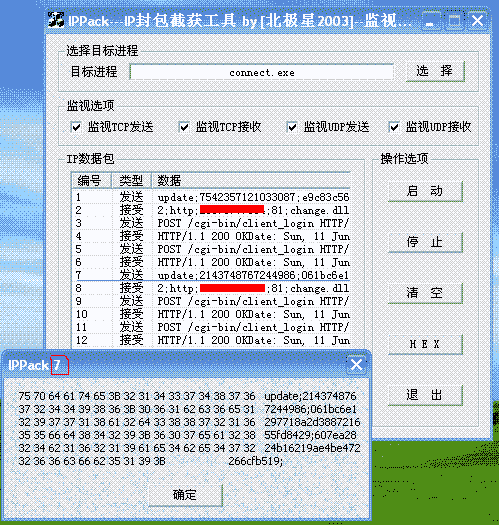
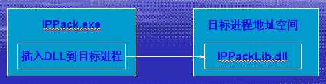
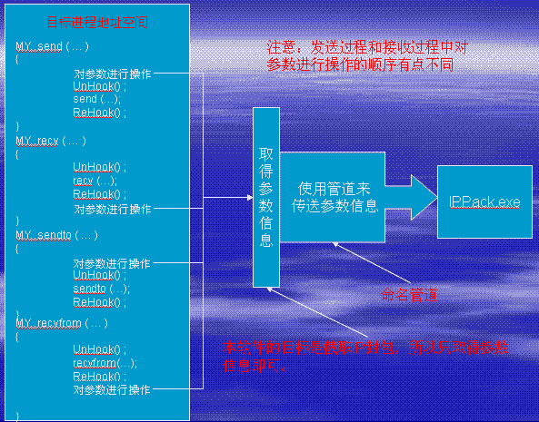
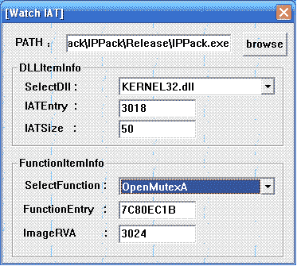

# Windows 系统程序设计之插入 DLL 和挂接 API

> 原文：[`www.pediy.com/kssd/pediy08/pediy8-742.htm`](https://www.pediy.com/kssd/pediy08/pediy8-742.htm)

                   Windows 系统程序设计之插入 DLL 和挂接 API  
【作者】北极星 2003  
【来源】看雪技术论坛（[bbs.pediy.com）](http://bbs.pediy.com）)   
【时间】2006 年 6 月 12 日  
【说明】关于本文的所有信息都可以在附件中下载:InsertDLLAndHOOKAPI.rar  
  
  首先简要介绍一下内容要点。  
  在 WINDOWS 中，每个进程都有自己的私有地址空间，当用指针访问内存的时候只能访问到自己进程的地址空间，而无法进入其他进程的地址空间。而当自己的进程需要对其他进程进行一系列操作的时候，一个比较好的选择就是把这些操作封装在一个 DLL 中，然后把 DLL 插入到目标进程的私有地址空间中。这样，如果 DLL 中使用指针的话，就可以访问目标进程的地址空间。  
  在程序中通常有两种方法来实现插入 DLL：（1）使用远程线程（2）HOOK  
  
  挂接 API 的目标是当系统调用 API 函数的时候能够执行我们的自定义函数，需要注意的是自定义函数的参数、返回类型、调用方式都必须和原 API 函数完全相同。这样我们就可以很便捷的取得或者修改参数来实现相应的目标，而无需考虑该 API 的内部实现。  
  通常有两种方法可以实现挂接 API：（1）修改 IAT（2）API 入口的覆盖。  
  
  需要说明的是对知识点的简要概括，至于具体信息，无论在书本或者网络上都有很多，不再赘述。  
    
  使用远程线程方法实现插入 DLL 可以参考我以前的文章《QQ 盗号的核心技术（简单版）》[`bbs.pediy.com/showthread.php?threadid=14203`](http://bbs.pediy.com/showthread.php?threadid=14203)  
  
  这里主要讲解两个软件的制作。  
（1）  IPPack——IP 封包截获工具  
原理：使用挂钩（HOOK）插入 DLL，覆盖 API 入口地址挂接 API  
（2）  Watch IAT ——查看 IAT 信息  
关于修改 IAT 来实现挂接 API 已经很普遍了，我也懒的再重复。这个工具软件是我很早以前写的，用来查看可执行文件的 IAT 信息，但有一个难点，由于 IAT 信息是在加载时候动态产生的，那么什么时候是最佳时机呢？？  
   
实例一 ： IPPack —— IP 封包截获工具  
   
   
1、设计目标  
    把基本的 DLL 插入技术和 HOOK API 技术相联系，应用到实际。另外，在该软件中还设计进程间通信、线程同步、DLL 实现等多种 Windows 程序设计中的基本技术。（经常有朋友说这个软件不能截获数据包，这里需要说明的是这个软件仅仅是一个技术实例，并不是工具软件。对目标进程进行测试的时候，最好先用 PE 分析工具查看一下，确认导入表中有 send,recv,sendto,recvfrom 这四个函数。）  
  
2、设计思路  
  第一步：把 DLL 插入到目标进程地址空间  
     
  
  第二步：挂接 API，取得相关的参数信息并传送到 IPPack.exe  
      如果不熟悉管道通信机制，可以参考《Windows 系统程序设计之进程间通信》  
[`bbs.pediy.com/showthread.php...;threadid=26252`](http://bbs.pediy.com/showthread.php?s=&threadid=26252)    
  
3、难点  
  插入 DLL 和挂接 API 的应用比较多，基本上没什么难度。  
    
4、详细设计  
（1）当启动 IPPack.exe 进行初始化时，启动命名管道线程服务  

>  
> 
> ```
> 代码:
> 
> * * *
> 
> UINT ServerThread ( LPVOID lpParameter )
> {
>   ……
>   while ( true )
>   {
>     ConnectNamedPipe ( CurPipeInst.hPipe, &OverLapStruct ) ;
>     WaitForSingleObject ( CurPipeInst.hEvent, INFINITE ) ;
>     if ( !GetOverlappedResult ( CurPipeInst.hPipe, &OverLapStruct, &dwByte, true ) )
>       break ;
>     ……
>     // 从管道中读取数据并显示到界面
>     ……
>     // 断开客户端的连接，以便等待下一客户的到来
>     DisconnectNamedPipe ( CurPipeInst.hPipe ) ;
>   }
>   
>   return 0 ;
> }
> 
> * * *
> 
> 
> ```

  
  
（2）显示进程列表，需要提升本进程的权限  

>  
> 
> ```
> 代码:
> 
> * * *
> 
> void CIPPackDlg::LookUpProcessPriviege ()
> {
>   TOKEN\_PRIVILEGES tkp; 
>   HANDLE hToken; 
>   if (!OpenProcessToken(GetCurrentProcess(),TOKEN\_ADJUST\_PRIVILEGES|TOKEN\_QUERY,&hToken))
>     return ; 
>   LookupPrivilegeValue(NULL,SE\_DEBUG\_NAME,&tkp.Privileges\[0\].Luid);  tkp.PrivilegeCount = 1; 
>   tkp.Privileges\[0\].Attributes = SE\_PRIVILEGE\_ENABLED; 
>   AdjustTokenPrivileges(hToken, FALSE, &tkp, 0, (PTOKEN\_PRIVILEGES)NULL, 0); 
> }
> 
> * * *
> 
> 
> ```

  
  
（3）更新进程列表  

>  
> 
> ```
> 代码:
> 
> * * *
> 
> void CSPDlg::UpdateProcess ()
> {
>   DWORD  cbNeededProcess, cbNeededModule;
>   HMODULE  hMod ;
>   CString TempStr ;
>   EnumProcesses ( dwProcessId, sizeof(dwProcessId), &cbNeededProcess ) ;
>   for ( unsigned i = 0; i < ( cbNeededProcess/sizeof(DWORD) ); i++ )
>   {
>     HANDLE hProcess = OpenProcess( PROCESS\_QUERY\_INFORMATION |  \\
>                                    PROCESS\_VM\_READ,  FALSE, dwProcessId\[i\] );
>     if ( hProcess != INVALID\_HANDLE\_VALUE )
>     {
>       EnumProcessModules( hProcess, &hMod, sizeof(hMod), &cbNeededModule ) ;
>       GetModuleBaseName ( hProcess, hMod, szProcessName\[i\].GetBuffer(512), 512 ) ;
> 
>       TempStr.Format ( "%d", dwProcessId\[i\] ) ;
>       m\_ListCon.InsertItem ( i, TempStr, 0 ) ;
>       m\_ListCon.SetItemText ( i, 1, szProcessName\[i\] ) ;      
>       CloseHandle ( hProcess ) ;
>     }
>   }
> }
> 
> * * *
> 
> 
> ```

  
  
  
（4）取得目标进程的主线程 ID  

>  
> 
> ```
> 代码:
> 
> * * *
> 
> dwTarProcessId    = dwProcessId\[nCurIndex\] ;
> szTarProcessName  = szProcessName\[nCurIndex\] ;
> 
> HANDLE hThreadSnap = CreateToolhelp32Snapshot ( TH32CS\_SNAPTHREAD, 0 ) ;
> if ( hThreadSnap == INVALID\_HANDLE\_VALUE ) 
>   return ; 
> 
> THREADENTRY32 te32 = { sizeof(THREADENTRY32) } ;
> if ( Thread32First ( hThreadSnap, &te32 ) )
> {
>   do{
>     if ( te32.th32OwnerProcessID == dwTarProcessId )
>     {
>       dwTarThreadId = te32.th32ThreadID ; 
>       break ;
>     }
>   }while ( Thread32Next ( hThreadSnap, &te32 ) ) ;
> }
> 
> * * *
> 
> 
> ```

  
  
（5）封装 HOOK API 入口地址覆盖到 CFEAHook 类，FEAHook.h 文件如下：  

>  
> 
> ```
> 代码:
> 
> * * *
> 
> #ifndef \_FEAHook\_H
> #define \_FEAHook\_H
> 
> class CFEAHook {
> public:
>   BOOL  isSuccess ;            // 标识是否成功
>   PSTR  pModuleName, pFunName ;      // 模块名、函数名
>   LPVOID  pOldFunEntry, pNewFunEntry ;  // 初始函数地址、HOOK 后的函数地址
>   BYTE  bOldByte\[5\], bNewByte\[5\] ;    // 原始字节、目标字节
> 
> public:
>   CFEAHook () {  isSuccess  = false ;  }
>   ~CFEAHook() {  UnHook() ;    }
>   void Hook ( PSTR szModuleName, PSTR szFunName, FARPROC pFun )
>   {  
>     HMODULE  hMod = GetModuleHandle ( szModuleName ) ;
>     if ( hMod != NULL )
>     {
>       isSuccess    = true ;
>       pModuleName    = szModuleName ;
>       pFunName    = szFunName ;
>       pNewFunEntry  = (LPVOID)pFun ;
>       pOldFunEntry  = (LPVOID)GetProcAddress ( hMod, pFunName ) ;
>       bNewByte\[0\]    = 0xE9 ;
>       \*((PDWORD)(&(bNewByte\[1\])))  = (DWORD)pNewFunEntry - (DWORD)pOldFunEntry - 5 ; 
> 
>       DWORD   dwProtect, dwWriteByte, dwReadByte ; 
>       VirtualProtect ( (LPVOID)pOldFunEntry, 5, PAGE\_READWRITE, &dwProtect );
>       ReadProcessMemory  ( GetCurrentProcess(), (LPVOID)pOldFunEntry, bOldByte, 5, &dwReadByte ) ;    
>       WriteProcessMemory  ( GetCurrentProcess(), (LPVOID)pOldFunEntry, bNewByte, 5, &dwWriteByte ) ;
>       VirtualProtect ( (LPVOID)pOldFunEntry, 5, dwProtect, NULL ) ;
>     }
>   }
>   void ReHook ()
>   {
>     DWORD  dwProtect, dwWriteByte ;
>     VirtualProtect ( pOldFunEntry, 5, PAGE\_READWRITE, &dwProtect );
>     WriteProcessMemory ( GetCurrentProcess(), pOldFunEntry, bNewByte, 5, &dwWriteByte ) ;
>     VirtualProtect ( pOldFunEntry, 5, dwProtect, NULL ) ;
>   }
>   void UnHook ()
>   {
>     DWORD  dwProtect, dwWriteByte ;
>     VirtualProtect ( pOldFunEntry, 5, PAGE\_READWRITE, &dwProtect );
>     WriteProcessMemory ( GetCurrentProcess(), pOldFunEntry, bOldByte, 5, &dwWriteByte ) ;
>     VirtualProtect ( pOldFunEntry, 5, dwProtect, NULL ) ;
>   }
> } ;
> 
> * * *
> 
> 
> ```

  
#endif  
  
（6）HOOK 四个函数  

>  
> 
> ```
> 代码:
> 
> * * *
> 
> CFEAHook  HOOK\_send ;
> CFEAHook  HOOK\_recv ;
> CFEAHook  HOOK\_sendto ;
> CFEAHook  HOOK\_recvfrom ;
> HOOK\_send.Hook    ( "wsock32.dll", "send",    (FARPROC)MY\_send ) ;
> HOOK\_recv.Hook    ( "wsock32.dll", "recv",    (FARPROC)MY\_recv ) ;
> HOOK\_sendto.Hook    ( "wsock32.dll", "sendto",    (FARPROC)MY\_sendto ) ;
> HOOK\_recvfrom.Hook  ("wsock32.dll",  "recvfrom",(FARPROC)MY\_recvfrom ) ;
> 
> * * *
> 
> 
> ```

  
  
实例二：Watch IAT —— 查看 IAT 信息  
    
  
1、  设计目标  
查看可执行文件的 IAT 信息。这个软件虽然与修改 IAT 的 HOOK API 没有直接的联系，但我觉得非常有必要放到这个部分，至于必要性请看下文。  
  
  
2、  存在的难点  
由于 IAT 信息是在可执行文件初始化时经过 PE 加载器改写的，而不是原本的磁盘文件中的数据。问题就在这里，什么时候才是对 IAT 进行操作的最佳时机？PE 加载器对 IAT 部分的改写是在什么时候完成的？如果仅仅创建挂起的进程，此时的加载器是否写入 IAT 信息？  
  
3、问题的分析与设计  
利用调试 API 实现对远程进程的创建、入口点的控制。  
其实，可以通过先到达程序入口点，同时让程序挂起。这就可以利用调试 API 来实现，先创建目标进程（即可执行的目标文件，要查看 IAT 信息必须要让 PE 文件执行，从而才能使加载器改写功能的实现），该进程需带有 DEBUG\_ONLY\_THIS\_PROCES 标志，这样该进程就具有可被本线程调试的权限，然后在主线程中建立一个调试循环体用于对目标进程执行流程的控制。当内核在完成进程装载和初始化之后会在被调试进程的上下文环境中自己调用一次 int 3 的（原本我在创建该进程的时候还带有 CREATE\_SUSPENDED 标志，然后在入口点写入\_\_int 3 断点(0xcc)，这样就等于做了重复工作，感谢 drwch 的指点），利用 WaitForDebugEvent 实现对目标进程 EXCEPTION\_DEBUG\_EVENT 异常的捕捉，这样程序就中断在程序入口点，同时可以读取所需的 IAT 信息。  
这里还有一个关键之处在于目标进程的 DEBUG\_ONLY\_THIS\_PROCESS   
标志。该目标进程与常见它的母体有个令人比较讨厌的特性，由于目标进程是 DEBUG 子程式，如果母程式存在，子程式就不会结束。原本想利用 DebugActiveProcessStop 来实现子程式与母程式的分离，但该函数对于平台的要求比较特殊，最终决定用开辟线程的方式来解决这个问题。线程一旦结束，该子程式自然也就结束了。  
  
3、  详细设计（关键代码如下）  

>  
> 
> ```
> 代码:
> 
> * * *
> 
> DWORD WINAPI GetIATInfo ( LPVOID lpParameter )
> {
>   ……
>   STARTUPINFO        stStartUp;
>   PROCESS\_INFORMATION    stProcInfo;
>   GetStartupInfo ( &stStartUp ) ;
>   if( !CreateProcess(BaseInfo.szFileName,NULL,NULL,NULL,FALSE, \\
>     DEBUG\_ONLY\_THIS\_PROCESS,NULL,NULL,&stStartUp,&stProcInfo) )   
>   {
>     SetEvent ( hEvent ) ;
>     return dwErrorCode ;
>   }
>   else
>   {    
>     DEBUG\_EVENT devent ;
>     BOOL bIsContinue = true ;
>     while ( bIsContinue )
>     {
>       if ( WaitForDebugEvent( &devent, 100 ) )
>       {
>         switch ( devent.dwDebugEventCode )
>         {
>         case EXCEPTION\_DEBUG\_EVENT:
>           // 取 IAT 信息
>           for ( UINT uIATEntryIndex = 0; DllItemInfo\[uIATEntryIndex\].dwIATEntry; uIATEntryIndex++ )
>           {
>             DWORD dwIATEntry = DllItemInfo\[uIATEntryIndex\].dwIATEntry + BaseInfo.dwImageBase ;
>             DWORD dwIAT = 0, dwNumberOfByte = 0 ;
>             UINT count = 0 ;
>             
>             while ( ReadProcessMemory(stProcInfo.hProcess,(LPVOID)(dwIATEntry),&dwIAT,0X4,&dwNumberOfByte) )
>             {
>               if ( dwIAT ) 
>               {
>                 DllItemInfo\[uIATEntryIndex\].FunctionItemInfo\[count\].dwFunctionEntry = dwIAT ;
>                 DllItemInfo\[uIATEntryIndex\].FunctionItemInfo\[count++\].dwImageRVa = dwIATEntry-BaseInfo.dwImageBase;
>                 DllItemInfo\[uIATEntryIndex\].dwIATSize += 4 ;
>                 dwIAT = 0 ;
>                 dwIATEntry += 4 ;
>               }  
>               else
>                 break ;
>             }    
>           }
>   
>           bIsContinue = false ;
>           break ;
>         } //switch
>         
>         ContinueDebugEvent ( devent.dwProcessId, devent.dwThreadId, DBG\_CONTINUE ) ;
>       } // if
>     } // while    
>   } // else
> 
> 
>   SetEvent ( hEvent ) ;
>   return 0; 
> }
> 
> * * *
> 
> 
> ```

  
4、  心得体会  
这个软件写的比较久了，回忆了下。加深对加载过程的了解，熟悉 WIN32 调试 API。  
【参考文献】  
\[1\].Windows 核心编程 Jeffrey Richter 著  
【版权声明】必须注明原创于看雪技术论坛([bbs.pediy.com](http://bbs.pediy.com)) 及作者，并保持文章的完整性。  

 4dd466d0e1e0cc123afbe504da2462ca