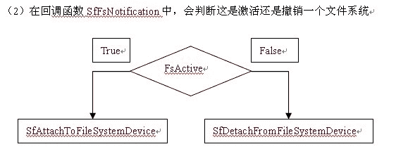
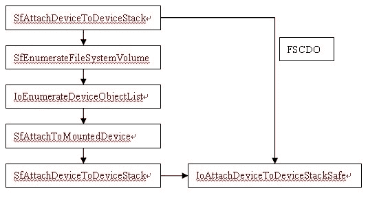

# Sfilter 中的那些绑定(学习笔记)

> 原文：[`www.pediy.com/kssd/pediy10/91468.html`](https://www.pediy.com/kssd/pediy10/91468.html)

1.首先是挂载 Sfilter 创建的设备到文件系统上。  
（1）在 DriverEntry 中 IoRegisterFsRegistrationChange 注册一个回调函数 SfFsNotification，当一个文件系统注册或者注销时，从而触发回调函数 SfFsNotification。  
{  
         当文件系统注册的时候会调用 IoRegisterFileSystem，  
      创建一个文件系统控制设备对象（file system control device object，FSCDO）到文  
      件系统对象的队列中。注销时会调用 IoUnregisterFileSystem，  
      把前面创建的 FSCDO 从队列中移除  
}  
  
  
（2）在回调函数 SfFsNotification 中，会判断这是激活还是撤销一个文件系统  
  
  
  
  
（3）首先看文件系统注册的处理， SfAttachToFileSystemDevice  
在 SfAttachToFileSystemDevice 中，我们只绑定  
         FILE\_DEVICE\_DISK\_FILE\_SYSTEM、  
         FILE\_DEVICE\_CD\_ROM\_FILE\_SYSTE、  
         FILE\_DEVICE\_NETWORK\_FILE\_SYSTEM，这三种类型的文件系统。  
  
         所以先要用 IS\_DESIRED\_DEVICE\_TYPE 判断是不是这三种类型的文件系统，然后再把文件系统识别器排除。接着调用 SfAttachDeviceToDeviceStack，绑定我们的设备对象 到 文件系统的控制设备对象 的 设备栈上。  
  然后调用 SfEnumerateFileSystemVolumes 枚举当前文件系统下，所有的当前安装的设备，并绑定它们。  
{    
         SfEnumerateFileSystemVolumes 枚举的过程是这样的：  
         调用 IoEnumerateDeviceObjectList 枚举这个驱动下的 device object list。  
         IoEnumerateDeviceObjectList 在这个函数要调用了两次。  
         第一次调用是获取 list 中 device objects 的数量，  
         然后根据大小开辟存放 device objects 的空间，第二次调用才得到设备链。  
         之后就是遍历已经得到的 device objects list，排除 CDO、不符合的类型的、已经绑  
         过的这三种设备，不绑定。  
         绑定时调用 SfAttachToMountedDevice，在 SfAttachToMountedDevice 设置我  
         们创建的设备的 Flag，然后调用 SfAttachDeviceToDeviceStack。  
         在 SfAttachDeviceToDeviceStack 中，终于是最终的绑定了，调用      
         IoAttachDeviceToDeviceStackSafe，到这里就完成了绑定。  
}  
  
流程图表示就是：  
  
  
  
2.  就像 WINDOWS 是用消息驱动一样，驱动是用 IRP 驱动的。  
当 Sfilter 接收到 IRP\_MJ\_FILE\_SYSTEM\_CONTROL 这个 IRP，会调用 SfFsControl 去处理。  
{  
  先简单说下 IRP\_MJ\_FILE\_SYSTEM\_CONTROL：  
  一个新的存储媒质被系统发现,并在文件系统中生成一个卷(Volume) 的过程称为  
          Mounting , 这时 I/O 管理器会发送 IRP\_MJ\_FILE\_SYSTEM\_CONTROL.  
  
他的副功能号有：  
         IRP\_MN\_KERNEL\_CALL  
         IRP\_MN\_MOUNT\_VOLUME  
         IRP\_MN\_USER\_FS\_REQUEST  
         IRP\_MN\_VERIFY\_VOLUME  
         IRP\_MN\_LOAD\_FILE\_SYSTEM  
  
Sfilter 中处理了以下三个：  
IRP\_MN\_MOUNT\_VOLUME     
         这是一个卷的 mount 请求  
  
IRP\_MN\_LOAD\_FILE\_SYSTEM  
  这是文件系统识别器的副功能号，是一个加载文件系统的请求  
  当一个文件识别器决定加载真正的文件系统的时候，会产生一个这样的 irp  
  调用 SfFsControlLoadFileSystem 处理。  
  
IRP\_MN\_USER\_FS\_REQUEST  
  这是一个文件系统操作的请求  
}  
    
当确认了一个卷的 mount 请求，也就是 IRP\_MN\_MOUNT\_VOLUME，  
Sfilter 调用 SfFsControlMountVolume 处理。  
{  
         SfFsControlMountVolume 这里面的处理大约就是判断下是不是卷影和调  
      用 SfAttachToMountedDevice 实现对卷的绑定。  
}  
  
  
当确认了一个加载文件系统的请求，也就是 IRP\_MN\_LOAD\_FILE\_SYSTEM，Sfilter 调用 SfFsControlLoadFileSystem，在 SfFsControlLoadFileSystem 的完成函数 SfFsControlLoadFileSystemComplete 中调用 SfAttachDeviceToDeviceStack 对文件系统识别器进行绑定。  
  
当确认了一个文件系统操作的请求，也就是 IRP\_MN\_USER\_FS\_REQUEST  
，查看 irpSp->Parameters.FileSystemControl.FsControlCode 中的值是否为  
FSCTL\_DISMOUNT\_VOLUME。如果是 FSCTL\_DISMOUNT\_VOLUME 则标志着这里是要 Dismounts a volume。  
  
    
  就先写到这里吧。  
  因为学驱动没多久，文中应该有不少错误，希望大家不吝指出。  
           脸丢了，东西就学到了   ^\_^