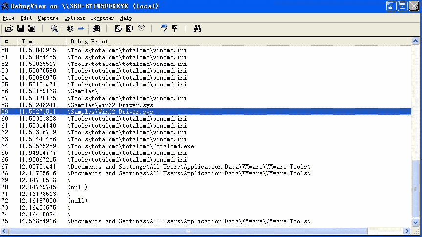

# 文件过滤驱动 DEMO 版

> 原文：[`www.pediy.com/kssd/pediy12/131576.html`](https://www.pediy.com/kssd/pediy12/131576.html)

首先声明本帖首发于赏金论坛，希望大家能多多关注这个正在成长的论坛 www.sgoldcn.com   
  
看了很久的文件系统过滤驱动相关教程，但一直抓不住过滤驱动代码的大框架，一直在过滤驱动的代码中找不到北。偶然看到了一篇英文版教程，读后豁然开朗，学习的过程中记录了以下文字，拿出来与大家分享。   
感谢作者，原作地址（http://www.codeproject.com/KB/system/fs-filter-driver-tutorial.aspx）   
代码是那篇英文教程的，代码注释换成了我自己的理解。这些代码忽略掉了请多细节，非常有助于快速掌握过滤驱动框架，不会像读 sfilter 那样拘泥于细节而找不着北，在掌握了整个框架之后再去读 sfilter 是个不错的选择。   
  
简洁的文件系统过滤驱动框架：   
1. DriverEntry 中设置初始化例程、卸载例程、需要过滤的 IRP 例程、快速 IO 例程，完成卸载例程。最重要的是最后一步：注册文件系统变更消息例程。   
2. 完成文件系统变更消息例程，其中需要完成挂载设备与解挂载设备的例程。挂载时需要枚举当前文件系统中已经存在的卷设备并也将自身挂载到他们之上。   
3. 处理 IRP 例程。包括普通 IRP 例程与快速 IO 例程。   
  
开始编写：   
1. 在 DriverEntry 中设置 IRP 例程，注册系统变更消息例程、卸载例程等。这里暂时只处理 IRP\_MJ\_CREATE，在 FsFilterDispatchCreate 只打印出路径信息。   

代码:

```
NTSTATUS DriverEntry( 
IN PDRIVER\_OBJECT DriverObject, 
IN PUNICODE\_STRING pRegistryPath 
) 
{ 
NTSTATUS status = STATUS\_SUCCESS; 
int i = 0; 

//保存驱动对象到全局变量 
g\_FsFilterDriverObject = DriverObject; 

//初始化例程 
for (i = 0; i <= IRP\_MJ\_MAXIMUM\_FUNCTION; i++) 
{ 
DriverObject->MajorFunction = FsFilterDispatchPassThrough; 
} 

//卸载例程 
DriverObject->DriverUnload = FsFilterUnload; 

//在这个 Demo 里，只过滤 IRP\_MJ\_CREATE 
DriverObject->MajorFunction\[IRP\_MJ\_CREATE\] = FsFilterDispatchCreate; 

//FastIO 分发函数 
DriverObject->FastIoDispatch = &g\_fastIoDispatch; 

//注册文件系统变更消息例程 
status = IoRegisterFsRegistrationChange(DriverObject,FsFilterNotificationCallback); 
if (!NT\_SUCCESS(status)) 
{ 
KdPrint(("IoRegisterFsRegistrationChange Error!")); 
return status; 
} 

return STATUS\_SUCCESS; 
}

```

处理卸载例程，首先注销系统变更消息例程，然后 Detach 所有设备并删除。   
代码:

```
VOID FsFilterUnload( 
IN PDRIVER\_OBJECT DriverObject) 
{ 
ULONG numDevices = 0; 
ULONG i = 0; 
LARGE\_INTEGER interval; 
PDEVICE\_OBJECT devList\[DEVOBJ\_LIST\_SIZE\]; 

interval.QuadPart = (5 \* DELAY\_ONE\_SECOND); 

//注销系统变更例程 
IoUnregisterFsRegistrationChange(DriverObject,FsFilterNotificationCallback); 

//循环 Detach 所有设备并删除 
for (;;) 
{ 
IoEnumerateDeviceObjectList(DriverObject,devList,sizeof(devList),&numDevices); 
if (0 == numDevices) 
break; 

numDevices = min(numDevices,RTL\_NUMBER\_OF(devList)); 

for (i = 0; i < numDevices; i++) 
{ 
//Detach 并删除设备 
FsFilterDetachFromDevice(devList); 
ObDereferenceObject(devList); 
} 

//延时 5 秒，保证所有 IRP 都完成 
KeDelayExecutionThread(KernelMode,FALSE,&interval); 
} 
}

```

2. 处理系统变更消息例程，此例程的代码只需要判断 FsActive 是否为真即可。FsActive 为真则是文件系统被激活，这时挂载设备。FsActive 为假则是文件系统被注销，解除挂载即可。   
代码:

```
//当文件系统被激活或被注销时会调用此回调函数 
VOID FsFilterNotificationCallback ( 
IN struct \_DEVICE\_OBJECT \*DeviceObject, 
IN BOOLEAN FsActive 
) 
{ 
if (FsActive) 
{ 
//FsActive == TRUE 被激活 
FsFilterAttachToFileSystemDevice(DeviceObject); 
} 
else 
{ 
//FsActive == FALSE 被注销 
FsFilterDetachFromFileSystemDevice(DeviceObject); 
} 
}

```

被激活里调用函数 FsFilterAttachToFileSystemDevice，此函数中先判断是否已经挂载，防止重复挂载而产生错误。如果没有挂载则开始挂载，然后还需要再检举一下此文件系统上已有的所有卷设备并对它们也进行挂载，因为在文件系统被注册之前有可能已经存在了很多卷设备，需要一并挂载。   
代码:

```
//文件系统激活回调函数 
NTSTATUS FsFilterAttachToFileSystemDevice ( 
IN PDEVICE\_OBJECT DeviceObject 
) 
{ 
NTSTATUS status = STATUS\_SUCCESS; 
PDEVICE\_OBJECT filterDeviceObject = NULL; 

//检测我们的设备是否已经挂载，防止重复挂载 
if (!FsFilterIsAttachedToDevice(DeviceObject)) 
{ 
//开始挂载 
status = FsFilterAttachToDevice(DeviceObject,&filterDeviceObject); 
if (!NT\_SUCCESS(status)) 
{ 
return status; 
} 

//枚举文件系统上已有的所有卷设备并挂载 
status = FsFilterEnumerateFileSystemVolumes(DeviceObject); 
if (!NT\_SUCCESS(status)) 
{ 
FsFilterDetachFromDevice(filterDeviceObject); 
return status; 
} 
} 

return STATUS\_SUCCESS; 
}

```

真正挂载过滤设备的工作都是在 FsFilterAttachToDevice 函数中完成的，这个函数首先创建过滤设备，然后复制各种标志位，最后进行挂载。其中有一点需要说明的是为了防止挂载的失败，在实现的过程中使用循环来进行多次尝试性挂载，直到成功或循环结束为止。   
代码:

```
//挂载设备 
NTSTATUS FsFilterAttachToDevice( 
IN PDEVICE\_OBJECT DeviceObject, 
OUT PDEVICE\_OBJECT\* pFilterDeviceObject 
) 
{ 
NTSTATUS status = STATUS\_SUCCESS; 
PDEVICE\_OBJECT filterDeviceObject = NULL; 
PFSFILTER\_DEVICE\_EXTENSION pDevExt = NULL; 
ULONG i = 0; 

//防止重复挂载 
ASSERT(!FsFilterIsAttachedToDevice(DeviceObject)); 

//创建过滤设备 
status = IoCreateDevice(g\_FsFilterDriverObject,sizeof(FSFILTER\_DEVICE\_EXTENSION),NULL,DeviceObject->DeviceType,0,FALSE,&filterDeviceObject); 
if (!NT\_SUCCESS(status)) 
{ 
return status; 
} 

pDevExt = (PFSFILTER\_DEVICE\_EXTENSION)filterDeviceObject->DeviceExtension; 

//复制标志位 
if (FlagOn(DeviceObject->Flags,DO\_BUFFERED\_IO)) 
{ 
SetFlag(filterDeviceObject->Flags,DO\_BUFFERED\_IO); 
} 

if (FlagOn(DeviceObject->Flags,DO\_DIRECT\_IO)) 
{ 
SetFlag(filterDeviceObject->Flags,DO\_DIRECT\_IO); 
} 

if (FlagOn(DeviceObject->Characteristics,FILE\_DEVICE\_SECURE\_OPEN)) 
{ 
SetFlag(filterDeviceObject->Characteristics,FILE\_DEVICE\_SECURE\_OPEN); 
} 

//如果挂载失败说明是设备对象还没有完成初始化，这种情况一般发生在卷正在被装入的时候过滤驱动被加载 
//所以用 for 循环，失败后可以再次尝试挂载 
for (i = 0; i < 8; i++) 
{ 
LARGE\_INTEGER interval; 

//正式挂载设备 
status = IoAttachDeviceToDeviceStackSafe(filterDeviceObject,DeviceObject,&pDevExt->AttachedToDeviceObject); 
if (NT\_SUCCESS(status)) 
{ 
break; 
} 

//延时 5 秒，给设备足够的时间完成初始化 
interval.QuadPart = (500 \* DELAY\_ONE\_MILLISECOND); 
KeDelayExecutionThread(KernelMode, FALSE, &interval); 
} 

if (!NT\_SUCCESS(status)) 
{ 
//失败则清理现场 
IoDeleteDevice(filterDeviceObject); 
filterDeviceObject = NULL; 
} 
else 
{ 
//设置正在初始化的标志 
ClearFlag(filterDeviceObject->Flags, DO\_DEVICE\_INITIALIZING); 

if (NULL != pFilterDeviceObject) 
{ 
\*pFilterDeviceObject = filterDeviceObject; 
} 
} 

return status; 
}

```

枚举卷设备并挂载的函数也是非常的简洁，只是简单的遍历并做一个小判断后进行挂载即可。   
代码:

```
//枚举这个文件系统上已有的所有卷设备并将自己挂载其上 
NTSTATUS FsFilterEnumerateFileSystemVolumes( 
IN PDEVICE\_OBJECT DeviceObject 
) 
{ 
NTSTATUS status = STATUS\_SUCCESS; 
ULONG numDevices = 0; 
ULONG i = 0; 
PDEVICE\_OBJECT devList\[DEVOBJ\_LIST\_SIZE\]; 

//检举设备对象 
status = IoEnumerateDeviceObjectList(DeviceObject->DriverObject,devList,sizeof(devList),&numDevices); 
if (!NT\_SUCCESS(status)) 
{ 
return status; 
} 

numDevices = min(numDevices, RTL\_NUMBER\_OF(devList)); 

//遍历卷设备，并全部挂载上 
for (i = 0; i < numDevices; ++i) 
{ 
//判断设备类型与是否已经挂载过 
if (devList != DeviceObject && devList->DeviceType == DeviceObject->DeviceType && !FsFilterIsAttachedToDevice(devList)) 
{ 
status = FsFilterAttachToDevice(devList, NULL); 
} 

ObDereferenceObject(devList); 
} 

return STATUS\_SUCCESS; 
}

```

当挂载失败后，需要调用 FsFilterDetachFromDevice 函数删除设备。   
代码:

```
//解挂载设备并将其删除 
void FsFilterDetachFromDevice( 
IN PDEVICE\_OBJECT DeviceObject 
) 
{ 
PFSFILTER\_DEVICE\_EXTENSION pDevExt = (PFSFILTER\_DEVICE\_EXTENSION)DeviceObject->DeviceExtension; 

IoDetachDevice(pDevExt->AttachedToDeviceObject); 
IoDeleteDevice(DeviceObject); 
}

```

当文件系统被注销的时候，会调用 FsFilterDetachFromFileSystemDevice 函数，此函数功能只是将自己的设备进行解挂载，然后删除即可。其中会用 IS\_MY\_DEVICE\_OBJECT 宏判断传进来的设备是否是自己生成的设备，判断是自己的设备后才会进行解挂载。   
代码:

```
//文件系统注销回调函数 
VOID FsFilterDetachFromFileSystemDevice( 
IN PDEVICE\_OBJECT DeviceObject 
) 
{ 
PDEVICE\_OBJECT device = NULL; 

for (device = DeviceObject->AttachedDevice; NULL != device; device = device->AttachedDevice) 
{ 
if (IS\_MY\_DEVICE\_OBJECT(device)) 
{ 
//将我们的设备解挂载并删除设备对象 
FsFilterDetachFromDevice(device); 
break; 
} 
} 
}

```

3. 处理 IRP 例程。这里需要处理普通的 IRP 例程也需要处理快速 IO 例程。普通 IRP 例程这里只需要两个，一个是直接向下转发 IRP 的例程，另一个是 IRP\_MJ\_CREATE。   
代码:

```
//向下转发例程 
NTSTATUS FsFilterDispatchPassThrough( 
IN PDEVICE\_OBJECT DeviceObject, 
IN PIRP Irp 
) 
{ 
PFSFILTER\_DEVICE\_EXTENSION pDevExt = (PFSFILTER\_DEVICE\_EXTENSION)DeviceObject->DeviceExtension; 

IoSkipCurrentIrpStackLocation(Irp); 
return IoCallDriver(pDevExt->AttachedToDeviceObject,Irp); 
} 

//IRP\_MJ\_CREATE 
NTSTATUS FsFilterDispatchCreate( 
IN PDEVICE\_OBJECT DeviceObject, 
IN PIRP Irp 
) 
{ 
PFILE\_OBJECT pFileObject = IoGetCurrentIrpStackLocation(Irp)->FileObject; 

DbgPrint("%wZn", &pFileObject->FileName); 

return FsFilterDispatchPassThrough(DeviceObject,Irp); 
}

```

快速 IO 例程我们直接向下转发并返回 FALSE 即可，据谭文介绍，不实现快速 IO 仅仅是速度上的损失。   
代码:

```
//快速 IO 函数例程数组 
FAST\_IO\_DISPATCH g\_fastIoDispatch = 
{ 
sizeof(FAST\_IO\_DISPATCH), 
FsFilterFastIoCheckIfPossible, 
FsFilterFastIoRead, 
FsFilterFastIoWrite, 
FsFilterFastIoQueryBasicInfo, 
FsFilterFastIoQueryStandardInfo, 
FsFilterFastIoLock, 
FsFilterFastIoUnlockSingle, 
FsFilterFastIoUnlockAll, 
FsFilterFastIoUnlockAllByKey, 
FsFilterFastIoDeviceControl, 
NULL, 
NULL, 
FsFilterFastIoDetachDevice, 
FsFilterFastIoQueryNetworkOpenInfo, 
NULL, 
FsFilterFastIoMdlRead, 
FsFilterFastIoMdlReadComplete, 
FsFilterFastIoPrepareMdlWrite, 
FsFilterFastIoMdlWriteComplete, 
FsFilterFastIoReadCompressed, 
FsFilterFastIoWriteCompressed, 
FsFilterFastIoMdlReadCompleteCompressed, 
FsFilterFastIoMdlWriteCompleteCompressed, 
FsFilterFastIoQueryOpen, 
NULL, 
NULL, 
NULL, 
};

```

快速 IO 例程实现基本都是一样的，直接向下层转发，并返回 FALSE。   
代码:

```
BOOLEAN FsFilterFastIoCheckIfPossible( 
IN PFILE\_OBJECT FileObject, 
IN PLARGE\_INTEGER FileOffset, 
IN ULONG Length, 
IN BOOLEAN Wait, 
IN ULONG LockKey, 
IN BOOLEAN CheckForReadOperation, 
OUT PIO\_STATUS\_BLOCK IoStatus, 
IN PDEVICE\_OBJECT DeviceObject 
) 
{ 
PDEVICE\_OBJECT nextDeviceObject = ((PFSFILTER\_DEVICE\_EXTENSION)DeviceObject->DeviceExtension)->AttachedToDeviceObject; 
PFAST\_IO\_DISPATCH fastIoDispatch = nextDeviceObject->DriverObject->FastIoDispatch; 

if (VALID\_FAST\_IO\_DISPATCH\_HANDLER(fastIoDispatch, FastIoCheckIfPossible)) 
{ 
return (fastIoDispatch->FastIoCheckIfPossible)( 
FileObject, 
FileOffset, 
Length, 
Wait, 
LockKey, 
CheckForReadOperation, 
IoStatus, 
nextDeviceObject); 
} 

return FALSE; 
}

```

到此，整个 DEMO 驱动就完成了。可见去掉了过滤驱动中的旁枝末节，整个过滤驱动框架是简单明了的。   
  
  
  
  
  
您正在看的文章来自赏金论坛 http://www.sgoldcn.com,原文地址:http://www.sgoldcn.com/read.php?tid=1417

上传的附件
|  || Code\_FileSystemFilterDemo.rar  
 |