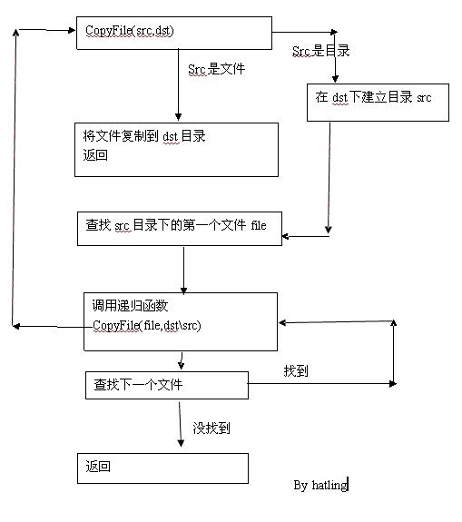

# 用递归实现目录结构的复制

> 原文：[`www.pediy.com/kssd/pediy10/95312.html`](https://www.pediy.com/kssd/pediy10/95312.html)

今天本想写个类似 FastCopy 的文件快速复制工具,先把文件快速复制的原理搞清了..准备着手写时  
却发现目录复制时要保持原目录结构却是个难题...想了想,用递归实现最简洁...  
可是实现的时候却遇到了些难题....大家往下看  
下面是递归实现遍历一个目录结构并复制的流程图:  
  
流程看着很简单..可是实现上却很容易犯一些细节上的问题  
最严重的就是堆栈问题  
开始时我是把每次调用 MyCopyFile 的两个变量定义在了函数 MyCopyFile 中,也就是定义在了堆栈中  
其实这也是大家用递归函数时正常的使用方法,可是在本例中却不实用.  
如果是一个简单的目录,可能还好..可是如果一个目录下有很多很深的目录,  
最后的错误就是 XXXXX 内存不可读的一个消息框弹出来  
为什么呢..因为堆栈被那俩个变量填满了..最后堆栈中就分配不到内存了  
所以最后我的想法是把这两个变量定义为全局变量,调用递归时将这两个变量修改成要压栈的变量  
函数返回时再将它们修改回  
大家看我代码中的函数 EnterDirectory 和函数 LeaveDirectory 就是起这个功能  
下面是目录复制的一个简单代码,代码中并没有复制文件,只是把目录复制的过程打印出来了  
大家可以下下去测试下:O(∩\_∩)O

代码:

```
// CopyFileA.cpp : Defines the entry point for the console application.
//

#include "stdafx.h"
#include <windows.h>
#include <stdio.h>

char szSrcName\[256\];//保存当前目录的名字(非路径)
char szFindDir\[256\];//保存 FindFirstFile 的第一个参数

char src\[256\];//源路径
char dst\[256\];//目的路径

//判断是否是文件
BOOL IsFile(LPSTR lpFile)
{
  DWORD dwFileAtt=GetFileAttributes(lpFile);
  if ((dwFileAtt&FILE\_ATTRIBUTE\_DIRECTORY)!=0)
  {
    return FALSE;
  }
  return TRUE;
}


//通过当前路径获取当前文件名
void GetSrcFileName(LPSTR src)
{
  int n=lstrlen(src);
  for (;src\[n-1\]!='\\\\';n--)
    ;
  lstrcpy(szSrcName,src+n);
}

//进入目录
void EnterDirectory(LPSTR src,LPSTR file)
{
  int n=lstrlen(src);
  if (src\[n-1\]=='\\\\')
  {
    memcpy(src+n,file,lstrlen(file)+1);
  }
  else
  {
    memcpy(src+n,"\\\\",1);
    memcpy(src+n+1,file,lstrlen(file)+1);
  }
}

//离开目录
void LeaveDirectory(LPSTR path)
{
  int n=lstrlen(path)-1;
  for (;path\[n\]!='\\\\';n--)
    ;
  path\[n\]='\\0';
}

//初始化 szFindDir 变量
void InitFind(LPSTR src)
{
  int n=lstrlen(src);
  if  (src\[n-1\]=='\\\\')
  {
    memcpy(szFindDir,src,n);
    memcpy(szFindDir+n,"\*",2);
  }
  else
  {
    memcpy(szFindDir,src,n);
    memcpy(szFindDir+n,"\\\\\*",3);
  }
}

//复制的递归函数
void MyCopyFile()
{
  if (IsFile(src))
  {    
    printf(src);
    printf("\\n 复制到\\n");
    printf(dst);
    printf("\\n\\n");
    
    //具体的复制是在这里实现    

//do
    LeaveDirectory(src);
    return;
  }
  else
  {
    InitFind(src);
    WIN32\_FIND\_DATA\* lpWfd=new WIN32\_FIND\_DATA;//如果直接定义 WIN32\_FIND\_DATA Wfd,当目录结构比较复杂,则程序运行到最后会出错,因为堆栈容易满                          //则程序运行到最后会出错,因为堆栈容易满    HANDLE hFile=FindFirstFile(szFindDir,lpWfd);
    GetSrcFileName(src);
    EnterDirectory(dst,szSrcName);
    do
    {
      if ((lstrcmp(lpWfd->cFileName,".") & lstrcmp(lpWfd->cFileName,".."))!=0)
      {
        EnterDirectory(src,lpWfd->cFileName);
        MyCopyFile();
      }
    } while(FindNextFile(hFile,lpWfd));
    delete lpWfd;
    LeaveDirectory(dst);
    LeaveDirectory(src);
  }
}


//main
int main(int argc, char\* argv\[\])
{
  if (argc!=3)
  {
    printf("useage:\\r\\ncopyfilea src dst\\n \\
        \\rexample:\\r\\n \\
        \\rcopyfilea c:\\\\ d:\\\\ 把 c 盘内容全部复制到 d 盘\\r\\n \\
        \\rcopyfilea c:\\\\boot.ini d:\\\\dir 把 c:\\\\boot.ini 复制到存在的目录 d:\\\\dir\\r\\n \\
        \\rcopyfilea c:\\\\windows d:\\\\dir 把目录 c:\\\\windows 复制到 d:\\\\dir 目录中\\r\\n \\
        \\r\\t\\t 本程序只是示例,打印出复制过程中的目录结构"); 
    getchar();
    return 1;
  }
  lstrcpy(src,argv\[1\]);
  lstrcpy(dst,argv\[2\]);
  MyCopyFile();
  return 0;
}

                                  //by hatling 
                                  //2009.8.8

```

上传的附件
|  || 代码及 exe 文件.rar  
 |