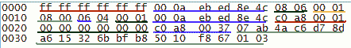
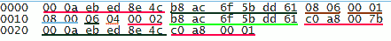
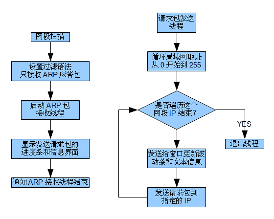
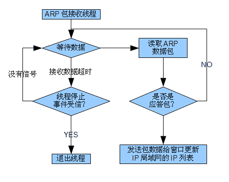

# ARP 攻击工具 DIY

> 原文：[`www.pediy.com/kssd/pediy12/128629.html`](https://www.pediy.com/kssd/pediy12/128629.html)

【文章标题】: ARP 攻击工具 DIY  
【文章作者】: Root  
【作者邮箱】: cppcoffee@gmail.com  
【作者主页】: http://hi.baidu.com/cppcoffee/home  
【软件名称】: ARP 攻击工具 by Root  
【下载地址】: 附件  
【编写语言】: WTL、WinPcap  
【软件介绍】: IP 地址冲突攻击、网关欺骗攻击  
【作者声明】: 只是感兴趣，没有其他目的。失误之处敬请诸位大侠赐教!  
\--------------------------------------------------------------------------------  
【详细过程】  
  菜鸟的作品，大牛请飘过：）  
首先感谢下 Debug0's 大牛的文章，不会让我在寻找 ARP 攻击资料的 google 的海量结果中淹没  
Debug0's 大牛的文章传送门：[`hi.baidu.com/yinyi\_k/blog/ite...d7f3e6fe2.html`](http://hi.baidu.com/yinyi_k/blog/item/28f7eecaa2ba0a1d7f3e6fe2.html)  
   由于上次重装系统，不小心将自己的一些源码删除了 - -b，这些天抽了点时间将 ARP 攻击工具重写下，重温下 WinPcap 的使用，俗话说：有舍才有得。心态要摆好，嘿嘿：）  
  先说下源码（见附件）的编译环境：使用的是 WTL 和 WinPcap。  
  为了保证文章的完整，这里还是需要介绍下 ARP 的相关信息和原理，可以略过：P  
  
  ARP 协议是“Address Resolution Protocol”（地址解析协议）的缩写。在局域网中，网络中实际传输的是“帧”，帧里面是有目标主机的 MAC 地址的。在以太网中，一个主机要和另一个 主机进行直接通信，必须要知道目标主机的 MAC 地址。但这个目标 MAC 地址是如何获得的呢？它就是通过地址解析协议获得的。所谓“地址解析”就是主机在发 送帧前将目标 IP 地址转换成目标 MAC 地址的过程。ARP 协议的基本功能就是通过目标设备的 IP 地址，查询目标设备的 MAC 地址，以保证通信的顺利进行。      
  每台安装有 TCP/IP 协议的电脑里都有一个 ARP 缓存表，表里的 IP 地址与 MAC 地址是一一对应的。下面就 ARP 数据包的各种类型作个简要说明。  
  
  下面给出实体的 ARP 例子，ARP 分为请求包和相应包，ARP 的封包包含了【物理帧头】和【ARP 帧】，这样就组成了一个完整的 ARP 包。  
  下图是用 Wireshark 捕获到的 ARP 请求包数据（文字的颜色尽量跟图片的颜色相同）  
    
  格式解析如下，末尾的\[x/y\]表示 x 是数据包的起始位置，y 是数据包的长度（以字节为单位）。  
  【物理帧头】  
  接收方 MAC：    FF:FF:FF:FF:FF:FF\[0/8\]      
  发送方 MAC：    00:0A:EB:ED:8E:4C\[8/8\]  
  协议类型 ：    0806\[12/2\]        // 这里的 0x0806 是 ARP 协议值  
  【ARP 帧】  
  硬件类型：     0001\[14/2\]        // 以太网  
  协议类型：     8000\[16/2\]  
  硬件地址长度： 06\[18/1\]  
  协议地址长度： 04\[19/1\]  
  操作类型：     0001\[20/2\]        // 操作码 1 为请求包，2 为应答包  
  源物理地址：   00:0A:EB:ED:8E:4C\[22/6\]  
  源 IP 地址：     192.168.0.1\[26/4\]    // C0A80001  
  目标物理地址： 00:00:00:00:00:00\[32/6\]  
  目标 IP 地址：   192.168.0.55\[38/4\]    // C0A80037  
  额外数据：     18 字节\[42/18\]  
  从上面的数据得知，这个是一个请求包，来自网关 192.168.0.1，网关询问谁拥有 192.168.0.55 这个 IP 地址。请注意：请求包的接收方 MAC 是 FF:FF:FF:FF:FF:FF。  
  
  下面用 Wireshark 捕获到的 ARP 应答包数据（这个包没有额外数据）   
    
   【物理帧头】   
  接收方 MAC：    00:0A:EB:ED:8E:4C\[0/8\]      
  发送方 MAC：    B8:AC:6F:5B:DD:61\[8/8\]  
  协议类型 ：    0806\[12/2\]        // 这里的 0x0806 是 ARP 协议值  
  【ARP 帧】  
  硬件类型：     0001\[14/2\]        // 以太网  
  协议类型：     8000\[16/2\]  
  硬件地址长度： 06\[18/1\]  
  协议地址长度： 04\[19/1\]  
  操作类型：     0002\[20/2\]        // 操作码 1 为请求包，2 为应答包  
  源物理地址：   B8:AC:6F:5B:DD:61\[22/6\]  
  源 IP 地址：     192.168.0.123\[26/4\]    // C0A8007B  
  目标物理地址： 00:0A:EB:ED:8E:4C\[32/6\]  
  目标 IP 地址：   192.168.0.1\[38/4\]    // C0A80001  
  额外数据：     无额外数据  
  上面这个请求包来自 192.168.0.123，发送给网关 192.168.0.1，告诉网关 192.168.0.123 的 MAC 地址是 B8:AC:6F:5B:DD:61，让网关更新 ARP 缓存表，这样就可以和网关进行通信了。  
  以上两种数据包在局域网中很普遍，可以是网关和其他机器发起请求，本机应答。也可以是本机向网关或别的机器发起请求，网关或者别的机器应答。  
  
  下面给出几个 ARP 攻击包的相关数据     
  这个包是为了检查局域网中是否有与自己的 IP 有相同的计算机。如果局域网内有与自己相同的 IP，就会发出应答包，也就是我们常看到的系统报告 IP 冲突。  
  IP 地址冲突 ARP 包  
  【物理帧头】  
  接收方 MAC：    FF:FF:FF:FF:FF:FF\[0/8\]      
  发送方 MAC：    00:0A:EB:ED:8E:4C\[8/8\]  
  协议类型 ：    0806\[12/2\]  
  【ARP 帧】  
  硬件类型：     0001\[14/2\]  
  协议类型：     8000\[16/2\]  
  硬件地址长度： 06\[18/1\]  
  协议地址长度： 04\[19/1\]  
  操作类型：     0001\[20/2\]            // 这是一个请求包  
  源物理地址：   00:0A:EB:ED:8E:4C\[22/6\]  
  源 IP 地址：     192.168.0.123\[26/4\]    // 注意这里（源 IP 和目标 IP 相同） C0A8007B  
  目标物理地址： 00:00:00:00:00:00\[32/6\]  
  目标 IP 地址：   192.168.0.123\[38/4\]    // 注意这里（源 IP 和目标 IP 相同） C0A8007B  
  额外数据：     18 字节\[42/18\]  
  以上的数据是让 192.168.0.123 的计算机出现地址冲突包。  
  
  以下是伪造网关广播包，当然，这个功能只有网关才有，我们可以伪造一个出来。   
  网关伪造广播包  
  【物理帧头】  
  接收方 MAC：    FF:FF:FF:FF:FF:FF\[0/8\]      
  发送方 MAC：    00:0A:EB:ED:8E:4C\[8/8\]    // 这里是网关的 MAC  
  协议类型 ：    0806\[12/2\]  
  【ARP 帧】  
  硬件类型：     0001\[14/2\]  
  协议类型：     8000\[16/2\]  
  硬件地址长度： 06\[18/1\]  
  协议地址长度： 04\[19/1\]  
  操作类型：     0001\[20/2\]            // 这是一个请求包  
  源物理地址：   B8:AC:6F:5B:DD:61\[22/6\]    // 这里修改成我们自己的 MAC，或者其他任意值（用来伪造网关的 MAC）  
  源 IP 地址：    192.168.0.1\[26/4\]        // 网关的 IP  
  目标物理地址： A0:12:DC:E9:2C:9D\[32/6\]    // 要欺骗计算机的 MAC，这里是 192.168.0.55 的 MAC  
  目标 IP 地址：   192.168.0.55\[38/4\]  
  额外数据：     18 字节\[42/18\]  
  这个包是告诉 192.168.0.55 网关的新 MAC 地址，让 192.168.0.55 刷新自身的 ARP 缓存。这样就达到了对 192.168.0.55 的网关攻击，发包后 192.168.0.55 将无法上网。因为它无法找到正确的网关了。  
  因为这个攻击工具用的是请求包攻击，当然还有请求包攻击，这里为了不使文章过于太长，将相关的攻击信息放到附件中：）  
  
  在这里贴下程序的工作流程：）   
    
    
   自动攻击流程->设置自动攻击标志位->设置相关按钮和菜单的状态->启动定时器，定时发包：）   
  // ArpAttack 项目文件夹说明 by Root  
  .\\                WTL 生成的文件  
  .\\Thread          线程相关类  
  .\\Controls        扩展控件  
  .\\Dialog          对话框类  
  .\\Common          常用的类(如:ARP 类,ARP 结构体文件,ARP 攻击者)  
  
  
  // 类设计说明    
  CAboutDlg         "关于"对话框类  
  CArpCacheItemsDlg "ARP 缓存项"对话框类  
  CArpSender        包发送者,对 WinPcap 的封装  
  CIpInfoListCtrl   网络 IP 地址列表 ListCtrl  
  CScanSegmentDlg   扫描网络段对话框类  
  CSelAdapterDlg    网卡选择对话框类  
  CAttacker         ARP 攻击者,封装了攻击的函数  
  
  CBaseThread       线程基类   
    |  
    -- CCapArpThread  捕获 ARP 包线程  
    |  
    -- CScanThread    扫描网段的发包线程  
  
  
  // 通用文件    
  DataStruct.h      包含了数据包的定义和 Virtual ListCtrl 数据的定义  
  
\--------------------------------------------------------------------------------   
【版权声明】: 本文原创于看雪技术论坛, 转载请注明作者并保持文章的完整, 谢谢!  
  
                                                       2011 年 01 月 25 日 16:49:42

上传的附件
|  || ARP 攻击工具 by Root.rar  
 |
|  || ARP 攻击相关资料.rar  
 |