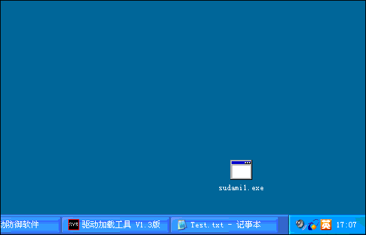

# Bypass“微点主动防御 2.0 公测版”

> 原文：[`www.pediy.com/kssd/pediy12/132785.html`](https://www.pediy.com/kssd/pediy12/132785.html)

微点主动防御软件  测试版  
程序版本： 2.0.20266.0108  
特征版本： 1.6.1852.110421  
更新时间： 2011-04-21 16:22:26  
下载地址：[`bbs.micropoint.com.cn/showthread.asp?tid=81489`](http://bbs.micropoint.com.cn/showthread.asp?tid=81489)  
  
微点官网出了微点 2.0 公测版，于是装了一个，界面不错。。。  
可惜由于微点不监控驱动加载，2 年前的一个老方法依然完美过微点。即将自身程序加入微点的白名单。  
sudami1.exe 作用是远程注入桌面导致 explorer 崩溃，看看效果，仅供娱乐。  
  
  
测试方法：  
1.直接运行 sudami1.exe，会被微点提示木马  
2.用 InstDrvA.exe 加载 1.sys，再次运行 sudami1.exe，桌面被成功结束  
  
附件中的**RemoteThreadMonitor.c**为关键代码，当时胡乱测试用的，供参考  
2 年前的帖子见：[`hi.baidu.com/sudami/blog/item...a27979167.html`](http://hi.baidu.com/sudami/blog/item/ecbae5ece63fdb3a27979167.html)

上传的附件
|  || BypassMP2.0.rar  
 |