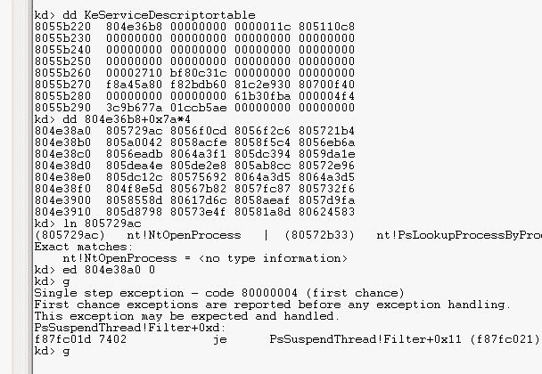
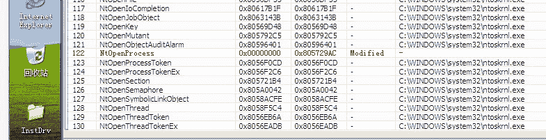

# 谈谈 通杀 SSDT hook 和 Shadow SSDT hook 的方法

> 原文：[`www.pediy.com/kssd/pediy12/143987.html`](https://www.pediy.com/kssd/pediy12/143987.html)

有点纠结，不知道应不应该发，本来想多攒点东西，留着以后找工作。毕竟说空话被 bs 过。其实技术含量也不高，耐心研究下都能实现。发出来了，权当促进游戏保护和反保护事业的发展吧。大牛飘过吧，那些还没成为大牛就开始倚老卖老喜欢对刚入门的小菜指手画脚的，时不时的来一句“别瞎鼓捣了，你应该从这学起，你应该从那学起的吧“请嘴上饶人吧。别人实现过，我纯粹研究，不做破坏的事情。我的学习是单纯的兴趣使然。  
         首先是我研究的思路，ring0 下过掉所有的 SSDThook 和 ShadowSSDT  hook（思路是从 360 的 hook 框架来的）。当然，对于过掉所有的 inline hook 具体实现也就是 pe 加载和重定位的问题。研究这个的目的是通杀所有的 SSDT hook 和 inline hook，很多游戏保护，很多木马都是通过给系统打补丁或者替换地址栏来执行恶意代码的目的。假如重新载入内核，系统调用都用我们的代理函数和数据变量，那么做很多事都就爽歪歪了。         1，原理: hook 系统函数,Kifastcallentry，然后给这个函数打补丁，让它执行我们自己的代码。然后对代码中用到的内核表（也就是 KeServiceDescriptorTable 和 KeServiceDescriptorTableShadow 表）进行替换。从而使得木马，病毒，游戏保护们去处理原来的表去吧，内核已经不使用它们了。      
          2，实现：  
                A,首先是找到两张系统表 KeServiceDescriptorTable 和 KeServiceDescriptorTableShadow 表。KeServiceDescriptorTable 是内核导出的，我们定义一下就 ok 了。        对于后边一张表，由于内核并没有导出，那么我们可以有好几种方法得到，比如搜 KeServiceDescriptorTable 周围的内存，比如 KeAddSystemServiceTable 函数中特征码搜索，比如线程对象 kthread 的 ServiceTable 域得到（这种方法最稳定）。在这里，我选择的是第二种方法 特征码搜索。获取表的地址后，解析来我们来把这张表保存到我们申请的内存吧。这是复制 SSDT 表，这里提高了系统的 irql 到 Dpclevel，防止线程切换。假如切换的话，我们复制的数据就会有问题了。同样的保存一下 ShadowSSDT 表这里要注意的就是 ShadowSSDT 表并不存在于系统进程空间的物理内存中，必须用 gui 线程来访问这张表。所以，我挂靠到了 csrss.exe 进程。这里偷懒了，604 是测试环境下 csrss.exe 的进程 id。  
        B，接下来是 hook kifastcallentry(所有系统调用都必须经过这个内核函数)函数了。这个函数也不是系统内核导出的函数，所以，我们必须用别的方法获取到。方法有堆栈回溯法（很牛，很稳定的大法），rdmsr 的方法。360 采取的是堆栈回溯法，hook 了 ZwSetEvent，这里不展开了。因为程序仅仅是测试，所以，从简处理。运用 rdmsr 的方法获取 kifastcallentry 的地址。接下里就是重点了。我没有用平常的 wrmsr 指令来替换 kifastcallentry 的地址，而是在这个函数内部实现 inline hook 跳转。所以，我要设法获取这个 hook 地址，我要 hook 的地址是为什么选这里呢？原因是 edi 指向的是表的地址。并且 eax 存放的是系统调用功能号。研究这个应该熟悉从 ring3 到 ring0 系统调用全过程的，这个我就不多说了。特征码就是"0x83,0x3f,0x8b,0x1c,0x87"。这段特征码将被我替换为跳转的代码。跳转我要多说几句。我们可以搭建跳板。怎么搭建呢，我们可以 ExallocatePool 分配跳转的中继地址，从 hook 出跳到中继地址，然后跳到最终地址 Filter 函数，这样可以躲过通过模块的起始地址和大小的检测方法，使我们的驱动模块合法点。出于实现的目的，没有采取上边的方法。跳转的偏移计算方法跳转偏移 = 目的地址 - 源地址 -5；然后，去除内核的代码段写保护，patch 地址，复位写保护。这样之后，经过 Kifastcallentry 函数的线程都要到我们的跳转目的地址去执行了。  
        C,hook 跳转的目的地址是我自己定义的 filter 裸函数现在代码仅仅替换 KeServiceDescriptorTable 这张表毕竟测试吗。对了，落了对这两张表的介绍。让我们来认识一下这两张表吧。  
ShadowSSDT 表。可以看出，它包含 SSDT 表。接下里，SSDT 表需要讲一下的时 edi 指向的是 PSSDT->ServiceTableBase，或者是 shadow 表的 ServiceTableBase。原理说完了。接下来让我们看看实验效果吧。如上图，我把系统本身的 SSDT 表中的 NtOpenProcess 修改为 0 了，然后运行系统。正常。我们来到 ark 工具中看看吧。  
       很闪亮的 NtOpenProcess 的当前地址变为零了。可是系统跑的很正常。哈哈。  
  
  
  

上传的附件
|  || 反 hook.pdf  
 |