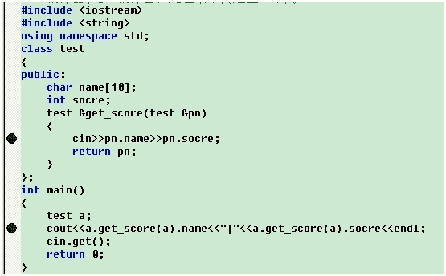
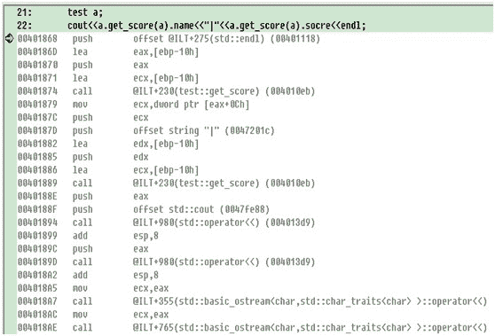
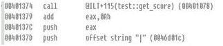
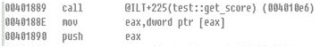
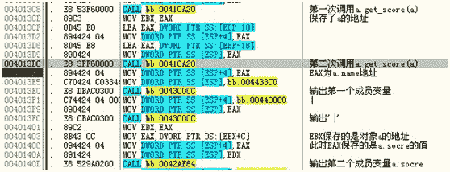
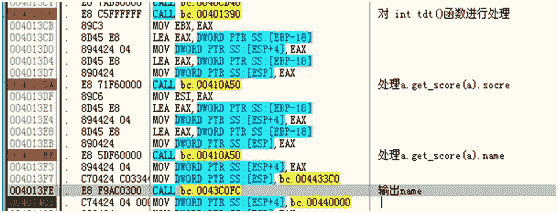

# 学习 C++时遇到的一个小问题&&解决

> 原文：[`www.pediy.com/kssd/pediy10/103036.html`](https://www.pediy.com/kssd/pediy10/103036.html)

学习 C++时遇到的一个小问题&&解决  
一、疑惑  
   
以上的代码运行之后输入  
first   255   second   1023  
为什么输出是 second|255，而不是 second|1023 或者 first|1023 呢?  
二、通过汇编代码查看  
在 VC++6.0 中设置断点，按 F5 运行。  
   
从上面的代码可以发现，编译器是按从右到左进栈的。这应该就是\_cdecl 调用方式的特点。  
00401874：调用了 a.get\_score(a)，在命令提示符界面上输入小于 10 个字符串+int 型数据。  
然后 00401879~0040187D：是进栈的操作，用于最后的输出’|’和 socre 的值  
进制顺序为：a.socre 的值-->’|’的地址  
00401889：第二次调用 a.get\_score(a)，在命令提示符上输入小于 10 个字符串+int 型数据。  
0040188E：函数返回值 EAX 是 a.name 的地址，进栈，用于输出 name 的字符串  
00401894：输出的是第二次输入的 name  
0040189D：输出的是’|’  
004018A7：输出的是第一次输入的 socre  
004018AE：输出的是 endl  
输出为：second|255  
          
总结：原来编译器这样子做的，关键的地方就是编译器在第一次调用 a.get\_score(a)之后就对输出进行了处理， socre 是直接采用 int 值进栈的，所以导致了在第二次调用 a.get\_score(a)之后，输出的 socre 是第一次输入的，因为之前进栈的是立即数，不是地址。  
三、如果 socre 的类型不是 int 呢？  
①  成员变量修改为：  
char name\[10\];    
    char socre\[10\];  
   
00401379：用于输出 socre，此时进栈的不是立即数，而是地址了  
②成员变量修改为：  
    int name;    
int socre;  
输入：12  34  56  78  
输出：56|34  
   
00401890：输出 name，进栈的是立即数  
所以，字符串输出用到地址，数值输出用到数值本身。  
  
  
四、如果编译器不是 VC++6.0，而是采用 g++在命令行里编译  
输入：first   255   second   1023  
输出：second|1023  
显然跟用 cl.exe 编译不同，为什么？  
不知道该怎么直接查看汇编代码，所以就用 OD 来查找问题  
通过超级字符串查找’|’,找到了输出的地方，然后在代码的周围寻找关键的地方，设置断点  
截图+注释如下：  
   
同样是\_cdecl 调用方式。跟之前 VC 的明显不同是它把两次 a.get\_score(a)放在一起执行了，把调用的函数都完成了之后再来处理输出。在 004013CD 处保存了 a 的地址，而不是 a.socre 的值，然后在输出 socre 时（00401403 行）用上了。在输出时也跟 VC 不同，采用的是地址，而不是立即数，所以输出的是第二次赋给 a.socre 的值。跟采用 VC 的不同应该就是编译器处理的不同。  
六、g++对以函数为参数的 cout 输出是怎么处理的  
增加函数 int tdt ()，修改 cout 行。如下  
   
OD 截图如下：  
   
原来对 cout<<a.get\_score(a).name<<"|"<<a.get\_score(a).socre<<"|"<<tdt()<<endl;的处理真的就是首先处理 cout 行中的函数参数，然后再处理 cout。  
int tdt()返回的是值，所以后面输出时 cout 参数进栈的也是值  
五、总结  
VC++6.0 对于 cout<<a.get\_score(a).name<<"|"<<a.get\_score(a).socre<<endl;的处理，关键的是它用的是\_cdecl 调用方式，而且是参数逐个处理。还有，对于数值，它进栈的是数值，对于字符串，它进栈的是地址，这跟 cout 的参数里的函数返回的类型无关，而跟它最终要输出的值的类型有关。第一次在命令命令提示符下面输入的 name 和 socre 其实是源代码行中的第二个 a.get\_score(a)。  
而采用 g++的方式编译，它是先处理 cout 中的参数，把每个函数都处理完之后再处理 cout，所以在输出时，传递 cout 的参数用的是地址。  
对于普通的 cout<<a.name<<"|"<<a.socre<<endl;两种编译就没什么差别了。  
g++的方式编译，cout<<XXX().b<<XXX().a<<endl;在输出时函数 cout 的参数进栈的类型跟 XXX()返回值同种类型。例如：  
cout<<a.get\_score(a).name<<"|"<<a.get\_score(a).socre<<"|"<<tdt()<<endl;  
1、如果 tdt()返回的是 int 类型，cout 参数进栈的是实际值  
2、如果 tdt()返回的是引用，cout 参数进栈的是地址。  
觉得用 cl 和 g++编译导致输出的不同，根本原因就是 cout 参数是传递值还是传递地址的不同。  
  
PS：最近才开始学习 C++，学习的时候发现了这个小小的问题，最终把问题解决了，知道了到底是怎么回事。先是对\_cdecl 的调用方式理解不透彻，通过在 VC++6.0 中看汇编代码，明白是\_cdecl 方式+cout 的参数传递的问题；之后，用 g++编译，又出现了问题，同样的\_cdecl 方式，输出却有差别，通过 OD 查看生成的 exe 文件，发现，g++对 cout 输出的处理跟 VC 的有差异。写完了总结，发现好像很简单，而且写得有点混乱。也许结果很简单，最重要的是对问题锲而不舍的求知过程。。由于对编译器学习得很少，C++也是刚开始学，所以有一些理解和描述可能有错误。  
  
  
  
                                                                     09.12.13