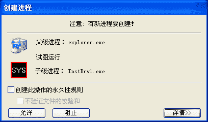
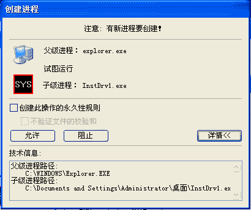
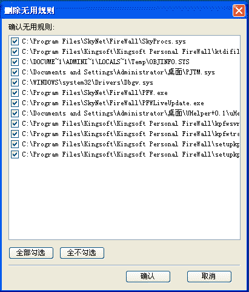

# MzfHips(开源)

> 原文：[`www.pediy.com/kssd/pediy12/136191.html`](https://www.pediy.com/kssd/pediy12/136191.html)

昨天刚当了安全编程论坛的实习版主. 得到了不少朋友的支持. 再此先谢过大家了. 我会努力的.  
本人博客: http://hi.baidu.com/hu3167343, 希望大家多多支持.  
  
在此, 我把我前段时间写的 MzfHips, 本来相当自己明年的毕业设计的. 现在开源出来给大家学习, 代码写的很烂, , 大牛飘过.   
这个工程应该是我写小工具以来最大代码量的一个了.   
  
此工程详细描述在我博客上有:   
http://hi.baidu.com/hu3167343/blog/item/d109a255bdee6d4b1138c214.html  
  
注意: 有些偏移, 硬编码了. 只保证在 Win xp  sp3 下正常.    
  
部分截图如下:  
  
  
  
  
  
  
  
  
  
  
  
  
R0 and R3 代码:

上传的附件
|  || MzfHips.rar  
 |