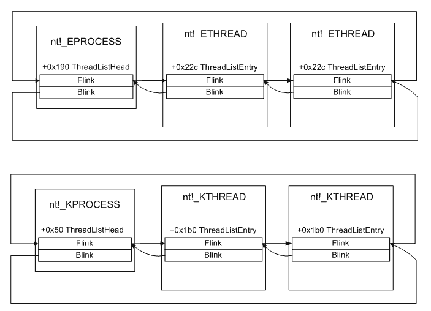

# 不 HOOK 任何函数，让任务管理器、XueTr、360 进程管理器无法结束保护进程

> 原文：[`www.pediy.com/kssd/pediy12/134645.html`](https://www.pediy.com/kssd/pediy12/134645.html)

【提示】能加驱动进内核，就没必要弄 EXE 了，所以我个人觉得没啥实际用途，仅供观看  
  
Windows 会给每一个进程建立一个 EPROCESS 结构，给每一个线程建立 ETHREAD 结构，EPROCESS 结构第一个成员是 KPROCESS 结构，ETHREAD 结构第一个成员是 KTHREAD 结构。每个进程的线程的 ETHREAD 结构都会按下图所示链接起来：  
  
  
里面有两条链表。通过遍历这两条链表，可以得到一个进程所有的线程。Windows 在执行线程调度时，不会去管这两条链表。只有当新建一个线程时，会加入到链表中，一个线程退出时，会从链表中移除。  
  
如果在 EPROCESS 中将这两条链表置空，会发生什么事呢？  
  
  
  
以下是验证步骤：  
  
【注意】请先关闭 360 安全卫士，以免加载驱动时提示。驱动代码中用了一堆的硬编码，所以请确保操作系统为 Windows XP SP3 中文版，否则可能蓝屏。  
  
1.编译以下代码为 haha.exe  
/\*  
 \* 【作者：KiDebug】  
 \* 【空间：http://hi.baidu.com/KiDebug/】  
 \*/  
#include <Windows.h>  
  
int APIENTRY wWinMain(HINSTANCE hInstance, HINSTANCE hPrevInstance, LPWSTR lpCmdLine, int nCmdShow)  
{  
  //这个循环是用来证明进程没有被结束，不是重点，请无视！  
  while (1)  
  {  
    MessageBoxA(NULL,"关不了，气死你！~","哈哈！~",MB\_OK);  
  }  
  return 0;  
}  
  
双击打开 haha.exe，它会不断地调用 MessageBox 弹出对话框，此时任务管理器、XueTr、360 进程管理器都可以结束 haha.exe  
  
2.确保 haha.exe 可以弹出对话框，然后再编译以下代码为 ProtectHaha.sys，利用 InstDrv.exe 加载 ProtectHaha.sys，依次点击安装、启动、停止、卸载  
/\*  
 \* 【作者：KiDebug】  
 \* 【空间：http://hi.baidu.com/KiDebug/】  
 \*/  
#include <ntddk.h>  
  
void DriverUnload(IN PDRIVER\_OBJECT DriverObject)  
{  
}  
  
NTSTATUS DriverEntry(IN PDRIVER\_OBJECT DriverObject, IN PUNICODE\_STRING  RegistryPath)  
{  
  \_\_asm  
  {  
    mov ebx,PsInitialSystemProcess  
    mov ebx,\[ebx\]  
    lea ebx,\[ebx+88h\]        //+0x088 ActiveProcessLinks : \_LIST\_ENTRY  
L1:    mov ebx,\[ebx\]          //遍历 ActiveProcessLinks，找 haha.exe 的 EPROCESS  
    cmp dword ptr \[ebx+0ECh\],61686168h  
    jnz L1  
    cmp dword ptr \[ebx+0F0h\],6578652eh    //68 61 68 61 2e 65 78 65 haha.exe  
    jnz L1  
  
    //88h、50h、190h、194h 都是硬编码，适用于 Windows XP SP3  
    lea ebx,\[ebx-88h\]        //EBX 为 haha.exe 的 EPROCESS  
    lea eax,\[ebx+50h\]        //nt!\_KPROCESS  
    mov \[ebx+50h\],eax        //+0x050 ThreadListHead : \_LIST\_ENTRY  
    mov \[ebx+54h\],eax        //置为空链  
    lea eax,\[ebx+190h\]        //nt!\_EPROCESS  
    mov \[ebx+190h\],eax        //+0x190 ThreadListHead : \_LIST\_ENTRY  
    mov \[ebx+194h\],eax        //置为空链  
  }  
  
  DriverObject->DriverUnload = DriverUnload;  
  return STATUS\_SUCCESS;  
}  
3.打开任务管理器，选中 haha.exe，点击“结束进程”，haha.exe 无法结束，仍然可以不停地弹对话框；  
4.打开 XueTr，在“进程”窗口中选中 haha.exe 按右键，点击“结束进程”，haha.exe 无法结束，仍然可以不停地弹对话框；刷新，再次右键，点击“强制结束进程”，haha.exe 无法结束，仍然可以不停地弹对话框；  
5.打开 360 安全卫士（8.0.0.2001），启动“功能大全”里面的“进程管理器”，选中 haha.exe，点击“关闭程序”，haha.exe 无法结束，仍然可以不停地弹对话框；  
  
【注意】  
1.有可能点击对话框右上角的关闭按钮后，haha.exe 会假死。这时先随便点下桌面或其他什么地方，再点对话框的“确定”按钮，就又活过来了。  
2.如果要应用到其他进程上，请确保驱动启动后这个进程不会新建线程，否则“强制结束进程”可以结束掉新建线程，可能会造成进程假死。  
3.haha.exe 中只有一个线程，对于其他进程，在 EPROCESS 中将两条链表置空后需要将链表中第一个线程和最后一个线程的 ThreadListEntry 链接起来。  
4.对于其他进程，置空链表时需要考虑同步问题。  
  
如何结束 haha.exe 呢？  
在 XueTr“进程”窗口中选中 haha.exe 按右键，点击“查看进程线程”，把看到的线程全部结束即可。  
WS 点可以把线程栈空间设小点，然后创建成百上千个线程……