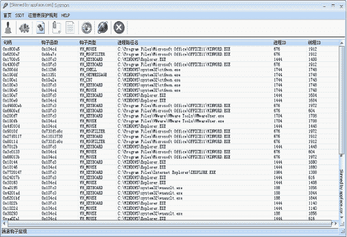
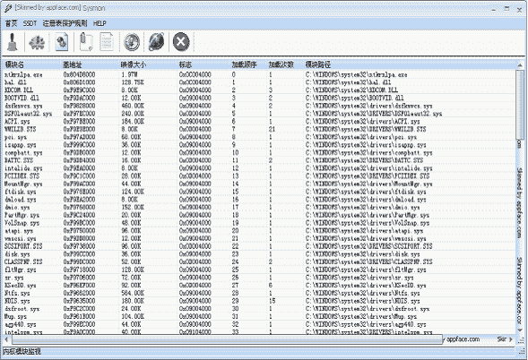
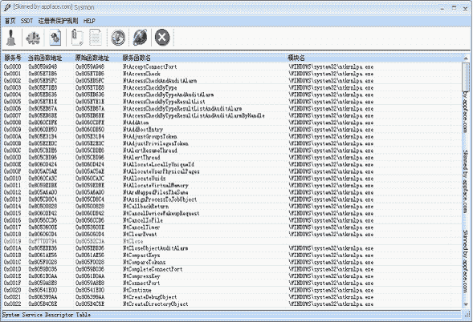
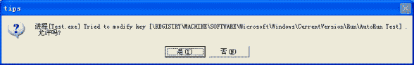
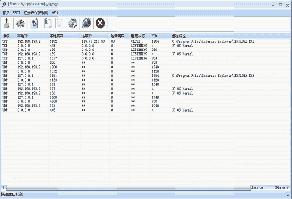
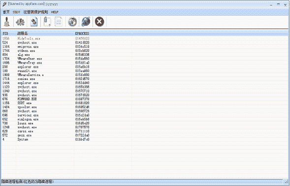

# 打造自己的 ARK 工具（公开源代码）

> 原文：[`www.pediy.com/kssd/pediy11/117902.html`](https://www.pediy.com/kssd/pediy11/117902.html)

作品是参加 2010 年全国大学生信息安全竞赛的作品，今天上竞赛的网站看下，发现决赛名单出来了，没能进入决赛，因此将本作品分享出来，附件里包括参加竞赛的作品报告和源程序、源代码，有些代码参考了一些大牛的代码和思路，在此表示感谢！  
  作品主要实现了以下七个模块：  
  1、息钩子监视：列举系统上的消息钩子。  
  2、块加载监视：列举系统上加载的所有内核模块  
  3、SSDT 监视：通过得到原始的 SSDT 地址来得到被恶意程序 HOOK 的 API 以及恢复 SSDT  
   4、注册表保护：对一些重要的注册表项进行保护，防止恶意程序对其进行修改。  
  5、隐藏进程检测：检测出系统中隐藏的进程。  
  6、隐藏端口检测：检测出系统中隐藏的端口。  
  7、进程强杀：能够杀死系统中的对自身保护的恶意进程。  
  具体的实现在作品报告里，由于本人实力有限，可能质量不高，望大牛指教！  
  
一、消息钩子监视  
  
二、内核模块监视  
  
三、SSDT 监视  
  
四、注册表保护  
  
五、隐藏端口检测  
  
六、隐藏进程检测  
  
七、进程强杀  
本软件能够结束 360 杀毒软件、360 卫士、瑞星、IceSword、XueTr 等

上传的附件
|  || Sysmon 作品.rar  
 |
|   
 |
|  |