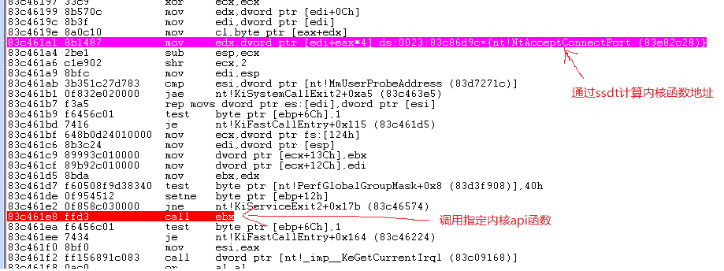
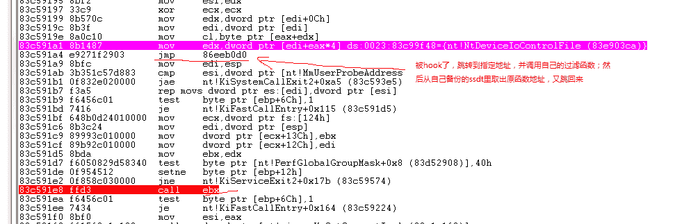
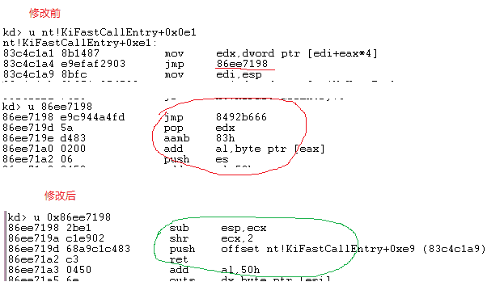
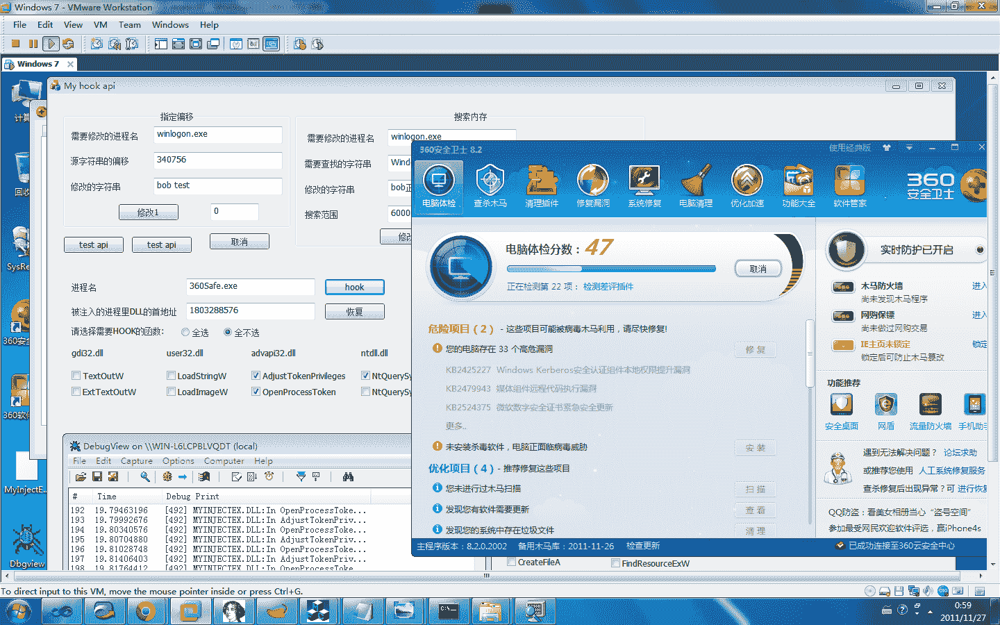

# 某安全卫士的内核 hook

> 原文：[`www.pediy.com/kssd/pediy12/143364.html`](https://www.pediy.com/kssd/pediy12/143364.html)

思路：  
1、自己分配一块内存，存放需要 hook 的函数地址。  
2、从内核模块中读取相应内核函数的地址，然后存放在自己分配的内存中。  
3、修改 nt!KiFastCallEntry 函数中的代码，使跳入自己的驱动模块中。  
  
优点：坚决不修改 ssdt 和内核模块中的数据，使得一般的工具软件无法检查出 hook 信息，也避免了和其他软件的不兼容性。  
  
详细情况，请看图：  
  
正常状态  
  
  
hook 后  
  
  
下面是如何解除 360 的 hook,看图：  
  
  
  
  
驱动在 explorer.rar 中，此驱动只在 win7 32 位下测试过，可用。  
  // 解除 360 的 hook  
  if( !NT\_SUCCESS( KillHookPort() ) )  
  {   
    KdPrint( ( "解除 360 的 hook 失败！" ) );  
  }  
  else  
  {  
    KdPrint( ( "解除 360 的 hook 成功！" ) );  
  }

上传的附件
|  || subFindApiAddr.txt  
 |
|  || save\_api\_address.txt  
 |
|  || explorer.rar  
 |
|  || MyInjectEx.zip  
 |