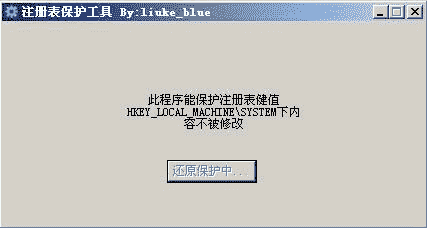

# Windows 内核编程来实现注册表还原保护的一种方法

> 原文：[`www.pediy.com/kssd/pediy12/131018.html`](https://www.pediy.com/kssd/pediy12/131018.html)

来源于一个注册表保护工具的逆向，主要利用 CmpParseKey 函数的 Object HOOK 实现注册表操作重定向来实现注册表还原保护，驱动代码如下：  

代码:

```
/\*一个简单的注册表还原驱动
来源于某工具逆向，主要解决以下两个问题：
一、理解 HIVE 文件，这个被 system 进程独占
二、CmpParseKey 函数的挂钩，object HOOK 

by:liuke\_blue
E-mail:liuke\_blue@126.com
\*/

#include <ntddk.h>
#include <windef.h>
#include <stdio.h>

extern POBJECT\_TYPE \*IoFileObjectType; 

#define KeyValueFullInformation 1 
#define RegHiveFileName  L"\\\\WINDOWS\\\\system32\\\\config\\\\system"
#define RepointRegItem   L"\\\\REGISTRY\\\\USER\\\\.DEFAULT\\\\Volatile\\\\"   
#define ObjectTypeName   L"\\\\ObjectTypes\\\\Key"
#define  itemlen 0x0E


 
typedef enum \_SYSTEM\_INFORMATION\_CLASS { 
SystemBasicInformation,      // 0 
   SystemProcessorInformation,     // 1 
   SystemPerformanceInformation,     // 2
   SystemTimeOfDayInformation,     // 3
   SystemNotImplemented1,      // 4
   SystemProcessesAndThreadsInformation,    // 5
   SystemCallCounts,       // 6
   SystemConfigurationInformation,     // 7
   SystemProcessorTimes,      // 8
   SystemGlobalFlag,       // 9
   SystemNotImplemented2,      // 10
   SystemModuleInformation,      // 11
   SystemLockInformation,      // 12
   SystemNotImplemented3,      // 13
   SystemNotImplemented4,      // 14
   SystemNotImplemented5,      // 15
   SystemHandleInformation,      // 16
   SystemObjectInformation,      // 17
   SystemPagefileInformation,      // 18
   SystemInstructionEmulationCounts,     // 19
   SystemInvalidInfoClass1,      // 20
   SystemCacheInformation,      // 21
   SystemPoolTagInformation,      // 22
   SystemProcessorStatistics,      // 23
   SystemDpcInformation,      // 24
   SystemNotImplemented6,      // 25
   SystemLoadImage,       // 26
   SystemUnloadImage,      // 27
   SystemTimeAdjustment,      // 28
   SystemNotImplemented7,      // 29
   SystemNotImplemented8,      // 30
   SystemNotImplemented9,      // 31
   SystemCrashDumpInformation,     // 32
   SystemExceptionInformation,     // 33
   SystemCrashDumpStateInformation,     // 34
   SystemKernelDebuggerInformation,     // 35
   SystemContextSwitchInformation,     // 36
   SystemRegistryQuotaInformation,     // 37
   SystemLoadAndCallImage,      // 38
   SystemPrioritySeparation,      // 39
   SystemNotImplemented10,      // 40
   SystemNotImplemented11,      // 41
   SystemInvalidInfoClass2,      // 42
   SystemInvalidInfoClass3,      // 43
   SystemTimeZoneInformation,      // 44
   SystemLookasideInformation,     // 45
   SystemSetTimeSlipEvent,      // 46
   SystemCreateSession,      // 47
   SystemDeleteSession,      // 48
   SystemInvalidInfoClass4,      // 49
   SystemRangeStartInformation,     // 50
   SystemVerifierInformation,      // 51
   SystemAddVerifier,      // 52
   SystemSessionProcessesInformation     // 53
} SYSTEM\_INFORMATION\_CLASS;


typedef struct \_SYSTEM\_HANDLE\_INFORMATION
{
    ULONG            ProcessId;
    UCHAR            ObjectTypeNumber;
    UCHAR            Flags;
    USHORT           Handle;
    PVOID            Object;
    ACCESS\_MASK      GrantedAccess;
} SYSTEM\_HANDLE\_INFORMATION, \*PSYSTEM\_HANDLE\_INFORMATION;


NTSYSAPI
NTSTATUS 
NTAPI
NtQuerySystemInformation(IN SYSTEM\_INFORMATION\_CLASS SystemInformationClass,
                         OUT PVOID SystemInformation,
                         IN ULONG SystemInformationLength,
                         OUT PULONG ReturnLength OPTIONAL);

NTSYSAPI
NTSTATUS 
NTAPI ObOpenObjectByPointer(IN PVOID Object,
                            IN ULONG HandleAttributes,
                            IN PACCESS\_STATE PassedAccessState,
                            IN  ACCESS\_MASK DesiredAccess,
                            IN  POBJECT\_TYPE ObjectType,
                            IN  KPROCESSOR\_MODE AccessMode,
                            OUT PHANDLE Handle);


NTSYSAPI
NTSTATUS
NTAPI
ZwRestoreKey(IN HANDLE KeyHandle,
             IN HANDLE FileHandle,
             IN ULONG  Flags);


NTSYSAPI 
NTSTATUS 
NTAPI 
NtClose(IN HANDLE ObjectHandle );


NTSYSAPI
NTSTATUS
NTAPI
ObOpenObjectByName(IN POBJECT\_ATTRIBUTES ObjectAttributes,
                   IN POBJECT\_TYPE ObjectType,
                   IN KPROCESSOR\_MODE AccessMode,
                   IN PACCESS\_STATE PassedAccessState,
                   IN ACCESS\_MASK DesiredAccess,
                   IN OUT PVOID ParseContext,
                   OUT PHANDLE Handle);


NTSYSAPI
NTSTATUS
NTAPI
ObReferenceObjectByHandle(IN HANDLE Handle,
                          IN ACCESS\_MASK DesiredAccess,
                          IN POBJECT\_TYPE ObjectType,
                          IN KPROCESSOR\_MODE AccessMode,
                          OUT PVOID\* Object,
                          OUT POBJECT\_HANDLE\_INFORMATION HandleInformation OPTIONAL);

//记得设置为全局变量
ULONG  PID; 
ULONG Orig\_CmpParseKey;

NTSTATUS MyCreateClose(IN PDEVICE\_OBJECT DeviceObject, IN PIRP Irp);
ULONG InstallObjectTypeHook(BOOLEAN IsHook);
VOID RestoreReg(PVOID CurrentId);
NTSTATUS Restorssymbol();


//重定向指向打开项或者键值
NTSTATUS  fake\_CmpParseKey(
                           IN PVOID ParseObject,
                           IN PVOID ObjectType,
                           IN OUT PACCESS\_STATE AccessState,
                           IN KPROCESSOR\_MODE AccessMode,
                           IN ULONG Attributes,
                           IN OUT PUNICODE\_STRING CompleteName,
                           IN OUT PUNICODE\_STRING RemainingName,
                           IN OUT PVOID Context OPTIONAL,
                           IN PSECURITY\_QUALITY\_OF\_SERVICE SecurityQos OPTIONAL,
                           OUT PVOID \*Object)
{
   wchar\_t ItemName\[10\];
   unsigned short  fullnamelen;
   WORD  name1Len;
   PVOID repoint\_pool;
   ULONG name2Len;
   unsigned short poollen;
   unsigned int  childlen;  
   DWORD  tmppos;
   ULONG repoint\_len;
   DWORD CompleteName\_;
   NTSTATUS status;
   
   
   CompleteName\_=CompleteName;
   fullnamelen=CompleteName->Length;
   name1Len=(WORD)(itemlen-2);

   if (fullnamelen<itemlen)
   { 
      if (fullnamelen==name1Len)  //不含"\\\\"的字符串长度
      {        
      //将 L"SOFTWARE"拷贝至 ItemName; 
      memcpy(ItemName,(void\*)(CompleteName->Buffer),name1Len);
          //最后一位'\\0'结尾
      ItemName\[name1Len>>1\]=0;
          //字符串转换为大写
      \_wcsupr(ItemName);
          //如果匹配字符串"SOFTWARE"
      if (RtlCompareMemory(ItemName,L"SYSTEM\\\\",name1Len)==name1Len)
          {
             //分配重定向缓冲区
        repoint\_pool=ExAllocatePool(PagedPool,0x40u);
        memcpy(repoint\_pool,L"\\\\REGISTRY\\\\USER\\\\.DEFAULT\\\\Volatile\\\\",0x40u);     
              repoint\_len=0x00420040;
        goto Over;
      }
    } 
   }
   else
   {
      memcpy(ItemName,(void\*)(CompleteName->Buffer),itemlen);  
      ItemName\[itemlen>>1\]=0;
    \_wcsupr(ItemName);
    name2Len=RtlCompareMemory(ItemName,L"SYSTEM\\\\",itemlen);
    fullnamelen=itemlen;
      if (name2Len==itemlen)
      {
         poollen=(WORD)CompleteName->Length-itemlen+0x42;
     repoint\_pool=ExAllocatePool(PagedPool,poollen);
         memcpy(repoint\_pool,L"\\\\REGISTRY\\\\USER\\\\.DEFAULT\\\\Volatile\\\\",0x42);     
         //后面子项的长度,除去前面"SOFTWARE\\"的字符串剩下长度
     childlen=CompleteName->Length-(WORD)itemlen;
         tmppos=\*(DWORD\*)(CompleteName\_+4);
     //把"SOFTWARE\\\\"后面所接的字符子串拷贝到重定向值后面
     memcpy((CHAR\*)repoint\_pool+0x42,(const void \*)(tmppos+2\*((WORD)(WORD)itemlen>>1)),childlen);      
       repoint\_len=( ((DWORD)(poollen+2)<<16) | ((WORD)poollen) );   
Over:     
      ExFreePoolWithTag(\*(PVOID\*)(CompleteName\_+4),0);
        \*(DWORD\*)CompleteName\_=repoint\_len;
        \*(DWORD\*)(CompleteName\_+4)=(DWORD)repoint\_pool;
      
    //重新解析
       return STATUS\_REPARSE;
    }


  }

   \_\_asm{
         push eax
       push Object
         push SecurityQos
     push Context
     push RemainingName
     push CompleteName\_
         push Attributes
     push AccessMode
         push AccessState
         push ObjectType
         push ParseObject
     call Orig\_CmpParseKey
         mov status,eax  
         pop eax
   }
 return status;
 
}


NTSTATUS  DriverEntry(IN PDRIVER\_OBJECT DriverObject, IN PUNICODE\_STRING RegistryPath)
{
   PDEVICE\_OBJECT DeviceObject;
   UNICODE\_STRING devicename;
   UNICODE\_STRING linkname;
   NTSTATUS status;
   HANDLE Threadhandle=NULL;


   RtlInitUnicodeString(&devicename,L"\\\\Device\\\\RevertHive\_2010");
   RtlInitUnicodeString(&linkname,L"\\\\DosDevices\\\\RevertHive\_2010");
   
   status=IoCreateDevice(DriverObject,0,&devicename,FILE\_DEVICE\_UNKNOWN,0x600,FALSE,&DeviceObject);
   if (NT\_SUCCESS(status))
   {
       status=IoCreateSymbolicLink(&linkname, &devicename);
     if (NT\_SUCCESS(status))
     {
         
        DriverObject->MajorFunction\[IRP\_MJ\_CREATE\] = MyCreateClose;
            DriverObject->MajorFunction\[IRP\_MJ\_CLOSE\]  = MyCreateClose;
        PID=PsGetCurrentProcessId(); 
      if (NT\_SUCCESS(PsCreateSystemThread(&Threadhandle,0x1F03FFu, 0, 0, 0, RestoreReg, (PVOID)&PID)))
            ZwClose(Threadhandle); 
      InstallObjectTypeHook(1);         
      status=STATUS\_SUCCESS;
     }else
     {
        IoDeleteDevice(DeviceObject);
     }
      
   }

return status;

}


ULONG InstallObjectTypeHook(BOOLEAN IsHook)
{
  OBJECT\_ATTRIBUTES objAttr;
  UNICODE\_STRING uObjName;
  NTSTATUS status;
  HANDLE KeyHandle;
  PVOID  keyObject;
  BYTE\*  ParseProcedureOfObject;

  RtlInitUnicodeString(&uObjName,ObjectTypeName); 
  InitializeObjectAttributes(&objAttr,&uObjName,OBJ\_CASE\_INSENSITIVE | OBJ\_KERNEL\_HANDLE ,NULL,NULL);
  
  status=ObOpenObjectByName(&objAttr,NULL,KernelMode,NULL,0,NULL,&KeyHandle);
  
  if (NT\_SUCCESS(status))
  {
      status= ObReferenceObjectByHandle(KeyHandle,0x80000000u,NULL,KernelMode,(PVOID)&keyObject,0);
      if (NT\_SUCCESS(status))
      {
        /\*
          OBJECT\_TYPE+0x60-->OBJECT\_TYPE\_INITIALIZER
          OBJECT\_TYPE\_INITIALIZER+0x3c-->ParseProcedure(nt!CmpParseKey)
          而且 KeyObject 指向 OBJECT\_TYPE,因此可以进行 OBJECT HOOK
         \*/
      
    ParseProcedureOfObject=(BYTE\*)keyObject+0x9C;
      if (!MmIsAddressValid((\*(DWORD\*)ParseProcedureOfObject)))
      {
        ObfDereferenceObject(keyObject);  
      ZwClose(KeyHandle);
      return status;
    }
    KdPrint(("CmpParseKey funcaddr=0x%X\\n",\*(DWORD\*)ParseProcedureOfObject));
    //开始 OBJECT HOOK
    if (IsHook)
    {
      \_\_asm{
           push eax
                   push ecx
               mov  ecx,ParseProcedureOfObject
           mov  eax,offset fake\_CmpParseKey
           xchg eax,\[ecx\]
             mov  Orig\_CmpParseKey,eax
           pop ecx
           pop eax
      }
        
    
    }else
    {
      \_\_asm{
                  push eax
                  push ecx
                  mov  eax,Orig\_CmpParseKey                 
                  mov  ecx,ParseProcedureOfObject  
          xchg eax,\[ecx\] 
                  pop ecx
          pop eax
      }
      
    }
      
     ObfDereferenceObject(keyObject);
    }
    ZwClose(KeyHandle);
  }

return status;  
}


/\*得到 system 进程里所独占的文件句柄（windows\\system32\\config\\system），
然后重新装载在 L"\\\\REGISTRY\\\\USER\\\\.DEFAULT\\\\Volatile\\"下，实现注册表 hive 文件重定向
\*/
VOID  RestoreReg(PVOID CurrentId)
{
  NTSTATUS status;
  PVOID pool;
  ULONG dwNeedsize;
  ULONG ReturnLength;
  unsigned int nCount;
  ULONG Object;
  ULONG PID;
  UNICODE\_STRING \*filetype;
  UNICODE\_STRING szfile;
  PFILE\_OBJECT FileObject=NULL;
  ULONG  current\_handle\_info\_pos;
  UNICODE\_STRING Hivename;
  HANDLE regedit\_software\_fileHandle;
  UNICODE\_STRING volatile\_reg;
  PUNICODE\_STRING filename;
  OBJECT\_ATTRIBUTES oa;
  ULONG numofhandles;


  RtlInitUnicodeString(&szfile,L"File");
  RtlInitUnicodeString(&Hivename,RegHiveFileName);
  dwNeedsize=0x1000;
  do 
  {
    pool=ExAllocatePool(PagedPool,dwNeedsize);
    if (pool)
  { 
      current\_handle\_info\_pos=(ULONG)pool; 
    status= NtQuerySystemInformation(SystemHandleInformation, pool, dwNeedsize, &ReturnLength);  
  }else
    return NULL;
  
  if (status==STATUS\_INFO\_LENGTH\_MISMATCH)
  {
      ExFreePoolWithTag(pool,0);
    dwNeedsize\*=2;
  } 
  } while(status == STATUS\_INFO\_LENGTH\_MISMATCH);
 /\*+++
 这里注意 pool 指向的缓冲区的内容，查看文档如下:
 The data returned to the SystemInformation buffer is a ULONG count of the number of
 handles followed immediately by an array of SYSTEM\_HANDLE\_INFORMATION.很显然是指句柄的数量,
 紧接着就是 SYSTEM\_HANDLE\_INFORMATION 的数组,还是的看文档,才清楚.
  ++\*/
  if (pool)
  {
    if (NT\_SUCCESS(status))
     {
         numofhandles=\*(ULONG\*)current\_handle\_info\_pos;
     nCount=0;
       Object=((ULONG)pool+0xC);
     while (nCount<numofhandles)
     {
       PID=\*(DWORD\*)(Object-0x8);  
        //如果是 system 进程，并且匹配文件，则打印
        if((PID==(\*(DWORD\*)CurrentId))&&(!RtlCompareUnicodeString(&szfile,(PUNICODE\_STRING)(\*(DWORD\*)(\*(DWORD\*)Object-0x10)+64),TRUE)))
      {
                    filetype=(PUNICODE\_STRING)(\*(DWORD\*)(\*(DWORD\*)Object-0x10)+64);
                   
           FileObject=\*(PULONG)Object;  
          //KdPrint(("filename=%wZ,vpb=0x%X\\n",(PUNICODE\_STRING)(&FileObject->FileName),\*(DWORD \*)(FileObject + 8)));         
                 filename=(PUNICODE\_STRING)(&FileObject->FileName);
                 if (filename)
           {   
             //找到 HIVE 文件:software
             if (!RtlCompareUnicodeString(filename,&Hivename,TRUE))
             {
                 KdPrint(("filetye=%wZ,Filename=%wZ,filelen=%d\\n",filetype,filename,filename->Length));
               status=ObOpenObjectByPointer(FileObject,512,NULL,0,0,KernelMode,&regedit\_software\_fileHandle);   
                 if (NT\_SUCCESS(status))
                 {
                     if (regedit\_software\_fileHandle)
                     {
                         
                  RtlInitUnicodeString(&volatile\_reg,RepointRegItem);
                  InitializeObjectAttributes(&oa,&volatile\_reg,OBJ\_KERNEL\_HANDLE|OBJ\_CASE\_INSENSITIVE,NULL,NULL);
                  //REG\_OPTION\_VOLATILE 表示创建的项存放在在内存中
                                    status=ZwCreateKey((PHANDLE)(&CurrentId),0xF003Fu,&oa,0,0,5u,&current\_handle\_info\_pos);
                                    if (NT\_SUCCESS(status))
                                    {
                                      //把 hive 文件临时恢复在设定下的注册表项
                     status=ZwRestoreKey((HANDLE)CurrentId,regedit\_software\_fileHandle,8u);
                     if (NT\_SUCCESS(status))
                                         Restorssymbol();   
                                      ZwClose((HANDLE)CurrentId);
                  }
                                     ZwClose(regedit\_software\_fileHandle);
                  goto while\_break;
                 }
               
               }
             
             }
             
    
           }          
      } 
        ++nCount;
      Object+=0x10;
     }


 
   }
  
  
  
  }
while\_break:
 ExFreePoolWithTag(pool,0);
return;

}


/\*开起一个线程时刻监测是否被 HOOK，防止被修复,猥琐的写法
VOID ProtectHook()
{
  ULONG Oldaddress; 
  LARGE\_INTEGER Interval; 

  Interval.QuadPart=100\*10000; 

  while (1)
  {
     Oldaddress=\*(ULONG\*)ParseKeyAddress;
   if (Oldaddress == Orig\_CmpParseKey) 
     \*(ULONG\*)ParseKeyAddress=(ULONG)fake\_CmpParseKey;
     
    KeDelayExecutionThread(0,0,&Interval);//延缓时间 
  }
    

}\*/

NTSTATUS MyCreateClose(IN PDEVICE\_OBJECT DeviceObject, IN PIRP Irp)
{

    Irp->IoStatus.Status = STATUS\_SUCCESS;
  Irp->IoStatus.Information = 0;
  IoCompleteRequest(Irp, IO\_NO\_INCREMENT);
    
  return Irp->IoStatus.Status;
}


//恢复符号连接
NTSTATUS Restorssymbol()
{
  UNICODE\_STRING DestinationString;
  NTSTATUS status;
  OBJECT\_ATTRIBUTES oa;
  HANDLE handle;
  HANDLE KeyHandle;
  UNICODE\_STRING valuename; 
  PVOID KeyValueInformation;
  ULONG ResultLength;
  ULONG Disposition;
  UNICODE\_STRING setvalue;
  CHAR unitevalue\[50\]={0}; 
  int controlvalue;
  ANSI\_STRING ansistring;
  ANSI\_STRING ansistring2;  
  UNICODE\_STRING subkeyname;
  HANDLE  subkey;
  int currentconfigvalue;
  CHAR unitevalue2\[160\]={0}; 

  KeyValueInformation=ExAllocatePool(NonPagedPool,0x100);
  RtlInitUnicodeString(&DestinationString, L"\\\\Registry\\\\Machine\\\\System\\\\Select");
  InitializeObjectAttributes(&oa,&DestinationString,OBJ\_CASE\_INSENSITIVE,NULL,NULL);
  
  status= ZwOpenKey(&handle, 0x20019u, &oa);
  
  if (NT\_SUCCESS(status))
  {
    RtlInitUnicodeString(&valuename, L"Current");

    status= ZwQueryValueKey(handle,&valuename,KeyValueFullInformation,KeyValueInformation,0x80,&ResultLength);  
    NtClose(handle);
    if (NT\_SUCCESS(status))
    {
       //得到 current 的值
    controlvalue=\*(int \*)((char\*)KeyValueInformation+0x24);
    RtlInitUnicodeString(&valuename,L"\\\\REGISTRY\\\\USER\\\\.DEFAULT\\\\Volatile\\\\CurrentControlSet"); 
     
    InitializeObjectAttributes(&oa,&valuename,OBJ\_CASE\_INSENSITIVE,NULL,NULL);  
    status= ZwCreateKey(&KeyHandle,KEY\_CREATE\_LINK,&oa, 0, 0,  REG\_OPTION\_VOLATILE |REG\_OPTION\_CREATE\_LINK , &Disposition); 
      if (NT\_SUCCESS(status))
      {
         RtlInitUnicodeString(&setvalue, L"SymbolicLinkValue");
       sprintf(&unitevalue,"\\\\REGISTRY\\\\USER\\\\.DEFAULT\\\\Volatile\\\\ControlSet%03d",controlvalue);
       RtlInitAnsiString(&ansistring,&unitevalue);  
       valuename.MaximumLength=256;         
       RtlAnsiStringToUnicodeString(&valuename,&ansistring, FALSE);
           status=ZwSetValueKey(KeyHandle, &setvalue, 0, REG\_LINK, valuename.Buffer, valuename.Length);
       if (NT\_SUCCESS(status))
       {
           RtlInitUnicodeString(&subkeyname, L"Control\\\\IDConfigDB");  
           InitializeObjectAttributes(&oa,&subkeyname,OBJ\_CASE\_INSENSITIVE,KeyHandle,NULL);
           
          status=ZwOpenKey(&subkey,0x20019u,&oa);
            NtClose(KeyHandle);
        if (NT\_SUCCESS(status))
            {
                RtlInitUnicodeString(&valuename, L"CurrentConfig");
          status=ZwQueryValueKey(subkey,&valuename,KeyValueFullInformation,KeyValueInformation,0x80,&ResultLength);
          
            NtClose(subkey);
                    if (NT\_SUCCESS(status))
                    {
                      currentconfigvalue= \*(int \*)((char \*)KeyValueInformation + 0x30);  
            
            RtlInitUnicodeString(&subkeyname,L"\\\\REGISTRY\\\\USER\\\\.DEFAULT\\\\Volatile\\\\CurrentControlSet\\\\Hardware Profiles\\\\Current"); 
                       
                                                
            InitializeObjectAttributes(&oa,&subkeyname,OBJ\_CASE\_INSENSITIVE,KeyHandle,NULL);
            status= ZwCreateKey(&KeyHandle, KEY\_CREATE\_LINK, &oa, 0, 0, REG\_OPTION\_VOLATILE |REG\_OPTION\_CREATE\_LINK, &Disposition);    
           if (NT\_SUCCESS(status))
            {
                sprintf(&unitevalue2,"\\\\REGISTRY\\\\USER\\\\.DEFAULT\\\\Volatile\\\\CurrentControlSet\\\\Hardware Profiles\\\\%04d",currentconfigvalue);
                          RtlInitAnsiString(&ansistring2,&unitevalue2);
                      valuename.MaximumLength=256;
                          RtlAnsiStringToUnicodeString(&valuename,&ansistring2, FALSE); 
              ZwSetValueKey(KeyHandle,&setvalue,0,REG\_LINK,valuename.Buffer,valuename.Length);
                          
              NtClose(KeyHandle);                  
          }
                     
        }
          
       }
           
         status= STATUS\_SUCCESS;
    }
      else
       NtClose(KeyHandle);

  }
  
  }

  }

ExFreePool(KeyValueInformation);

return status;
  
}

```

ring3 的代码我就不提供了，文章后提供该小工具的 bin 下载，本文已发表在黑客防线 2011 年第 2 期,  
在此十分感谢 sudami 牛，目前对磁盘还原十分有兴趣，希望能够继续学习，谢谢!!  
具体效果示意图如下：  
  


上传的附件
|  || KeyProtect.rar  
 |