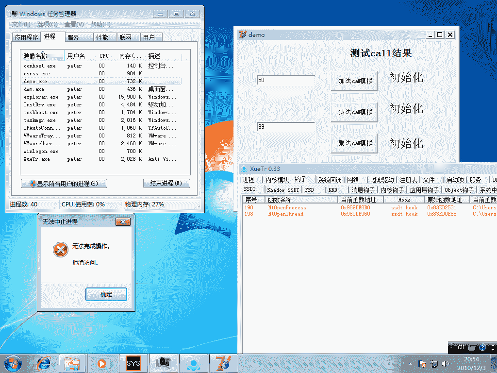

# (开源)一个简单的 ssdthook 进程名 保护进程 兼容 2000 以后所有 x86 系统

> 原文：[`www.pediy.com/kssd/pediy11/126077.html`](https://www.pediy.com/kssd/pediy11/126077.html)

大牛已经把这些 玩的烂熟了  
小小小菜鸟 把一个 修改了 无数次的代码发出来  
希望 大家多多 提出意见 代码是非常的挫（本代码 修改自一个 网络博客的代码只是修改函数和部分通讯 把 r3 r0 通讯 修改为 进程名 保护不需要通讯 直接加载驱动就可以了  
虽说不是原原创 但是也是花了很多心血 ）  

代码:

```

/\*
  Project Name:  Processes Guard
  Description:  Protection user  specified process(es)
  Date:      2010-5-5
  Version:    1.0
  Author:  Kernone     Alter:     君君寒
  Blog:      http://hi.baidu.com/kernone
  File Name:    ProcGuard.c
  Copyright(c)  Kernone Soft 2010
\*/
#include <Ntifs.h>


#pragma pack(1)
typedef struct \_SYSTEM\_SERVICES\_DESCRIPTOR\_TABLE
{
  PULONG      \*ServiceTableBase;
  PULONG      \*ServiceCounterTableBase;  //Used in check builds only
  unsigned int  NumberOfServices;
  PULONG      \*ParamTableBase;
}SSDT, \*PSSDT;
#pragma pack()

typedef struct \_DEVICE\_EXTENSION
{
  PDEVICE\_OBJECT  pDevObj;
  UNICODE\_STRING  uniSymLink;
  PMDL      pMdl;
  PULONG      pulSSDTMapped;
}DEVICE\_EXTENSION, \*PDEVICE\_EXTENSION;

typedef NTSTATUS (\_\_stdcall \*ZWOPENPROCESS)(
                       OUT PHANDLE ProcessHandle,
                       IN ACCESS\_MASK DesiredAccess,
                       IN POBJECT\_ATTRIBUTES ObjectAttributes,
                       IN PCLIENT\_ID PCLIENT\_ID OPTIONAL
);

typedef NTSTATUS  (\_\_stdcall \*ZWOPENTHREAD) (
                          OUT PHANDLE ProcessHandle,
                          IN ACCESS\_MASK DesiredAccess,
                          IN POBJECT\_ATTRIBUTES ObjectAttributes,
                          IN PCLIENT\_ID PCLIENT\_ID OPTIONAL

); 


NTSYSAPI
NTSTATUS
NTAPI 
ZwOpenProcess( OUT PHANDLE ProcessHandle,
         IN ACCESS\_MASK AccessMask,                                           
         IN POBJECT\_ATTRIBUTES ObjectAttributes,
               IN PCLIENT\_ID ClientId);

NTSYSAPI
NTSTATUS
NTAPI 
ZwOpenThread( OUT PHANDLE ProcessHandle,
              IN ACCESS\_MASK AccessMask,                                           
              IN POBJECT\_ATTRIBUTES ObjectAttributes,
              IN PCLIENT\_ID ClientId);


    
  
/\*Getting system service function address, the index of function locates 1 bytes offset\*/
#define  SYSTEM\_SERVICE(\_Func)  KeServiceDescriptorTable.ServiceTableBase\[\*(PULONG)((PUCHAR)\_Func + 1)\]
#define  SYSTEM\_INDEX(\_Func)    (\*(PULONG)((PUCHAR)\_Func + 1))
//#define  SYSTEM\_SERVICEONE(\_Func)  KeServiceDescriptorTable.ServiceTableBase\[\*(PULONG)((PUCHAR)\_Func + 1)\]
//#define  SYSTEM\_INDEXONE(\_Func)    (\*(PULONG)((PUCHAR)\_Func + 1))

#define  IOCTL\_START\_PROTECTION  CTL\_CODE(FILE\_DEVICE\_UNKNOWN, 0x800, METHOD\_BUFFERED, FILE\_ANY\_ACCESS)
#define  C\_MAXPROCNUMS      12

//Global variable
//\_\_declspec(dllimport) SSDT  KeServiceDescriptorTable;
\_\_declspec(dllimport) SSDT  KeServiceDescriptorTable;
ZWOPENPROCESS        ZwOpenProcessReal;
ZWOPENTHREAD          ZwOpenThreadReal;

ULONG  ulPIDs\[C\_MAXPROCNUMS\];

DRIVER\_UNLOAD  DriverUnload;
DRIVER\_DISPATCH  DispatchDevOpen, DispatchDevCtl;
NTSTATUS ZwOpenProcessHook(PHANDLE ProcessHandle, ACCESS\_MASK DesiredAccess, POBJECT\_ATTRIBUTES ObjectAttributes,PCLIENT\_ID ClientId);
NTSTATUS ZwOpenThreadHook(PHANDLE ProcessHandle, ACCESS\_MASK DesiredAccess, POBJECT\_ATTRIBUTES ObjectAttributes,PCLIENT\_ID ClientId);


NTSTATUS DriverEntry(PDRIVER\_OBJECT pDriverObj, PUNICODE\_STRING pRegistryPath)
{
  PDEVICE\_OBJECT    pDevObj;
  PDEVICE\_EXTENSION  pDevExt;
  UNICODE\_STRING    uniSymLink, uniDevName;
  NTSTATUS      ntStatus;
  PMDL        pMdl;
  PULONG        pulSSDTMapped;
  
  RtlInitUnicodeString(&uniSymLink, L"\\\\DosDevices\\\\ProcessesGuard");
  RtlInitUnicodeString(&uniDevName, L"\\\\Device\\\\ProcessesGuard");
  pDriverObj->DriverUnload = DriverUnload;
  pDriverObj->MajorFunction\[IRP\_MJ\_CREATE\] = 
  pDriverObj->MajorFunction\[IRP\_MJ\_CLOSE\] = DispatchDevOpen;
  pDriverObj->MajorFunction\[IRP\_MJ\_DEVICE\_CONTROL\] = DispatchDevCtl;
  
  ntStatus = IoCreateDevice(pDriverObj, sizeof (DEVICE\_EXTENSION), &uniDevName, FILE\_DEVICE\_UNKNOWN, 
    0, FALSE, &pDevObj);
  if (!NT\_SUCCESS(ntStatus))
    return(ntStatus);
    
  IoCreateSymbolicLink(&uniSymLink, &uniDevName);
  pDevObj->Flags |= DO\_BUFFERED\_IO;
  pDevExt = pDevObj->DeviceExtension;
  pDevExt->pDevObj = pDevObj;
  pDevExt->uniSymLink = uniSymLink;
  
  pMdl = IoAllocateMdl(KeServiceDescriptorTable.ServiceTableBase, KeServiceDescriptorTable.NumberOfServices \* 4,
    FALSE, FALSE, NULL);
  if (pMdl == NULL)
  {
    IoDeleteSymbolicLink(&uniSymLink);
    IoDeleteDevice(pDevObj);
    return(STATUS\_INSUFFICIENT\_RESOURCES);
  }
  
  MmBuildMdlForNonPagedPool(pMdl);
  pMdl->MdlFlags |= MDL\_MAPPED\_TO\_SYSTEM\_VA;  //Write SSDT
  
  pulSSDTMapped = (PULONG)MmMapLockedPagesSpecifyCache(pMdl, KernelMode, MmNonCached, NULL, FALSE, NormalPagePriority);
  if (pulSSDTMapped == NULL)
  {
    IoDeleteSymbolicLink(&uniSymLink);
    IoDeleteDevice(pDevObj);
    IoFreeMdl(pMdl);
    return(STATUS\_UNSUCCESSFUL);
  }
  
  pDevExt->pMdl = pMdl;
  pDevExt->pulSSDTMapped = pulSSDTMapped;
  
  ZwOpenProcessReal = (ZWOPENPROCESS)SYSTEM\_SERVICE(ZwOpenProcess);
  pulSSDTMapped\[SYSTEM\_INDEX(ZwOpenProcess)\] = (PULONG)ZwOpenProcessHook;

  ZwOpenThreadReal = (ZWOPENTHREAD)SYSTEM\_SERVICE(ZwOpenThread);
  pulSSDTMapped\[SYSTEM\_INDEX(ZwOpenThread)\] = (PULONG)ZwOpenThreadHook;

  
  return(ntStatus);
}

VOID DriverUnload(PDRIVER\_OBJECT pDriverObj)
{
  PDEVICE\_OBJECT    pDevObj = pDriverObj->DeviceObject;
  PDEVICE\_EXTENSION  pDevExt = pDevObj->DeviceExtension;
  PULONG        pulSSDTMapped = pDevExt->pulSSDTMapped;
  PMDL        pMdl = pDevExt->pMdl;
  
  pulSSDTMapped\[SYSTEM\_INDEX(ZwOpenProcess)\] = (PULONG)ZwOpenProcessReal;
  pulSSDTMapped\[SYSTEM\_INDEX(ZwOpenThread)\] = (PULONG)ZwOpenThreadReal;//先这个顺序
  MmUnmapLockedPages(pulSSDTMapped, pMdl);
  IoFreeMdl(pMdl);
  while (pDevObj)
  {
    pDevExt = pDevObj->DeviceExtension;
    pDevObj = pDevObj->NextDevice;
    
    IoDeleteSymbolicLink(&pDevExt->uniSymLink);
    IoDeleteDevice(pDevExt->pDevObj);
  }
}

NTSTATUS DispatchDevOpen(PDEVICE\_OBJECT pDevObj, PIRP pIrp)
{
  NTSTATUS  ntStatus = STATUS\_SUCCESS;
  
  pIrp->IoStatus.Status = ntStatus;
  pIrp->IoStatus.Information = 0;
  IoCompleteRequest(pIrp, IO\_NO\_INCREMENT);
  return(ntStatus);
}

NTSTATUS DispatchDevCtl(PDEVICE\_OBJECT pDevObj, PIRP pIrp)
{
  PIO\_STACK\_LOCATION  pIrpStack = IoGetCurrentIrpStackLocation(pIrp);
  ULONG        ulIoCode, ulBufLength, ulRtn, ulCounts = 0, ulIndex;
  PVOID        pvBuf;
  NTSTATUS      ntStatus;
  
  ulIoCode = pIrpStack->Parameters.DeviceIoControl.IoControlCode;
  switch (ulIoCode)
  {
  case IOCTL\_START\_PROTECTION:
    ulBufLength = pIrpStack->Parameters.DeviceIoControl.InputBufferLength;
    pvBuf = pIrp->AssociatedIrp.SystemBuffer;
    ulCounts = ulBufLength / sizeof (ULONG);
    KdPrint(("Protection Numbers: %d\\n"), ulCounts);
    for (ulIndex = 0; ulIndex < ulCounts && ulIndex < C\_MAXPROCNUMS; ulIndex++)
    {
      ulPIDs\[ulIndex\] = ((PULONG)pvBuf)\[ulIndex\];
      KdPrint(("Index %d -- PID %d\\n"), ulIndex, ulPIDs\[ulIndex\]);
    }
    ntStatus = STATUS\_SUCCESS;
    ulRtn = ulBufLength;
    break;
  default:
    ntStatus = STATUS\_INVALID\_PARAMETER;
    ulRtn = 0;
    break;
  }
  
  pIrp->IoStatus.Status = ntStatus;
  pIrp->IoStatus.Information = ulRtn;
  IoCompleteRequest(pIrp, IO\_NO\_INCREMENT);
  return(ntStatus);
}


CHAR \*TerminateName = "demo.exe";      //这里就是我们的进程名   
UCHAR \*PsGetProcessImageFileName( IN PEPROCESS Process );   
  
BOOLEAN IsProtect(CHAR \*temp)            //判断正在结束的进程是否是我们要保护的进程   
{   
    ULONG len = strcmp(TerminateName, temp);   
    if(!len)   
        return TRUE;   
    return FALSE;   
} 
NTSTATUS ZwOpenProcessHook(PHANDLE ProcessHandle,ACCESS\_MASK DesiredAccess,POBJECT\_ATTRIBUTES ObjectAttributes,PCLIENT\_ID ClientId)//我们自己的//NtZwOpenProcess   
{   
  PEPROCESS process;  //接受通过 ProcessHandle 返回的进程   
  NTSTATUS status;    
   CHAR \*pName;        //接受进程的进程名 
   HANDLE  hID;
   ULONG dwProcessId = NULL;
  PEPROCESS EProcessToOpen;
       

       status = PsLookupProcessByProcessId(
          ClientId->UniqueProcess,
          &process
           );
       
  if(!NT\_SUCCESS(status))    
     return(ZwOpenProcessReal(ProcessHandle,DesiredAccess,ObjectAttributes,ClientId)); 
  

     pName = (CHAR\*)PsGetProcessImageFileName(process); //获取进程名  
    

   if(IsProtect(pName)) //判断是否是我们要保护的进程，是则返回权限不足，否则调用原函数结束进程   
    {   
        if(process != PsGetCurrentProcess())   
        {   
            
      hID = PsGetProcessId(process);//获得进程 id
      KdPrint(("Protection Pid: %d\\n"), hID);
    return STATUS\_ACCESS\_DENIED;   
        }   
   }  
  
       
   return(ZwOpenProcessReal(ProcessHandle,DesiredAccess,ObjectAttributes,ClientId));    
} 


NTSTATUS ZwOpenThreadHook(PHANDLE ProcessHandle,ACCESS\_MASK DesiredAccess,POBJECT\_ATTRIBUTES ObjectAttributes,PCLIENT\_ID ClientId)//我们自己的 NtZwOpenProcess   
{   
    PEPROCESS process;  //接受通过 ProcessHandle 返回的进程   
    NTSTATUS status;    
    CHAR \*pName;        //接受进程的进程名 
    HANDLE  hID;
    ULONG dwProcessId = NULL;
  //PEPROCESS EProcessToOpen;
       

       status = PsLookupProcessByProcessId(
            ClientId->UniqueProcess,
            &process
            );
       
    if(!NT\_SUCCESS(status))    
        return(ZwOpenThreadReal(ProcessHandle,DesiredAccess,ObjectAttributes,ClientId)); 
  

     pName = (CHAR\*)PsGetProcessImageFileName(process); //获取进程名  
    

    if(IsProtect(pName)) //判断是否是我们要保护的进程，是则返回权限不足，否则调用原函数结束进程   
    {   
        if(process != PsGetCurrentProcess())   
        {   
            
      hID = PsGetProcessId(process);//获得进程 id
      KdPrint(("Protection Pid: %d\\n"), hID);
      return STATUS\_ACCESS\_DENIED;   
        }   
    }  
  
       
   return(ZwOpenThreadReal(ProcessHandle,DesiredAccess,ObjectAttributes,ClientId));    
} 

 

```

代码是完全可以编译的  （wdk  7600）  
具体的就是 ssdt hook  
希望大家保留 原原创的版权  
既然他给大家做了 贡献 就要尊重别人的成果  
还有希望下了代码的都留点 痕迹 呵呵  
  
  
  
win7 系统下稳定运行截图  
  
解压密码 kanxue                   发错代码跟附件 居然没人说我 羞死了。

  
  

上传的附件
|  || 123.rar  
 |