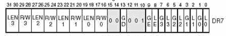
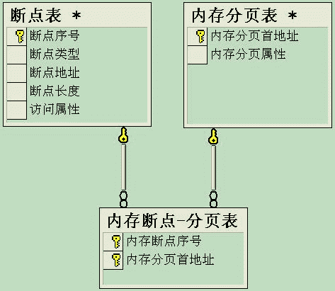

# 【更新完毕】调试器实现(1、11、19、29、34、45、50 楼更新)（50 楼已上传源码）

> 原文：[`www.pediy.com/kssd/pediy11/111876.html`](https://www.pediy.com/kssd/pediy11/111876.html)

目录：  
   
1 楼    第一章 调试器框架流程、用户输入处理及三种断点介绍  
11 楼   第二章 INT3 断点  
19 楼   第三章 硬件断点  
29 楼   第四章 多内存断点  
34 楼   第五章 单步异常的处理  
45 楼   第六章 功能扩展  
50 楼          调试器源码  
   
   
前言：  
作为一个软件逆向工程的研究者，必然会用到调试工具，如果能够掌握调试器工作的原理必然对软件调试会有更深入的了解。  
   
本文根据笔者自己实现一个完整的调试器的过程，结合 OD 在调试功能上的实现方法，详细讲述一个调试器其主要功能的实现步骤，及实现过程中需要注意的细节，力求在原理、方法上能让阅读者有所收获。由于本人能力有限，文中必然有错漏之处，恳请读者不吝赐教。  
   
第一章 调试器框架流程、用户输入处理及三种断点介绍  
windows 三环下的调试器是利用异常处理来实现的。其主要流程可简要概述如下：创建或附加一个调试进程，然后进入等待调试事件的循环，整个调试工作大部分都在处理异常调试事件中完成。除了进程创建时需要在入口点设断点（以便程序断在入口点）、进程结束时进行一些必要的释放资源的操作。  
创建调试进程和普通的创建进程一样都是使用 CreateProcess API。只是创建调试进程时需要设置 CreateProcess 的第 6 个参数 dwCreationFlags 为 DEBUG\_PROCESS，这些细节都可以在 MSDN 中查到。  
   
等待调试事件的循环可以直接在 MSDN 中找到 VC 的源码，在 MSDN 搜索 API：WaitForDebugEvent，然后看 Debugging Overview,中的 Using Debugging Support。即可找到 VC 代码如下：  
for(;;)   
{   
WaitForDebugEvent(&DebugEv, INFINITE);   
switch (DebugEv.dwDebugEventCode)   
{   
case EXCEPTION\_DEBUG\_EVENT:   
switch (DebugEv.u.Exception.ExceptionRecord.ExceptionCode)   
{   
case EXCEPTION\_ACCESS\_VIOLATION:   
case EXCEPTION\_BREAKPOINT:   
case EXCEPTION\_DATATYPE\_MISALIGNMENT:   
case EXCEPTION\_SINGLE\_STEP:   
case DBG\_CONTROL\_C:   
}   
case CREATE\_THREAD\_DEBUG\_EVENT:   
case CREATE\_PROCESS\_DEBUG\_EVENT:   
case EXIT\_THREAD\_DEBUG\_EVENT:   
case EXIT\_PROCESS\_DEBUG\_EVENT:   
case LOAD\_DLL\_DEBUG\_EVENT:   
case UNLOAD\_DLL\_DEBUG\_EVENT:   
case OUTPUT\_DEBUG\_STRING\_EVENT:   
}   
ContinueDebugEvent(DebugEv.dwProcessId,   
DebugEv.dwThreadId, dwContinueStatus);   
}  
   
为节省篇幅，我将代码中的注释已经删除，详细的注释说明请参阅 MSDN。  
   
通过这个循环我们可以看到 WaitForDebugEvent 这个 API 可以获得的调试事件类型包括了“异常事件”，“创建线程事件”，“创建进程事件”，“退出线程事件”，“退出进程事件”，“加载 DLL 事件”，“卸载 DLL 事件”，“调试输出字符串事件”。  
在创建调试进程成功之后，会捕获“创建进程事件”，在创建进程事件中我们可以获得程序的入口地址(OEP)，我们可以在 OEP 处设置一个一次性的软件断点（INT3），使得我们的被调试程序有机会断在 OEP 处等待用户输入。  
   
用户的输入包括查看反汇编代码，查看数据，查看寄存器内容，下各种断点，单步步入，单步步过，运行（到某地址）等各种命令。断点一般包括软件断点（INT3 断点），硬件断点和内存断点。  
   
用户输入的命令可分为两种类型：  
1. 控制程序流程的命令。如单步步入(T)、步过(P)，运行(G)等；  
2. 断点相关操作，如设置(bp)、查看(bl)、取消(bc)各种断点；查看反汇编代码(U)、数据(D)、寄存器(R)等。  
可以设计一个等待用户输入的函数，当用户输入的是 T、P、G 时，函数返回值为 TRUE，表示程序需要往下运行（单步或运行）。为其他输入时，函数返回值为 FALSE，表示其他的操作或错误操作。  
   
三种断点分别对应的异常类型及处理：  
   
1. 软件断点（INT3）：对应的异常是 EXCEPTION\_BREAKPOINT，处理方式为恢复代码为原来字节，并将 EIP 减一，并设置单步以便进入单步后重新设置这个一般断点。  
   
2. 硬件断点：对应的异常是 EXCEPTION\_SINGLE\_STEP，处理方式要看是否为硬件执行断点，如果是硬件执行断点，则先取消断点，设置单步，进入单步后重新设置这个硬件执行断点。  
   
3.内存断点：将要设置内存断点的分页属性设置为 PAGE\_NOACCESS，则会产生 EXCEPTION\_ACCESS\_VIOLATION 异常。进入异常后先取消断点，设置单步，进入单步后再重新设置这个内存断点。  
   
第一章先介绍到这里，下一章将介绍软件断点（INT3 断点）。查看反汇编代码，查看数据和查看寄存器值比较简单我就不多说了，如果想要了解也可以从我以后发的源码中阅读到。  
   
   
本系列文章参考书目、资料如下：  
1．《加密与解密 3》 编著：段钢  
2．《调试寄存器（DRx）理论与实践》 作者：Hume/冷雨飘心  
3．《数据结构》 作者：严蔚敏  
   
附件为《调试器使用手册》和 调试器可执行文件。

上传的附件
|  || 调试器使用手册.rar  
 |
|  || SunDbg.rar  
 |

一个调试器的实现  
第二章 INT3 断点  
     INT3 断点，简单地说就是将你要断下的指令地址处的第一个字节设置为 0xCC，软件执行到 0xCC（对应汇编指令 INT3）时，会触发异常代码为 EXCEPTION\_BREAKPOINT 的异常。这样我们的调试程序就能够接收到这个异常，然后进行相应的处理。  
  
INT3 断点的管理：  
  
在我的程序中，INT3 断点的信息结构体如下：  
struct stuPointInfo  
{  
PointType ptType; //断点类型  
int nPtNum; //断点序号  
LPVOID lpPointAddr; //断点地址  
BOOL isOnlyOne; //是否一次性断点（针对 INT3 断点）  
char chOldByte; //原先的字节（针对 INT3 断点）  
};  
而每一个 INT3 断点信息结构体指针又保存到一个链表中。  
  
INT3 断点的设置：  
  
     设置 INT3 断点比较简单，只需要根据用户输入的断点地址和断点类型（是否一次性断点），将被调试进程中对应地址处的字节替换为 0xCC，同时将原来的字节保存到 INT3 断点信息结构体中，并将该结构体的指针加入到断点链表中。  
  
     一款好的软件，无论大小，必然在程序的逻辑上要求严谨无误。调试器的设计也不例外，如果在被调试的某地址处已经存在一个同样的断点了，那么用户还要往这个地址上设置相同的断点，则必然会因为重复设置断点导致错误。例如这里的 INT3 断点，如果不对用户输入的地址进行是否重复的检查，而让用户在同一个地址先后下了两次 INT3 断点，则后一次 INT3 断点会误以为这里本来的字节就是 0xCC。所以在设置 INT3 断点之前应该先看该地址是否已经下过 INT3 断点，如果该地址已经存在一个 INT3 断点，且是非一次性的，则不能再在此地址下 INT3 断点，如果该地址有一个 INT3 一次性断点，而用户要继续下一个 INT3 非一次性断点，则将原来存在的 INT3 断点的属性从一次性改为非一次性断点。  
  
以下是设置 INT3 断点的一些关键代码：  
//在断点列表中查找是否已经存在此处的一般断点  
stuPointInfo tempPointInfo;  
stuPointInfo\* pResultPointInfo = NULL;  
memset(&tempPointInfo, 0, sizeof(stuPointInfo));  
tempPointInfo.lpPointAddr = lpAddr;  
tempPointInfo.ptType = ORD\_POINT;  
//判断所下的 INT3 断点是否是一次性断点  
if (stricmp(pCmd->chParam2, "once") == 0)  
{  
tempPointInfo.isOnlyOne = TRUE;  
}   
else  
{  
tempPointInfo.isOnlyOne = FALSE;  
}  
//如果查找到在要设置 INT3 断点的地址处已经存在 INT3 断点  
if (FindPointInList(tempPointInfo, &pResultPointInfo, FALSE))  
{  
if (tempPointInfo.isOnlyOne == FALSE)//要设置的是非一次性断点  
{  
if (pResultPointInfo->isOnlyOne == FALSE)//查找到的是非一次性断点  
{  
printf("This Ordinary BreakPoint is already exist!\\r\\n");  
}   
else//查找到的是一次性断点  
{  
//将查找到的断点属性改为非一次性断点  
pResultPointInfo->isOnlyOne = FALSE;  
}  
}  
return FALSE;  
}   
  
//要设置 INT3 断点的位置不存在 INT3 断点（也就是说，该地址可以设置 INT3 断点）  
char chOld;  
char chCC = 0xcc;  
DWORD dwOldProtect;  
//先读出原先的字节  
bRet = ReadProcessMemory(m\_hProcess, lpAddr, &chOld, 1, NULL);  
if (bRet == FALSE)  
{  
printf("ReadProcessMemory error! may be is not a valid memory address!\\r\\n");  
return FALSE;  
}  
//将要设置 INT3 断点的地址处的字节改为 0xCC  
bRet = WriteProcessMemory(m\_hProcess, lpAddr, &chCC, 1, NULL);  
if (bRet == FALSE)  
{  
printf("WriteProcessMemory error!\\r\\n");  
return FALSE;  
}  
//将该 INT3 断点信息结构体添加到断点链表中  
stuPointInfo\* NewPointInfo = new stuPointInfo;  
memset(NewPointInfo, 0, sizeof(stuPointInfo));  
NewPointInfo->nPtNum = m\_nOrdPtFlag;  
m\_nOrdPtFlag++;  
NewPointInfo->ptType = ORD\_POINT;  
NewPointInfo->lpPointAddr = lpAddr;  
NewPointInfo->u.chOldByte = chOld;  
NewPointInfo->isOnlyOne = tempPointInfo.isOnlyOne;  
g\_ptList.push\_back(NewPointInfo);  
  
INT3 断点被断下的处理：  
     INT3 断点被断下后，首先从断点链表中找到对应的断点信息结构体。如果没有找到，则说明该 INT3 断点不是用户下的断点，调试器不做处理，交给系统去处理（其他类型的断点触发异常也需要做同样的处理）。如果找到对应的断点，根据断点信息将断下地址处的字节还原为原来的字节，并将被调试进程的 EIP 减一，因为 INT3 异常被断下后，被调试进程的 EIP 已经指向了 INT3 指令后的下一条指令，所以为了让被调试进程执行本来需要执行的指令，应该让其 EIP 减 1。  
  
如以下代码：  
地址 机器码 汇编代码  
01001959 55 push ebp  
0100195A 33ED xor ebp,ebp  
0100195C 3BCD cmp ecx,ebp  
0100195E 896C24 04 mov dword ptr ss:\[esp+4\],ebp  
  
当用户在 0100195A 地址处设置 INT3 断点后，0100195A 处的字节将改变为 0xCC（原先是 0x33）。  
  
此时对应的代码如下：  
地址 机器码 汇编代码  
01001959 55 push ebp  
0100195A CC int3  
0100195B ED in eax,dx  
0100195C 3BCD cmp ecx,ebp  
0100195E 896C24 04 mov dword ptr ss:\[esp+4\],ebp  
  
     当被调试程序执行到 0100195A 地址处，触发异常，进入异常处理程序后，获取被调试线程的环境（GetThreadContext），可看出此时 EIP 指向了 0100195B，也就是 INT3 指令之后，所以我们除了要恢复 0xCC 为原来的字节之外，还要将被调试线程的 EIP 减一，让 EIP 指向 0100195A。否则 CPU 就会执行 0100195B 处的指令（0100195B ED in eax,dx），显然这是错误的。  
  
     如果查找到的断点信息显示该 INT3 断点是一个非一次性断点，那么需要设置单步，然后在进入单步后将这一个断点重新设置上（硬件执行断点和内存断点如果是非一次性的也需要做相同的处理）。因为 INT3 断点同时只会断下一个，所以可以用一个临时变量保存要重新设置的 INT3 断点的地址，然后用一个 BOOL 变量表示当前是否有需要重新设置的 INT3 断点。  
  
关于 INT3 断点的一些细节：  
  
1． 创建调试进程后，为了能够让被调试程序断在 OEP（程序入口点），我们可以在被调试程序的 OEP 处下一个一次性 INT3 断点。  
  
2． 在创建调试进程的过程中（程序还没有执行到 OEP 处），会触发一个 ntdll.dll 中的 INT3，遇到这个断点直接跳出不处理。这个断点在使用微软自己的调试工具 WinDbg 时会被断下，可以猜测，微软设置这个断点是为了能够在程序到达 OEP 之前就被断下，方便用户做一些处理（如设置各种断点）。  
  
3． 因为 INT3 断点修改了被调试程序的代码内容，所以在进行反汇编和显示被调试进程内存数据的时候，需要检查碰到的 0xCC 字节是否是用户所下的 INT3 断点，如果是需要替换为原来的字节，再做相应的反汇编和显示数据工作。这一点 olldbg 做的很不错，而有一些国产的调试器好像没有注意到这些小的细节。  
  
本系列文章参考书目、资料如下：  
1．《加密与解密 3》 编著：段钢  
2．《调试寄存器（DRx）理论与实践》 作者：Hume/冷雨飘心  
3．《数据结构》 作者：严蔚敏 

第三章 硬件断点  
一 硬件断点介绍  
  
     硬件断点，顾名思义是由硬件提供给我们的调试寄存器组，我们可以对这些硬件寄存器设置相应的值，然后让硬件帮我们断在需要下断点的地址。  
  
     硬件断点是 CPU 提供的功能，所以要怎么做就得听 CPU 的硬件寄存器的了。先来看看关于硬件寄存器的说明。Intel 80386 以上的 CPU 提供了调试寄存器以用于软件调试。386 和 486 拥有 6 个（另外两个保留）调试寄存器：Dr0，Dr1，Dr2，Dr3，Dr6 和 Dr7。这些寄存器均是 32 位的，如下图所示（该图来源于看雪文章《调试寄存器（DRx）理论与实践》（http://www.pediy.com/bbshtml/BBS6/pediy6751.htm），在此对文章作者 Hume/冷雨飘心表示感谢）：  
  
|－－－－－－－－－－－－－－－|－－－－－－－－－－－－－－－－|  
Dr0| 用于一般断点的线性地址   
|－－－－－－－－－－－－－－－|－－－－－－－－－－－－－－－－|  
Dr1| 用于一般断点的线性地址   
|－－－－－－－－－－－－－－－|－－－－－－－－－－－－－－－－|  
Dr2| 用于一般断点的线性地址   
|－－－－－－－－－－－－－－－|－－－－－－－－－－－－－－－－|  
Dr3| 用于一般断点的线性地址   
|－－－－－－－－－－－－－－－|－－－－－－－－－－－－－－－－|  
Dr4| 保留   
|－－－－－－－－－－－－－－－|－－－－－－－－－－－－－－－－|  
Dr5| 保留   
|－－－－－－－－－－－－－－－|－－－－－－－－－－－－－－－－|  
Dr6| |BBB BBB B |  
| |TSD 3 2 1 0 |  
|－－－－－－－－－－－－－－－|－－－－－－－－－－－－－－－－|  
Dr7|RWE LEN ... RWE LEN | G GLGLGLGLGL |  
| 3 3 ... 0 0 | D E E 3 3 2 21 100 |  
|－－－－－－－－－－－－－－－|－－－－－－－－－－－－－－－－|  
31 15 0  
  
     Dr0~3 用于设置硬件断点，由于只有 4 个断点寄存器，所以最多只能设置 4 个硬件调试断点,产生的异常是 STATUS\_SINGLE\_STEP（单步异常） 。Dr7 是一些控制位，用于控制断点的方式，Dr6 用于显示是哪个硬件调试寄存器引起的断点，如果是 Dr0～3 或单步（EFLAGS 的 TF）的话，则相对应的位会置一。   
即如果是 Dr0 引起的断点，则 Dr6 的第 0 位被置 1，如果是 Dr1 引起的断点，则 Dr6 的第 1 位被置 1，依此类推。因为硬件断点同时只会触发一个，所以 Dr6 的低 4 位最多只有一个位被置 1，所以在进入单步后，我们可以通过检测 Dr6 的低 4 位是否有值为 1 的位，来判断当前进入单步的原因是否是因为硬件断点被断下。如果是因为硬件断点被断下，也可以通过判断 Dr6 的低 4 位中哪一位是 1，来进一步判断是被 Dr0 到 dr3 中的哪一个断点所断下。  
  
调试控制寄存器 Dr7 比较重要，其 32 位结构如下：  
  
1. 位 0 L0 和位 1 G0：用于控制 Dr0 是全局断点还是局部断点，如果 G0 置位则是全局断点，L0 置位则是局部断点。G1L1～G3L3 用于控制 D1～Dr3，其功能同上。  
  
2. LE 和 GE：P6 family 和之后的 IA32 处理器都不支持这两位。当设置时，使得处理器会检测触发数据断点的精确的指令。当其中一个被设置的时候，处理器会放慢执行速度，这样当命令执行的时候可以通知这些数据断点。建议在设置数据断点时需要设置其中一个。切换任务时 LE 会被清除而 GE 不会被清除。为了兼容性，Intel 建议使用精确断点时把 LE 和 GE 都设置为 1。   
  
3. LEN0 到 LEN3：指定调试地址寄存器 DR0 到 DR3 对应断点所下断的长度。如果 R/Wx 位为 0（表示执行断点），则 LENx 位也必须为 0（表示 1 字节），否则会产生不确定的行为。LEN0 到 LEN3 其可能的取值如下：  
（1）00 1 字节  
（2）01 2 字节  
（3）10 保留  
（4）11 4 字节  
  
4. R/W0 到 R/W3：指定各个断点的触发条件。它们对应于 DR0 到 DR3 中的地址以及 DR6 中的 4 个断点条件标志。可能的取值如下：  
（1） 00 只执行  
（2） 01 写入数据断点  
（3） 10 I/O 端口断点（只用于 pentium+，需设置 CR4 的 DE 位，DE 是 CR4 的第 3 位 ）  
（4） 11 读或写数据断点  
  
5. GD 位：用于保护 DRx，如果 GD 位为 1，则对 Drx 的任何访问都会导致进入 1 号调试陷阱(int 1)。即 IDT 的对应入口，这样可以保证调试器在必要的时候完全控制 Drx。   
  
二 设置硬件断点  
  
     通过上面的介绍，我们知道设置一个硬件断点一般只需要以下几个步骤。  
（1） 在 Dr0 到 Dr3 中找一个可用的寄存器，将其值填写为要断下的地址。  
（2） 设置 Dr7 对应的 GX 或 LX 位为 1。（例如断点设置在 Dr0 上则设置 Dr7 的 G0 或 L0 位为 1）。  
（3） 设置 Dr7 对应的断点类型位（R/W0 到 R/W3 其中之一）为执行、写入或访问类型。  
（4） 设置 Dr7 对应的断点长度位（LEN0 到 LEN3 其中之一）为 1、2 或 4 字节。  
  
  
三 处理硬件断点  
  
     在硬件断点的介绍中已经说过，硬件断点被断下后将触发单步异常，因此在进入单步异常后，我们检测 Dr6 的低 4 位是否有值为 1 的位，就可以判断是否是因为硬件断点被断下，以及进一步判断是被 Dr0 到 Dr3 中的哪一个断点所断下。  
硬件断点有三种类型，硬件执行断点、硬件访问断点和硬件写入断点。硬件断点被断下后，所断下的位置（也就是程序的 EIP 值）会因为断点的类型不同而有差异。对于硬件执行断点，会断在所下断点地址指令处，也就是 EIP 的值和断点设置的值一样，下断点的指令还没有被执行。而对于硬件访问、写入断点，会断在所下断点地址指令的下一条指令处，也就是 EIP 的值已经是断点指令后的下一条指令的地址了，下断点地址处的指令已经被执行了。  
  
     究其原因是因为硬件执行断点只需要查看 EIP 的值就可以判断是否命中硬件执行断点了，所以在指令执行前就可以断下，而硬件访问、写入断点是需要在 CPU 拿到完整指令代码并译码完毕之后才能判断是否命中了硬件访问、写入断点的。此时 EIP 已经指向了下一条指令，又因为 intel 的 cpu 指令是变长指令集，所以不易倒推实际触发硬件访问、写入断点的指令地址，所以 intel 对硬件访问、写入断点的处理是停在触发异常指令后的下一条指令处（这一段是我本人的理解，如有不对之处，请读者多多指教）。  
由于不同类型的硬件断点触发异常的情况不同，所以要区别对待。对于硬件执行断点，触发异常断点被断下后，要先暂时取消硬件执行断点，然后设置单步，到下一次的单步中进行硬件断点的恢复工作。对于硬件访问、写入断点则不需要做多余的处理，断下后显示一下断点信息，并等待用户操作就可以了。  
  
     因为硬件断点的设计比较死板，照着 intel 手册的说明一步步来就可以了。对 Dr7 的操作也就是一些位操作。我的代码里面是一个大大的 SWITCH 里面套了 4 个小 SWITCH 来做的，显得拖堂冗长、很不好看，所以就不放上来了。  
  
硬件断点设计需要注意的几点如下：  
  
1. 设置硬件断点的时候也要检查是否重复设置了。  
  
2. 硬件执行断点被断下后，此时需要暂时取消掉该硬件执行断点（否则程序一直被断在这里，跑不下去）。并设置单步，在下一次单步中重设该硬件执行断点。  
  
3. 如果硬件执行断点被断下之后，此时用户执行了取消该断点的操作，则不需要在下一次的单步中恢复该断点的设置了（这一点同样适用于 INT3 断点和内存断点）。  
  
  
本系列文章参考书目、资料如下：  
1．《加密与解密 3》 编著：段钢  
2．《调试寄存器（DRx）理论与实践》 作者：Hume/冷雨飘心  
3．《数据结构》 作者：严蔚敏

上传的附件
|  || 1.JPG  
 |

第四章 多内存断点  
    内存断点通过修改内存分页的属性，使被调试程序触发内存访问、写入异常而断下。  
  
多内存断点的数据关系：  
  
    因为我设计的是多内存断点，即在同一个内存分页上可以下多个内存断点，同一个断点也可以跨分页下在几个内存分页上。所以从数据关系上来说断点和内存分页是多对多的关系。因此需要设计三个表：“内存断点信息表”，“内存分页属性表”，以及中间表“内存断点\-分页对照表”。在用户下内存断点的时候，首先将断点所跨越的内存分页属性加入到“内存分页属性表”中。然后在中间表“内存断点\-分页对照表”中添加内存断点对应的分页信息，一个内存断点对应了几个分页就会添加几条信息。内存断点的信息保存在“断点信息表”中。  
三个表的属性字段如下：  
  
  
  
内存断点的设置：  
  
    内存断点的信息中需要用户输入确定的有：下断点首地址、断点的长度和断点的类型（访问还是写入）。根据用户输入的信息可以组成一个临时的内存断点结构体，然后到内存断点链表中查找是否已经存在同属性的内存断点，如果已经存在则不需要再设置，否则可以设置这个内存断点。  
  
    设置内存断点，首先根据断点的首地址和长度可以确定断点所跨越的内存分页，用 VirtualQueryEx API 获取内存分页的属性，然后将内存分页的属性信息添加到“内存分页表”中（需要注意的是，如果“内存分页表”中已经存在同一内存分页的属性记录了，则不需要再添加重复的记录），同时将断点对应分页的信息添加到“内存断点\-分页对照表”中，并设置断点所跨过的每一个内存分页的属性为不可访问（PAGE\_NOACCESS）。  
  
    这一点和 OllyDbg 的做法不大一样，OllyDbg 设置内存访问断点是将断点所跨分页设置为 PAGE\_NOACCESS 属性，而设置内存写入断点是将断点所跨分页属性设置为 PAGE\_EXECUTE\_READ，而我的做法是不管哪种断点都将断点所跨内存页的属性设置为 PAGE\_NOACCESS，这样做的问题是会产生多余的异常，好处是设置断点，恢复断点时省去类型的判断。而且出于另外一个考虑，OllyDbg 是只能设置一个内存断点的，所以它这样设置合情合理，而我设计的是多内存长度任意的断点。假设出现了用户先在某个分页上下了一个内存写入断点，之后用户又在同一个分页上下了内存访问断点，那么如果按照 OllyDbg 的方式，先将内存页的属性设置为 PAGE\_EXECUTE\_READ，然后处理后一个内存断点时，将内存页的属性设置为 PAGE\_NOACCESS。而如果相反，出现了用户先在某个分页上下了一个内存访问断点，之后用户又在同一个分页上下了内存写入断点，内存页的属性首先被改为 PAGE\_NOACCESS，但不能根据第二个断点将内存页的属性改为 PAGE\_EXECUTE\_READ，否则前一个内存访问断点就失效了。与其因设置不同的属性产生这么多种麻烦的情况，不如牺牲一点效率（多了一些异常的情况），对内存访问和写入断点都将断点所跨过的分页属性设置为 PAGE\_NOACCESS，再通过断点被断下后，异常记录结构体 EXCEPTION\_RECORD 中的访问标志和断点信息中的类型标志来判断是否命中了用户所下的内存断点。  
  
    处理完内存页的属性，将内存页原先属性信息、断点\-分页对照信息加入对应链表之后，最后需要将断点信息添加到断点链表中。  
  
关键代码如下：  
  
代码:

```
//根据用户输入创建一个临时内存断点

```

代码:

```
 stuPointInfo tempPointInfo;
 stuPointInfo\* pResultPointInfo = NULL;
 memset(&tempPointInfo, 0, sizeof(stuPointInfo));
 tempPointInfo.lpPointAddr = lpAddr;
 tempPointInfo.ptType = MEM\_POINT;
 tempPointInfo.isOnlyOne = FALSE;
 
 if (stricmp("access", pCmd->chParam2) == 0)
 {
     tempPointInfo.ptAccess = ACCESS;
 } 
 else if (stricmp("write", pCmd->chParam2) == 0)
 {
     tempPointInfo.ptAccess = WRITE;
 }
 else
 {
     printf("Void access!\\r\\n");
     return FALSE;
 }
 
 int nLen = (int)HexStringToHex(pCmd->chParam3, TRUE);
 
 if (nLen == 0 )
 {
     printf("Point length can not set Zero!\\r\\n");
     return FALSE;
 }
 
 tempPointInfo.dwPointLen = nLen;
 tempPointInfo.nPtNum = m\_nOrdPtFlag;
 m\_nOrdPtFlag++;
 
 //查找该内存断点在断点链表中是否已经存在
 if (FindPointInList(tempPointInfo, &pResultPointInfo, FALSE))
 {
     if (pResultPointInfo->dwPointLen >= nLen)//存在同样类型且长度大于要设置断点的断点
     {
         printf("The Memory breakpoint is already exist!\\r\\n");
         return FALSE;
     } 
     else//查找到的断点长度小于要设置的断点长度，则删除掉找到的断点，重新设置
         //此时只需要删除断点\-分页表项 和 断点表项
     {
         DeletePointInList(pResultPointInfo->nPtNum, FALSE);
     }
 }
 
 // 根据 tempPointInfo 设置内存断点
 // 添加断点链表项，添加内存断点\-分页表中记录，添加分页信息表记录
 // 首先根据 tempPointInfo 中的地址和长度获得所跨越的全部分页
 
 LPVOID lpAddress = (LPVOID)((int)tempPointInfo.lpPointAddr & 0xfffff000);
 DWORD OutAddr = (DWORD)tempPointInfo.lpPointAddr + 
         tempPointInfo.dwPointLen;
 
 MEMORY\_BASIC\_INFORMATION mbi = {0};
 
 while ( TRUE )
 {
     if ( sizeof(mbi) != VirtualQueryEx(m\_hProcess, lpAddress, &mbi, sizeof(mbi)) )
     {
         break;
     }
 
     if ((DWORD)mbi.BaseAddress >= OutAddr)
     {
         break;            
     }
 
     if ( mbi.State == MEM\_COMMIT )
     {
         //将内存分页信息添加到分页表中
         AddRecordInPageList(mbi.BaseAddress, 
                             mbi.RegionSize, 
                             mbi.AllocationProtect);
         //将断点\-分页信息添加到断点\-分页表中
         DWORD dwPageAddr = (DWORD)mbi.BaseAddress;
         while (dwPageAddr < OutAddr)
         {
             stuPointPage \*pPointPage = new stuPointPage;
             pPointPage->dwPageAddr = dwPageAddr;
             pPointPage->nPtNum = tempPointInfo.nPtNum;
             g\_PointPageList.push\_back(pPointPage);
             //设置该内存页为不可访问
             DWORD dwTempProtect;
             VirtualProtectEx(m\_hProcess, (LPVOID)dwPageAddr,
                 1, PAGE\_NOACCESS, &dwTempProtect);
 
             dwPageAddr += 0x1000;
         }
 
     }
     lpAddress = (LPVOID)((DWORD)mbi.BaseAddress + mbi.RegionSize);
     if ((DWORD)lpAddress >= OutAddr)
     {
         break;
     }
 }
 
 //断点添加到断点信息表中
 stuPointInfo \*pPoint = new stuPointInfo;
 memcpy(pPoint, &tempPointInfo, sizeof(stuPointInfo));
 g\_ptList.push\_back(pPoint);
printf("\*\*\*Set Memory breakpoint success!\*\*\*\\r\\n");
 

```

内存断点精确命中的判断思路：  
  
    根据产生访问异常时，异常的类型是访问还是写入，以及异常访问的地址这两个信息到“断点\-分页对照表”中去查找。如果没有找到，则说明此异常不是用户调试所下的内存断点，调试器不予处理。  
  
    如果找到，再根据断点序号，到“断点信息表”中查看断点的详细信息。看断点是否准确命中（下断的内存区域，断点的类型：如果是读异常则只命中访问类型断点；如果是写异常，则访问类型、写入类型断点都算命中）。  
  
    如果遍历完“断点\-分页对照表”，异常访问地址只是在“断点\-分页对照表”中找到，但没有精确命中内存断点，则暂时恢复内存页的原属性，并设置单步，进入单步后再恢复该内存页为不可访问。  
  
    如果在“断点\-分页表”中找到，且精确命中某个断点，则先暂时恢复页属性，设置单步，并等待用户输入。程序运行进入单步后，再设置内存页属性为不可访问。  
  
内存断点的处理：  
  
    当被调试程序触发访问异常时，异常事件被调试器接收到，分析此时的异常结构体如下：  
  
struct \_EXCEPTION\_RECORD {   
DWORD ExceptionCode;   
DWORD ExceptionFlags;   
struct \_EXCEPTION\_RECORD \*ExceptionRecord;   
PVOID ExceptionAddress;   
DWORD NumberParameters;   
ULONG\_PTR ExceptionInformation\[EXCEPTION\_MAXIMUM\_PARAMETERS\]; }  
  
    我们考察其中最后一个成员 ExceptionInformation 数组的数据，MSDN 上的说明如下：  
The first element of the array contains a read-write flag that indicates the type of operation that caused the access violation. If this value is zero, the thread attempted to read the inaccessible data. If this value is 1, the thread attempted to write to an inaccessible address.   
The second array element specifies the virtual address of the inaccessible data.  
  
    即：数组的第一个元素 ExceptionInformation\[0\]包含了表示引发访问违规操作类型的读写标志。如果该标志为 0，表示线程试图读一个不可访问地址处的数据；如果该标志是 1，表示线程试图写数据到一个不可访问的地址。数组的第二个元素 ExceptionInformation\[1\]指定了不可访问的地址。  
  
    根据这两个信息，我们就可以利用上面提到的内存断点精确命中的判断思路，来判断是否命中用户所下的内存断点，以及做出对应的处理。  
  
整个模块如下：  
代码:

```
//处理访问异常部分

```

代码:

```
BOOL CDoException::DoAccessException()
{
BOOL bRet;
DWORD dwAccessAddr; //读写地址
DWORD dwAccessFlag; //读写标志
BOOL isExceptionFromMemPoint = FALSE; //异常是否由内存断点设置引起，默认为否
stuPointInfo\* pPointInfo = NULL; //命中的断点
BOOL isHitMemPoint = FALSE; //是否精确命中断点
 
dwAccessFlag = m\_DbgInfo.ExceptionRecord.ExceptionInformation\[0\];
dwAccessAddr = m\_DbgInfo.ExceptionRecord.ExceptionInformation\[1\];
//根据 访问地址 到“断点\-分页表”中去查找
//同一个内存分页可能有多个断点
//如果没有在“断点\-分页表”中查找到，则说明这个异常不是断点引起的
list<stuPointPage\*>::iterator it = g\_PointPageList.begin();
int nSize = g\_PointPageList.size();
 
//遍历链表中每个节点，将每个匹配的“断点\-分页记录”都添加到 g\_ResetMemBp 链表（需要重设的断点的内存分页信息链表）中
for ( int i = 0; i < nSize; i++ )
{
stuPointPage\* pPointPage = \*it;
//如果在“断点\-分页表”中查找到
//再根据断点表中信息判断是否符合用户所下断点信息
if (pPointPage->dwPageAddr == (dwAccessAddr & 0xfffff000))
{
stuResetMemBp \*p = new stuResetMemBp;
p->dwAddr = pPointPage->dwPageAddr;
p->nID = pPointPage->nPtNum; 
g\_ResetMemBp.push\_back(p);
 
//暂时恢复内存页原来的属性
BOOL bDoOnce = FALSE;
if (!bDoOnce)
{
//这些操作只需要执行一次
bDoOnce = TRUE;
isExceptionFromMemPoint = TRUE;
//暂时恢复内存页原来属性的函数
TempResumePageProp(pPointPage->dwPageAddr);
//设置单步，在单步中将断点设回
UpdateContextFromThread();
m\_Context.EFlags |= TF;
UpdateContextToThread();
}
 
//先找到断点序号对应的断点
list<stuPointInfo\*>::iterator it2 = g\_ptList.begin();
for ( int j = 0; j < g\_ptList.size(); j++ )
{
pPointInfo = \*it2;
if (pPointInfo->nPtNum == pPointPage->nPtNum)
{
break;
}
it2++;
}
 
//再判断是否符合用户所下断点信息（断点类型和断点范围是否均相符）
if (isHitMemPoint == FALSE)
{
if (dwAccessAddr >= (DWORD)pPointInfo->lpPointAddr && 
dwAccessAddr < (DWORD)pPointInfo->lpPointAddr +
pPointInfo->dwPointLen)
{
if ( pPointInfo->ptAccess == ACCESS || 
(pPointInfo->ptAccess == WRITE && dwAccessFlag == 1) )
{
isHitMemPoint = TRUE;
}
}
}
}
it++;
}
 
//如果异常不是由内存断点设置引起，则调试器不处理
if (isExceptionFromMemPoint == FALSE)
{
return FALSE;
}
 
//如果命中内存断点，则暂停，显示相关信息并等待用户输入
if (isHitMemPoint)
{
ShowBreakPointInfo(pPointInfo);
//显示反汇编代码
m\_lpDisAsmAddr = m\_DbgInfo.ExceptionRecord.ExceptionAddress;
ShowAsmCode();
//显示寄存器值
ShowRegValue(NULL);
 
//等待用户输入
bRet = FALSE;
while (bRet == FALSE)
{
bRet = WaitForUserInput();
}
}
return TRUE;
}

```

  
内存断点需要注意的细节：  
  
1. 由于内存断点将页面属性改为不可访问了，所有很多命令（如反汇编、查看数据）都需要进行修改。  
  
2. 内存断点可能出现多个内存断点下在同一个分页的情况。所以在删除一个内存断点时，如果该断点对应的某个（或某几个）分页也有其他的断点，则不能将该内存分页设置回原属性。  
  
本系列文章参考书目、资料如下：  
  
1．《加密与解密 3》 编著：段钢  
2．《调试寄存器（DRx）理论与实践》 作者：Hume/冷雨飘心  
3．《数据结构》 作者：严蔚敏 

第五章 单步异常的处理  
    因为在调试器的设计与实现中，很多关键性的操作都是在单步异常处理中完成的，故本章重点论述在单步异常中的处理。首先我们来看看会有哪些情况导致调试器进入单步异常。  
  
进入单步异常的原因：  
  
  
1. 用户输入了单步进入的命令，调试器需要设置单步，让被调试程序单步执行。  
  
2. 用户所下的 INT3 断点被断下后，调试器会暂时恢复 INT3 断点处的字节为原有的字节，并让被调试线程的 EIP 减一，为了重新设置这个 INT3 断点，调试器自己设置了单步。  
  
3. 用户所下的硬件断点被断下时，会触发单步异常。  
  
4. 用户所下的硬件执行断点被断下后，调试器会暂时取消掉该硬件执行断点，以便被调试进程顺利跑下去，为了重新设置该硬件执行断点，调试器自己设置了单步。  
  
5. 用户所下的内存断点被断下后，调试器会暂时恢复产生访问异常的内存分页为原来的属性，以便被调试进程顺利跑下去，为了重新设置该内存分页的属性（以便内存断点继续起作用），调试器自己设置了单步。  
  
单步异常的处理：  
  
  
    从以上所述各点来看，进入单步的原因有三种，一是用户需要单步步入运行程序；二是调试器需要重新设置之前被临时取消的断点而设置了单步；三是硬件断点被断下时触发的单步。当然也有可能几种原因同时存在。所以我们需要几个 BOOL 变量来表明是否有需要重设的断点。INT3 断点对应一个 BOOL 变量，硬件执行断点对应一个 BOOL 变量，是否是用户输入的单步步入命令对应一个 BOOL 变量。另外，进入单步后还需要检查线程环境中的 Dr6 的低 4 位是否有值为 1 的位，如果有那么进入单步的原因之一是因为触发了硬件断点，此时需要进一步判断该硬件断点是否是硬件执行断点，如果是硬件执行断点需要做相应的处理（具体处理方法见《调试器实现（第三章）硬件断点》）。  
  
多断点重合的情况：  
  
  
    当用户对代码段的同一个地址（指令首字节）即设置了硬件执行断点，又设置了 INT3 断点，同时还设置了内存访问断点，此时会先触发硬件执行断点，然后会触发内存访问断点，最后会触发 INT3 断点。如果用户不想在同一个地址被多个断点断下多次，可以在相应的异常中做判断，先临时取消掉同一地址处的其他类型的断点，然后设置一个单步，进入单步后再把前面取消的断点再重新设置上。  
  
  
处理单步异常的模块代码：  
  
代码:

```
//处理单步异常
BOOL CDoException::DoStepException()
{
   BOOL                    bRet;
   DWORD                  dwDr6 = 0;                //硬件调试寄存器 Dr6 的值
   DWORD                 dwDr6Low = 0;    //硬件调试寄存器 Dr6 低 4 位的值
   stuPointInfo               tempPointInfo;
   stuPointInfo\*              pResultPointInfo = NULL;
   char                     CodeBuf\[24\] = {0};
 
   UpdateContextFromThread();
 
   //是否需要重设 INT3 断点
   if (m\_isNeedResetPoint == TRUE)
   {
       m\_isNeedResetPoint = FALSE;
       char chCC = (char)0xcc;
       bRet = WriteProcessMemory(m\_hProcess, m\_pFindPoint->lpPointAddr, 
                                 &chCC, 1, NULL);
       if (bRet == FALSE)
       {
           printf("WriteProcessMemory error!\\r\\n");
           return FALSE;
       }
   }
 
   //是否需要重设硬件断点
   if (m\_isNeedResetHardPoint == TRUE)
   {
       m\_Context.Dr7 |= (int)pow(4, m\_nNeedResetHardPoint);
       UpdateContextToThread();
       m\_isNeedResetHardPoint = FALSE;
   }
 
   dwDr6 = m\_Context.Dr6;
   dwDr6Low = dwDr6 & 0xf; //取低 4 位
 
   //如果是由硬件断点触发的单步，需要用户输入才能继续
   //另外，如果是硬件执行断点，则需要先暂时取消断点，设置单步，下次再恢复断点
   if (dwDr6Low != 0)
   {
       ShowHardwareBreakpoint(dwDr6Low);
       m\_nNeedResetHardPoint = log(dwDr6Low)/log(2)+0.5;//加 0.5 是为了四舍五入
       //判断由 dwDr6Low 指定的 DRX 寄存器，是否是执行断点
       if((m\_Context.Dr7 << (14 - (m\_nNeedResetHardPoint \* 2))) >> 30 == 0)
       {
           switch (m\_nNeedResetHardPoint)
           {
           case 0:
               m\_Context.Dr7 &= 0xfffffffe;
               break;
           case 1:
               m\_Context.Dr7 &= 0xfffffffb;
               break;
           case 2:
               m\_Context.Dr7 &= 0xffffffef;
               break;
           case 3:
               m\_Context.Dr7 &= 0xffffffbf;
               break;
           default:
               printf("Error!\\r\\n");
           }
           m\_Context.EFlags |= TF;
           UpdateContextToThread();
           m\_isNeedResetHardPoint = TRUE;
       }
 
       m\_isUserInputStep = TRUE; //这个设置只是为了能够等待用户输入
   }
 
   if (m\_isUserInputStep == FALSE)
   {
       //重设内存断点
       ResetMemBp();
       return TRUE;
   }
 
   //以下代码在用户输入为 "T" 命令、或硬件断点触发时执行
   //如果此处有 INT3 断点，则需要先暂时删除 INT3 断点
   //这样做是为了在用户输入“T”命令、或硬件断点触发时忽略掉 INT3 断点
   //以免在一个地方停下两次
   memset(&tempPointInfo, 0, sizeof(stuPointInfo));
   tempPointInfo.lpPointAddr = m\_DbgInfo.ExceptionRecord.ExceptionAddress;
   tempPointInfo.ptType = ORD\_POINT;
 
   if (FindPointInList(tempPointInfo, &pResultPointInfo, TRUE))
   {
       //非一次性断点，才需要重设断点
       if (pResultPointInfo->isOnlyOne == FALSE)
       {
           m\_Context.EFlags |= TF;
           UpdateContextToThread();
           m\_isNeedResetPoint = TRUE;
       }
       else//一次性断点，从链表里面删除
       {
           delete\[\] m\_pFindPoint;
           g\_ptList.erase(m\_itFind);
       }
       WriteProcessMemory(m\_hProcess, m\_pFindPoint->lpPointAddr, 
           &(m\_pFindPoint->u.chOldByte), 1, NULL);
       if (bRet == FALSE)
       {
           printf("WriteProcessMemory error!\\r\\n");
           return FALSE;
       }
}
 
   m\_lpDisAsmAddr = m\_DbgInfo.ExceptionRecord.ExceptionAddress;
   m\_isUserInputStep = FALSE;
 
   //更新 m\_Context 为现在的环境值
   UpdateContextFromThread();
 
   //显示汇编代码和寄存器信息
   ShowAsmCode();
   ShowRegValue(NULL);
 
   //重设内存断点
   ResetMemBp();
 
//等待用户输入
   bRet = FALSE;
   while (bRet == FALSE)
   {
       bRet = WaitForUserInput();
   }
   return TRUE;
}

```

  
本系列文章参考书目、资料如下：  
  
1．《加密与解密 3》 编著：段钢  
2．《调试寄存器（DRx）理论与实践》 作者：Hume/冷雨飘心  
3．《数据结构》 作者：严蔚敏 

调试器实现（第六章） 功能扩展  
     前面几章基本上已经将调试器的基本功能及其实现过程讲述的差不多了。本章作为一个结束，将补充一些前面没有提到的细节性问题，并就调试器的功能扩展做一些探讨。  
  
单步步过的实现：  
  
     单步步过对于非 CALL 的指令，其实和单步步入一样，遇到 CALL 指令的时候我的处理方式是在 CALL 之后的指令首地址设置一个一次性的 INT3 断点，这一点和 OllyDbg 略有差异。OllyDbg 的做法是看当前的 4 个硬件调试寄存器中是否有空闲可用的，如果有就设置一个一次性的硬件执行断点，断点地址为 CALL 指令后的下一条指令首地址，如果没有可用的硬件调试寄存器，才使用下一次性 INT3 断点的方式。因为下硬件断点比 INT3 断点效率高，所以 OllyDbg 优先使用硬件断点。  
  
显示系统 API、DLL 导出函数的实现：  
  
     大家在使用 OD 的时候，其 API 提示功能用的都很爽吧。显示 DLL 导出函数的方法，可以是先遍历所有 DLL 的导出函数，将函数名称和函数地址放入一个链表中，反汇编过程中遇到地址值或寄存器值直接查链表匹配 API；或者反过来，反汇编过程中遇到地址值或寄存器值到对应 DLL 的导出表中去查是否有匹配的函数地址。由于代码比较长，且都是不停地查导出表的过程，我就不贴完整的代码了。我把我写的含有寄存器的表达式转化为对应数值的函数贴出来，让大家帮我看看是否还有更好的处理方式，我总觉得我的处理方法比较冗长，应该还有更好的处理方法。  
  
// 有寄存器参与的 CALL 指令，将寄存器表达式转化为数值  
// 参数 pAddr 可能为以下情况的字符串：  
// eax  
// eax+3  
// eax\*4  
// eax\*4+ebx  
// eax\*8+1000  
// eax+ebx+3000  
// ebx+eax\*2+F10000  
int CDoException::ExpressionToInt(char \*pAddr)  
{  
char chNewBuf\[30\] = {0};  
int nRetValue = 0;  
  
//先找有没有 \* 号  
BOOL isFindMultiplicationSign = FALSE; //是否找到乘号  
BOOL isFindPlusSign = FALSE; //是否找到加号  
int nLen = strlen(pAddr);  
  
int nMultiplicationPos; //找到的乘号位置下标  
for ( nMultiplicationPos = 0; nMultiplicationPos < nLen; nMultiplicationPos++)  
{  
if (pAddr\[nMultiplicationPos\] == '\*')  
{  
isFindMultiplicationSign = TRUE;  
break;  
}  
}  
  
if (isFindMultiplicationSign == TRUE)  
{  
//从乘号向前找，直到遇到加号或找到头  
int nTemp = nMultiplicationPos;  
while (nTemp > 0 && pAddr\[nTemp\] != '+')  
{  
nTemp--;  
}  
//获得乘法的操作数 1，必定是一个寄存器  
char chOpNum1\[5\] = {0};  
if (nTemp != 0)  
{  
memcpy(chOpNum1, &pAddr\[nTemp+1\], nMultiplicationPos - nTemp -1);  
}   
else  
{  
memcpy(chOpNum1, &pAddr\[0\], nMultiplicationPos);  
}  
int nOpNum1 = RegStringToInt(chOpNum1);  
  
//从乘号向后找  
//获得乘法的操作数 2，必定是比例因子 2，4，8  
if (pAddr\[nMultiplicationPos+1\] == '2')  
{  
nRetValue += nOpNum1\*2;  
}   
else if(pAddr\[nMultiplicationPos+1\] == '4')  
{  
nRetValue += nOpNum1\*4;  
}   
else if(pAddr\[nMultiplicationPos+1\] == '8')  
{  
nRetValue += nOpNum1\*8;  
}  
else  
{  
printf("invalid scale!\\r\\n");  
return 0;  
}  
  
//对 pAddr 字符串进行重组  
if (nTemp != 0)  
{  
memcpy(&pAddr\[nTemp\], &pAddr\[nMultiplicationPos+2\], 20);  
}   
else  
{  
memcpy(&pAddr\[0\], &pAddr\[nMultiplicationPos+2\], 20);  
}  
nLen = strlen(pAddr);  
}  
  
//乘法处理完后，表达式中将只有“+”号，或没有符号，或是空字符串  
if (nLen == 0)  
{  
return nRetValue;  
}  
  
//找加号  
int nPlusPos; //从前往后找到的加号位置下标  
for ( nPlusPos = 0; nPlusPos < nLen; nPlusPos++)  
{  
if (pAddr\[nPlusPos\] == '+')  
{  
isFindPlusSign = TRUE;  
break;  
}  
}  
  
if (isFindPlusSign == TRUE)  
{  
//加法之前必定是一个寄存器  
char chPlusOpNum1\[5\] = {0};  
memcpy(chPlusOpNum1, &pAddr\[0\], 3);  
int nPlusOp1 = RegStringToInt(chPlusOpNum1);  
  
//加法之后可能是一个寄存器或立即数，判断一下是否是 Eax 等寄存器  
if (pAddr\[nPlusPos+3\] == 'x' || pAddr\[nPlusPos+3\] == 'X' ||  
pAddr\[nPlusPos+3\] == 'i' || pAddr\[nPlusPos+3\] == 'I' ||  
pAddr\[nPlusPos+3\] == 'p' || pAddr\[nPlusPos+3\] == 'P')  
{  
//是寄存器  
char chPlusOpNum2\[5\] = {0};  
memcpy(chPlusOpNum2, &pAddr\[nPlusPos+1\], 3);  
int nPlusOp2 = RegStringToInt(chPlusOpNum2);  
nRetValue += nPlusOp1 + nPlusOp2;  
//对 pAddr 字符串进行重组  
if (nLen == 7)  
{  
return nRetValue;  
}   
else  
{  
memcpy(&pAddr\[0\], &pAddr\[8\], 20);  
nLen = strlen(pAddr);  
}  
}   
else  
{  
//是立即数，说明是最后一个操作数  
int nPlusOp2 = (int)HexStringToHex(&pAddr\[nPlusPos+1\], FALSE);  
nRetValue += nPlusOp1 + nPlusOp2;  
return nRetValue;  
}  
}  
  
int nLast = (int)HexStringToHex(pAddr, FALSE);  
if (nLast == 0)  
{  
nLast = RegStringToInt(pAddr);  
}  
nRetValue += nLast;  
  
return nRetValue;  
}  
  
脚本功能：  
  
     脚本功能其主要目的是能够将用户的操作命令保存成文本，同时也可以从文本中逐行导入命令并执行命令。避免用户的重复操作。其实现也比较简单，就是将用户输入的所有合法命令添加到一个链表中，在用户调试完一个程序后可以将命令链表中的命令导出到文本文件中。导入功能与之相反，当使用导入功能的时候，从脚本文件中逐行读取命令文本，通过查全局的“命令-函数对照表”，调用相应的函数。“命令-函数对照表”为如下所示的结构体：  
//全局命令-函数对照表  
stuCmdNode g\_aryCmd\[\] = {  
ADD\_COMMAND("T", CDoException::StepInto)  
ADD\_COMMAND("P", CDoException::StepOver)  
ADD\_COMMAND("G", CDoException::Run)  
ADD\_COMMAND("U", CDoException::ShowMulAsmCode)  
ADD\_COMMAND("D", CDoException::ShowData)  
ADD\_COMMAND("R", CDoException::ShowRegValue)  
ADD\_COMMAND("BP", CDoException::SetOrdPoint)  
ADD\_COMMAND("BPL", CDoException::ListOrdPoint)  
ADD\_COMMAND("BPC", CDoException::ClearOrdPoint)  
ADD\_COMMAND("BH", CDoException::SetHardPoint)  
ADD\_COMMAND("BHL", CDoException::ListHardPoint)  
ADD\_COMMAND("BHC", CDoException::ClearHardPoint)  
ADD\_COMMAND("BM", CDoException::SetMemPoint)  
ADD\_COMMAND("BML", CDoException::ListMemPoint)  
ADD\_COMMAND("BMC", CDoException::ClearMemPoint)  
ADD\_COMMAND("LS", CDoException::LoadScript)  
ADD\_COMMAND("ES", CDoException::ExportScript)  
ADD\_COMMAND("SR", CDoException::StepRecord)  
ADD\_COMMAND("H", CDoException::ShowHelp)  
{"", NULL} //最后一个空项  
};  
  
其中的 ADD\_COMMAND 为一个宏定义：  
  
#define ADD\_COMMAND(str, memberFxn) {str, memberFxn},  
  
简单地说，也就是一个字符串对应一个函数指针，通过命令字符串查对应的函数指针，调用函数。  
  
单步记录指令功能：  
  
     单步记录指令就是让程序以单步（步入或步过）的方式运行，将指令地址 EIP、对应的二进制指令和一些其他的信息放到一个平衡二叉树（以下简称 AVL 树）上，单步运行的过程中，不断地比较当前指令的 EIP 和二进制指令是否已经存在于 AVL 树上，如果不存在则在 AVL 树上添加这个新的指令结点。这里之所有要用 AVL 树是出于对检查重复时效率的要求。当然 AVL 树记录指令非常占用堆空间，如果堆空间消耗严重，可以将 AVL 树上的一部分内容放到文件中去。记录指令的意义在于让程序走不同的流程，然后可以比较不同流程的差异。另外也可以使用记录指令的方式跳过无意义的跳转，只让程序记录有意义的指令。  
  
     记录指令的过程中，我的做法是遇到 CALL 一个 DLL 的导出函数时，就采用单步步过的方式，否则就采用单步步入的方式。实际运用中，对于控制台程序记录很有效，但是对于基于消息的窗口程序，由于窗口回调函数是系统 API 在调用的，所以需要先在回调函数中设置断点，然后再记录指令才能记录到消息函数的代码。  
  
行文至此，我的调试器也讲的差不多了。最后要感谢我在科锐学习以来，钱老师及其他各位老师的教导，同时也要感谢我的同班同学在学习的过程中给予我的帮助。另外要感谢看雪论坛，我的很多思路和想法都源于在看雪论坛上读到的好文章。  
  
本系列文章参考书目、资料如下：  
  
1．《加密与解密 3》 编著：段钢  
2．《调试寄存器（DRx）理论与实践》 作者：Hume/冷雨飘心  
3．《数据结构》 作者：严蔚敏