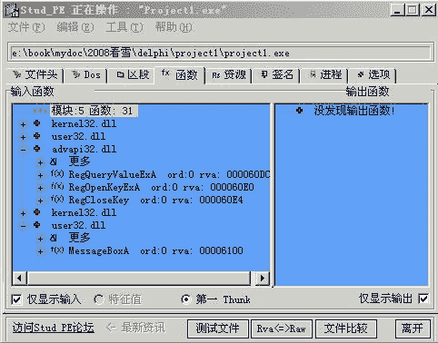
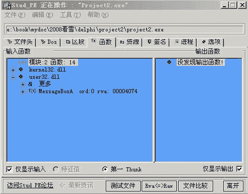
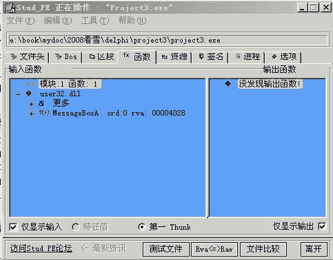
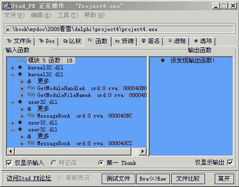

# Delphi 之萝莉调教篇

> 原文：[`www.pediy.com/kssd/pediy10/59585.html`](https://www.pediy.com/kssd/pediy10/59585.html)

本文纯属技术交流.如果各位看官想与小生一起探讨萝莉的问题的话...PM 我吧  
  
关于 Delphi 的萝莉调教技术,很久以前就有大牛做过了...其实技术早掌握了  
只是觉得太无聊~估计大家也都会于是就没有写~既然群里有人提出~就留下一份记录  
以前我很傻很天真.主要原因是也因为很懒.  
正值新春之际全当写出来给各位献礼了.给大家拜个晚年  
由于本文作者水平问题,有说的不对或者不明确的地方请大家海涵.菜鸟之作高手跳过...  
  
Q:为啥不用 Delphi?  
A:体积太大  
Q:为啥用 Delphi?  
A:很方便  
  
体积问题一直都是 Delphi Programer 头痛的问题...  
我也幻想过有一天用 Delphi 像 VC 一样的写出迷你小程序...  
  
直到某一天我发现许多萝莉控都在调教萝莉...于是我突发奇想我也来调教一个萝莉吧  
目标 Delphi~御姐变萝莉...  
  
关于这篇文章打算分为两个部分描述...  
1.萝莉自身的调教(关于核心库的修改.导入表的迷你化)  
2.外界的调教力量(Delphi 编译...MASM link)  
  
开始说说如何调教 Delphi(萝莉)吧...  
  
0.VCL 的力量  
1.KOL 的力量  
2.自修改核心库  
3.导入表的优化  
4.进一步优化  
  
\[0\].VCL 的力量...  
关于 VCL 不多说了...其实在迷你化程序中  
VCL 基本上都不会使用.  
这里我说的 VCL 不是说窗体 VCL...例如 SysUtils,Classes 等单元也都是属于 VCL 部分  
system,sysinit 也是属于吧?我也不太清楚,这两个单元是 Delphi 默认加载的...  
想取消不编译到工程中...不在本章讨论范围中  
  
给各位的建议是...除了 system,sysinit 以外的 Delphi 自带 VCL 单元都不要使用...  
system 中其实已经有许多函数了...  
由于这两个单元是默认的所以想不用也没办法...  
  

代码:

```
program Project1;

uses
  Windows;

begin
  MessageBox(0, 'Hello World!', 'By Anskya', 0);
end.

```

写下以下代码,编译后...15k For Delphi7(Delphi 6 这份代码编译出是 8k)  
为什么这么大?和 VC 一样的原因,系统默认库,编译器底层干了许多不为人所知的事情  
看看导入表...  
  
看到没有?除了 user32 和 kernel32,还有 advapi32??还是操作注册表函数.  
我们并没有操作注册表呀?  
IDA 逆向分析一下发现是读取  
代码:

```
unknown\_libname\_13 proc near

cbData= dword ptr -0Ch
Data= byte ptr -8
hKey= dword ptr -4

push    ebp
mov     ebp, esp
add     esp, 0FFFFFFF4h
movzx   eax, ds:word\_40400C
mov     dword ptr \[ebp+Data\], eax
lea     eax, \[ebp+hKey\]
push    eax             ; phkResult
push    1               ; samDesired
push    0               ; ulOptions
push    offset SubKey   ; "SOFTWARE\\\\Borland\\\\Delphi\\\\RTL"
push    80000002h       ; hKey
call    RegOpenKeyExA
test    eax, eax
jnz     short loc\_402A84
.
.
.

```

好了这个就是大家平时所编译的 Delphi 最小化程序...  
  
\[1\]KOL 的力量  
KOL 是俄罗斯的一群 Delphi fans 有感于 VCL 的庞大而创造的一个 framework 工程  
内部与 VCL 一样包含了大量的窗体等等操作封装的控件...不熟悉的朋友  
可以去官方主页上看一下 KOL+MCK,官方主页:http://kolmck.net/  
  
我们这里主要使用到的是 KOL 的 sysdcu 库.这个是一个优化的核心库.Delphi7 优化的很好  
还是上面的代码我们进行优化设置...使用指定的核心库  
菜单选择->Project->Options->Directories/Conditionals-Search path  
在这个选项中选择核心库的位置(其实一般也是用于设置..控件的源代码或者 dcu 路径)  
设置好编译后 5.5k  
  
查看导入表发现,居然只有 kernel32 和 user32 这两个库...  
体积居然缩减了这么多  
其实仔细对比一下 system.pas 就可以发现其中的奥秘  
许多不必要的函数操作单元函数和过程被取消掉了...  
下场非常悲惨(比如几个函数都没办法用了...Write,Writeln 函数等等 Readln 函数等)  
  
不过对于写 Windows 程序来说不大.KOL 库中有专门的 console 函数  
  
是不是想说什么?配合 VCL 试试?我建议大家放弃这个想法,因为 VCL 本身需要这些不知名和知名  
的一些函数和声明,不信你可以试试编译一下~Delphi 就会大量提示你编译错误,许多  
VCL 本身需要的东西都被优化掉了...  
  
好了继续我们的优化之旅  
  
\[2\]自修改核心库  
看完上面的两个试验后是不是有感,user32 是我们需要的那个函数,但是..kernel32 中还是有  
大量的我们不需要的函数...  
是的,kol 虽然进行的优化,但是他必须保证一些基本的操作函数存在  
例如 string...string 这个类型以后的其他文章我会详细介绍的...  
string 的暗藏操作也是许多的.和 MFC 的 CString 其实差不多~类似的性质而已  
只是 string 做的很好让许多人误认为那个就是一个字符串类型...  
关于取舍问题在这里我就不多废话了...说说优化吧...  
对于我们来说 string 也是不需要的因为我们有了 PChar(别说不知道是什么其实就是 char \*)  
  
由于我们要最终打造一个只有一个迷你化的库,迷你到什么程度?  
需要什么函数他就给我们保留什么函数其他的什么都不需要.好的为了这个目的我们继续  
  
相信有些人看过潘爱民老师的 Delphi 源码分析这本书,说实话我没有看过,  
只是在 CSDN 上看了一下目录,发现其中的许多东西都是大家应该知道的常识  
自己穷也没钱买,Google 可以搜一下电子版(电子版我也没有.太懒~有时间我宁可看漫画)  
  
文中提到 Nico 大牛的 MiniDExe 这个自己优化的迷你 EXE 演示(见附件)  
MiniDExe.zip  
我们来看一下基本的代码.其实 system,sysinit 中的代码已经被删除的差不多了  
只保留了最基本的...  
代码:

```
unit SysInit;

interface

var
  TlsIndex: Integer;
  TlsLast : Byte;
  PtrToNil: Pointer;

var
  HInstance: Pointer;
  GetCommandLine: PAnsiChar;

procedure \_InitExe;

implementation

procedure \_InitExe; assembler;
asm
        mov     eax, \[ebp+$08\]
        mov     \[HInstance\], eax
        mov     eax, \[ebp+$10\]
        mov     \[GetCommandLine\], eax
end;

end.

```

代码:

```
unit System;

interface

type
  TGUID = record
    D1: LongWord;
    D2: Word;
    D3: Word;
    D4: array\[0..7\] of Byte;
  end;
  TDLLProc = procedure(Reason: Integer);
  TDLLProcEx = procedure(Reason: Integer; Reserved: Integer);

procedure \_Halt0;
procedure \_HandleFinally;

var
  ExitCode: Integer;

implementation

procedure \_Halt0; assembler;
asm
        mov     eax, \[ExitCode\]
        leave
end;

procedure \_HandleFinally; assembler;
asm
        mov     eax, True
end;

end.

```

这些都是最基本的核心库了 OD 跟踪一下发现  
代码:

```
00401124 > $  55            push    ebp
00401125   .  8BEC          mov     ebp, esp
00401127   .  83C4 F0       add     esp, -10
0040112A   .  B8 FC104000   mov     eax, 004010FC
0040112F   .  E8 14FFFFFF   call    00401048
00401134   .  6A 00         push    0                                ; /Style = MB\_OK|MB\_APPLMODAL
00401136   .  68 4C114000   push    0040114C                         ; |Title = "By Anskya"
0040113B   .  68 58114000   push    00401158                         ; |Text = "Hello World!"
00401140   .  6A 00         push    0                                ; |hOwner = NULL
00401142   .  E8 4DFFFFFF   call    <jmp.&user32.MessageBoxA>        ; \\MessageBoxA
00401147   .  E8 B4FEFFFF   call    00401000

```

仅仅剩下这些东西.  
  
导入表下也剩下了 user32.MessageBoxA  
由于不能使用 Windows.pas 单元中的函数了所以不得不使用自己编写的  
引用单元了.  
  
现在体积:3.5k  
  
\[3\]导入表的优化  
不知道大家注意过没有...Delphi 生成的 PE 很奇怪.为什么这么说呢  
1.不知名的资源  
2.导入表的胡乱创建  
3.不分场合的重定位表  
  
我们这里说说导入表的奇怪现象  
见代码:Project4  
\[图 4\]  
代码:

```
program Project4;

uses
  Windows, Unit1, Unit2;

var
  hSelfModule: HMODULE;
  szBuffer: Array\[0..MAX\_PATH\] Of Char;
begin
  hSelfModule := GetModuleHandle(nil);
  ZeroMemory(@szBuffer, SizeOf(szBuffer));
  szBuffer\[GetModuleFileName(hSelfModule, szBuffer, SizeOf(szBuffer))\] := #0;
  BoxFun1();
  BoxFun2();
  MessageBox(0, szBuffer, 'By Anskya', 0);
end.

```

单元 1,单元 2 都是一样的代码  
代码:

```
unit Unit1;

interface

uses
  Windows;

procedure BoxFun1();

implementation

function MessageBoxA(hWnd: HWND; lpText, lpCaption: PAnsiChar; uType: UINT): Integer; stdcall; external user32 name 'MessageBoxA';

procedure BoxFun1();
begin
  MessageBoxA(0, 'Hello Wolrd!', 'Fun1', 0);
end;

end.

```

  
但是导入表中确出现了许多特别的东西.  
比如说代码中调用了 GetModuleHandleA 函数一次,但是导入表中确出现了三次...  
user32.MessageBoxA 竟然出现了四次...  
由于代码的疏忽也会产生大量的~重复导入表函数  
为此只能建议大家尽量的把声明和引用代码都尽量写在一个单元中...  
大家可以使用 PEID 或者 Stud\_PE 自行查看演示程序的导入表  
  
\[4\]进一步优化  
上面说了 Delphi 会产生一些非常无聊的垃圾  
  
下面说说最大的两个部分.  
1.资源  
2.重定位表  
  
不管我们是否使用了资源,Delphi 最后生成的资源目录中始终会产生资源目录  
关于这个部分的优化我只能建议大家使用 ResHacker 或者 Restorator 进行删除  
其实这个资源也包含了大家的一些代码信息  
RCData->PACKAGEINFO  
资源中就包含了程序主 dpr 中包含的代码单元...  
DEDE 也是根据这个文件查看你的 Delphi 程序一些信息的  
  
删除掉这些没用的资源可以减少 0.5k 体积  
现在我们的程序只有 3k 体积了  
  
清除重定位表.Delphi 给我们添加的.一般来说没什么用清除掉也就清除掉吧  
清除工具很多,大家自己找找 Stud\_PE 自己手工删除也可以  
手工删除资源和重定位表后...程序体积只有 2.5k 了  
和 VC 指定入口点编译也没啥区别...  
  
Mew11 1.2SE 压缩后 861 字节...不知道大家满意否?不满意?  
  
剩下占用大量体积的东西我们看看也就知道了...大量无用的数据段  
在 VC 中可以通过设置编译参数来进行段合并.Delphi 没这麽强的参数  
而且编译的时候会产生大量的垃圾...那怎么办呢?  
那就只有祭出绝招...武力调教萝莉了...  
  
看下篇

上传的附件
|  || Delphi 之萝莉调教篇(上篇).rar  
 |

不好意思少上传一个附件

上传的附件
|  || MiniDExe.zip  
 |