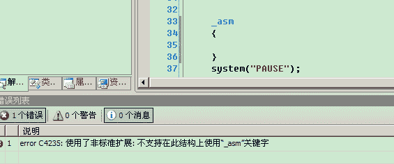
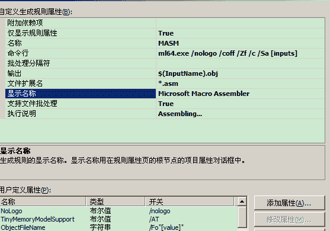
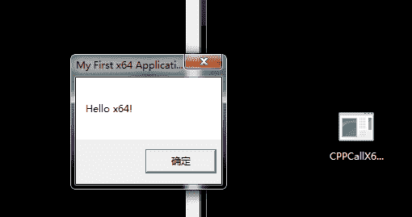

# c++中调用 64 位汇编函数

> 原文：[`www.pediy.com/kssd/pediy12/134123.html`](https://www.pediy.com/kssd/pediy12/134123.html)

众所周知从 vs2005 开始微软就不支持在 c++中内联汇编了。会出现如下的错误  
  
如果我们要在程序中内联汇编的话就要把汇编单独编译成一个文件，然后自定义规则生成 obj,在链接的时候添加进去。  
网上有 32 位的汇编与 C++相互调用的例子，今天说的是 X64 的，其实也就是有一点差别。  
步骤如下：  
1.编写一个 ASM 文件  
extern        MessageBoxA:proc  
.data  
text     db 'Hello x64!', 0  
caption  db 'My First x64 Application', 0  
  
.code  
  MyMessage proc   
    
        xor r9,r9  
        lea r8, caption  
        lea rdx, text  
       xor rcx,rcx  
       call MessageBoxA  
  
  ret   
  MyMessage endp  
  
end  
要注意 X64 汇编与 X32 的不同，尤其是参数的传递，这方面可以参考论坛里面的 X64 教程。  
2.用 VS2008 创建一个项目，然后把 ASM 添加进去。  
3.修改自定义规则如下。  
  
4.编写调用函数  
#include "stdafx.h"  
#include <stdio.h>  
#include <windows.h>  
extern "C" int \_\_stdcall  MyMessage ();  
  
int main(int argc, \_TCHAR\* argv\[\])  
{  
  
  MyMessage();  
 system("pause");  
 return 0;  
}  
5 编译链接  
6.执行结果  
  
  
不足之处请大家多多指教