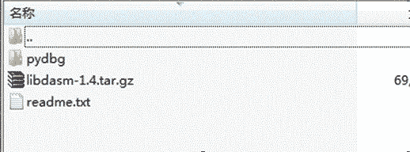
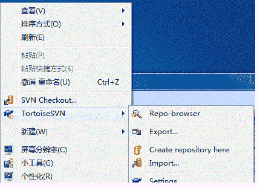
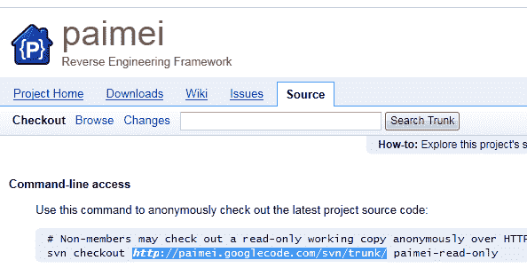
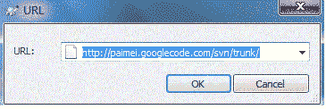
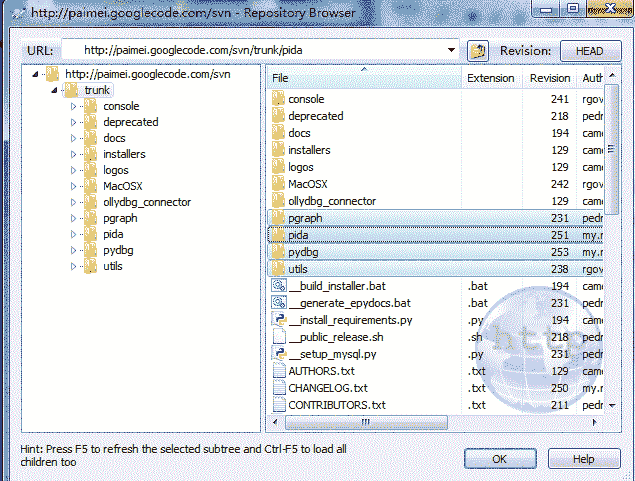

# 《Python 灰帽子》一书中环境的搭建

> 原文：[`www.pediy.com/kssd/pediy12/133992.html`](https://www.pediy.com/kssd/pediy12/133992.html)

题记:今天下午回到家用一种叫罗汉果的东西泡了杯水喝(罗汉果又叫仙人果)，然后打开看雪论坛看到 Python pydbg 这样的字样，这不正是这些天我在书店看到的那本书上的内容吗，打开链接一看，帖子的作者叫仙果，也就是罗汉果啦。这位罗汉果老兄翻译了日本人写的安装 pydbg 的文章，我想这本书上的示例运行起来确实有点麻烦，本着罗汉果老兄方便后学的精神，发了这样一篇帖子。  
    
  首先第一步就是安装 Python 了，这个很简单啦，值得说明的就是 Python 的版本，那本书上用的是 2.5 的版本，后来更新还有其他的版本，由于 2.5 以前没有 ctypes，所以不建议安装，我的电脑上装了 2 个版本 2.5 和 2.7， 2.5 是在 2.7 之后安装的，双击\*.py 文件时运行的是 2.5，要运行 2.7 需要加上路径: C:\\Python27\\ Python.exe  X:\\xxxx\\xxx.py,没有配置环境变量。  
  
  
  其次比较麻烦的就是 pydbg,一开始不知道去哪里下载 pydbg 运行示例程序就会报这样的错：  
Traceback (most recent call last):  
  File "E:\\src\\firefox\_hook.py", line 1, in <module>  
    from pydbg import \*  
ImportError: No module named pydbg  
  
去网上找了一个 pydbg 是一个压缩包 pydbg-package.rar  
  
  
Pydbg 要拷贝到 拷贝到 python 的安装目录里面，一般是 C:\\Python27\\Lib，这样还不行，因为因为 python 里面的 pydasm.pyd 不匹配，pydasm.pyd 需要重新编译，解压 libdasm-1.4.tar.gz，cmd 切换到解压后的目录里 cd  pydasm  python setup.py build\_ext，编译成功的话会生成一个 build 目录,里面有一个 pydasm.pyd，将这个 pydasm.pyd 替换到 C:\\Python27\\Lib\\python 里面的 pydasm.pyd 就可以了。有的同学这里可能编译不成功，电脑上需要有 Visual Studio  
我的电脑上装有 vs2008，使用的 python 的版本是 2.7，如果是用 python 的版本是 2.5 也会编译不成功，提示电脑上没有 vs2003。  
  
         
       其实，那个 pydasm.pyd 也可以不用重新编译（有误，补充里有说明），可能是那个 pydbg-package.rar 里面的 Pydbg 版本太低，后来我从 google 上 paimei 项目里面下载的那个 pydbg 是没有问题的，拷贝到 C:\\Python27\\Lib 目录下就可以直接使用，不用重新编译 pydasm.pyd。要重新下载需要安装 TortoiseSVN。装好了之后到桌面点鼠标右键会多一个菜单  
  
  
点那个 Repo-browser 会让你添 URL ,谷歌搜索 paimei  
  
  
得到这样的地址 http://paimei.googlecode.com/svn/trunk/  
  
  
点 ok 等一段时间会有这样的界面   
  
  
选中的那几个是我们需要的 pgraph、pida、pydbg、utils，点右键 CheckOut,导出到本地，拷贝到 C:\\Python27\\Lib 里面就 ok 了。  
  
  最后，还有那个 idaPython,如果 python 的版本不对的话他会识别不了。我的是 IDA 版本 5.5。要装 python2.5 才可以。  
  
罗汉果的故事.doc  
pydbg-package.rar  
  
(补充一下: SVN 导出的那个 pydbg 要放到 python2.7 下面是不行的，估计放到 python2.6 里面可以，2.5 版本的可以从 pyemu 里面去拷贝(SVN 地址：http://pyemu.googlecode.com/svn/trunk/)，这个里面的 pydasm.pyd 是 2.5 编译的放到 2.5 下面可以使用)  
  
pydasm(3 个版本).rar