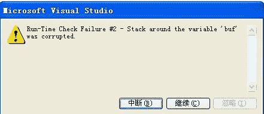
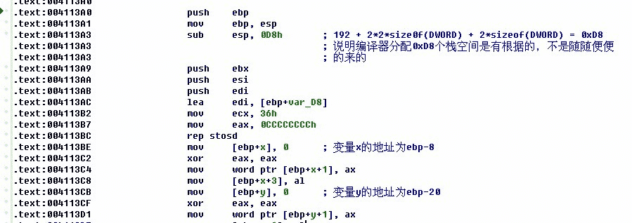
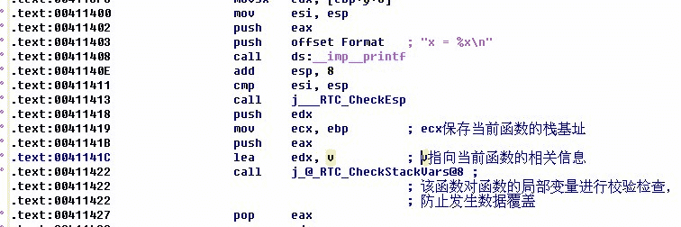
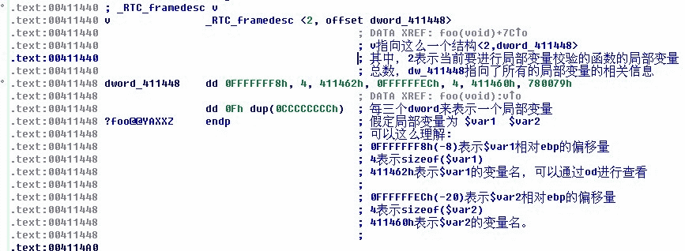
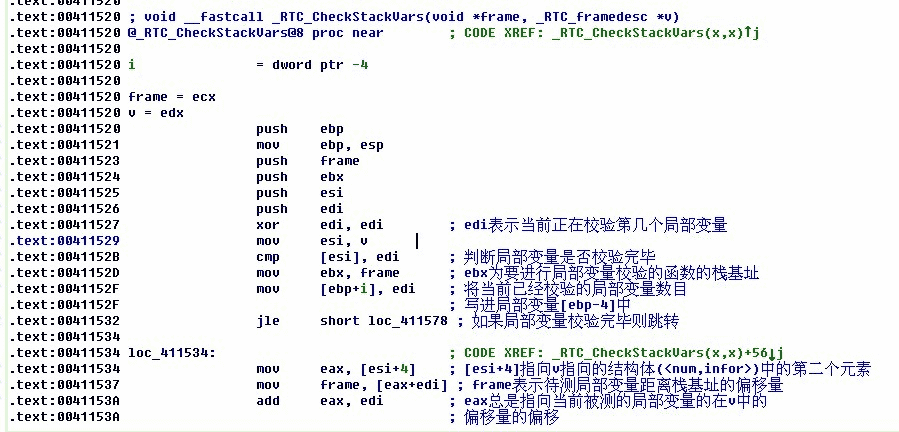
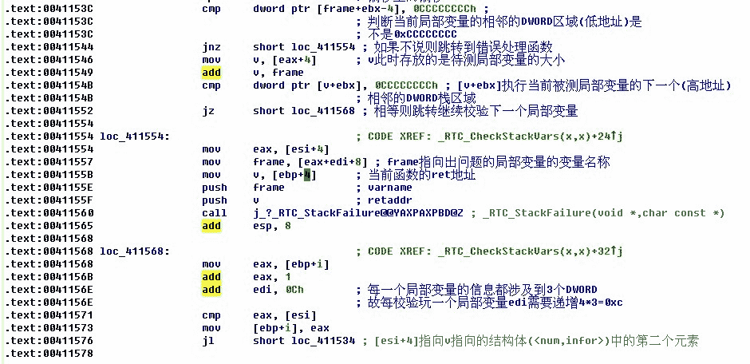

# vs2005 对函数局部变量的堆栈检测分析

> 原文：[`www.pediy.com/kssd/pediy12/126973.html`](https://www.pediy.com/kssd/pediy12/126973.html)

前两天，在论坛上看了泉哥的“泉行之路”和笨笨熊的“职场游记”，深受鼓舞，于是决定写下下面这篇鸟文，高手飘过，如有错误，概不负责哦 ，呵呵  
  
   引子：<本文的分析是在 debug 模式下，呜呜，有人怒了……>  
  在 vc6.0 下，写溢出程序很容易，在.net 下由于添加了/GS 选项，加入了\_\_security\_\_cookie，溢出就没那么简单了。对\_security\_cookie 我也是最近才研究了一下，才知道：当在函数中 buff 的长度 <= 4 时，编译器是不会在函数中插入 cookie 进行校验的。于是产生了下面这个天真的想法:  
void  foo()  
{  
  char  buf\[4\] = {0};      
  strcpy(buf,shellcode);    
}  
是不是这样 foo 函数流程就能被逆转了呢(想法很天真呐，嘿嘿……)，于是我就进行尝试了一把，结果挂了，弹出下面这个框框:  
  
  
  单步调试，才发现编译器加入了函数 void \_\_fastcall \_RTC\_CheckStackVars(void \*frame, \_RTC\_framedesc \*v)对函数的局部变量进行校验……呜呼，显然我的想法很傻很天真。  
  
    其实微软的编译器是这么检查堆栈变量的：在一个存在局部变量的函数里头，编译器统计函数的局部变量个数 num，在栈上分配 192 + num \* 2 \* sizeof(DWORD) + num\*sizeof(DWORD)个字节的栈空间，并将其全部填充为 0xCCCCCCCC,当函数结束后，编译器会检测每个局部变量的前 4 个字节和后四个字节是否为 0xCCCCCCCC，如果不是，则说明发生数据覆盖等,跳向错误处理……  
  
  实例演示:  
 

代码:

```
#include <stdio.h>
void foo()
{
  char x\[4\] = {0};
  char  y\[4\] = {0};
  x\[3\] = 'A';
  y\[3\] = 'A';
  printf("x = %x\\n",x\[3\]);
  printf("x = %x\\n",y\[3\]);
}

void main()
{
  foo();
}

```

用 vs2005 编译后，用 ida 打开，进入 foo 函数内部：  
  
继续往下走，找到\_RTC\_CheckStackVars 函数：  
  
在进入\_RTC\_CheckStackVars 函数之前我们先分析一下变量 v 到底是个什么东西……  
  
下面在进入关键函数\_RTC\_CheckStackVars 分析:  
  
  
  通过对编译器插入的函数\_RTC\_CheckStackVars 的分析，估计大家对编译器的行为又有了一个新的了解。