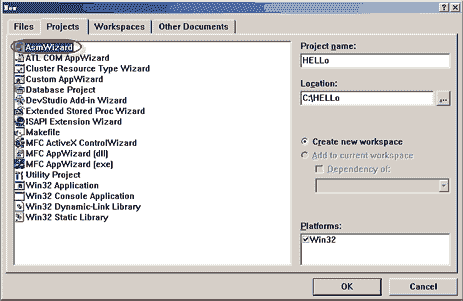
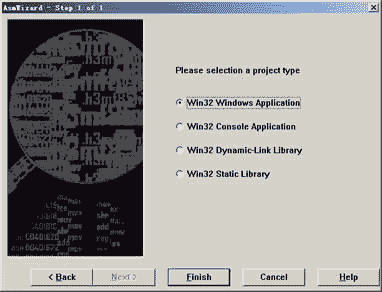
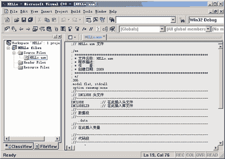
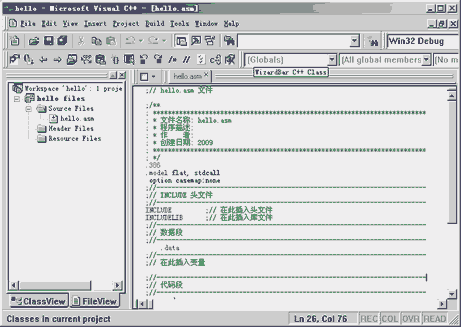

# 后天就要回家了,近期怕是不能上论坛了,把前些日子写的一个 VC6 汇编向导提供给大家,方便写汇编程序

> 原文：[`www.pediy.com/kssd/pediy10/89386.html`](https://www.pediy.com/kssd/pediy10/89386.html)

后天就要回家了,近期怕是不能上论坛了,把前些日子写的一个 VC6 汇编向导提供给大家,方便写汇编程序.  
  
写这个向导的起因是,看到有一个 VC6 的驱动向导,于是我也想写一个 ASM 的向导,因为最近在自学汇编做了几年的程序员,汇编还不会,只会调调 API,玩几个 IDE.写写应用程序,有时候就在想,我这几年到底做了点会什么,好像什么都不会,想想快三十的人了,真有点"老大徒伤悲"的感觉.  
  
本来想写一篇详细的开发过程,也没时间,看雪论坛都是牛人,这种工具只有我等小菜来写了.  
  
要说的是,各个类型编译参数已经配置好了,只是 LIB(静态库还有问题,希望大侠指点一下)不能用,其它三个都可以用了.我还想加一个 ASM 文件类型模板,不知道怎么弄 MSDN 上只有 VC7 以上版本的,没有 VC6 的.  
  
  
  
  
  
  
  
  
再补充一下:  
1.下载的向导文件放到:VC6 的安装目录\\Common\\MSDev98\\Template  目录下,再打开 IDE 就可以看到了.  
2.如果是编译向导源码,IDE 会自动将向导文件复制到相应目录下的.  
3.用 AsmWizard 向导编译汇编程序之前,需要一个 MASM32,我现在用的 masm32v10 版本,在网上下载回来之后直接解压就行,  
(1)最好将 masm32v10\\BIN 文件夹里面的"ML.EXE" 和 "ML.ERR" 复制到:VC6 的安装目录\\VC98\\Bin 下.  
(2)将 masm32v10\\lib 和 masm32v10\\include 另起一个名字如 AsmLib\\AsmInclude 复制到:VC6 的安装目录\\VC98 下.  
(3)然后再打开 IDE,在 "Tools" -> "Opti0ns" -> "Directorier" 中配置一下 include 和 lib 的目录.  
(4)我认为用 VC6 的 IDE 写汇编程序,主要是可以用 VC6 调试功能很方便,也可以语法高亮,在 VC 的注册表项  
HKEY\_CURRENT\_USER\\Software\\Microsoft\\Devstudio\\6.0\\Text Editor\\Tabs/Language Setting/C/C++ 中 FileExtensions,  
添加一个 asm 类型即可.关键字需要在:VC6 的安装目录\\Common\\MSDev98\\Bin\\ 建一个 usertype.dat 文件,里面加上关键就可以了.  
  

上传的附件
|  || AsmWizard.rar  
 |
|  || AsmWizard\_SRC.rar  
 |