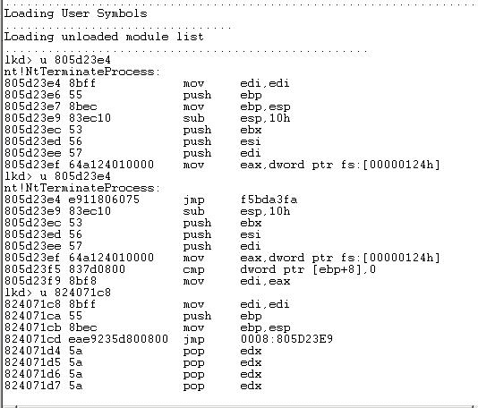

# 绕过函数头 INLINE HOOK

> 原文：[`www.pediy.com/kssd/pediy10/97281.html`](https://www.pediy.com/kssd/pediy10/97281.html)

一直潜水 看大牛们的帖子 受益很多    
最近比较闲 也来发几篇撮文       高手就请路过吧。  
  
  
    绕函数头 INLINE HOOK  方法比较简单 玩过 INLINE HOOK 的人应该都知道    
没有处理重定位  不过绕函数头的几个字节应该没什么问题   
代码很烂 就不贴出来了      需要的朋友自己下载吧   
  
附件是 VS2008 +DDKWizard 的 请自行编译  XP SP2 下测试通过

上传的附件
|  || passinline.rar  
 |

引用: *最初由 **绿豆青蛙**发布*  进来看看，要是在帖子里有个说明原理的就好了

看这张图  就知道了   
  
  
  
第一个 U  是正常函数的   
  
第二个 U 是打开冰刃后的   
  
第三个 U 是驱动里那个 20 字节  用来替代 NtTerminateProcess 函数的  
  
  
  
首先 定位函数地址 转换为文件偏移  然后从原始文件读取相应的长度   
最后加上一个跳转指令跳回去  就绕过了函数头 inline hook   
  
刚裁图发现代码里有个小错误      NOP 应该是 0x90  。。 

看这张图，貌似这个函数有为 hotpatch 预留的空间  
开始是 mov edi,edi，用来 patch 成短跳转 上面还应该有 5 个 nop，用来 patch 成长跳转