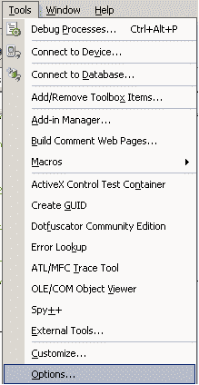
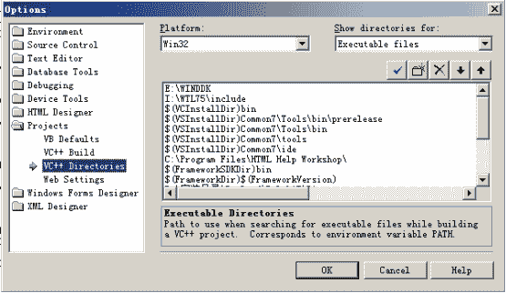
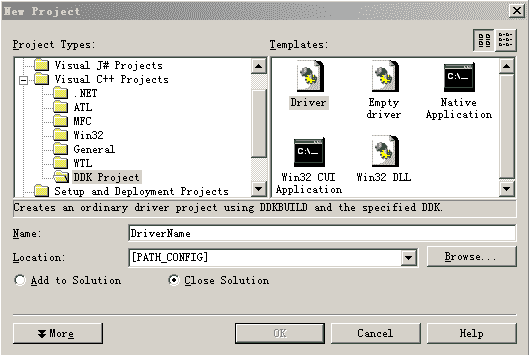
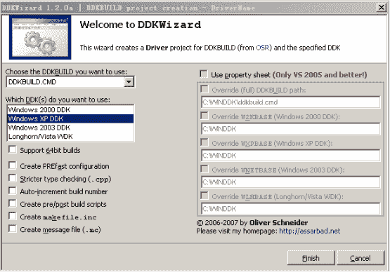

# 扫盲贴，HOOK SSDT 短文一篇。

> 原文：[`www.pediy.com/kssd/pediy10/78218.html`](https://www.pediy.com/kssd/pediy10/78218.html)

//author:梧桐  
//转载请注明出处  
  
\------------------------很不华丽的分割线------------------------------------------------------  
  
本文章仅供那些在驱动开发门外徘徊的程序爱好者参考和学习，大牛就绕过吧，  
如有错误的地方，还请多多指出，不胜感激。  
  
\------------------------很不华丽的分割线------------------------------------------------------  
  
      对于 Driver 一词儿，我想大家都不陌生，它是工作在 ring0 下的，正是因为如此，它不不能够快速上手的，更多的时候你要熟悉它的技术资料和接口，还要熟悉底层工作的原理，一不小心搞个 BSOD，那是会非常郁闷的。  
  
    好了，现在让我们步入正题，首先确认你已经安装好了 DDK（学习驱动开发，推荐 WINXP DDK 2600、 Windows XP,  VS2003），配置好了你的开发环境（DDK Wizard），在 VS20003 里添加 WINDDK 路径。  
  
    打开 VS2003，Tools 选项，选取 Options（如下图）：  
  
  
  
    然后，我们找到 Projects（工程），选取 VC++ Directories，添加 WINDDK 路径：  
  
  
    配置好这些环境以后，我们开始与驱动的亲密接触吧。  
  
    先来建立一个驱动的工程：  
  
  
  
    那些默认的选项，全部取消掉：  
  
  
  
    接着点 Finish ，删除 Header Files、Resource Files，此时，DDK Wizard 已经为我们建立了一套 Driver 模板了，但细看，是不是感觉非常非常的乱？  
  
    OK，我们把它 K 掉，现在我们自己来打造一个简单的入口点。  
  
    

代码:

```
#include "ntddk.h"

//Unload
VOID UnLoad(IN PDRIVER\_OBJECT DriverObject)
{
   DbgPrint("UnLoad Driver.\\n");
}

//EntryPoint.
NTSTATUS DriverEntry(IN PDRIVER\_OBJECT DriverObject, 
           IN PUNICODE\_STRING RegistryPath)
{
  DriverObject->DriverUnload = UnLoad;
  //TODO
  return STATUS\_SUCCESS;
}

```

    在 DriverName.WXP 上点 Build，看看 objchk\\i386 目录下产生的 Sys 文件，OK，Cool 吧，当然，我们这个驱动连任何功能都没有的，Cool 是很 Cool，就是 Cool 得没内涵了，那么我们来实现点什么功能呢，好吧，让我们来对 SSDT 挂钩一下吧。  
  
    要挂钩 SSDT，就必须先要由内核到处一个 KeServiceDescriptorTable，那么我们还要先定义一个 KeServiceDescriptorTable 类型的的结构体：  
  
代码:

```
typedef struct ServiceDescriptorEntry
{
        unsigned int \*ServiceTableBase;
        unsigned int \*ServiceCounterTableBase; //Used only in checked build
        unsigned int NumberOfServices;
        unsigned char \*ParamTableBase;
} SSDTEntry;

```

    定义了 KSDT 的结构，那么我们想想要 HOOK 那个函数呢，好吧，就以 ZwTerminateProcess 为例，我们开动，首先定义一个 ZwTerminateProcess 函数结构，函数原型：  
  
代码:

```
ZwTerminateProcess(
        IN HANDLE ProcessHandle OPTIONAL, 
        IN NTSTATUS ExitStatus
        ); 

```

结构定义：  
  
代码:

```
typedef NTSTATUS(\*\_ZwTerminateProcess)(
                IN HANDLE ProcessHandle OPTIONAL,
                IN NTSTATUS ExitStatus
                );

```

    我们要 HOOK ZwTerminateProcess，那么我们是不是要先找出它在 KSDT 中的位置呢，没错，那么我们来定义一个通过 SSDT 服务号得到函数地址的宏以达到我们的目的：  
  
代码:

```
#define  GetSystemFunc(FuncName) KeServiceDescriptorTable.ServiceTableBase\[\*(PULONG)((PUCHAR)FuncName+1)\]; 

```

    想要达到改写 SSDT 的目的，那么首先要解决的是内存保护机制的问题，众所周知，Windows 的某些版本对内存区域启用了写保护的功能，在 XP 和 2003 中更为常见，SSDT 是只读的，那怎么办呢？  
  
    有的网友此刻估计已经明白了。  
  
    没错，就是 Memory Descriptor List，简称 MDL。有的同学可能会问了，MDL 究竟是个什么东西呢？从字面意思看，不难理解，内存描述符列表。MDL 包含了内存区域的起始、拥有者 proc、字节数、标记等。OK，我们需要先定义一个 MDL 的指针。  
  
代码:

```
PMDL MDLSystemCall;

```

  
    定义了 MDL 的指针以后，我们要通过 MAPPED 系列的参数来使内存拥有可写性，然后锁定内存中的 MDL，那么我们就要定义一个 PVOID 的指针，来供 MmMap 操作。  
  
代码:

```
PVOID \*MappedSCT;

```

    代码片段：  
代码:

```
MDLSystemCall = MmCreateMdl(NULL, KeServiceDescriptorTable.ServiceTableBase, KeServiceDescriptorTable.NumberOfServices\*4);
if(!MDLSystemCall)
  return STATUS\_UNSUCCESSFUL;

```

    那么，建立了 MDL，是不是该填充一下页数组啊？  
  
    对的，没错。  
  
代码:

```
MmBuildMdlForNonPagedPool(MDLSystemCall);
MDLSystemCall->MdlFlags = MDLSystemCall->MdlFlags | MDL\_MAPPED\_TO\_SYSTEM\_VA; //可写
MappedSCT = MmMapLockedPages(MDLSystemCall, KernelMode);

```

    我们转入 HOOK 话题，继续。  
  
    刚才我们已经定义了 ZwTerminateProcess 的结构。  
  
代码:

```
Old\_ZwTerminateProcess = (\_ZwTerminateProcess)(GetSystemFunc(ZwTerminateProcess));

```

    获取没被 HOOK 之前的 ZwTerminateProcess 在 KSDT 中的索引，保存。  
  
    那么下一步呢，就是干掉他了，替换为我们的函数，那么我们是不是要构造一个自己的函数过程呢，恩，没错。  
  
代码:

```
NTSTATUS NewZwTerminateProcess(
                IN HANDLE ProcessHandle OPTIONAL, 
                IN NTSTATUS ExitStatus
                )
{
  //TODO
  return STATUS\_SUCCESS;
}

```

    在过程里要怎么玩，全看你自己了。  
  
    下面就是替换函数了，修改 SSDT 中函数地址指向的位置，下面是宏定义：  
  
代码:

```
#define GetIndex(\_foo) \*(PULONG)((PUCHAR)\_foo+1)
#define HookOn(\_Old,\_New) InterlockedExchange((PLONG)&MappedSCT\[GetIndex(\_Old)\] ,(LONG)\_New)

```

    代码片段：  
  
代码:

```
MDLSystemCall = MmCreateMdl(NULL, KeServiceDescriptorTable.ServiceTableBase, KeServiceDescriptorTable.NumberOfServices\*4);
if(!MDLSystemCall)
  return STATUS\_UNSUCCESSFUL;
MmBuildMdlForNonPagedPool(MDLSystemCall);
MDLSystemCall->MdlFlags = MDLSystemCall->MdlFlags | MDL\_MAPPED\_TO\_SYSTEM\_VA; //可写
MappedSCT = MmMapLockedPages(MDLSystemCall, KernelMode);
HookOn(ZwTerminateProcess, NewZwTerminateProcess);
return STATUS\_SUCCESS;

```

完整代码：  
  
代码:

```
///////////////////////////////////////////////////////////////////////////////
///
/// Copyright (c) 2008 - <company name here>
///
/// Original filename: NtHook.c
/// Project          : NtHook
/// Date of creation : 2008-11-20
/// Author(s)        : 梧桐
///
/// Purpose          : <description>
///
/// Revisions:
///  0000 \[2008-11-20\] Initial revision.
///
///////////////////////////////////////////////////////////////////////////////
#include "ntddk.h"

#pragma pack(1)
typedef struct ServiceDescriptorEntry
{
        unsigned int \*ServiceTableBase;
        unsigned int \*ServiceCounterTableBase; //Used only in checked build
        unsigned int NumberOfServices;
        unsigned char \*ParamTableBase;
} SSDTEntry;
\_\_declspec(dllimport)  SSDTEntry KeServiceDescriptorTable;

#pragma pack()

NTKERNELAPI NTSTATUS ZwTerminateProcess(
                IN HANDLE ProcessHandle OPTIONAL, 
                IN NTSTATUS ExitStatus
                ); 


typedef NTSTATUS(\*\_ZwTerminateProcess)(
                IN HANDLE ProcessHandle OPTIONAL,
                IN NTSTATUS ExitStatus
                );
\_ZwTerminateProcess Old\_ZwTerminateProcess;


#define GetSystemFunc(FuncName) KeServiceDescriptorTable.ServiceTableBase\[\*(PULONG)((PUCHAR)FuncName+1)\]
PMDL  MDSystemCall;
PVOID \*MappedSCT;

#define GetIndex(\_Function) \*(PULONG)((PUCHAR)\_Function+1)

#define HookOn(\_Old, \_New)  \\
       (PVOID) InterlockedExchange( (PLONG) &MappedSCT\[GetIndex(\_Old)\], (LONG) \_New)

#define UnHook(\_Old, \_New)  \\
       InterlockedExchange( (PLONG) &MappedSCT\[GetIndex(\_Old)\], (LONG) \_New)


NTSTATUS NewZwTerminateProcess(
                IN HANDLE ProcessHandle OPTIONAL, 
                IN NTSTATUS ExitStatus
                )
{
  return STATUS\_SUCCESS;
}


//Unload
VOID UnLoad(IN PDRIVER\_OBJECT DriverObject)
{
   DbgPrint("UnLoad Driver.\\n");
   //卸载 Hook
   UnHook( ZwTerminateProcess, Old\_ZwTerminateProcess);

   //解锁、释放 MDL
   if(MDSystemCall)
   {
      MmUnmapLockedPages(MappedSCT, MDSystemCall);
      IoFreeMdl(MDSystemCall);
   }
}

//EntryPoint.
NTSTATUS DriverEntry(IN PDRIVER\_OBJECT DriverObject, 
           IN PUNICODE\_STRING RegistryPath)
{
  DriverObject->DriverUnload = UnLoad;
  
  //找出旧函数地址并保存
  Old\_ZwTerminateProcess =(\_ZwTerminateProcess)(GetSystemFunc(ZwTerminateProcess));

  MDSystemCall = MmCreateMdl(NULL, KeServiceDescriptorTable.ServiceTableBase, KeServiceDescriptorTable.NumberOfServices\*4);
  if(!MDSystemCall)
    return STATUS\_UNSUCCESSFUL;
  MmBuildMdlForNonPagedPool(MDSystemCall);
  MDSystemCall->MdlFlags = MDSystemCall->MdlFlags | MDL\_MAPPED\_TO\_SYSTEM\_VA;
  MappedSCT = MmMapLockedPages(MDSystemCall, KernelMode);

  //安装 HOOK
  HookOn( ZwTerminateProcess, NewZwTerminateProcess);
  return STATUS\_SUCCESS;
}

```

工程附件：http://xlick.3video.cn/1.zip