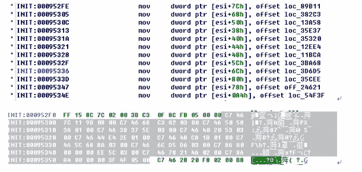
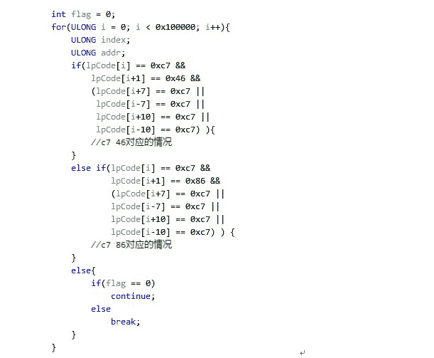
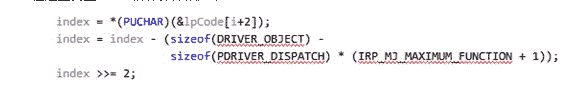
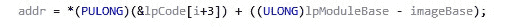
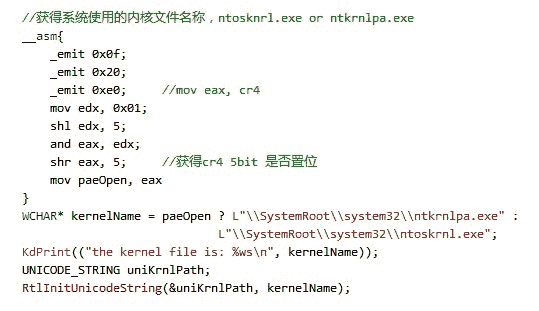
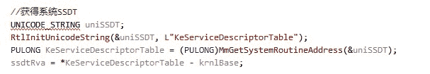
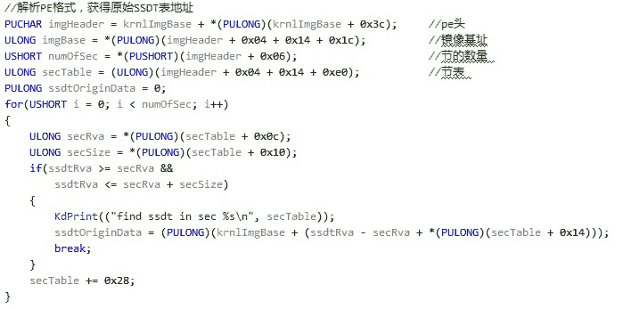
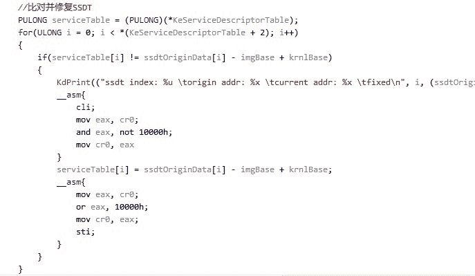

# FSD HOOK 与 SSDT HOOK 恢复简单思路

> 原文：[`www.pediy.com/kssd/pediy10/99970.html`](https://www.pediy.com/kssd/pediy10/99970.html)

这几天看了一下 FSD HOOK 与 SSDT HOOK 恢复相关的东西，都是众牛人玩腻了的技术了。大家莫笑。  
  
首先是 FSD HOOK。  
网上比较容易找到的是 sudami 对 360superkiller 的逆向，映射大小计算上好像有些错误。  
  
这里贴出我的想法，备忘 ：）  
  
1.       向 ZwQuerySystemInformation 传递 11 号参数，获得 SYSTEM\_MODULE\_INFORMATION 结构，通过结构查询 ntfs 和 fastfat 的基地址（lpModuleBase）。  
  
2.       通过指定路径打开 ntfs.sys 和 fastfat.sys 对应的磁盘文件  
L”\\\\SystemRoot\\\\system32\\\\drivers\\\\ntfs.sys”  
L” \\\\SystemRoot\\\\system32\\\\drivers\\\\fastfat.sys”  
  
3.       根据 PE 格式获得文件中镜像基地址（imageBase）  
  
4.       使用特征码搜索 ntfs.sys 和 fastfat.sys 设置派遣路径的指令。  
  
用 IDA 反汇编 ntfs.sys（fastfat.sys 类似）见指令和对应的机器码如下：  
  
esi 指向 DriverObject 结构，指令字结构分别为  
  
c7 46 XX YY YY YY YY   
  
c7 86 XX XX XX XX YY YY YY YY (XX 为 esi 的相对偏移，YY 为真正的函数地址)  
  
因此可以通过特征搜索此段指令：  
  
  
  
获得指令后，根据上述结构分别获取 IRP 派遣序号 index 和原始派遣函数地址 addr。  
  
在这里真正 index 的计算方法如下：  
  
  
同时由于 ntfs.sys 实际加载的位置和 pe 文件中存储的位置不同，所以需要重定位：  
  
  
至此获得了派遣函数的原始路径。  
  
5.       使用 ObReferenceObjectByName 分别获得  
  
L”\\\\FileSystem\\\\Ntfs”  
  
L”\\\\FileSystem\\\\Fastfat”  
  
对应的驱动对象(DriverObject)。  
  
将驱动对象中的派遣函数地址与从 pe 文件读取的地址进行比对，如果发现不同和进行修复。  
  
\-----------------------------------------------------------------------------------------  
  
SSDT HOOK  
1. 确定 windows 所使用内核文件时 ntoskrnl.exe 还是 ntkrnlpa.exe。  
当电脑内存大于 512MB 时 windows 开启 PAE 使用 ntkrnlpa.exe 否则使用 ntoskrnl.exe 这里并没有考虑支持多核处理器的内核。  
所以我们只要检测 PAE 是否开启就能确定内核文件名了。  
当 cr4 寄存器的 5 bit 置为时说明开启了 PAE。  
  
  
2.       将内核文件映射如内存，首地址为 krnlImgBase。  
3.       向 ZwQuerySystemInformation 传递 11 号参数，得到 SYSTEM\_MODULE\_INFORMATION 结构数组，遍历数组得到系统内核在内存中的基地址 krnlBase。  
4.       根据 PE 格式解析映射到内存中的文件，获得原始 SSDT。  
方法是：首先获得系统导出的 SSDT 表地址，减去基地址后得到 SSDT 的 RVA  
  
  
找出内存映射的内核文件的节表。  
搜索 SSDT 的 RVA 处在文件那哪个节中。  
内存映射文件的 SSDT = SSDT RVA  所在节 RVA + 所在节 RawOffset + krnlImgBase  
  
  
5.       对比原始 SSDT 与当前 SSDT 内容，不同则替换。  
这里存在一个重定位问题需要注意。  
代码如下：  
  
  
\------------------------------------------------------------------------------------------  
本人菜鸟一只，欢迎各位来拍砖、撞墙或者说“太挫了” ：）  
http://hi.baidu.com/index09