# Hook And Inject 系列教程 7.12 update

> 原文：[`www.pediy.com/kssd/pediy07/pediy7-792.htm`](https://www.pediy.com/kssd/pediy07/pediy7-792.htm)

从现在开始，我将带你走进 Hook 与 Inject 的世界，我至少介绍 5 种不同的 Hook 方法和至少 4 种不同的 Inject 方法给你。还会用相应的例子来示范，其中我也许会附带发布一些我写的工具，当然示范代码都是用 Delphi 写，(我还不太会 C(正要学，请各位老大多多关照),用 ASM 又比 Delphi 麻烦^\_^),基本上所有的例子我会详细解释其工作思路。PS:非常欢迎大家和我讨论，我的 QQ:86667342(以前的 1157297 作废拉),由于方法都是自己想的，并未参考其他书籍什么的，所以难免有什么错误的地方，烦请见者不要见笑，多多指教。对了，还要说一句，请不要将代码用于商业用途，否着造成什么后果啊，纠纷啊，一概与本人无关。（现在流行的语句）文章中也许会偶尔提到一些大家未知的工具，别担心，到了一定时候，也就是时机成熟的时候我就在这个板块发布。PS:希望大家多多支持这个板块啊，让这个板块死而复生。废话就不多说啦，OK……Begin：  
Inject---chapter---1  
从某种意义上来讲，注入是为了让被注入的软件拥有完成软件本身所不具备的工作的权利。从原理上讲，注入是让被注入的程序的进程空间里拥有希望注入的代码，并能在期望的时候能够得以执行。从我的理解上来看，注入拥有 2 种模式，静态和动态模式，故名思议，静态模式就是在程序尚未运行前就让程序拥有执行软件本上所不具备的功能的权利（并为执行）：后文称为特权，动态注入就是在程序运行的时候让程序在本次运行周期中拥有特权。静态注入的最基本原理就是修改软件固定代码，让软件被 windows 装入后拥有特权代码。之所以将这种方式归纳为注入，是因为它的本质和注入的本质是一样的，这是一种最原始最初级的注入当然不一定是最有效的注入。平时我们很少用，不过病毒程序很多都这样，我们来看看这种注入方法的原理和例子：  
静态注入之修改软件代码：  
  优点：不需要额外工具的帮助。被注入后永久有效（病毒的爱好）。  
  缺点：注入代码时比较麻烦。  
注入原理：  
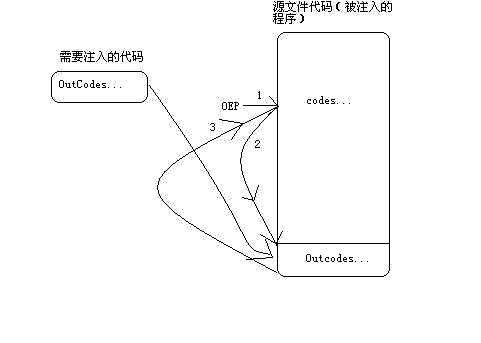    
上图是一个最最基本的原理图，首先我们来看完成这个注入方式所需要的条件：  
首先我们需要准备好将要注入到程序的代码 Outcodes…,还需要被注入的程序。还要工具。(我喜欢用 winhex 其实这个注入用 casm32 更方便)。  
注入过程：  
先在被注入的程序找出一个存放代码的空间。对于这个空间的要求是在程序的段中，（这样程序运行的时候才会被自动映射到内存）。你也可以手工给程序添加一个段(LordPE)，然后把代码放进去（好像很多壳都是这样的，优点自然不说，不用和原来的程序抢空间），然后把代码方进去(Winhex)，然后在期望的地方修改程序原流程来执行这段代码。  
所有的注入过程就这样的。现在我们来亲自注入一下。  
我选择的目标程序是：Inject1\_1.exe（在 chapt 目录下的 inject1-1 目录下有这个程序），  
程序本身没有任何有效代码，也就是看不到执行效果，双击后程序运行然后自动退出。  
首先我们来确定我们注入目的。我们的目的是让程序运行后执行我们自己的代码，弹出一个对话窗口，告诉我们一些信息。有了注入目标后我们需要来构件注入代码。  
先在原程序加入一个新的名位 inject 的段：（LordPE or Stud\_pe(推荐，因为他添加新段可以用 null 填充)）  
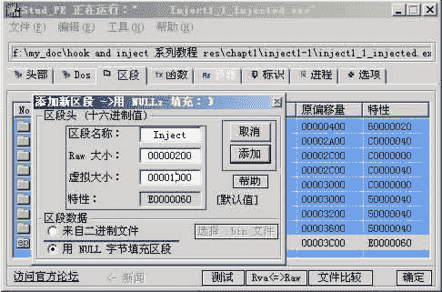    
修改 oep 到指向这个段头，也就是注入代码后的开始；  
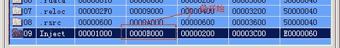    
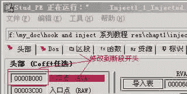    
然后用 OD 装入程序开始构件代码。  
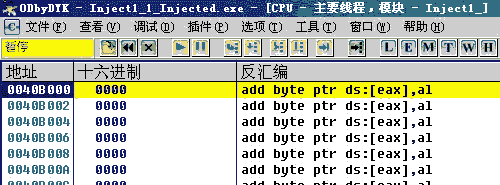    
确定了用 MessageBoxA 函数来显示我们的信息时，我们能构件出如下代码：  
Push 0        //handle  
Push xxxxxxxx    //text…….xxxxxxxx 字串保存地址  
Push xxxxxxxx    //tite  
Push 0        //MB\_OK  
Call xxxxxxxx      //call to MessageBoxA  
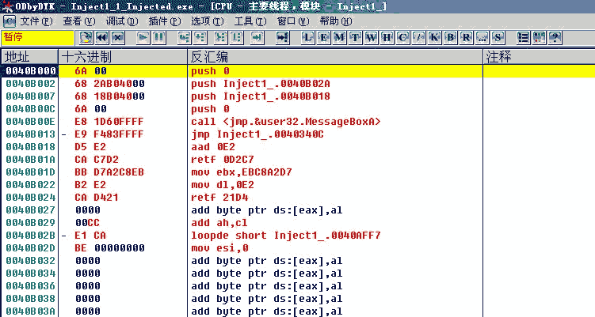   
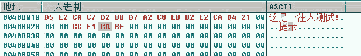   
   
0040B000 >  6A 00               push 0  
0040B002    68 2AB04000         push Inject1\_.0040B02A  
0040B007    68 18B04000         push Inject1\_.0040B018  
0040B00C    6A 00               push 0  
0040B00E    E8 1D60FFFF         call <jmp.&user32.MessageBoxA>//  
这里因为原程序的 IAT 里面有这个函数，我们找到在 401030 所以我们直接  
Call 401030 调用。  
0040B013  - E9 F483FFFF         jmp Inject1\_.0040340C  
0040B018    D5 E2               aad 0E2  
//从这里开始为字串内容的值。  
0040B01A    CA C7D2             retf 0D2C7  
0040B01D    BB D7A2C8EB         mov ebx,EBC8A2D7  
0040B022    B2 E2               mov dl,0E2  
0040B024    CA D421             retf 21D4  
0040B027    0000                add byte ptr ds:\[eax\],al  
0040B029    00CC                add ah,cl  
0040B02B  - E1 CA               loopde short Inject1\_.0040AFF7  
0040B02D    BE 00000000         mov esi,0  
构建代码完毕后我们保存到 exe 文件。运行程序。。。  
程序运行结果：  
 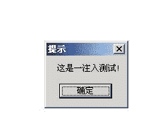    
到此。我们已经学会了这种基本而简单的注入方法。如果会写程序来完成这些过程那么我告诉你你已经会写最最简单的病毒拉^\_^然而病毒最精彩的是他的传播和破坏方式，而不是寄生方式。。。  
  
附件:inject1-1.rar   
  
Inject---chapter---2  
动态注入之 CreateRemoteThread：  
  介绍完了静态注入方式，现在我们来看动态注入方式中的 CreateRemoteThread 注入方式。CreateRemoteThread 是 2000 或后继系统里才有的一个专门用于在目标进程创建线程的  
API,正式由于这个原因，这种注入方法只能用于 2000 或后继系统，（不过现在问题也不大，用 9x 的人已经很少拉。）。  
函数原形:  
  function CreateRemoteThread(hProcess: THandle; lpThreadAttributes: Pointer;  
  dwStackSize: DWORD; lpStartAddress: TFNThreadStartRoutine; lpParameter: Pointer;  
  dwCreationFlags: DWORD; var lpThreadId: DWORD): THandle; stdcall;  
具体参数意思-MSDN^\_^  
  应用这个函数的前提条件是目标进程中已经拥有需要注入的代码,这个函数的功能只是在目标进程中创建一个新线程,我们只要把线程开始定位到我们注入的代码开始就可以拉.我们如何注入我们的代码呢?来看看另外一个 API 函数,也许你已经想到了对就是他: WriteProcessMemory,看看函数原形:  
function WriteProcessMemory(hProcess: THandle; const lpBaseAddress: Pointer; lpBuffer: Pointer;  
  nSize: DWORD; var lpNumberOfBytesWritten: DWORD): BOOL; stdcall;  
我们可以通过这个函数向目标进程写代码.这样以来实现过程就很清楚拉.我们先用 WriteProcessMemory 向目标进程写如需要注入的代码,然后用 CreateRemoteThread 来执行这些代码.  
下面我们来看例子:  
  我们注入都需要首先确定自己注入的目的.我们这次将通过注入创建一个基本窗口.  
确定好注入目的后我们来开始构件代码.我们来了解一下创建一个窗口的基本步骤.  
1:我们需要定义一个 wClass 然后利用 RegisterClass 函数注册这个 class.  
2:我们需要定义一个 cardinal 变量来存放窗口的句柄.  
3:我们需要利用 CreateWindowExA 来创建一个窗口.  
4:然后我们再建立一个循环.用 GetMessageA 等待消息.  
5:我们需要建立一个处理消息的过程.  
我们分析程序: Inject1\_2.exe  
找空闲代码:  
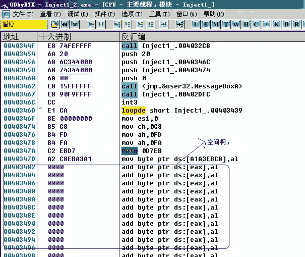   
   
为了方便我们以后写程序注入,我们将代码段修改为可写.那样就不用再用程序来修改属性.  
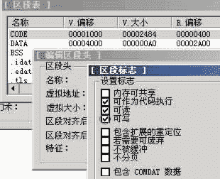   
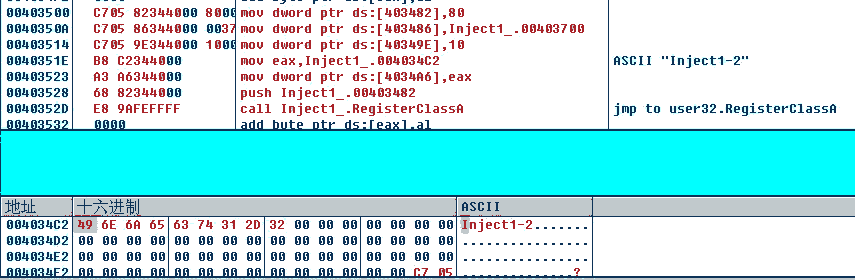   
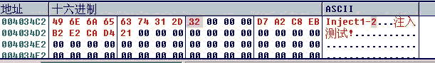   
   
现在开始构建代码.  
确定我们代码的开始点.这里我们选 403500 为代码开始.注入也需要把代码从这里开始写.  
这之前的代码我们用来当作全局变量.比如 class 类啊,form’s handle 啊.什么的.我也不能确定够不够,不过先用着,不够再说.  
现在开始按照流程来构建代码.先注册 class.  
我们来确定 class 变量的大小和存放位置.我们看一下大小刚好 40byte.然后我们找一个存放位置.为了节约\*\_\*,我们就从 403482 开始.我们要记住,从 403482 开始的 40 字节是 class 的空间.就不要在后面用到拉.要不然容易出错.  
我们看看 class 结构  tagWNDCLASSA = packed record  
    style: UINT;  //cardinal  4 字节  
    lpfnWndProc: TFNWndProc;//pointer 4 字节  
    cbClsExtra: Integer;  //4 字节  
    cbWndExtra: Integer;  //4 字节  
    hInstance: HINST;    //cardinal 4 字节  
    hIcon: HICON;    //cardinal 4 字节  
    hCursor: HCURSOR;  //cardinal 4 字节  
    hbrBackground: HBRUSH;  //cardinal 4 字节  
    lpszMenuName: PAnsiChar;  //pointer to char 4 字节  
    lpszClassName: PAnsiChar; //pointer to char 4 字节  
  end;  
这样刚好 40 字节。为了方便我们只需要给出最简单的关键的东西就可以拉。比如 style, lpfnWndProc, hbrBackground, lpszClassName;  
我们先模拟一下代码  
  with \_wClass do  
  begin  
    Style:=CS\_PARENTDC;//$80  
    lpfnWndProc:=@ proc; //403700 我们需要的消息处理过程  
    hbrBackground:= COLOR\_BTNFACE+1; //$16  
    lpszClassName:= 'Inject1-2';  
  end;  
  
还原成汇编：  
00403482    0000                add byte ptr ds:\[eax\],al  
00403484    0000                add byte ptr ds:\[eax\],al  
00403486    0000                add byte ptr ds:\[eax\],al  
00403488    0000                add byte ptr ds:\[eax\],al  
0040348A    0000                add byte ptr ds:\[eax\],al  
0040348C    0000                add byte ptr ds:\[eax\],al  
0040348E    0000                add byte ptr ds:\[eax\],al  
00403490    0000                add byte ptr ds:\[eax\],al  
00403492    0000                add byte ptr ds:\[eax\],al  
00403494    0000                add byte ptr ds:\[eax\],al  
00403496    0000                add byte ptr ds:\[eax\],al  
00403498    0000                add byte ptr ds:\[eax\],al  
0040349A    0000                add byte ptr ds:\[eax\],al  
0040349C    0000                add byte ptr ds:\[eax\],al  
0040349E    0000                add byte ptr ds:\[eax\],al  
004034A0    0000                add byte ptr ds:\[eax\],al  
004034A2    0000                add byte ptr ds:\[eax\],al  
004034A4    0000                add byte ptr ds:\[eax\],al  
004034A6    0000                add byte ptr ds:\[eax\],al  
004034A8    0000                add byte ptr ds:\[eax\],al  
004034AA    0000                add byte ptr ds:\[eax\],al  
004034AC    0000                add byte ptr ds:\[eax\],al  
004034AE    0000                add byte ptr ds:\[eax\],al  
004034B0    0000                add byte ptr ds:\[eax\],al  
004034B2    0000                add byte ptr ds:\[eax\],al  
004034B4    0000                add byte ptr ds:\[eax\],al  
004034B6    0000                add byte ptr ds:\[eax\],al  
004034B8    0000                add byte ptr ds:\[eax\],al  
004034BA    0000                add byte ptr ds:\[eax\],al  
004034BC    0000                add byte ptr ds:\[eax\],al  
004034BE    0000                add byte ptr ds:\[eax\],al  
004034C0    0000                add byte ptr ds:\[eax\],al  
//class 变量  
004034C2    49                  dec ecx  
004034C3    6E                  outs dx,byte ptr es:\[edi\]  
004034C4    6A 65               push 65  
004034C6    637431 2D           arpl word ptr ds:\[ecx+esi+2D\],si  
004034CA    3200                xor al,byte ptr ds:\[eax\]  
004034CC    0000                add byte ptr ds:\[eax\],al  
004034CE    D7                  xlat byte ptr ds:\[ebx+al\]  
004034CF    A2 C8EBB2E2         mov byte ptr ds:\[E2B2EBC8\],al  
004034D4    CA D421             retf 21D4  
String //Inject1-2 and 注入测试  
   
004034D7    0000                add byte ptr ds:\[eax\],al  
004034D9    0000                add byte ptr ds:\[eax\],al  
004034DB    0000                add byte ptr ds:\[eax\],al  
004034DD    0000                add byte ptr ds:\[eax\],al  
004034DF    0000                add byte ptr ds:\[eax\],al  
004034E1    0000                add byte ptr ds:\[eax\],al  
004034E3    0000                add byte ptr ds:\[eax\],al  
004034E5    0000                add byte ptr ds:\[eax\],al  
004034E7    0000                add byte ptr ds:\[eax\],al  
004034E9    0000                add byte ptr ds:\[eax\],al  
004034EB    0000                add byte ptr ds:\[eax\],al  
004034ED    0000                add byte ptr ds:\[eax\],al  
004034EF    0000                add byte ptr ds:\[eax\],al  
004034F1    0000                add byte ptr ds:\[eax\],al  
004034F3    0000                add byte ptr ds:\[eax\],al  
004034F5    0000                add byte ptr ds:\[eax\],al  
004034F7    0000                add byte ptr ds:\[eax\],al  
004034F9    0000                add byte ptr ds:\[eax\],al  
004034FB    0000                add byte ptr ds:\[eax\],al  
004034FD    0000                add byte ptr ds:\[eax\],al  
004034FF    00C7                add bh,al  
00403501    05 82344000         add eax,Inject1\_.00403482  
00403506    8000 00             add byte ptr ds:\[eax\],0  
00403509    00C7                add bh,al  
0040350B    05 86344000         add eax,Inject1\_.00403486  
00403510    0037                add byte ptr ds:\[edi\],dh  
00403512    40                  inc eax  
00403513    00C7                add bh,al  
00403515    05 9E344000         add eax,Inject1\_.0040349E  
0040351A    1000                adc byte ptr ds:\[eax\],al  
0040351C    0000                add byte ptr ds:\[eax\],al  
0040351E    B8 C2344000         mov eax,Inject1\_.004034C2                       ; ASCII "Inject1-2"  
00403523    A3 A6344000         mov dword ptr ds:\[4034A6\],eax  
00403528    68 82344000         push Inject1\_.00403482  
0040352D    E8 9AFEFFFF         call Inject1\_.RegisterClassA                    ; jmp to user32.RegisterClassA  
00403532    6A 00               push 0  
00403534    68 00004000         push Inject1\_.00400000                          ; ASCII "MZP"  
00403539    6A 00               push 0  
0040353B    6A 00               push 0  
0040353D    68 AA000000         push 0AA  
00403542    68 0E010000         push 10E  
00403547    6A 64               push 64  
00403549    6A 64               push 64  
0040354B    68 00000810         push 10080000  
00403550    68 CE344000         push Inject1\_.004034CE  
00403555    68 C2344000         push Inject1\_.004034C2                          ; ASCII "Inject1-2"  
0040355A    6A 00               push 0  
0040355C    E8 5BFEFFFF         call Inject1\_.CreateWindowExA                   ; jmp to user32.CreateWindowExA  
00403561    A3 D9344000         mov dword ptr ds:\[4034D9\],eax  
00403566    EB 0C               jmp short Inject1\_.00403574  
00403568    53                  push ebx  
00403569    E8 56FEFFFF         call Inject1\_.TranslateMessage                  ; jmp to user32.TranslateMessage  
0040356E    53                  push ebx  
0040356F    E8 68FEFFFF         call Inject1\_.DispatchMessageA                  ; jmp to user32.DispatchMessageA  
00403574    6A 00               push 0  
00403576    6A 00               push 0  
00403578    A1 D9344000         mov eax,dword ptr ds:\[4034D9\]  
0040357D    50                  push eax  
0040357E    53                  push ebx  
0040357F    E8 50FEFFFF         call Inject1\_.GetMessageA                       ; jmp to user32.GetMessageA  
00403584    85C0                test eax,eax  
00403586  ^ 75 E0               jnz short Inject1\_.00403568  
00403588    5B                  pop ebx  
00403589    C3                  retn  
0040358A    0000                add byte ptr ds:\[eax\],al  
0040358C    0000                add byte ptr ds:\[eax\],al  
0040358E    0000                add byte ptr ds:\[eax\],al  
00403590    0000                add byte ptr ds:\[eax\],al  
00403592    0000                add byte ptr ds:\[eax\],al  
00403594    0000                add byte ptr ds:\[eax\],al  
00403596    0000                add byte ptr ds:\[eax\],al  
00403598    0000                add byte ptr ds:\[eax\],al  
0040359A    0000                add byte ptr ds:\[eax\],al  
0040359C    0000                add byte ptr ds:\[eax\],al  
0040359E    0000                add byte ptr ds:\[eax\],al  
004035A0    0000                add byte ptr ds:\[eax\],al  
004035A2    0000                add byte ptr ds:\[eax\],al  
004035A4    0000                add byte ptr ds:\[eax\],al  
004035A6    0000                add byte ptr ds:\[eax\],al  
004035A8    0000                add byte ptr ds:\[eax\],al  
004035AA    0000                add byte ptr ds:\[eax\],al  
004035AC    0000                add byte ptr ds:\[eax\],al  
004035AE    0000                add byte ptr ds:\[eax\],al  
004035B0    0000                add byte ptr ds:\[eax\],al  
004035B2    0000                add byte ptr ds:\[eax\],al  
004035B4    0000                add byte ptr ds:\[eax\],al  
004035B6    0000                add byte ptr ds:\[eax\],al  
004035B8    0000                add byte ptr ds:\[eax\],al  
004035BA    0000                add byte ptr ds:\[eax\],al  
004035BC    0000                add byte ptr ds:\[eax\],al  
004035BE    0000                add byte ptr ds:\[eax\],al  
004035C0    0000                add byte ptr ds:\[eax\],al  
004035C2    0000                add byte ptr ds:\[eax\],al  
004035C4    0000                add byte ptr ds:\[eax\],al  
004035C6    0000                add byte ptr ds:\[eax\],al  
004035C8    0000                add byte ptr ds:\[eax\],al  
004035CA    0000                add byte ptr ds:\[eax\],al  
004035CC    0000                add byte ptr ds:\[eax\],al  
004035CE    0000                add byte ptr ds:\[eax\],al  
004035D0    0000                add byte ptr ds:\[eax\],al  
004035D2    0000                add byte ptr ds:\[eax\],al  
004035D4    0000                add byte ptr ds:\[eax\],al  
004035D6    0000                add byte ptr ds:\[eax\],al  
004035D8    0000                add byte ptr ds:\[eax\],al  
004035DA    0000                add byte ptr ds:\[eax\],al  
004035DC    0000                add byte ptr ds:\[eax\],al  
004035DE    0000                add byte ptr ds:\[eax\],al  
004035E0    0000                add byte ptr ds:\[eax\],al  
004035E2    0000                add byte ptr ds:\[eax\],al  
004035E4    0000                add byte ptr ds:\[eax\],al  
004035E6    0000                add byte ptr ds:\[eax\],al  
004035E8    0000                add byte ptr ds:\[eax\],al  
004035EA    0000                add byte ptr ds:\[eax\],al  
004035EC    0000                add byte ptr ds:\[eax\],al  
004035EE    0000                add byte ptr ds:\[eax\],al  
004035F0    0000                add byte ptr ds:\[eax\],al  
004035F2    0000                add byte ptr ds:\[eax\],al  
004035F4    0000                add byte ptr ds:\[eax\],al  
004035F6    0000                add byte ptr ds:\[eax\],al  
004035F8    0000                add byte ptr ds:\[eax\],al  
004035FA    0000                add byte ptr ds:\[eax\],al  
004035FC    0000                add byte ptr ds:\[eax\],al  
004035FE    0000                add byte ptr ds:\[eax\],al  
00403600    0000                add byte ptr ds:\[eax\],al  
00403602    0000                add byte ptr ds:\[eax\],al  
00403604    0000                add byte ptr ds:\[eax\],al  
00403606    0000                add byte ptr ds:\[eax\],al  
00403608    0000                add byte ptr ds:\[eax\],al  
0040360A    0000                add byte ptr ds:\[eax\],al  
0040360C    0000                add byte ptr ds:\[eax\],al  
0040360E    0000                add byte ptr ds:\[eax\],al  
00403610    0000                add byte ptr ds:\[eax\],al  
00403612    0000                add byte ptr ds:\[eax\],al  
00403614    0000                add byte ptr ds:\[eax\],al  
00403616    0000                add byte ptr ds:\[eax\],al  
00403618    0000                add byte ptr ds:\[eax\],al  
0040361A    0000                add byte ptr ds:\[eax\],al  
0040361C    0000                add byte ptr ds:\[eax\],al  
0040361E    0000                add byte ptr ds:\[eax\],al  
00403620    0000                add byte ptr ds:\[eax\],al  
00403622    0000                add byte ptr ds:\[eax\],al  
00403624    0000                add byte ptr ds:\[eax\],al  
00403626    0000                add byte ptr ds:\[eax\],al  
00403628    0000                add byte ptr ds:\[eax\],al  
0040362A    0000                add byte ptr ds:\[eax\],al  
0040362C    0000                add byte ptr ds:\[eax\],al  
0040362E    0000                add byte ptr ds:\[eax\],al  
00403630    0000                add byte ptr ds:\[eax\],al  
00403632    0000                add byte ptr ds:\[eax\],al  
00403634    0000                add byte ptr ds:\[eax\],al  
00403636    0000                add byte ptr ds:\[eax\],al  
00403638    0000                add byte ptr ds:\[eax\],al  
0040363A    0000                add byte ptr ds:\[eax\],al  
0040363C    0000                add byte ptr ds:\[eax\],al  
0040363E    0000                add byte ptr ds:\[eax\],al  
00403640    0000                add byte ptr ds:\[eax\],al  
00403642    0000                add byte ptr ds:\[eax\],al  
00403644    0000                add byte ptr ds:\[eax\],al  
00403646    0000                add byte ptr ds:\[eax\],al  
00403648    0000                add byte ptr ds:\[eax\],al  
0040364A    0000                add byte ptr ds:\[eax\],al  
0040364C    0000                add byte ptr ds:\[eax\],al  
0040364E    0000                add byte ptr ds:\[eax\],al  
00403650    0000                add byte ptr ds:\[eax\],al  
00403652    0000                add byte ptr ds:\[eax\],al  
00403654    0000                add byte ptr ds:\[eax\],al  
00403656    0000                add byte ptr ds:\[eax\],al  
00403658    0000                add byte ptr ds:\[eax\],al  
0040365A    0000                add byte ptr ds:\[eax\],al  
0040365C    0000                add byte ptr ds:\[eax\],al  
0040365E    0000                add byte ptr ds:\[eax\],al  
00403660    0000                add byte ptr ds:\[eax\],al  
00403662    0000                add byte ptr ds:\[eax\],al  
00403664    0000                add byte ptr ds:\[eax\],al  
00403666    0000                add byte ptr ds:\[eax\],al  
00403668    0000                add byte ptr ds:\[eax\],al  
0040366A    0000                add byte ptr ds:\[eax\],al  
0040366C    0000                add byte ptr ds:\[eax\],al  
0040366E    0000                add byte ptr ds:\[eax\],al  
00403670    0000                add byte ptr ds:\[eax\],al  
00403672    0000                add byte ptr ds:\[eax\],al  
00403674    0000                add byte ptr ds:\[eax\],al  
00403676    0000                add byte ptr ds:\[eax\],al  
00403678    0000                add byte ptr ds:\[eax\],al  
0040367A    0000                add byte ptr ds:\[eax\],al  
0040367C    0000                add byte ptr ds:\[eax\],al  
0040367E    0000                add byte ptr ds:\[eax\],al  
00403680    0000                add byte ptr ds:\[eax\],al  
00403682    0000                add byte ptr ds:\[eax\],al  
00403684    0000                add byte ptr ds:\[eax\],al  
00403686    0000                add byte ptr ds:\[eax\],al  
00403688    0000                add byte ptr ds:\[eax\],al  
0040368A    0000                add byte ptr ds:\[eax\],al  
0040368C    0000                add byte ptr ds:\[eax\],al  
0040368E    0000                add byte ptr ds:\[eax\],al  
00403690    0000                add byte ptr ds:\[eax\],al  
00403692    0000                add byte ptr ds:\[eax\],al  
00403694    0000                add byte ptr ds:\[eax\],al  
00403696    0000                add byte ptr ds:\[eax\],al  
00403698    0000                add byte ptr ds:\[eax\],al  
0040369A    0000                add byte ptr ds:\[eax\],al  
0040369C    0000                add byte ptr ds:\[eax\],al  
0040369E    0000                add byte ptr ds:\[eax\],al  
004036A0    0000                add byte ptr ds:\[eax\],al  
004036A2    0000                add byte ptr ds:\[eax\],al  
004036A4    0000                add byte ptr ds:\[eax\],al  
004036A6    0000                add byte ptr ds:\[eax\],al  
004036A8    0000                add byte ptr ds:\[eax\],al  
004036AA    0000                add byte ptr ds:\[eax\],al  
004036AC    0000                add byte ptr ds:\[eax\],al  
004036AE    0000                add byte ptr ds:\[eax\],al  
004036B0    0000                add byte ptr ds:\[eax\],al  
004036B2    0000                add byte ptr ds:\[eax\],al  
004036B4    0000                add byte ptr ds:\[eax\],al  
004036B6    0000                add byte ptr ds:\[eax\],al  
004036B8    0000                add byte ptr ds:\[eax\],al  
004036BA    0000                add byte ptr ds:\[eax\],al  
004036BC    0000                add byte ptr ds:\[eax\],al  
004036BE    0000                add byte ptr ds:\[eax\],al  
004036C0    0000                add byte ptr ds:\[eax\],al  
004036C2    0000                add byte ptr ds:\[eax\],al  
004036C4    0000                add byte ptr ds:\[eax\],al  
004036C6    0000                add byte ptr ds:\[eax\],al  
004036C8    0000                add byte ptr ds:\[eax\],al  
004036CA    0000                add byte ptr ds:\[eax\],al  
004036CC    0000                add byte ptr ds:\[eax\],al  
004036CE    0000                add byte ptr ds:\[eax\],al  
004036D0    0000                add byte ptr ds:\[eax\],al  
004036D2    0000                add byte ptr ds:\[eax\],al  
004036D4    0000                add byte ptr ds:\[eax\],al  
004036D6    0000                add byte ptr ds:\[eax\],al  
004036D8    0000                add byte ptr ds:\[eax\],al  
004036DA    0000                add byte ptr ds:\[eax\],al  
004036DC    0000                add byte ptr ds:\[eax\],al  
004036DE    0000                add byte ptr ds:\[eax\],al  
004036E0    0000                add byte ptr ds:\[eax\],al  
004036E2    0000                add byte ptr ds:\[eax\],al  
004036E4    0000                add byte ptr ds:\[eax\],al  
004036E6    0000                add byte ptr ds:\[eax\],al  
004036E8    0000                add byte ptr ds:\[eax\],al  
004036EA    0000                add byte ptr ds:\[eax\],al  
004036EC    0000                add byte ptr ds:\[eax\],al  
004036EE    0000                add byte ptr ds:\[eax\],al  
004036F0    0000                add byte ptr ds:\[eax\],al  
004036F2    0000                add byte ptr ds:\[eax\],al  
004036F4    0000                add byte ptr ds:\[eax\],al  
004036F6    0000                add byte ptr ds:\[eax\],al  
004036F8    0000                add byte ptr ds:\[eax\],al  
004036FA    0000                add byte ptr ds:\[eax\],al  
004036FC    0000                add byte ptr ds:\[eax\],al  
004036FE    0000                add byte ptr ds:\[eax\],al  
00403700    55                  push ebp  
00403701    8BEC                mov ebp,esp  
00403703    53                  push ebx  
00403704    56                  push esi  
00403705    8B5D 0C             mov ebx,dword ptr ss:\[ebp+C\]  
00403708    8B45 14             mov eax,dword ptr ss:\[ebp+14\]  
0040370B    50                  push eax  
0040370C    8B45 10             mov eax,dword ptr ss:\[ebp+10\]  
0040370F    50                  push eax  
00403710    53                  push ebx  
00403711    8B45 08             mov eax,dword ptr ss:\[ebp+8\]  
00403714    50                  push eax  
00403715    E8 CAFCFFFF         call Inject1\_.DefWindowProcA                    ; jmp to user32.DefWindowProcA  
0040371A    8BF0                mov esi,eax  
0040371C    83FB 10             cmp ebx,10  
0040371F    75 07               jnz short Inject1\_.00403728  
00403721    6A 01               push 1  
00403723    E8 00D9FFFF         call <jmp.&kernel32.ExitProcess>  
00403728    8BC6                mov eax,esi  
0040372A    5E                  pop esi  
0040372B    5B                  pop ebx  
0040372C    5D                  pop ebp  
0040372D    C2 1000             retn 10  
00403730    0000                add byte ptr ds:\[eax\],al  
00403732    0000                add byte ptr ds:\[eax\],al  
00403734    0000                add byte ptr ds:\[eax\],al  
00403736    0000                add byte ptr ds:\[eax\],al  
00403738    0000                add byte ptr ds:\[eax\],al  
0040373A    0000                add byte ptr ds:\[eax\],al  
  
汇编详细手工构建过程我就不多说啦，好像与主题联系不大。所以略。  
为了方便读者，哦不对，是众多看雪好友能测试，我将这些代码弄成了一个流文件保存在 inject1-2 下面。这样你可以不必手工来构建代码。  
代码构建好后，我们开始写程序来注入。  
我们看看我们的测试程序。Inject1\_2.exe。先运行看看效果  
    
很显然程序代码很少，就一个 MessageBoxA  
  
  
program Inject1\_2;  
uses  
  Windows;  
{$R \*.res}  
procedure CreateWindowExA;external 'User32.dll' name 'CreateWindowExA';  
procedure TranslateMessage;external 'User32.dll' name 'TranslateMessage';  
procedure RegisterClassA;external 'User32.dll' name 'RegisterClassA';  
procedure GetMessageA;external 'User32.dll' name 'GetMessageA';  
procedure DispatchMessageA;external 'User32.dll' name 'DispatchMessageA';  
procedure DefWindowProcA;external 'User32.dll' name 'DefWindowProcA';  
exports CreateWindowExA,TranslateMessage,RegisterClassA,GetMessageA,DispatchMessageA,DefWindowProcA;  
begin  
  MessageBox(0, '等待代码注入！', '提示', MB\_OK + MB\_ICONQUESTION);  
end.  
这是程序源代码。之所以多出了很几个静态调用是应为为了构建代码方便，让程序编译的时候把这些函数编译到输入表中。这样我们会方便些。  
program InjectPro;  
  
uses  
  Windows,Classes,SysUtils;  
  
{$R \*.res}  
type  
  pprocess  = ^tprocessinformation;  
var  
  \_ProcessInfo:TProcessInformation; //进程信息  
  \_StartUpInfo: TStartUpInfo;       //进程信息  
  \_realwrite:cardinal;  
  \_Injectcode:TMemoryStream;  
begin{调试进程}  
  \_Injectcode:=TMemoryStream.Create;  
  \_Injectcode.LoadFromFile(ExtractFilePath(ParamStr(0))+'injectcode.stream');  
  FillChar(\_StartupInfo,SizeOf(TStartupInfo), 0);  
  CreateProcess(PChar(ExtractFilePath(ParamStr(0))+'Inject1\_2.exe') ,nil,nil,nil, False,NORMAL\_PRIORITY\_CLASS ,nil,nil,\_StartupInfo,\_ProcessInfo);  
  VirtualProtectEx(\_ProcessInfo.hProcess,Pointer($403000),$1000 ,PAGE\_READWRITE,\_realwrite);  
//修改内存属性为可写。  
  WriteProcessMemory(\_ProcessInfo.hProcess,Pointer($403482),\_Injectcode.memory,\_Injectcode.size ,\_realwrite);  
写入代码。  
  CreateRemoteThread(\_ProcessInfo.hProcess,nil,0,Pointer($403500),nil,NORMAL\_PRIORITY\_CLASS ,\_realwrite);  
end.  
运行注入的代码。  
运行效果：  
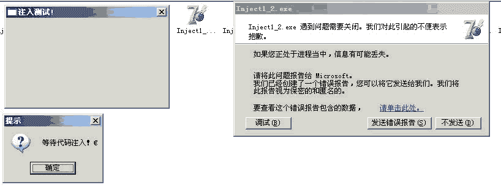    
很显然，注入成功啦。但是程序出现了一个小小的错误，肯定是我们构建代码的问题，但是我没有去分析错误，因为这已经证明我们的代码注入是成功的拉。  
我同样用静态注入的方法注入了这个程序，名字为 Inject1\_2\_test.exe。工作成功！。  
运行效果：  
 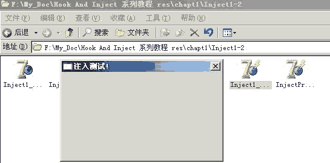   
  
。到此我们的动态注入之 CreateRemoteThread 就告一段落。^\_^  
  
  
代码注入之 OEP 前的噩梦  
  
很多时候我们需要在程序运行前和被 windowsPE 载入器载入之间做些其他的工作来完成一些工作以达到一些目的。这对于脱壳和破解尤其有用，比如我么这样注入程序然后 HooK 一些函数。  
我们首先来看看原理图。  
    
这个原理图和我刚开始讲的静态图一模一样，程序工作的时候，现从 1-〉2-〉（运行注入的代码）3，然后返回原程序 OEP.继续执行程序。不同的是。这里我们注入的代码时动态注入，而且代码已经改变。可以装入其他 dll 这样让我们注入的代码可以是 dll,这意味着什么？意味着我们可以将我们自己的程序都整体注入到其他程序中。而且注入方法比较通用。  
好了。目的已经明确，我们首先来构建注入代码。和准备 Dll.Dll 文件我们可以随便找一个，也可以自己写，在这章的 dll 是我用 delphi 写的只拥有一个窗口的程序（Inject1\_3\_DLL.dll）。  
现在来构建装入 dll 的代码。相信大家都知道纯汇编调用 loadlibraryA 装入 dll。我们就来一步一步构建代码。  
看看我们需要什么---------^\_^  
Loadlibrary’s handle?  
Module name?  
其他的呢？空间?  
一个个解决，我们知道在 windows 中，核心模块例如 kernel32.dll 这样的连接库装入的首地址都是一样的。也就是说函数句柄也是一样的。所以 loadlibrary’s handle 我们可以通过取得注入程序的函数句柄来作为目标程序的函数句柄。当然你也可以从目标程序中取得，但是比较麻烦而以。一般我不会那样做。Module Name 当然不用说。至于空间问题。我们不用担心。PE 头的 dossub 已经够我们用的了。当然如果愿意你也可以去找空间。或者申请。2000 和后继版本系统有专么的函数 VirtualAllocEx 可以在目标程序申请内存空间，但是考虑到兼容性的问题我们不讨论使用那种方法。  
我们在来分析一下注入需要做的工作。  
首先我们没有更改程序文件，那么 OEP 是我们无法确定的。所以我们需要把 OEP 的代码拷贝 5 字节作备份，为什么是 5 字节？因为一个长条转刚好 5 字节，也许你已经想到了。我们需要让程序已开始运行就跳到我们的代码开始。当然我们的代码结尾还需要恢复 OEP 的 5 字节代码。然后再跳回 OEP,继续执行程序。  
20067413    49                  dec ecx  
20067414    6E                  outs dx,byte ptr es:\[edi\]  
20067415    6A 65               push 65  
20067417    637431 5F           arpl word ptr ds:\[ecx+esi+5F\],si  
2006741B    335F 44             xor ebx,dword ptr ds:\[edi+44\]  
2006741E    4C                  dec esp  
2006741F    4C                  dec esp  
20067420    2E:                 prefix cs:  
20067421    64:6C               ins byte ptr es:\[edi\],dx  
20067423    6C                  ins byte ptr es:\[edi\],dx  
20067424    0000                add byte ptr ds:\[eax\],al  
上面为模块名字。Module name   Inject1\_3\_Dll.Dll  
20067426    50                  push eax  
//保存 eax  
20067427    E8 00000000         call Cmp\_Pdbg.2006742C  
2006742C    58                  pop eax  
//get eip  
2006742D    83E8 19             sub eax,19  
计算模块名称地址  
20067430    50                  push eax  
保存，作为调用 loadlibraryA 函数的参数。  
20067431    83C0 34             add eax,34  
计算函数返回地址（2006743B）;为模拟 call 作准备  
20067434    50                  push eax  
20067435    68 43323402         push XXXXXXXX  
Xxxxxxxx 为我们需要的函数句柄，也就是 loadlibraryA 的入口地址  
2006743A    C3                  retn  
调用 LoadlibraryA  
2006743B    58                  pop eax  
恢复 EAX  
2006743C    C705 32344223 43434>mov dword ptr ds:\[OEP\],xxxxxx  
恢复 OEP 处的代码,这里的 OEP 需要程序来填写.xxxxxx 代码.也需要程序来填写.  
20067446    C605 32244332 43    mov byte ptr ds:\[OEP+4\],xx  
同上  
2006743C    68 43434343         push xxxxxxxx  
20067441    C3                  retn  
模拟 jmp 返回 OEP  
代码中我们 2 次用到了模拟，模拟 call 和 jmp,为什么呢？哈哈，是因为 call 和 jmp 是用的偏移,所以我们模拟避免去计算偏移.  
接下来的事情就是用程序来填写 XXXXXXXX 注入这段代码到目标程序的 DosSub 处然后就让程序自己去运行.因为这个时候已经注入成功拉。  
Hfile:=FileOpen(Edit1.Text,fmOpenRead or fmShareDenyNone);  
  FileSeek(Hfile,0,soFromBeginning);  
  FileRead(Hfile,PEDH,SizeOf(PEDH));  
  FileSeek(Hfile,PEDH.\_lfanew,soFromBeginning);  
  FileRead(Hfile,PENH,SizeOf(PENH));  
  FileClose(Hfile);  
  if CheckBox1.Checked then PENH.OptionalHeader.ImageBase:=StrToInt('$'+Edit4.Text)-$50;  
  
  BackAdr:=PENH.OptionalHeader.ImageBase+PENH.OptionalHeader.AddressOfEntryPoint;  
  ModBack:=PENH.OptionalHeader.ImageBase+80;  
  StepAdr:=PENH.OptionalHeader.ImageBase+97;  
  MName:=PENH.OptionalHeader.ImageBase+$80;  
  LoadAdr:=Cardinal(GetProcAddress(GetModuleHandle('Kernel32.dll'),'LoadLibraryA'));  
  i0:=StrToInt('$'+Copy(IntToHex(MName,8),7,2));  
  i1:=StrToInt('$'+Copy(IntToHex(MName,8),5,2));  
  i2:=StrToInt('$'+Copy(IntToHex(MName,8),3,2));  
  i3:=StrToInt('$'+Copy(IntToHex(MName,8),1,2));  
  
  i4:=StrToInt('$'+Copy(IntToHex(StepAdr,8),7,2));  
  i5:=StrToInt('$'+Copy(IntToHex(StepAdr,8),5,2));  
  i6:=StrToInt('$'+Copy(IntToHex(StepAdr,8),3,2));  
  i7:=StrToInt('$'+Copy(IntToHex(StepAdr,8),1,2));  
  
  i8:=StrToInt('$'+Copy(IntToHex(LoadAdr,8),7,2));  
  i9:=StrToInt('$'+Copy(IntToHex(LoadAdr,8),5,2));  
  i10:=StrToInt('$'+Copy(IntToHex(LoadAdr,8),3,2));  
  i11:=StrToInt('$'+Copy(IntToHex(LoadAdr,8),1,2));  
  
  i12:=StrToInt('$'+Copy(IntToHex(BackAdr,8),7,2));  
  i13:=StrToInt('$'+Copy(IntToHex(BackAdr,8),5,2));  
  i14:=StrToInt('$'+Copy(IntToHex(BackAdr,8),3,2));  
  i15:=StrToInt('$'+Copy(IntToHex(BackAdr,8),1,2));  
  
  FillChar(StartupInfo, SizeOf(TStartupInfo), 0);  
  CreateProcess(PChar(Edit1.Text),nil,nil,nil, False,CREATE\_SUSPENDED,nil,nil, StartupInfo, ProcessInfo);  
  VirtualProtectEx(ProcessInfo.hProcess,Pointer(PENH.OptionalHeader.ImageBase),100,PAGE\_writecopy,Hfile);  
  VirtualProtectEx(ProcessInfo.hProcess,Pointer(PENH.OptionalHeader.ImageBase+PENH.OptionalHeader.AddressOfEntryPoint ),10,PAGE\_writecopy,Hfile);  
  ReadProcessMemory(ProcessInfo.hProcess,Pointer(PENH.OptionalHeader.ImageBase+PENH.OptionalHeader.AddressOfEntryPoint),@codetemp,16,Hfile);  
  
  
  i16:=StrToInt('$'+Copy(IntToHex(CodeTemp,16),15,2));  
  i17:=StrToInt('$'+Copy(IntToHex(CodeTemp,16),13,2));  
  i18:=StrToInt('$'+Copy(IntToHex(CodeTemp,16),11,2));  
  i19:=StrToInt('$'+Copy(IntToHex(CodeTemp,16),9,2));  
  i32:=StrToInt('$'+Copy(IntToHex(CodeTemp,16),7,2));  
  i33:=StrToInt('$'+Copy(IntToHex(CodeTemp,16),5,2));  
  i34:=StrToInt('$'+Copy(IntToHex(CodeTemp,16),3,2));  
  i35:=StrToInt('$'+Copy(IntToHex(CodeTemp,16),1,2));  
  
  BackAdr:=BackAdr+4;  
  
  i20:=StrToInt('$'+Copy(IntToHex(BackAdr,8),7,2));  
  i21:=StrToInt('$'+Copy(IntToHex(BackAdr,8),5,2));  
  i22:=StrToInt('$'+Copy(IntToHex(BackAdr,8),3,2));  
  i23:=StrToInt('$'+Copy(IntToHex(BackAdr,8),1,2));  
  
  BackAdr:=BackAdr-4;  
  
  i24:=StrToInt('$'+Copy(IntToHex(BackAdr,8),7,2));  
  i25:=StrToInt('$'+Copy(IntToHex(BackAdr,8),5,2));  
  i26:=StrToInt('$'+Copy(IntToHex(BackAdr,8),3,2));  
  i27:=StrToInt('$'+Copy(IntToHex(BackAdr,8),1,2));  
  
  i28:=StrToInt('$'+Copy(IntToHex(ModBack,8),7,2));  
  i29:=StrToInt('$'+Copy(IntToHex(ModBack,8),5,2));  
  i30:=StrToInt('$'+Copy(IntToHex(ModBack,8),3,2));  
  i31:=StrToInt('$'+Copy(IntToHex(ModBack,8),1,2));  
  
  incodea:=chr($90)+chr($68)+Chr(i0)+Chr(i1)+Chr(i2)+Chr(i3)  
          +chr($68)+Chr(i4)+Chr(i5)+Chr(i6)+Chr(i7)+chr($68)+Chr(i8)  
          +Chr(i9)+Chr(i10)+Chr(i11)+chr($C3)+chr($c7)+chr($05)  
          +Chr(i12)+Chr(i13)+Chr(i14)+Chr(i15)+Chr(i16)+Chr(i17)  
          +Chr(i18)+Chr(i19)+chr($c7)+chr($05)+Chr(i20)+Chr(i21)  
          +Chr(i22)+Chr(i23)+Chr(i32)+Chr(i33)+Chr(i34)+Chr(i35)  
          +chr($68)+chr(i24)+chr(i25)+chr(i26)+chr(i27)+chr($C3);  
  
  WriteProcessMemory(ProcessInfo.hProcess,Pointer(PENH.OptionalHeader.ImageBase+80),PChar(IncodeA),Length(INCodea),Hfile);  
  
  INCodea:=pchar(Edit2.text+Chr($00)+Chr($00));  
  WriteProcessMemory(ProcessInfo.hProcess,Pointer(PENH.OptionalHeader.ImageBase+$80),PChar(Incodea),Length(IncodeA)+2,Hfile);  
  incodea:=chr($68)+chr(i28)+chr(i29)+chr(i30)+chr(i31)+chr($C3);  
  WriteProcessMemory(ProcessInfo.hProcess,Pointer(PENH.OptionalHeader.ImageBase+PENH.OptionalHeader.AddressOfEntryPoint),PChar(IncodeA),Length(INCodea),Hfile);  
  ResumeThread(ProcessInfo.hThread);    
这段代码就是实现上面所说的…当然为了利于理解代码写得很冗长,是取自我的一个注入小工具 Dllinject.exe,没有一步一步.去写程序,是为了节省时间……..  
  
未完待续...      
PS:老家的网终于是开通了啊。以后上网的机会特多  
附件:inject1-2.rar  

 4dd466d0e1e0cc123afbe504da2462ca