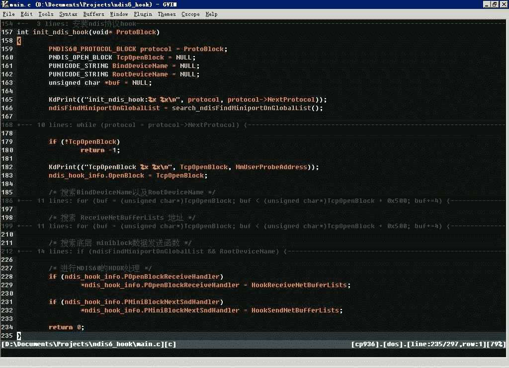

# NDIS6 X86 通用 hook 代码

> 原文：[`www.pediy.com/kssd/pediy12/143507.html`](https://www.pediy.com/kssd/pediy12/143507.html)

原理参见[`www.opscn.com/index.php?actio...rum=1&topic=15`](http://www.opscn.com/index.php?action=vthread&forum=1&topic=15)  

代码:

```
/\*
 \* 安装 ndis 协议 hook
 \*/
int init\_ndis\_hook(void\* ProtoBlock)
{
        PNDIS60\_PROTOCOL\_BLOCK protocol = ProtoBlock;
        PNDIS\_OPEN\_BLOCK TcpOpenBlock = NULL;        
        PUNICODE\_STRING BindDeviceName = NULL;
        PUNICODE\_STRING RootDeviceName = NULL;
        unsigned char \*buf = NULL;

        KdPrint(("init\_ndis\_hook:%x %x\\n", protocol, protocol->NextProtocol));
        ndisFindMiniportOnGlobalList = search\_ndisFindMiniportOnGlobalList();

        while (protocol = protocol->NextProtocol) {
                PUNICODE\_STRING Name = NULL;
                Name = &protocol->Name;

                KdPrint(("Enume protocol %wZ\\n", Name));
                if (0 == wcsncmp(Name->Buffer, (const wchar\_t\*)&L"TCPIP", Name->Length>>1)){
                        TcpOpenBlock = protocol->OpenQueue;
                        break;
                }
        }
        
        if (!TcpOpenBlock)
                return -1;

        KdPrint(("TcpOpenBlock %x %x\\n", TcpOpenBlock, MmUserProbeAddress));
        ndis\_hook\_info.OpenBlock = TcpOpenBlock;

        /\* 搜索 BindDeviceName 以及 RootDeviceName \*/
        for (buf = (unsigned char\*)TcpOpenBlock; buf < (unsigned char\*)TcpOpenBlock + 0x500; buf+=4) {
                if (\*(PULONG)(buf) > MmUserProbeAddress
                        && \*\*(PULONG\*)(buf) == 0x005e005c 
                        && \*\*(PULONG\*)(buf + 4) == 0x005e005c) {
                        BindDeviceName = \*(PUNICODE\_STRING\*)buf;
                        RootDeviceName = \*(PUNICODE\_STRING\*)(buf + 4);
                        ndis\_hook\_info.RootDeviceName = RootDeviceName;
                        KdPrint(("tcp root dev %wZ\\n", RootDeviceName));
                        break;
                }
        }

        /\* 搜索 ReceiveNetBufferLists 地址 \*/
        for (buf = (unsigned char\*)TcpOpenBlock; buf < (unsigned char\*)TcpOpenBlock + 0x500; buf+=4) {
                if (\*(PULONG)(buf) > MmUserProbeAddress
                        && \*(PULONG)(buf) == \*(PULONG)(buf + 4)
                        && \*(PULONG)(buf) == \*(PULONG)(buf + 12)) {
                        /\* buf->tcpip!FlReceiveNetBufferListChain \*/
                        ndis\_hook\_info.POpenBlockReceiveHandler = (PVOID\*)(buf + 8);
                        ndis\_hook\_info.ReceiveNetBufferLists = \*(PVOID\*)(buf + 8);
                        KdPrint(("ReceiveNetBufferLists:%x\\n", \*(PVOID\*)(buf + 8)));
                        break;
                }
        }

        /\* 搜索底层 miniblock 数据发送函数 \*/
        if (ndisFindMiniportOnGlobalList && RootDeviceName) {
                PNDIS\_MINIPORT\_BLOCK miniBlock = ndisFindMiniportOnGlobalList(RootDeviceName);
                if (miniBlock) {
                        /\* 0x16c NextSendNetBufferListsHandler  偏移地址 NDIS6 中固定 \*/
                        PVOID NextSendNetBufferListsHandler = \*(PVOID\*)((char\*)miniBlock + 0x16c);
                        ndis\_hook\_info.MiniBlock = miniBlock;
                        ndis\_hook\_info.PMiniBlockNextSndHandler = (PVOID\*)((char\*)miniBlock + 0x16c);
                        ndis\_hook\_info.NextSendNetBufferListsHandler = NextSendNetBufferListsHandler;
                        KdPrint(("miniBlock: %x %x\\n", miniBlock, NextSendNetBufferListsHandler));
                        
                } else {
                        KdPrint(("ndisFindMiniportOnGlobalList failed!\\n"));
                }
        }

        /\* 进行 NDIS60 的 HOOK 处理 \*/
        if (ndis\_hook\_info.POpenBlockReceiveHandler) 
                \*ndis\_hook\_info.POpenBlockReceiveHandler = HookReceiveNetBuferLists; 

        if (ndis\_hook\_info.PMiniBlockNextSndHandler)
                \*ndis\_hook\_info.PMiniBlockNextSndHandler = HookSendNetBufferLists;

        return 0;
}

```

  
  
WDK7600 编译，Windows7 旗舰版 SP1 测试通过

上传的附件
|  || ndis6\_hook.rar  
 |