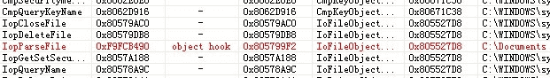
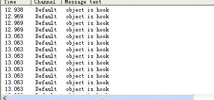

# objectHook 简单介绍

> 原文：[`www.pediy.com/kssd/pediy12/128161.html`](https://www.pediy.com/kssd/pediy12/128161.html)

其实这东西很多大牛多玩腻了的东西，看下论坛上比较少这类的，就来献献丑，科普一下 大牛们直接  
可以飘过，这东西主要是自我复习一下 OBJECT 的一些知识，技术这东西久了不弄容易忘记，所以  
拿出来跟和我一样菜的菜鸟们分享一下。如果有不对的地方欢迎大家指正，这样对于自己也进步得  
快点，多多交流，互相学习，水平才能提高得快。  
   第一我们先看下 OBJECT 的组成 主要是 3 部分 如下图  
                
         |---------|   
             | 附加信息| --->  主要的几个结构是 OBJECT\_HEADER\_CREATOR\_INFO 创建信息   
                              OBJECT\_HEADER\_NAME\_INFO 这里面有对象名等主要信息   
                              OBJECT\_HEADER\_HANDLE\_INFO 一些句柄信息            
         |\_\_\_\_\_\_\_\_\_|                   
             |                   |   
             | 对象头      |---->     一个重要的结构   OBJECT\_HEADER                
             |\_\_\_\_\_\_\_\_\_|    
             |                  |   
             | OBJECT      | --->       对象                  
         |\_\_\_\_\_\_\_\_\_|    
   我们主要看下 OBJECT\_HEADER 这个数据结构几个重要我成员我注释出来  
  
typedef struct \_OBJECT\_HEADER {   
  LONG PointerCount;   
  union {   
    LONG HandleCount;   
    PSINGLE\_LIST\_ENTRY SEntry;   
  };   
  POBJECT\_TYPE Type; //这个很重要 HOOK 就靠它，对象类型结构也是一个对象，TYPE 它是系统第一个创建出来的对象类型   
  UCHAR NameInfoOffset; //OBJECT\_HEADER\_NAME\_INFO 偏移  
  UCHAR HandleInfoOffset; //OBJECT\_HEADER\_HANDLE\_INFO 偏移  
  UCHAR QuotaInfoOffset;   
  UCHAR Flags;   
  union   
  {   
    POBJECT\_CREATE\_INFORMATION ObjectCreateInfo;   
    PVOID QuotaBlockCharged;   
  };  
    
  PSECURITY\_DESCRIPTOR SecurityDescriptor;   
  QUAD Body;//对象本身   
} OBJECT\_HEADER, \*POBJECT\_HEADER;   
对象类型结构  
typedef struct \_OBJECT\_TYPE {   
  ERESOURCE Mutex;   
  LIST\_ENTRY TypeList; //队列  
  UNICODE\_STRING Name;   
  PVOID DefaultObject;   
  ULONG Index;   
  ULONG TotalNumberOfObjects;   
  ULONG TotalNumberOfHandles;   
  ULONG HighWaterNumberOfObjects;   
  ULONG HighWaterNumberOfHandles;   
  OBJECT\_TYPE\_INITIALIZER TypeInfo; //这个很重要，下面讲这个结构  
#ifdef POOL\_TAGGING   
  ULONG Key;   
#endif   
} OBJECT\_TYPE, \*POBJECT\_TYPE;  
对象类型结构主要是创建对象类型比如\*IoFileObjectType，\*PsProcessType，\*PsThreadType 这些类型  
系统初始化的时候第一个创建的对象类型结构就是 TYPE 类型结构生成对象目录\\ObjectTypes 其它后面的  
比如文件对象类型就挂在\\ObjectTypes\\File 再比如\\ObjectTypes\\Device  
说白点就是你要生成对象就会创建(指定)相对应的对象类型结构  
 最重要的一个数据结构  
typedef struct \_OBJECT\_TYPE\_INITIALIZER {  
  USHORT Length;  
  BOOLEAN UseDefaultObject;  
  BOOLEAN CaseInsensitive;  
  ULONG InvalidAttributes;  
  GENERIC\_MAPPING GenericMapping;  
  ULONG ValidAccessMask;  
  BOOLEAN SecurityRequired;  
  BOOLEAN MaintainHandleCount;  
  BOOLEAN MaintainTypeList;  
  POOL\_TYPE PoolType;  
  ULONG DefaultPagedPoolCharge;  
  ULONG DefaultNonPagedPoolCharge;  
  PVOID DumpProcedure;/\*  
  PVOID OpenProcedure;        这几个函数指针就是我们最需要的  
  PVOID CloseProcedure;       这些函数都是决定你的对象的的一些  
  PVOID DeleteProcedure;      操作或者叫方法，比如打开 创建 删除  
  PVOID ParseProcedure;       不同的对象类型(OBJECT\_TYPE)操作也不同  
  PVOID SecurityProcedure;    所以要清楚的知道(OBJECT\_TYPE)对象是什么类型  
  PVOID QueryNameProcedure;   如果没有配置系统调用的对象类型 都是用 NtOpenFile  
  PVOID OkayToCloseProcedure;\*/  
} OBJECT\_TYPE\_INITIALIZER, \*POBJECT\_TYPE\_INITIALIZER;  
  
  
这些方法何时被调用呢，我举个例子  
当你调用 NtCreateFile->IoCreateFile->ObOpenObjectByName->ObpLookupObjectName->IopParseFile->IopParseDevice  
IopParseFile 最终也会调用 IopParseDevice  
ObjectHook 其实就是比如你要 HOOK 创建打开就是 OBJECT\_TYPE\_INITIALIZER->ParseProcedure  
说了一大堆废话 上段代码。  
#include <ntddk.h>  
  
#define OBJECT\_TO\_OBJECT\_HEADER(o)\\  
      CONTAINING\_RECORD((o),OBJECT\_HEADER,Body)  
#define CONTAINING\_RECORD(address,type,field)\\  
      ((type\*)(((ULONG\_PTR)address)-(ULONG\_PTR)(&(((type\*)0)->field))))  
  
  
typedef struct \_OBJECT\_TYPE\_INITIALIZER {  
  USHORT Length;  
  BOOLEAN UseDefaultObject;  
  BOOLEAN CaseInsensitive;  
  ULONG InvalidAttributes;  
  GENERIC\_MAPPING GenericMapping;  
  ULONG ValidAccessMask;  
  BOOLEAN SecurityRequired;  
  BOOLEAN MaintainHandleCount;  
  BOOLEAN MaintainTypeList;  
  POOL\_TYPE PoolType;  
  ULONG DefaultPagedPoolCharge;  
  ULONG DefaultNonPagedPoolCharge;  
  PVOID DumpProcedure;  
  PVOID OpenProcedure;  
  PVOID CloseProcedure;  
  PVOID DeleteProcedure;  
  PVOID ParseProcedure;  
  PVOID SecurityProcedure;  
  PVOID QueryNameProcedure;  
  PVOID OkayToCloseProcedure;  
} OBJECT\_TYPE\_INITIALIZER, \*POBJECT\_TYPE\_INITIALIZER;  
  
  
typedef struct \_OBJECT\_TYPE {   
  ERESOURCE Mutex;   
  LIST\_ENTRY TypeList;   
  UNICODE\_STRING Name;   
  PVOID DefaultObject;   
  ULONG Index;   
  ULONG TotalNumberOfObjects;   
  ULONG TotalNumberOfHandles;   
  ULONG HighWaterNumberOfObjects;   
  ULONG HighWaterNumberOfHandles;   
  OBJECT\_TYPE\_INITIALIZER TypeInfo;   
#ifdef POOL\_TAGGING   
  ULONG Key;   
#endif   
} OBJECT\_TYPE, \*POBJECT\_TYPE;  
  
typedef struct \_OBJECT\_CREATE\_INFORMATION {   
  ULONG Attributes;   
  HANDLE RootDirectory;   
  PVOID ParseContext;   
  KPROCESSOR\_MODE ProbeMode;   
  ULONG PagedPoolCharge;   
  ULONG NonPagedPoolCharge;   
  ULONG SecurityDescriptorCharge;   
  PSECURITY\_DESCRIPTOR SecurityDescriptor;   
  PSECURITY\_QUALITY\_OF\_SERVICE SecurityQos;   
  SECURITY\_QUALITY\_OF\_SERVICE SecurityQualityOfService;   
} OBJECT\_CREATE\_INFORMATION, \*POBJECT\_CREATE\_INFORMATION;  
  
  
  
typedef struct \_OBJECT\_HEADER {   
  LONG PointerCount;   
  union {   
    LONG HandleCount;   
    PSINGLE\_LIST\_ENTRY SEntry;   
  };   
  POBJECT\_TYPE Type;   
  UCHAR NameInfoOffset;   
  UCHAR HandleInfoOffset;   
  UCHAR QuotaInfoOffset;   
  UCHAR Flags;   
  union   
  {   
    POBJECT\_CREATE\_INFORMATION ObjectCreateInfo;   
    PVOID QuotaBlockCharged;   
  };  
    
  PSECURITY\_DESCRIPTOR SecurityDescriptor;   
  QUAD Body;   
} OBJECT\_HEADER, \*POBJECT\_HEADER;  
POBJECT\_TYPE pType= NULL;  
POBJECT\_HEADER addrs=NULL;  
PVOID OldParseProcedure = NULL;  
  
  
NTSTATUS NewParseProcedure(IN PVOID ParseObject,  
             IN PVOID ObjectType,  
             IN OUT PACCESS\_STATE AccessState,  
             IN KPROCESSOR\_MODE AccessMode,  
             IN ULONG Attributes,  
             IN OUT PUNICODE\_STRING CompleteName,  
             IN OUT PUNICODE\_STRING RemainingName,  
             IN OUT PVOID Context OPTIONAL,  
             IN PSECURITY\_QUALITY\_OF\_SERVICE SecurityQos OPTIONAL,  
             OUT PVOID \*Object)   
{  
     NTSTATUS Status;  
     KdPrint(("object is hook\\n"));  
   
  \_\_asm  
  {  
      push eax  
      push Object  
      push SecurityQos  
      push Context  
      push RemainingName  
      push CompleteName  
      push Attributes  
      movzx eax, AccessMode  
      push eax  
      push AccessState  
      push ObjectType  
      push ParseObject  
      call OldParseProcedure  
      mov Status, eax  
      pop eax  
  
        
  }   
  return Status;  
  
}  
NTSTATUS Hook()  
{  
  NTSTATUS  Status;  
  HANDLE hFile;  
  UNICODE\_STRING Name;  
  OBJECT\_ATTRIBUTES Attr;  
  IO\_STATUS\_BLOCK ioStaBlock;  
  PVOID pObject = NULL;  
    
    
  RtlInitUnicodeString(&Name,L"\\\\Device\\\\HarddiskVolume1\\\\1.txt");  
  InitializeObjectAttributes(&Attr,&Name,OBJ\_CASE\_INSENSITIVE | OBJ\_KERNEL\_HANDLE ,\\  
    0,NULL);  
  Status = ZwOpenFile(&hFile,GENERIC\_ALL,&Attr,&ioStaBlock,\\  
    0,FILE\_NON\_DIRECTORY\_FILE);  
  if (!NT\_SUCCESS(Status))  
  {  
    KdPrint(("File is Null\\n"));  
    return Status;  
  }  
   
  Status = ObReferenceObjectByHandle(hFile,GENERIC\_ALL,NULL,KernelMode,&pObject,NULL);  
  if (!NT\_SUCCESS(Status))  
  {  
    KdPrint(("Object is Null\\n"));  
    return Status;  
  }  
   
 KdPrint(("pobject is %08X\\n",pObject));  
  
 addrs=OBJECT\_TO\_OBJECT\_HEADER(pObject);//获取对象头  
  
  
pType=addrs->Type;//获取对象类型结构 object-10h  
  
KdPrint(("pType is %08X\\n",pType));  
OldParseProcedure = pType->TypeInfo.ParseProcedure;//获取服务函数原始地址 OBJECT\_TYPE+9C 位置为打开  
KdPrint(("OldParseProcedure addrs is %08X\\n",OldParseProcedure));  
KdPrint(("addrs is %08X\\n",addrs));  
//这里最好检查一下 OldParseProcedure ，我真的是太懒了。  
\_\_asm  
  {  
    cli;  
    mov eax, cr0;  
    and eax, not 10000h;  
    mov cr0, eax;  
  }  
pType->TypeInfo.ParseProcedure = NewParseProcedure;//hook  
  \_\_asm  
  {  
    mov eax, cr0;  
    or eax, 10000h;  
    mov cr0, eax;  
    sti;  
  }  
 Status = ZwClose(hFile);  
  return Status;  
}  
  
NTSTATUS DriverEntry(PDRIVER\_OBJECT DriverObject,PUNICODE\_STRING RegistryPath)  
{  
  NTSTATUS Status = STATUS\_SUCCESS;  
  Status=Hook();  
  return Status;  
}  
  
  
  
