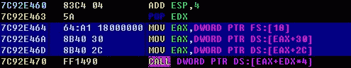
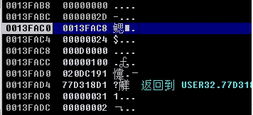
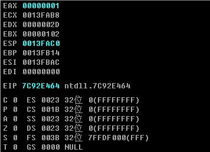
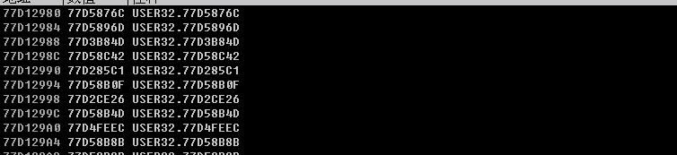
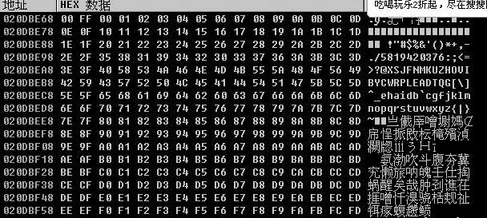

# 从底层分析某软件 2011 版的底层钩子

> 原文：[`www.pediy.com/kssd/pediy12/130932.html`](https://www.pediy.com/kssd/pediy12/130932.html)

无聊拿出来分享一下，送给和我一样菜的朋友，如果有什么不正确的欢迎大家指出  
共同学习共同进步嘛，最近在研究 WINDOWS 的回调机制。又找不到什么好题材，干脆就分析一下  
QQ2011 的底层键盘钩子啦，只为学习，希望大家不要拿来做什么违法的事。  
     首先说下 WINDOWS 的回调吧，其实回调有点像 APC。通俗点讲就是底层调用用户空间函数又  
返回底层主要涉及到的函数就是 KeUserModeCallback 它的作用就是帮回调函数设计好用户空间堆栈  
回调函数返回用户空间的时候让它指向用户空间的分派函数 KiUserCallbackDispatcher 再从    
KernelCallbackTable 表中以 ID 找到对应的中继函数，再从底层传回来的结构中的 PROC 函数指针中  
调用我们的(用户空间)回调函数 , 在调用 KeUserModeCallback 的时候会把三个参数写到用户空间  
堆载，KernelCallbackTable 的 ID，回调函数结构,里面包含了很多信息比如 PROC HOOKID   
包括底层键盘钩子用到的 KBDLLHOOKSTRUCT 结构(lParam),还有个就是这个结构的长度  
在调用完用户空间的函数以后再通过 NtCallbackReturn 返回底层。  
  顺便说下 KernelCallbackTable 在 PEB+0X2C 的位置 XPSP3  
 下图就是 KiUserCallbackDispatcher 调用啦 也就是底层回调到用户层的第一步  
  
  
POP EDX   
   MOV EAX,DWORD PTR FS:\[18\]  
   MOV EAX,DWORD PTR DS:\[EAX+30\]  
   MOV EAX,DWORD PTR DS:\[EAX+2C\] //得到 KernelCallbackTable EDX 保存着 ID  
   CALL DWORD PTR DS:\[EAX+EDX\*4\]  
  
  我们来加载 QQ 设置个条件断点看看寄存器和堆栈有什么内容点击密码输入框  
按个 1，看下  
   从图可以看到寄存器 EDX=2D(ID)   
  
   堆栈上  
  
0013FABC   0000002D  //ID   
0013FAC0   0013FAC8 //回调结构指针  
0013FAC4   00000024  //大小  
0013FAC8   000D0000  //HOOKID  
0013FACC   00000100  //CODE  
0013FAD0   020DC191  //回调函数地址 用户空间  
0013FAD8   00000031  //这个就是我们输入的 1  
  我们进一步跟进去看看  
下图是 KernelCallbackTable 表以 ID 调用的函数  
  
  
//CALL DWORD PTR DS:\[EAX+EDX\*4\] 来到这里  
77D58D54    8BFF            MOV EDI,EDI  
77D58D56    55              PUSH EBP  
77D58D57    8BEC            MOV EBP,ESP  
77D58D59    83EC 0C         SUB ESP,0C  
77D58D5C    8B45 08         MOV EAX,DWORD PTR SS:\[EBP+8\]  
77D58D5F    FF70 08         PUSH DWORD PTR DS:\[EAX+8\]//回调函数地址  
77D58D62    8D48 10         LEA ECX,DWORD PTR DS:\[EAX+10\]//结构地址  
77D58D65    51              PUSH ECX  
77D58D66    FF70 04         PUSH DWORD PTR DS:\[EAX+4\] //CODE  
77D58D69    C745 F8 1400000>MOV DWORD PTR SS:\[EBP-8\],14  
77D58D70    FF30            PUSH DWORD PTR DS:\[EAX\]  //HOOKID  
77D58D72    894D FC         MOV DWORD PTR SS:\[EBP-4\],ECX  
77D58D75    FF50 0C         CALL DWORD PTR DS:\[EAX+C\]//CALL 77D318D1  
到这里就用到我们从底层传上来的结构里的内容啦 我们继续进 CALL  
  
//CALL DWORD PTR DS:\[EAX+C\]//CALL 77D318D1 来到这里省略一些钩子类型检测的代码  
77D31912    8B75 08         MOV ESI,DWORD PTR SS:\[EBP+8\] //lParam  
77D31915    53              PUSH EBX       //wParam  
77D31916    FF75 0C         PUSH DWORD PTR SS:\[EBP+C\]  
77D31919    0FB7FE          MOVZX EDI,SI  
77D3191C    57              PUSH EDI //nCode  
77D3191D    897D F8         MOV DWORD PTR SS:\[EBP-8\],EDI  
77D31920    FF55 14         CALL DWORD PTR SS:\[EBP+14\]  
这里一系列检测完钩子类型以后来到这个 CALL 这里就是  
LRESULT CALLBACK LowLevelKeyboardProc(  
  int nCode,     // hook code  
  WPARAM wParam, // message identifier  
  LPARAM lParam  
这个时候就到了 QQ 的钩子回调函数啦  
  
020DC191    55              PUSH EBP  
020DC192    8BEC            MOV EBP,ESP  
020DC194    83EC 30         SUB ESP,30  
020DC197    56              PUSH ESI  
020DC198    57              PUSH EDI  
020DC199    C745 FC 78BF0D0>MOV DWORD PTR SS:\[EBP-4\],20DBF78  
/\*注意这里这里有个基址很重要很多函数的定位和数据的定位都是它\*/  
020DC1A0    8D7D D0         LEA EDI,DWORD PTR SS:\[EBP-30\]  
020DC1A3    B9 07000000     MOV ECX,7  
020DC1A8    33C0            XOR EAX,EAX  
020DC1AA    FC              CLD  
020DC1AB    F3:AB           REP STOS DWORD PTR ES:\[EDI\]  
020DC1AD    8B45 10         MOV EAX,DWORD PTR SS:\[EBP+10\]//获取 KBDLLHOOKSTRUCT  
  
020DC1B0    8945 F8         MOV DWORD PTR SS:\[EBP-8\],EAX//保存  
020DC1B3    8B4D FC         MOV ECX,DWORD PTR SS:\[EBP-4\]//基地址定位判断  
020DC1B6    8379 0C 00      CMP DWORD PTR DS:\[ECX+C\],0   
020DC1BA    74 21           JE SHORT 020DC1DD  
020DC1BC    8B55 FC         MOV EDX,DWORD PTR SS:\[EBP-4\]  
020DC1BF    FF52 54         CALL DWORD PTR DS:\[EDX+54\]// GetForegroundWindow 调用判断  
窗口                                  
          HWND hwnd=GetForegroundWindow();  
            \_asm{  
                mov edx,0x20DBF78  
                mov edx,\[edx+0x1c\]  
                cmp  hwnd,edx  
                jnz  020DC1DD  
               }  
020DC1C2    8B55 FC         MOV EDX,DWORD PTR SS:\[EBP-4\]//取基地址  
020DC1C5    3B42 1C         CMP EAX,DWORD PTR DS:\[EDX+1C\]//+1C 位置存放着窗口句柄比较  
020DC1C8    75 13           JNZ SHORT 020DC1DD  
020DC1CA    8B4D F8         MOV ECX,DWORD PTR SS:\[EBP-8\]  
020DC1CD    8B41 08         MOV EAX,DWORD PTR DS:\[ECX+8\]  
020DC1D0    8945 CC         MOV DWORD PTR SS:\[EBP-34\],EAX  
020DC1D3    B8 10000000     MOV EAX,10  
020DC1D8    F7D0            NOT EAX  
020DC1DA    2141 08         AND DWORD PTR DS:\[ECX+8\],EAX  
020DC1DD    C745 F4 0000000>MOV DWORD PTR SS:\[EBP-C\],0  
020DC1E4    E8 20000000     CALL 020DC209     //上面的跳转如果不成立就到这个 CALL  
       {020DC209    5F              POP EDI          //此时 EDI 等下返回地址 也就是-》 020DC1E9  
       020DC20A    8B4D F4         MOV ECX,DWORD PTR SS:\[EBP-C\]  
       020DC20D    833C8F 00       CMP DWORD PTR DS:\[EDI+ECX\*4\],0  
       020DC211    74 1D           JE SHORT 020DC230  
        020DC213    8B55 F4         MOV EDX,DWORD PTR SS:\[EBP-C\]  
         020DC216    8B0497          MOV EAX,DWORD PTR DS:\[EDI+EDX\*4\]//取 020DC1E9 的代码  
         020DC219    50              PUSH EAX  
         020DC21A    8B4D FC         MOV ECX,DWORD PTR SS:\[EBP-4\]  
        020DC21D    FF51 50         CALL DWORD PTR DS:\[ECX+50\]  
         /\* 调用 GetAsyncKeyState 判断被按下 餐宿 EAX=020DC1E9 的代码  
          实际上 20DC1E9 是 020DC1E9  00000010  
                          020DC1ED  00000011  
                          020DC1F1  00000012  
                          020DC1F5  00000013  
                           020DC1F9  00000009  
                           020DC1FD  0000005B  
                           020DC201  0000005C  
                          循环判断知道遇到 0 结束  
\*/  
       020DC220    0FBFD0          MOVSX EDX,AX  
        020DC223    81E2 00800000   AND EDX,8000  
        020DC229    75 05           JNZ SHORT 020DC230  
        020DC22B    FF45 F4         INC DWORD PTR SS:\[EBP-C\]  
        020DC22E  ^ EB DA           JMP SHORT 020DC20A  
        020DC230    8B55 F8         MOV EDX,DWORD PTR SS:\[EBP-8\]//KBDLLHOOKSTRUCT  
       020DC233    8B02            MOV EAX,DWORD PTR DS:\[EDX\] //KBDLLHOOKSTRUCT->vkCode 也就是我们按下的 1=31   
     020DC235    C745 F0 0000000>MOV DWORD PTR SS:\[EBP-10\],0  
     020DC23C    E8 3C000000     CALL 020DC27D      
    这里来到下个 CALL 进入这个 CALL 再下面大家往下看              
  
     
}  
  
  
020DC1E9    1000            ADC BYTE PTR DS:\[EAX\],AL  
020DC1EB    0000            ADD BYTE PTR DS:\[EAX\],AL  
020DC1ED    1100            ADC DWORD PTR DS:\[EAX\],EAX  
020DC1EF    0000            ADD BYTE PTR DS:\[EAX\],AL  
020DC1F1    1200            ADC AL,BYTE PTR DS:\[EAX\]  
020DC1F3    0000            ADD BYTE PTR DS:\[EAX\],AL  
020DC1F5    1300            ADC EAX,DWORD PTR DS:\[EAX\]  
020DC1F7    0000            ADD BYTE PTR DS:\[EAX\],AL  
020DC1F9    0900            OR DWORD PTR DS:\[EAX\],EAX  
020DC1FB    0000            ADD BYTE PTR DS:\[EAX\],AL  
020DC1FD    5B              POP EBX  
020DC1FE    0000            ADD BYTE PTR DS:\[EAX\],AL  
020DC200    005C00 00       ADD BYTE PTR DS:\[EAX+EAX\],BL  
020DC204    0000            ADD BYTE PTR DS:\[EAX\],AL  
020DC206    0000            ADD BYTE PTR DS:\[EAX\],AL  
020DC208    005F 8B         ADD BYTE PTR DS:\[EDI-75\],BL  
020DC20B    4D              DEC EBP  
020DC20C    F4              HLT  
020DC20D    833C8F 00       CMP DWORD PTR DS:\[EDI+ECX\*4\],0  
020DC211    74 1D           JE SHORT 020DC230  
020DC213    8B55 F4         MOV EDX,DWORD PTR SS:\[EBP-C\]  
020DC216    8B0497          MOV EAX,DWORD PTR DS:\[EDI+EDX\*4\]  
020DC219    50              PUSH EAX  
020DC21A    8B4D FC         MOV ECX,DWORD PTR SS:\[EBP-4\]  
020DC21D    FF51 50         CALL DWORD PTR DS:\[ECX+50\]  
020DC220    0FBFD0          MOVSX EDX,AX  
020DC223    81E2 00800000   AND EDX,8000  
020DC229    75 05           JNZ SHORT 020DC230  
020DC22B    FF45 F4         INC DWORD PTR SS:\[EBP-C\]  
020DC22E  ^ EB DA           JMP SHORT 020DC20A  
020DC230    8B55 F8         MOV EDX,DWORD PTR SS:\[EBP-8\]  
020DC233    8B02            MOV EAX,DWORD PTR DS:\[EDX\]  
020DC235    C745 F0 0000000>MOV DWORD PTR SS:\[EBP-10\],0  
020DC23C    E8 3C000000     CALL 020DC27D  
020DC241    1000            ADC BYTE PTR DS:\[EAX\],AL  
020DC243    0000            ADD BYTE PTR DS:\[EAX\],AL  
020DC245    1100            ADC DWORD PTR DS:\[EAX\],EAX  
020DC247    0000            ADD BYTE PTR DS:\[EAX\],AL  
020DC249    1200            ADC AL,BYTE PTR DS:\[EAX\]  
020DC24B    0000            ADD BYTE PTR DS:\[EAX\],AL  
020DC24D    1300            ADC EAX,DWORD PTR DS:\[EAX\]  
020DC24F    0000            ADD BYTE PTR DS:\[EAX\],AL  
020DC251    5B              POP EBX  
020DC252    0000            ADD BYTE PTR DS:\[EAX\],AL  
020DC254    005C00 00       ADD BYTE PTR DS:\[EAX+EAX\],BL  
020DC258    005D 00         ADD BYTE PTR SS:\[EBP\],BL  
020DC25B    0000            ADD BYTE PTR DS:\[EAX\],AL  
020DC25D    90              NOP  
020DC25E    0000            ADD BYTE PTR DS:\[EAX\],AL  
020DC260    00A0 000000A1   ADD BYTE PTR DS:\[EAX+A1000000\],AH  
020DC266    0000            ADD BYTE PTR DS:\[EAX\],AL  
020DC268    00A2 000000A3   ADD BYTE PTR DS:\[EDX+A3000000\],AH  
020DC26E    0000            ADD BYTE PTR DS:\[EAX\],AL  
020DC270    00A400 0000A500 ADD BYTE PTR DS:\[EAX+EAX+A50000\],AH  
020DC277    0000            ADD BYTE PTR DS:\[EAX\],AL  
020DC279    0000            ADD BYTE PTR DS:\[EAX\],AL  
020DC27B    0000            ADD BYTE PTR DS:\[EAX\],AL  
  
  
  
  
  
020DC27D    5E              POP ESI  
020DC27E    8B4D F0         MOV ECX,DWORD PTR SS:\[EBP-10\]  
020DC281    833C8E 00       CMP DWORD PTR DS:\[ESI+ECX\*4\],0  
020DC285    74 0A           JE SHORT 020DC291  
020DC287    3B048E          CMP EAX,DWORD PTR DS:\[ESI+ECX\*4\]  
020DC28A    74 05           JE SHORT 020DC291  
020DC28C    FF45 F0         INC DWORD PTR SS:\[EBP-10\]  
020DC28F  ^ EB ED           JMP SHORT 020DC27E  
/\*  
 我们按下的虚拟键和下面的值比较  
020DC241  00000010  
020DC245  00000011  
020DC249  00000012  
020DC24D  00000013  
020DC251  0000005B  
020DC255  0000005C  
020DC259  0000005D  
020DC25D  00000090  
020DC261  000000A0  
020DC265  000000A1  
020DC269  000000A2  
020DC26D  000000A3  
020DC271  000000A4  
020DC275  000000A5  
020DC279  00000000  
\*/  
020DC291    837D 08 00      CMP DWORD PTR SS:\[EBP+8\],0  
020DC295    7C 4E           JL SHORT 020DC2E5  
020DC297    817D 0C 0001000>CMP DWORD PTR SS:\[EBP+C\],100  
020DC29E    74 09           JE SHORT 020DC2A9  
020DC2A0    817D 0C 0101000>CMP DWORD PTR SS:\[EBP+C\],101  
020DC2A7    75 3C           JNZ SHORT 020DC2E5  
020DC2A9    8B4D F8         MOV ECX,DWORD PTR SS:\[EBP-8\]  
020DC2AC    8139 FF000000   CMP DWORD PTR DS:\[ECX\],0FF  
020DC2B2    75 31           JNZ SHORT 020DC2E5  
/\*  
比较钩子类型状态和虚拟键最终跳到 020DC2E5  
\*/  
020DC2B4    8B4D F8         MOV ECX,DWORD PTR SS:\[EBP-8\]  
020DC2B7    8B51 0C         MOV EDX,DWORD PTR DS:\[ECX+C\]  
020DC2BA    81F2 56B7C7E8   XOR EDX,E8C7B756  
020DC2C0    3951 10         CMP DWORD PTR DS:\[ECX+10\],EDX  
020DC2C3    75 20           JNZ SHORT 020DC2E5  
020DC2C5    6A 00           PUSH 0  
020DC2C7    6A 00           PUSH 0  
020DC2C9    68 04140000     PUSH 1404  
020DC2CE    8B55 FC         MOV EDX,DWORD PTR SS:\[EBP-4\]  
020DC2D1    8B42 18         MOV EAX,DWORD PTR DS:\[EDX+18\]  
020DC2D4    50              PUSH EAX  
020DC2D5    8B4D FC         MOV ECX,DWORD PTR SS:\[EBP-4\]  
020DC2D8    FF51 44         CALL DWORD PTR DS:\[ECX+44\]  
020DC2DB    B8 01000000     MOV EAX,1  
020DC2E0    E9 54020000     JMP 020DC539  
020DC2E5    837D 08 00      CMP DWORD PTR SS:\[EBP+8\],0  
020DC2E9    0F8C E1010000   JL 020DC4D0  
020DC2EF    8B4D FC         MOV ECX,DWORD PTR SS:\[EBP-4\]  
020DC2F2    8379 0C 00      CMP DWORD PTR DS:\[ECX+C\],0  
020DC2F6    0F84 D4010000   JE 020DC4D0  
020DC2FC    817D 0C 0001000>CMP DWORD PTR SS:\[EBP+C\],100  
020DC303    74 0D           JE SHORT 020DC312  
020DC305    817D 0C 0101000>CMP DWORD PTR SS:\[EBP+C\],101  
020DC30C    0F85 BE010000   JNZ 020DC4D0  
020DC312    8B4D F8         MOV ECX,DWORD PTR SS:\[EBP-8\]  
020DC315    8379 10 20      CMP DWORD PTR DS:\[ECX+10\],20  
020DC319    0F84 B1010000   JE 020DC4D0  
020DC31F    8B4D F8         MOV ECX,DWORD PTR SS:\[EBP-8\]  
020DC322    8379 10 21      CMP DWORD PTR DS:\[ECX+10\],21  
020DC326    0F84 A4010000   JE 020DC4D0  
020DC32C    8B4D F8         MOV ECX,DWORD PTR SS:\[EBP-8\]  
020DC32F    8379 10 22      CMP DWORD PTR DS:\[ECX+10\],22  
020DC333    0F84 97010000   JE 020DC4D0  
020DC339    8B4D FC         MOV ECX,DWORD PTR SS:\[EBP-4\]  
020DC33C    8B51 24         MOV EDX,DWORD PTR DS:\[ECX+24\]  
020DC33F    33C0            XOR EAX,EAX  
020DC341    8A02            MOV AL,BYTE PTR DS:\[EDX\]  
020DC343    8B4D F8         MOV ECX,DWORD PTR SS:\[EBP-8\]  
020DC346    3901            CMP DWORD PTR DS:\[ECX\],EAX  
020DC348    0F82 82010000   JB 020DC4D0  
/\*经过一系列参数的比较来到这里注意下面\*/  
020DC34E    8B55 FC         MOV EDX,DWORD PTR SS:\[EBP-4\] //取出刚才的基址 20DBF78  
020DC351    8B42 24         MOV EAX,DWORD PTR DS:\[EDX+24\]//\[20DBF78+0X24\]  
020DC354    33C9            XOR ECX,ECX  
020DC356    8A48 01         MOV CL,BYTE PTR DS:\[EAX+1\]  
020DC359    8B55 F8         MOV EDX,DWORD PTR SS:\[EBP-8\]  
020DC35C    390A            CMP DWORD PTR DS:\[EDX\],ECX  
020DC35E    0F87 6C010000   JA 020DC4D0  
020DC364    8B4D F8         MOV ECX,DWORD PTR SS:\[EBP-8\]  
020DC367    8B09            MOV ECX,DWORD PTR DS:\[ECX\]  
020DC369    81E1 FF000000   AND ECX,0FF  
020DC36F    81F9 A0000000   CMP ECX,0A0  
020DC375    0F84 55010000   JE 020DC4D0  
020DC37B    8B4D F8         MOV ECX,DWORD PTR SS:\[EBP-8\]  
020DC37E    8B09            MOV ECX,DWORD PTR DS:\[ECX\]  
020DC380    81E1 FF000000   AND ECX,0FF  
020DC386    81F9 A1000000   CMP ECX,0A1  
020DC38C    0F84 3E010000   JE 020DC4D0  
020DC392    8B4D F8         MOV ECX,DWORD PTR SS:\[EBP-8\]  
020DC395    8B09            MOV ECX,DWORD PTR DS:\[ECX\]  
020DC397    81E1 FF000000   AND ECX,0FF  
020DC39D    81F9 A2000000   CMP ECX,0A2  
020DC3A3    0F84 27010000   JE 020DC4D0  
020DC3A9    8B4D F8         MOV ECX,DWORD PTR SS:\[EBP-8\]  
020DC3AC    8B09            MOV ECX,DWORD PTR DS:\[ECX\]  
020DC3AE    81E1 FF000000   AND ECX,0FF  
020DC3B4    81F9 A3000000   CMP ECX,0A3  
020DC3BA    0F84 10010000   JE 020DC4D0  
020DC3C0    8B4D F8         MOV ECX,DWORD PTR SS:\[EBP-8\]  
020DC3C3    8B09            MOV ECX,DWORD PTR DS:\[ECX\]  
020DC3C5    81E1 FF000000   AND ECX,0FF  
020DC3CB    81F9 A4000000   CMP ECX,0A4  
020DC3D1    0F84 F9000000   JE 020DC4D0  
020DC3D7    8B4D F8         MOV ECX,DWORD PTR SS:\[EBP-8\]  
020DC3DA    8B09            MOV ECX,DWORD PTR DS:\[ECX\]  
020DC3DC    81E1 FF000000   AND ECX,0FF  
020DC3E2    81F9 A5000000   CMP ECX,0A5  
020DC3E8    0F84 E2000000   JE 020DC4D0  
/\*  
      打字好麻烦我上面一段用伪代码来表示  
       a=0x31;//我们按下的虚拟键 1  
      if(a==0||(a&0xff)==0xa1||(a&0xff)==0xa2||(a&0xff)==0xa3||(a&0xff)==0xa4||(a&0xff)==0xa5)  
      {  
           JMP 20DC4D0 这里调用 CallNextHookEx 钩子链下个钩子  
  
      }  
  
\*/  
020DC3EE    8B55 FC         MOV EDX,DWORD PTR SS:\[EBP-4\]  
020DC3F1    FF52 54         CALL DWORD PTR DS:\[EDX+54\]  
  
020DC3F4    8B55 FC         MOV EDX,DWORD PTR SS:\[EBP-4\]  
020DC3F7    3B42 1C         CMP EAX,DWORD PTR DS:\[EDX+1C\]  
020DC3FA    0F85 D0000000   JNZ 020DC4D0  
/\*继续比较窗口不是就跳  
 EDX=20dbf78 刚才的基址  
 EDX+1C=QQ 登陆框的句柄  
 EDX+18=QQ 密码框的句柄  
\*/  
020DC400    8365 CC 10      AND DWORD PTR SS:\[EBP-34\],10  
020DC404    837D CC 00      CMP DWORD PTR SS:\[EBP-34\],0  
020DC408    74 2C           JE SHORT 020DC436  
/\*这里跳到 020DC436\*/  
020DC40A    8B4D F8         MOV ECX,DWORD PTR SS:\[EBP-8\]  
020DC40D    8B11            MOV EDX,DWORD PTR DS:\[ECX\]  
020DC40F    52              PUSH EDX  
020DC410    8B45 F8         MOV EAX,DWORD PTR SS:\[EBP-8\]  
020DC413    8B48 0C         MOV ECX,DWORD PTR DS:\[EAX+C\]  
020DC416    51              PUSH ECX  
020DC417    8B55 FC         MOV EDX,DWORD PTR SS:\[EBP-4\]  
020DC41A    8B42 20         MOV EAX,DWORD PTR DS:\[EDX+20\]  
020DC41D    8B08            MOV ECX,DWORD PTR DS:\[EAX\]  
020DC41F    51              PUSH ECX  
020DC420    8B55 0C         MOV EDX,DWORD PTR SS:\[EBP+C\]  
020DC423    52              PUSH EDX  
020DC424    E8 13FDFFFF     CALL 020DC13C  
020DC429    85C0            TEST EAX,EAX  
020DC42B    75 09           JNZ SHORT 020DC436  
020DC42D    C745 E0 2200000>MOV DWORD PTR SS:\[EBP-20\],22  
020DC434    EB 07           JMP SHORT 020DC43D  
  
020DC436    C745 E0 2100000>MOV DWORD PTR SS:\[EBP-20\],21  
020DC43D    C745 D0 0100000>MOV DWORD PTR SS:\[EBP-30\],1  
020DC444    8B45 F4         MOV EAX,DWORD PTR SS:\[EBP-C\]  
020DC447    833C87 00       CMP DWORD PTR DS:\[EDI+EAX\*4\],0  
020DC44B    75 2E           JNZ SHORT 020DC47B  
020DC44D    8B45 F0         MOV EAX,DWORD PTR SS:\[EBP-10\]  
020DC450    833C86 00       CMP DWORD PTR DS:\[ESI+EAX\*4\],0  
020DC454    75 25           JNZ SHORT 020DC47B  
020DC456    8B4D FC         MOV ECX,DWORD PTR SS:\[EBP-4\]//取基地址  
020DC459    8B51 24         MOV EDX,DWORD PTR DS:\[ECX+24\]//取基地址+24  
020DC45C    8BCA            MOV ECX,EDX //送到 ECX  
020DC45E    33C0            XOR EAX,EAX  
020DC460    8A01            MOV AL,BYTE PTR DS:\[ECX\]  
020DC462    8B4D F8         MOV ECX,DWORD PTR SS:\[EBP-8\]//取 KBDLLHOOKSTRUCT  
020DC465    8B09            MOV ECX,DWORD PTR DS:\[ECX\]//取我们的虚拟键  
020DC467    2BC8            SUB ECX,EAX  
020DC469    81E1 FF000000   AND ECX,0FF  
020DC46F    66:0FB65411 02  MOVZX DX,BYTE PTR DS:\[ECX+EDX+2\]  
/\*  
这段是最终的结果啦 以我们的虚拟键为下标从 基地址+24 下的地址再+2 取出值(就是 AS 的 38 也就是 8)  
这下面是什么值呢我们看下图 看见吗就是我们所说的乱码啦  
\*/  
  
020DC475    66:8955 D4      MOV WORD PTR SS:\[EBP-2C\],DX  
/\*  
这个时候 DX 变成了 38=\[ECX+EDX+2\]  
ECX=我们按下的虚拟键 EDX=\[20DBF78+24\]\*/  
  
020DC479    EB 16           JMP SHORT 020DC491 //跳到 20DC491  
020DC47B    C745 E0 2000000>MOV DWORD PTR SS:\[EBP-20\],20  
020DC482    8B4D F8         MOV ECX,DWORD PTR SS:\[EBP-8\]  
020DC485    8B09            MOV ECX,DWORD PTR DS:\[ECX\]  
020DC487    81E1 FF000000   AND ECX,0FF  
020DC48D    66:894D D4      MOV WORD PTR SS:\[EBP-2C\],CX  
/\*跳到这里\*/  
020DC491    6A 00           PUSH 0  
020DC493    0FB745 D4       MOVZX EAX,WORD PTR SS:\[EBP-2C\]  
020DC497    50              PUSH EAX  
020DC498    8B55 FC         MOV EDX,DWORD PTR SS:\[EBP-4\]  
020DC49B    FF52 48         CALL DWORD PTR DS:\[EDX+48\]  
/\*这里调用 MapVirtualKeyA 函数转换虚拟键  
  
\*/  
020DC49E    66:8945 D6      MOV WORD PTR SS:\[EBP-2A\],AX//保存其实这里\[EBP-2A\]是个结构我们往下看  
020DC4A2    8B45 F8         MOV EAX,DWORD PTR SS:\[EBP-8\]  
020DC4A5    8B48 0C         MOV ECX,DWORD PTR DS:\[EAX+C\]  
020DC4A8    894D DC         MOV DWORD PTR SS:\[EBP-24\],ECX  
020DC4AB    817D 0C 0101000>CMP DWORD PTR SS:\[EBP+C\],101  
020DC4B2    75 07           JNZ SHORT 020DC4BB //这里跳啦  
020DC4B4    C745 D8 0200000>MOV DWORD PTR SS:\[EBP-28\],2  
/\*这里就是最终结果啦\*/  
020DC4BB    6A 1C           PUSH 1C //结构大小 cbSize    
020DC4BD    8D55 D0         LEA EDX,DWORD PTR SS:\[EBP-30\]  
020DC4C0    52              PUSH EDX//就是\[EBP-2A\]是个结构    
020DC4C1    6A 01           PUSH 1//nInputs  
020DC4C3    8B45 FC         MOV EAX,DWORD PTR SS:\[EBP-4\]  
020DC4C6    FF50 4C         CALL DWORD PTR DS:\[EAX+4C\]//SendInput  
/\*  
调用 SendInput  
typedef struct tagINPUT {  
    DWORD   type;  
    union  
    {  
        MOUSEINPUT      mi;  
        KEYBDINPUT      ki;//TYPE 为键盘时的结构 typedef struct tagKEYBDINPUT {  
                                           WORD    wVk;  
                                           WORD    wScan;  
                                           DWORD   dwFlags;  
                                            DWORD   time;  
                                           DWORD   dwExtraInfo;  
}                                         KEYBDINPUT, \*PKEYBDINPUT, FAR\* LPKEYBDINPUT;  
  
        HARDWAREINPUT   hi;  
    };  
} INPUT, \*PINPUT, FAR\* LPINPUT;<------\[EBP-30\]  
我们开始输入的 31 这个时候变成了 38 所以说很多情况下抓不到正确的数据  
主要是通过这一系列的转换最终由 SendInput 结束。  
MOVZX DX,BYTE PTR DS:\[ECX+EDX+2\] 这个是转换的关键，记得那个基地址很重要  
\*/  
020DC4C9    B8 01000000     MOV EAX,1  
020DC4CE    EB 69           JMP SHORT 020DC539//这里就跳到结束啦  
020DC4D0    8B55 F8         MOV EDX,DWORD PTR SS:\[EBP-8\]  
020DC4D3    8B02            MOV EAX,DWORD PTR DS:\[EDX\]  
020DC4D5    C745 EC 0000000>MOV DWORD PTR SS:\[EBP-14\],0  
020DC4DC    E8 0C000000     CALL 020DC4ED  
020DC4E1    5D              POP EBP  
020DC4E2    0000            ADD BYTE PTR DS:\[EAX\],AL  
020DC4E4    0079 00         ADD BYTE PTR DS:\[ECX\],BH  
020DC4E7    0000            ADD BYTE PTR DS:\[EAX\],AL  
020DC4E9    0000            ADD BYTE PTR DS:\[EAX\],AL  
020DC4EB    0000            ADD BYTE PTR DS:\[EAX\],AL  
020DC4ED    5E              POP ESI  
020DC4EE    8B4D EC         MOV ECX,DWORD PTR SS:\[EBP-14\]  
020DC4F1    833C8E 00       CMP DWORD PTR DS:\[ESI+ECX\*4\],0  
020DC4F5    74 0A           JE SHORT 020DC501  
020DC4F7    3B048E          CMP EAX,DWORD PTR DS:\[ESI+ECX\*4\]  
020DC4FA    74 05           JE SHORT 020DC501  
020DC4FC    FF45 EC         INC DWORD PTR SS:\[EBP-14\]  
020DC4FF  ^ EB ED           JMP SHORT 020DC4EE  
020DC501    837D 08 00      CMP DWORD PTR SS:\[EBP+8\],0  
020DC505    7C 19           JL SHORT 020DC520  
020DC507    8B4D FC         MOV ECX,DWORD PTR SS:\[EBP-4\]  
020DC50A    8379 0C 00      CMP DWORD PTR DS:\[ECX+C\],0  
020DC50E    74 10           JE SHORT 020DC520  
020DC510    8B55 EC         MOV EDX,DWORD PTR SS:\[EBP-14\]  
020DC513    833C96 00       CMP DWORD PTR DS:\[ESI+EDX\*4\],0  
020DC517    74 07           JE SHORT 020DC520  
020DC519    B8 01000000     MOV EAX,1  
020DC51E    EB 19           JMP SHORT 020DC539  
020DC520    8B4D 10         MOV ECX,DWORD PTR SS:\[EBP+10\]  
020DC523    51              PUSH ECX  
020DC524    8B55 0C         MOV EDX,DWORD PTR SS:\[EBP+C\]  
020DC527    52              PUSH EDX  
020DC528    8B45 08         MOV EAX,DWORD PTR SS:\[EBP+8\]  
020DC52B    50              PUSH EAX  
020DC52C    8B4D FC         MOV ECX,DWORD PTR SS:\[EBP-4\]  
020DC52F    8B51 14         MOV EDX,DWORD PTR DS:\[ECX+14\]  
020DC532    52              PUSH EDX  
020DC533    8B45 FC         MOV EAX,DWORD PTR SS:\[EBP-4\]  
020DC536    FF50 38         CALL DWORD PTR DS:\[EAX+38\]  
020DC539    5F              POP EDI  
020DC53A    5E              POP ESI  
020DC53B    8BE5            MOV ESP,EBP  
020DC53D    5D              POP EBP  
020DC53E    C2 0C00         RETN 0C  
          
              
由于时间比较匆忙只能写这么多啦，大家注意文中我说的那个基址很多函数的定位  
和一些数据都靠它来定位。 还有一些内存校验呀，反调试功能等东西  
下次有时间再写啦，如果有什么不对的地方，请大家指正，共同学习共同进步嘛！  
我相信很多人能写出截取密码的代码，连我这么笨的人都能有几种方法截取，何况论坛上的大牛  
们，所以代码我就不放上来啦，第一 怕一些人拿代码做些违法的事，我是以学习技术为主。  
第二 我代码写得比较烂，不好意思拿出来丢人。所以大家谅解一下拉。