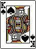

# 钩子应用举例一--屏幕劫图(关于素材提取的几种方法)

> 原文：[`www.pediy.com/kssd/pediy10/63176.html`](https://www.pediy.com/kssd/pediy10/63176.html)

**钩子应用举例一****\--****屏幕劫图****(****关于素材提取的几种方法****)**  
   
还记得暑假的时候，学校因评建 211 工程临时搭建了”创新实验室”，让我们去“创新”，召来一批研究生作指导。记得当时学长们给我们选的课题是“80 分”游戏，当时去看了一次，他所提供的素材（就是扑克牌）说是在 QQGame 的桌牌游戏时靠屏幕截图，然后一张一张地在 PS 里处理的，花了很大的功夫。不过可惜的是我不会玩 80 分的游戏，所以就没有参加了。不过后来风头一过也没有人再去“创新“了。  
后来想想这件事，素材的获取也挺难的，有没有更好更便捷的方法呢？我试着做了一下总结：  
**1.      ****直接从网上免费下载****（上上策）**  
**2.       ****使用资源提取工具如****exescope****等提取某个程序中现有的资源（上策）**  
**3.       ****如果目标程序中的资源以某种特殊的数据结构存储而不能直接提取的话，可以编程实现（如红色警戒中的图像就不能直接使用资源工具提取，但是研究其资源组织方式进而编写代码来解码并提取）****（上策）**  
**4.       ****钩挂关键的****API****（如对画图的几个****API****钩挂就可以获取对应的图像素材）****（上策）**  
**5.       ****手工截取并处理（下策）**  
**6.       ****其他方法（呵呵，可能还有更好的方法吧，欢迎提出）**  
  
对于第一种和第二种方法相信大家都熟悉，第三种方法对不同的应用程序又有所不同，这里暂不提及，第五种方法在实在无奈的情况下也可以使用，相信大家也都会。今天主要是讲第三种方法，靠钩挂 API 的方法来获取所需的素材，主要以图片素材的获取为主要线索。  
我选了一个原生的 win32 应用程序作为目标程序，就是 Windows 自带的游戏“空当接龙”，因为它就含有相当有利用价值的图像素材。  
技术原理就是 API HOOK，我是在“屏幕取词”一文里学到的，所以就现学现卖喽。截获的几个 API 是：BeginPaint，GetWindowDC，GetDC，CreateCompatibleDC，BitBlt，StretchBlt，TransparentBlt。  
实际运行情况是这样子的：当目标程序需要画图的时候，会调用相应的绘图 API 来处理，由于我们钩挂了这些主要的 API，所以在处理前就进入了我们设置的圈套（“陷阱式”），我们首先把图像（以参数形式传进来的）画到我们的“画布”上，然后恢复原程序流程保证原程序处理的正确性。  
一个需要注意的是不同语言之间的调用形式，例如我具体使用的是 Delphi 语言，在 Delphi 里调用是使用寄存器作为默认参数的，如果目标程序使用的是 stdcall 形式（push 参数然后 call），我们就必须采用相应的形式。  
一个难点是获取的素材的保存问题。因为图像有大有小，而且数据量通常都不小，如何截取图像并保存呢？一般来说，我们在钩挂 API 时候都是使用 dll 映射到目标进程的方法。dll 与主程序的通信是可以靠发送消息来完成，即当捕获到数据时通知主窗体去处理，通常我们会设置一个共享区用来存放数据。但是在这里我感觉不太好，主要是图像数据较大，首先要把捕获的数据 copy 到共享区，然后通知主窗体去取；主窗体得到消息后再去共享区去取，然后处理相应的数据，一来一回开销不少，更何况是绘图的处理在应用程序中是很频繁的（后来就知道了，仅仅在 BeginPaint 截获时，秒间就处理了 1000 多张），当然这也是很头疼的一个方面，就是重复处理的图片很多。  
我的做法是在开始钩挂时让主程序传递一个句柄给 dll，众所周知，句柄是全局的。这个句柄标示一个 Panel，它能提供“画布”给我们，也就是说 dll 在获取到图像素材时把图像化到 Panel 上，然后再通知主程序保存图像。由于 API 在绘图时是很快的，这个方法我感觉还是不错的，当然也希望有高手能提出更好的方法。  
这样一来，我们的共享数据其实就很少了，以下是 dll 过程的相关单元：  
//--------------------------------------------------------------------------------  
**library **SpyImgDll;  
  
{ Important note about DLL memory management: ShareMem must be the  
  first unit in your library's USES clause AND your project's (select  
  Project-View Source) USES clause if your DLL exports any procedures or  
  functions that pass strings as parameters or function results. This  
  applies to all strings passed to and from your DLL--even those that  
  are nested in records and classes. ShareMem is the interface unit to  
  the BORLNDMM.DLL shared memory manager, which must be deployed along  
  with your DLL. To avoid using BORLNDMM.DLL, pass string information  
  using PChar or ShortString parameters. }  
  
**uses**  
  SysUtils,  
  Classes,  
  HookClass in 'HookClass.pas',  
  FuncType in 'FuncType.pas',  
  ShareMemType in 'ShareMemType.pas';  
  
**exports**  
    StartHook,StopHook;  
  
  
{$R \*.res}  
  
**begin**  
**end**.  
//--------------------------------------------------------------------------------  
  
//--------------------------------------------------------------------------------  
**unit** FuncType;   
  
**interface**   
  
**uses** windows,dialogs,SysUtils,ExtCtrls,HookClass,ShareMemType;   
  
**CONST**   
    fBeginPaint=0;   
    fGetWindowDC=1;   
    fGetDC      =2;   
    fCreateCompatibleDC=3;   
    fLoadBitmap=4;   
    fBitBlt=5;   
    fStretchBlt=6;   
    fTransparentBlt=7;   
  
//注意:一定要加上 stdcall...   
**procedure**  StartHook(hMainWnd:HWND;hDstWnd:HWND;hSrcWnd:HWND);**stdcall**;   
**procedure**  StopHook();   
  
**var**   
i           :integer;   
hhk         :HHOOK;   
Hook        : **array**\[fBeginPaint..fTransparentBlt\] **of** THookClass;{API HOOK 类}   
  
hMappingFile : THandle;   
pShMem : PShareMem;   
  
hdcMem: HDC;   
hBmp:HBITMAP;   
**implementation**   
  
{自定义的 BeginPaint}   
**function** NewBeginPaint(Wnd: HWND; **var** lpPaint: TPaintStruct): HDC; **stdcall**;   
**type**   
   TBeginPaint=**function** (Wnd: HWND; **var** lpPaint: TPaintStruct): HDC; **stdcall**;   
**begin**   
   Hook\[fBeginPaint\].Restore;   
   result:=TBeginPaint(Hook\[fBeginPaint\].OldFunction)(Wnd,lpPaint);   
   **if** Wnd=pshmem^.hSrcWnd **then**{如果是当前鼠标的窗口句柄}   
   **begin**   
      pshmem^.DCMouse:=result;{记录它的返回值}   
   **end**   
   **else** pshmem^.DCMouse:=0;   
   Hook\[fBeginPaint\].Change;   
**end**;   
  
{自定义的 GetWindowDC}   
**function** NewGetWindowDC(Wnd: HWND): HDC; **stdcall**;   
**type**   
   TGetWindowDC=**function** (Wnd: HWND): HDC; **stdcall**;   
**begin**   
   Hook\[fGetWindowDC\].Restore;   
   result:=TGetWindowDC(Hook\[fGetWindowDC\].OldFunction)(Wnd);   
   **if** Wnd=pshmem^.hSrcWnd **then**{如果是当前鼠标的窗口句柄}   
   **begin**   
      pshmem^.DCMouse:=result;{记录它的返回值}   
   **end**   
   **else** pshmem^.DCMouse:=0;    
   Hook\[fGetWindowDC\].Change;   
**end**;   
  
  
{自定义的 GetDC}   
**function** NewGetDC(Wnd: HWND): HDC; **stdcall**;   
**type**   
   TGetDC=**function** (Wnd: HWND): HDC; **stdcall**;   
**begin**   
   Hook\[fGetDC\].Restore;   
   result:=TGetDC(Hook\[fGetDC\].OldFunction)(Wnd);   
   **if** Wnd=pshmem^.hSrcWnd **then**{如果是当前鼠标的窗口句柄}   
   **begin**   
      pshmem^.DCMouse:=result;{记录它的返回值}   
   **end**   
   **else** pshmem^.DCMouse:=0;   
   Hook\[fGetDC\].Change;   
**end**;   
  
  
{自定义的 CreateCompatibleDC}   
**function** NewCreateCompatibleDC(DC: HDC): HDC; **stdcall**;   
**type**   
   TCreateCompatibleDC=**function** (DC: HDC): HDC; **stdcall**;   
**begin**   
   Hook\[fCreateCompatibleDC\].Restore;   
   result:=TCreateCompatibleDC(Hook\[fCreateCompatibleDC\].OldFunction)(DC);   
   **if** DC=pshmem^.DCMouse **then**{如果是当前鼠标的窗口 HDC}   
   **begin**   
      pshmem^.DCCompatible:=result;{记录它的返回值}   
   **end**   
   **else** pshmem^.DCCompatible:=0;   
   Hook\[fCreateCompatibleDC\].Change;   
**end**;   
  
  
//--------------------------------------------------------------------------------   
**function** NewLoadBitmap(hInstance:Cardinal;lpBmpName:PAnsichar):HBITMAP;**stdcall**;   
**type**   
TLoadBitmap = **function**(hInstance:Cardinal;lpBmpName:PAnsichar):HBITMAP;**stdcall**;   
**begin**   
    Hook\[fLoadBitmap\].Restore;   
    result:= TLoadBitmap(Hook\[fLoadBitmap\].OldFunction)(hInstance,lpBmpName);   
    beep;   
    Hook\[fLoadBitmap\].Change;   
**end**;   
//--------------------------------------------------------------------------------   
**function** NewBitBlt(   
      hdcDest:HDC ; // handle to destination DC   
      nXDest:integer;  // x-coord of destination upper-left corner   
      nYDest:integer;  // y-coord of destination upper-left corner   
      nWidth:integer;  // width of destination rectangle   
      nHeight:integer; // height of destination rectangle   
      hdcSrc:HDC ;  // handle to source DC   
      nXSrc:integer;   // x-coordinate of source upper-left corner   
      nYSrc:integer;   // y-coordinate of source upper-left corner   
      dwRop:Cardinal  // raster operation code   
     &nbspBoolean;**stdcall**;   
**type**   
TBitBlt = **Function**(   
      hdcDest:HDC ; // handle to destination DC   
      nXDest:integer;  // x-coord of destination upper-left corner   
      nYDest:integer;  // y-coord of destination upper-left corner   
      nWidth:integer;  // width of destination rectangle   
      nHeight:integer; // height of destination rectangle   
      hdcSrc:HDC ;  // handle to source DC   
      nXSrc:integer;   // x-coordinate of source upper-left corner   
      nYSrc:integer;   // y-coordinate of source upper-left corner   
      dwRop:Cardinal  // raster operation code   
     &nbspboolean;**stdcall**;   
**var**   
hdstdc:HDC;   
**begin**   
    Hook\[fBitBlt\].Restore;   
    result:=TBitBlt(Hook\[fBitBlt\].OldFunction)(hdcDest,nXDest,nYDest,nWidth,nHeight,hdcSrc,nXSrc,nYSrc,dwRop);   
    **if** ( hdcDest=pShMem^.DCMouse  )**or** ( hdcDest=pShMem^.DCCompatible )**then**   
    **begin**   
        hdstdc:=GetWindowDC(pShMem^.hDstWnd);   
        result:=TBitBlt(Hook\[fBitBlt\].OldFunction)(hdstdc,0,0,nWidth,nHeight,hdcSrc,nXSrc,nYSrc,dwRop);   
        PostMessage(pShMem^.hMainWnd ,WM\_GOTIMG,nWidth,nHeight);   
    **end**;   
    Hook\[fBitBlt\].Change;   
**end**;   
//--------------------------------------------------------------------------------   
**function** NewStretchBlt(hdcDest:HDC ;nXOriginDest:integer;nYOriginDest:integer;nWidthDest:integer;nHeightDest:integer;hdcSrc:HDC ;   
                    nXOriginSrc:integer;nYOriginSrc:integer;nWidthSrc:integer;nHeightSrc:integer;dwRop:Cardinal):boolean;**stdcall**;   
**type**   
TStretchBlt = **Function**(hdcDest:HDC ;nXOriginDest:integer;nYOriginDest:integer;nWidthDest:integer;nHeightDest:integer;hdcSrc:HDC ;   
                    nXOriginSrc:integer;nYOriginSrc:integer;nWidthSrc:integer;nHeightSrc:integer;dwRop:Cardinal):boolean;**stdcall**;   
**var**   
hdstdc:HDC;   
**begin**   
    Hook\[fStretchBlt\].Restore;   
    result:=TStretchBlt(Hook\[fStretchBlt\].OldFunction)(hdcDest,nXOriginDest,nYOriginDest,nWidthDest,nHeightDest,hdcSrc,nXOriginSrc,nYOriginSrc,nWidthSrc,nHeightSrc,dwRop);   
    **if** ( hdcDest=pShMem^.DCMouse  )**or** ( hdcDest=pShMem^.DCCompatible )**then**   
    **begin**   
        hdstdc:=GetWindowDC(pShMem^.hDstWnd);   
        result:=TStretchBlt(Hook\[fStretchBlt\].OldFunction)(hdstdc,0,0,nWidthDest,nHeightDest,hdcSrc,nXOriginSrc,nYOriginSrc,nWidthSrc,nHeightSrc,dwRop);   
        PostMessage(pShMem^.hMainWnd ,WM\_GOTIMG,nWidthDest,nHeightDest);   
    **end**;   
    Hook\[fStretchBlt\].Change;   
**end**;   
  
//--------------------------------------------------------------------------------   
**function** NewTransparentBlt(hdcDest:HDC ;nXOriginDest:integer;nYOriginDest:integer;nWidthDest:integer;nHeightDest:integer;hdcSrc:HDC ;   
            nXOriginSrc:integer;YOriginSrc:integer;nWidthSrc:integer;nHeightSrc:integer;crTransparent:Cardinal):boolean;**stdcall**;   
**type**   
TTransparentBlt = **function**(hdcDest:HDC ;nXOriginDest:integer;nYOriginDest:integer;nWidthDest:integer;nHeightDest:integer;hdcSrc:HDC ;   
            nXOriginSrc:integer;YOriginSrc:integer;nWidthSrc:integer;nHeightSrc:integer;crTransparent:Cardinal):boolean;**stdcall**;   
**var**   
hdstdc:HDC;   
**begin**   
    Hook\[fTransparentBlt\].Restore;   
    result:=TTransparentBlt(Hook\[fTransparentBlt\].OldFunction)(hdcDest,nXOriginDest,nYOriginDest,nWidthDest,nHeightDest,hdcSrc,   
            nXOriginSrc,YOriginSrc,nWidthSrc,nHeightSrc,crTransparent);   
    **if** ( hdcDest=pShMem^.DCMouse  )**or** ( hdcDest=pShMem^.DCCompatible )**then**   
    **begin**   
        hdstdc:=GetWindowDC(pShMem^.hDstWnd);   
      result:=TTransparentBlt(Hook\[fTransparentBlt\].OldFunction)(hdstdc,0,0,nWidthDest,nHeightDest,hdcSrc,   
            nXOriginSrc,YOriginSrc,nWidthSrc,nHeightSrc,crTransparent);   
      PostMessage(pShMem^.hMainWnd ,WM\_GOTIMG,nWidthDest,nHeightDest);   
    **end**;   
   result:=true;   
   Hook\[fStretchBlt\].Change;   
**end**;   
//--------------------------------------------------------------------------------   
**function**  MouseProc(nCode:integer;wParam:Cardinal;lParam:Cardinal):DWORD;   
**begin**   
    result:=CallNextHookEx(hhk,nCode,wParam,lParam);   
**end**;   
  
**procedure**  StartHook(hMainWnd:HWND;hDstWnd:HWND;hSrcWnd:HWND);**stdcall**;   
**begin**   
    pShMem^.hMainWnd := hMainWnd;   
    pShMem^.hDstWnd:=hDstWnd;   
    pShMem^.hSrcWnd:= hSrcWnd;   
    hhk:=SetWindowsHookEx(WH\_MOUSE,@MouseProc,HInstance,0);   
**end**;   
  
**procedure**  StopHook();   
**begin**   
    **if** hhk <> 0   **then**   
    **begin**   
        UnhookWindowsHookEx(hhk);   
        hhk:=0;   
        //SendMessage(HWND\_BROADCAST,WM\_SETTINGCHANGE,0,0);   
    **end**;   
**end**;   
  
**initialization**   
  
   //hProcess := OpenProcess(PROCESS\_ALL\_ACCESS,FALSE, GetCurrentProcessID);   
    hMappingFile := OpenFileMapping(FILE\_MAP\_WRITE,False,MappingFileName);   
    **if** hMappingFile=0 **then**   
        hMappingFile := CreateFileMapping($FFFFFFFF,**nil**,PAGE\_READWRITE,0,SizeOf(TShareMem),MappingFileName);   
    **if** hMappingFile=0 **then**   
        Exception.Create('不能建立共享内存!');   
    pShMem :=  MapViewOfFile(hMappingFile,FILE\_MAP\_WRITE **or** FILE\_MAP\_READ,0,0,0);   
    **if** pShMem = **nil** **then**   
    **begin**   
        CloseHandle(hMappingFile);   
        Exception.Create('不能映射共享内存!');   
    **end**;   
  
    Hook\[fBeginPaint\]       :=THookClass.Create(@BeginPaint,@NewBeginPaint);{Trap=True 陷阱式}   
    Hook\[fGetWindowDC\]      :=THookClass.Create(@GetWindowDC,@NewGetWindowDC);   
    Hook\[fGetDC\]            :=THookClass.Create(@GetDC,@NewGetDC);   
    Hook\[fCreateCompatibleDC\]:=THookClass.Create(@CreateCompatibleDC,@NewCreateCompatibleDC);   
    Hook\[fLoadBitmap\]       :=THookClass.Create(@LoadBitmap , @NewLoadBitmap);   
    Hook\[fBitBlt\]           :=THookClass.Create(@BitBlt, @NewBitBlt);   
    Hook\[fStretchBlt\]       :=THookClass.Create(@StretchBlt, @NewStretchBlt);   
    Hook\[fTransparentBlt\]   :=THookClass.Create(@TransparentBlt,@NewTransparentBlt);   
  
     **for** i:=Low(Hook) **to** High(Hook) **do**   
        **if** Hook\[i\]<>**nil** **then**   
            Hook\[i\].Change;   
  
  
**finalization**   
  
    **for** i:=Low(Hook) **to** High(Hook) **do**   
        **if** Hook\[i\]<>**nil** **then**   
            Hook\[i\].Destroy;   
  
    UnMapViewOfFile(pShMem);   
    CloseHandle(hMappingFile);   
**end**.   
//--------------------------------------------------------------------------------  
  
//--------------------------------------------------------------------------------  
**unit** ShareMemType;   
  
**interface**  
  
**uses**  
windows,messages,ExtCtrls;   
  
**const** MappingFileName = 'Spy Img...';   
**const** WM\_GOTIMG = WM\_USER+ 102;   
**type**  
  
  
TShareMem =**record**  
    hMainWnd    :HWND;   
    hDstWnd     :HWND;   
    hSrcWnd     :HWND;   
  
    DCMouse,DCCompatible: HDC;   
**end**;   
PShareMem = ^TShareMem;   
  
**implementation**  
  
**end**.  
//--------------------------------------------------------------------------------  
  
//--------------------------------------------------------------------------------  
**interface**  
  
**uses** classes, Windows,SysUtils, messages,dialogs;   
  
**type**  
  TImportCode = **packed****record**  
     JumpInstruction: Word;   
     AddressOfPointerToFunction: PPointer;   
**end**;   
PImportCode = ^TImportCode;   
  
  TLongJmp = **packed****record**  
     JmpCode: ShortInt; {指令，用$E9 来代替系统的指令}  
     FuncAddr: DWORD; {函数地址}  
**end**;   
//-----------------------------------------------------------------------------  
THookClass = **class**  
  
**private**  
  hProcess: Cardinal; {进程句柄，只用于陷阱式}  
  Oldcode: **array**\[0..4\]**of** byte; {系统函数原来的前 5 个字节}  
  Newcode: TLongJmp; {将要写在系统函数的前 5 个字节}  
  
  Trapped:boolean;   
  
**function** GetFuncRealBase(pFunc: Pointer): Pointer;   
  
**public**  
  OldFunction,NewFunction:Pointer;{被截函数、自定义函数}  
**constructor** Create(OldFun,NewFun:pointer);   
**destructor**  Destroy;   
**procedure**   Restore;   
**procedure**   Change;   
  
**end**;   
  
**implementation**  
  
{取函数的实际地址。如果函数的第一个指令是 Jmp，则取出它的跳转地址（实际地址），这往往是  
  
由于程序中含有 Debug 调试信息引起的}  
**function** THookClass.GetFuncRealBase(pFunc: Pointer): Pointer;   
**var**  
func:PImportCode;   
**begin**  
  Result:=pFunc;   
**if** pFunc=**nil****then** exit;   
**try**  
    func:=PImportCode(pFunc);   
**if** (func^.JumpInstruction=$25FF) **then**  
{指令二进制码 FF 25 汇编指令 jmp \[...\]}  
      result:=func^.AddressOfPointerToFunction^   
**else**  
  result:=pFunc;   
**except**  
    Result:=**nil**;   
**end**;   
**end**;   
  
  
**constructor** THookClass.Create(OldFun,NewFun:pointer);   
**var**  
nCount:Cardinal;   
**begin**  
{求被截函数、自定义函数的实际地址}  
    OldFunction:= GetFuncRealBase(OldFun);   
    NewFunction:= GetFuncRealBase(NewFun);   
{以特权的方式来打开当前进程}  
    hProcess := OpenProcess(PROCESS\_ALL\_ACCESS,FALSE, GetCurrentProcessID);   
{生成 jmp xxxx 的代码，共 5 字节}  
    Newcode.JmpCode := ShortInt($E9); {jmp 指令的十六进制代码是 E9}  
    NewCode.FuncAddr := DWORD(NewFunction) - DWORD(OldFunction) - 5;   
{保存被截函数的前 5 个字节}  
    ReadProcessMemory(hProcess,OldFunction,@(Oldcode),5,nCount);   
//move(OldFunction^,OldCode,5);  
  
    Trapped:=false;   
**end**;   
  
**destructor**  THookClass.Destroy;   
**begin**  
**if** Trapped **then**  
        Restore;   
    CloseHandle(hProcess);   
**end**;   
  
{恢复系统函数的调用}  
**procedure**   THookClass.Restore;   
**var**  
nCount:Cardinal;   
**begin**  
**if** (hProcess = 0) **or** (OldFunction = **nil**) **or** (NewFunction = **nil**) **then**  
        exit;   
**try**  
  
    WriteProcessMemory(hProcess, OldFunction, @(Oldcode), 5, nCount);   
**except**  
    showmessage('');   
**end**;   
    Trapped := false;   
**end**;   
  
**procedure**   THookClass.Change;   
**var**  
nCount:Cardinal;   
**begin**  
**if** (hProcess = 0) **or** (OldFunction = **nil**) **or** (NewFunction = **nil**) **then**  
        exit;   
**try**  
    WriteProcessMemory(hProcess, OldFunction, @(Newcode), 5, nCount);   
**except**  
    showmessage('');   
**end**;   
    Trapped := true;   
**end**;   
  
  
  
**end**.  
  
//-----------------------------------------------------------------------------  
  
    主程序界面可以根据自己需要自行搭建,这里就不贴代码了.主要原因是处理得还不够成熟,发出来主要是寻求更好的解决方法,希望各路好手指点一二,这里谢过先.  
    程序可以提取所需素材,共 52 张纸牌,这里只贴出部分:  
  
  
              By  Sing  
asmcvc@163.com  
2008-04-15  
