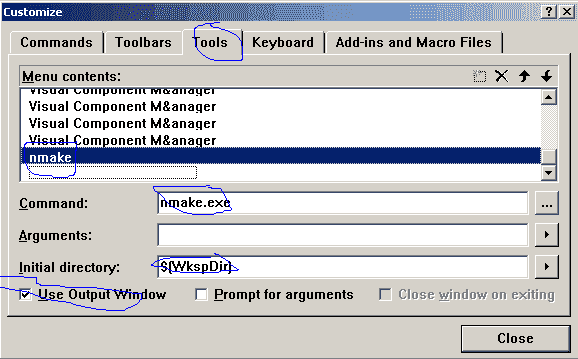
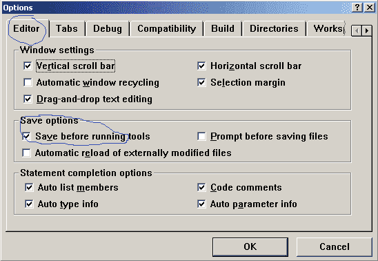

# 使用 VC6 调试器源码级调试 win32 汇编程序

> 原文：[`www.pediy.com/kssd/pediy07/pediy7-725.htm`](https://www.pediy.com/kssd/pediy07/pediy7-725.htm)

首先声明：本人是菜鸟，以下是我在使用中的心得，请不要笑话我^\_^  
  
                使用 VC6 调试器源码级调试 win32 汇编程序  
  
   本人拙笨，如有错误请批评指正，或有更好的方法或者技巧，欢迎互相交流。hejiwen2001@sohu.com。  
    
   使用一个好的调试器无疑对学习 win32 汇编是至关重要的，本人更偏爱 VC 的强大调试环境，能否用 VC 调试器调试哪，于是从网上搜搜，找到一篇 Spring.W 的文章《贴个用 VC++在源码级下调试 MASM32 汇编程序的方法。。。大家交流。。》，此文就是在此基础上的改进，好像效率更高耶。  
  
编程环境：VC6.0，Masm32v8  
  
方法如下：  
1、使用 VC6 新建一个空工程 test（win32 console，win32 application 等均可）。  
2、把汇编工程中的文件拷至新建工程目录下（hello.asm，makefile），并把这些文件加入工程中管理。  
3、配置 IDE：  
（1）、tools/customize…/tools 中添加一个工具 nmake。在 menu contens 中添加一项 nmake，Command 中填入：nmake.exe，Initial Directory 中填入： $(WkspDir)，选中 use output window。这样就在 tools 菜单下出现了一个新的菜单项 nmake。可以把这个菜单项添加到工具栏中。

  
  
（2）、tools/option…/editor 在 save option 中选中 save befor running tools。

  
4、制作 makefile 文件：  
  
EXE = test.exe    #指定输出文件  
OBJS = hello.obj    #需要的目标文件  
  
LINK\_FLAG = /subsystem:windows /DEBUG /OUT:debug\\test.exe   #连接选项          
#注： （1）/DEBUG 必须存在 。  
#（2）/OUT:debug\\test.exe 输出可执行文件名要与 VC 建立的工程名一致。  
#（3）/subsystem:windows：如果是控制台程序，这里需要改为/subsystem:console  
  
ML\_FLAG = /c /coff /Zi   #编译选项           
#注： /Zi 必须存在  
  
$(EXE): $(OBJS)  
   Link $(LINK\_FLAG) $(OBJS)  
.asm.obj:  
   ml $(ML\_FLAG) $<  
5、点击菜单项 tools/nmake，调用 masm32 中的 ml，link 进行编译连接程序。  
  
至此就可以使用 VC 调试器源码级调试汇编程序了，可以设置断点，察看变量、内存、寄存器等，nmake 出现语法错误时可以双击 output window 中的错误行定位到程序中的指定行，改代码时别忘了要用 nmake 编译。  
注：变量最好不要以@开头定义，比如@num，这样的变量名无法在 vc 下察看。  
  
参考：  
http://www.pediy.com/bbshtml/bbs5/pediy50355.htm  作者：Spring.W  
http://bbs.pediy.com/showthread.php?threadid=12067 作者：Spring.W  
http://www.aogosoft.com/bbs/mixpage.asp?mode=viewoktext&fileid=123 作者：crige  
http://asm.yeah.net 《Windows 环境下 32 位汇编语言程序设计》pdf 及代码 作者：罗云彬  
附件：代码。  
                                    2005/6/2 

 4dd466d0e1e0cc123afbe504da2462ca