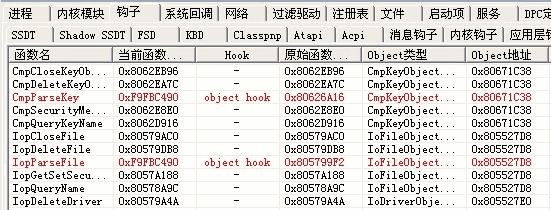
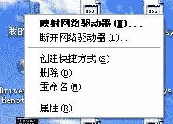
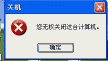

# inline-hook 和 object 双 HOOK 联合调用拒绝 WIN 打开服务

> 原文：[`www.pediy.com/kssd/pediy12/128506.html`](https://www.pediy.com/kssd/pediy12/128506.html)

inline-hook 和 object 双 HOOK 联合调用拒绝 WIN 打开服务  
   
     看标题其实很简单我也没有找到比较合适的标题，所以各位大牛们别嘲笑小弟就好，  
原理很简单，其实就是找到个和对象有关的系统频繁调用的函数实现双 HOOK 就行啦，  
我选折 ObCreateObject 函数下手，关于 OBJECTHOOK 的文章参考一下我的前篇科普篇  
http://bbs.pediy.com/showthread.php?t=128161  
 我们先看下 ObCreateObject 函数原型先  
NTSTATUS  
ObCreateObject (  
    \_\_in KPROCESSOR\_MODE ProbeMode,            // 决定是否要验证参数  
    \_\_in POBJECT\_TYPE ObjectType,              // 对象类型指针  
    \_\_in POBJECT\_ATTRIBUTES ObjectAttributes,  // 对象的属性, 最终会转化成 ObAllocateObject 需要的 OBJECT\_CREATE\_INFORMATION 结构  
    \_\_in KPROCESSOR\_MODE OwnershipMode,        // 内核对象?用户对象?   
    \_\_inout\_opt PVOID ParseContext,            // 这参数没用  
    \_\_in ULONG ObjectBodySize,                 // 对象体大小  
    \_\_in ULONG PagedPoolCharge,                //   
    \_\_in ULONG NonPagedPoolCharge,             //   
    \_\_out PVOID \*Object                        // 接收对象体的指针  
    )   
这里面有 1 个结构和一个对象对我们比较有用 ObjectAttributes 和 ObjectType  
ObjectType 那那个科普帖已经介绍了，下面简单介绍一下这个结构  
\_OBJECT\_ATTRIBUTES { ULONG  Length;//结构长  
HANDLE  RootDirectory;    //对象所在目录  
PUNICODE\_STRING  ObjectName;   //对象名   
ULONG  Attributes;    //属性标志  
PVOID  SecurityDescriptor;      
PVOID  SecurityQualityOfService;  
} OBJECT\_ATTRIBUTES, \*POBJECT\_ATTRIBUTES;  
这里面最重要还是 ObjectType  
直接上代码吧，太乱 因为是笔记  
  
  
#include<ntddk.h>  
#include<windef.h>  
  
VOID Hook();  
VOID WPOFF();  
VOID WPON();  
typedef struct \_OBJECT\_TYPE\_INITIALIZER {  
  USHORT Length;  
  BOOLEAN UseDefaultObject;  
  BOOLEAN CaseInsensitive;  
  ULONG InvalidAttributes;  
  GENERIC\_MAPPING GenericMapping;  
  ULONG ValidAccessMask;  
  BOOLEAN SecurityRequired;  
  BOOLEAN MaintainHandleCount;  
  BOOLEAN MaintainTypeList;  
  POOL\_TYPE PoolType;  
  ULONG DefaultPagedPoolCharge;  
  ULONG DefaultNonPagedPoolCharge;  
  PVOID DumpProcedure;  
  PVOID OpenProcedure;  
  PVOID CloseProcedure;  
  PVOID DeleteProcedure;  
  PVOID ParseProcedure;  
  PVOID SecurityProcedure;  
  PVOID QueryNameProcedure;  
  PVOID OkayToCloseProcedure;  
} OBJECT\_TYPE\_INITIALIZER, \*POBJECT\_TYPE\_INITIALIZER;  
  
  
typedef struct \_OBJECT\_TYPE {   
  ERESOURCE Mutex;   
  LIST\_ENTRY TypeList;   
  UNICODE\_STRING Name;   
  PVOID DefaultObject;   
  ULONG Index;   
  ULONG TotalNumberOfObjects;   
  ULONG TotalNumberOfHandles;   
  ULONG HighWaterNumberOfObjects;   
  ULONG HighWaterNumberOfHandles;   
  OBJECT\_TYPE\_INITIALIZER TypeInfo;   
#ifdef POOL\_TAGGING   
  ULONG Key;   
#endif   
} OBJECT\_TYPE, \*POBJECT\_TYPE;  
  
typedef struct \_OBJECT\_CREATE\_INFORMATION {   
  ULONG Attributes;   
  HANDLE RootDirectory;   
  PVOID ParseContext;   
  KPROCESSOR\_MODE ProbeMode;   
  ULONG PagedPoolCharge;   
  ULONG NonPagedPoolCharge;   
  ULONG SecurityDescriptorCharge;   
  PSECURITY\_DESCRIPTOR SecurityDescriptor;   
  PSECURITY\_QUALITY\_OF\_SERVICE SecurityQos;   
  SECURITY\_QUALITY\_OF\_SERVICE SecurityQualityOfService;   
} OBJECT\_CREATE\_INFORMATION, \*POBJECT\_CREATE\_INFORMATION;  
  
  
  
typedef struct \_OBJECT\_HEADER {   
  LONG PointerCount;   
  union {   
    LONG HandleCount;   
    PSINGLE\_LIST\_ENTRY SEntry;   
  };   
  POBJECT\_TYPE Type;   
  UCHAR NameInfoOffset;   
  UCHAR HandleInfoOffset;   
  UCHAR QuotaInfoOffset;   
  UCHAR Flags;   
  union   
  {   
    POBJECT\_CREATE\_INFORMATION ObjectCreateInfo;   
    PVOID QuotaBlockCharged;   
  };  
    
  PSECURITY\_DESCRIPTOR SecurityDescriptor;   
  QUAD Body;   
} OBJECT\_HEADER, \*POBJECT\_HEADER;  
POBJECT\_TYPE pType= NULL;  
POBJECT\_HEADER addrs=NULL;  
PVOID OldParseProcedure = NULL;  
BYTE \*pAddrs=NULL;  
ULONG Ret=0;  
ULONG hookaddr=0;  
  
NTSTATUS NewParseProcedure(IN PVOID ParseObject,  
             IN PVOID ObjectType,  
             IN OUT PACCESS\_STATE AccessState,  
             IN KPROCESSOR\_MODE AccessMode,  
             IN ULONG Attributes,  
             IN OUT PUNICODE\_STRING CompleteName,  
             IN OUT PUNICODE\_STRING RemainingName,  
             IN OUT PVOID Context OPTIONAL,  
             IN PSECURITY\_QUALITY\_OF\_SERVICE SecurityQos OPTIONAL,  
             OUT PVOID \*Object)   
{  
     NTSTATUS Status;  
     
    KdPrint(("object is hook\\n"));  
   
  \_\_asm  
  {  
      push eax  
      push Object  
      push SecurityQos  
      push Context  
      push RemainingName  
      push CompleteName  
      push Attributes  
      movzx eax, AccessMode  
      push eax  
      push AccessState  
      push ObjectType  
      push ParseObject  
      call OldParseProcedure  
      mov Status, eax  
      pop eax  
  
        
  }   
  return Status;  
  
}  
VOID Hook1()  
{  
  
  \_asm{  
     pushf  
           pusha  
     mov eax,pType  
     cmp eax,0  
     jz ggdd //空就跳  
     add eax,0x9c  
     cmp \[eax\],0 //打开服务为空就跳  
     jz  ggdd  
     mov eax,\[eax\]  
     cmp eax,NewParseProcedure // 已经 HOOK 了就跳  
     jz ggdd  
     mov OldParseProcedure,eax  
     mov ebx,NewParseProcedure  
     mov eax,pType  
     add eax,0x9c  
     mov \[eax\],ebx  
      
ggdd:  
     popa  
           popf  
  }  
  
  
}   
 \_\_declspec(naked)  void \_\_stdcall MyHook()   
{  
   \_asm{  
    
    push eax  
    mov eax,\[ebp+0xc\] //获取 ObjectType  
    mov pType,eax  
    call \[hookaddr\]  
          pop eax  
    push ecx  
    push ebx  
    push esi  
    push edi  
    jmp \[Ret\]  
        
  }  
  
  
     
}  
NTSTATUS DriverEntry(IN PDRIVER\_OBJECT DriverObject,PUNICODE\_STRING RegistryPath)  
{  
   NTSTATUS status;  
    
   hookaddr=(ULONG)Hook1;  
     
   Hook();  
     
   return STATUS\_SUCCESS;  
}  
VOID Hook()  
{      
   ULONG ObjAddrs,jmpAddrs;  
   UNICODE\_STRING  name;  
   KIRQL  Irql;   
   char code\[5\]={0xe9,0,0,0,0};  
     RtlInitUnicodeString(&name,L"ObCreateObject");  
     pAddrs=(BYTE\*)MmGetSystemRoutineAddress(&name);  
   if(pAddrs==NULL)  
   {  
     DbgPrint("pAaddrs is NULL\\n");  
   }  
   DbgPrint("pAaddrs is:%08X\\n",pAddrs);  
   ObjAddrs=(ULONG)pAddrs;  
   ObjAddrs=ObjAddrs+6;  
   Ret=ObjAddrs+5;  
   DbgPrint("pAaddrs is:%08X\\n",ObjAddrs);   
     DbgPrint("Ret is:%08X\\n",Ret);   
   jmpAddrs=(ULONG)MyHook-ObjAddrs-5;  
   \*(ULONG\*)(code+1)=jmpAddrs;  
       
     WPOFF();   
       
      Irql=KeRaiseIrqlToDpcLevel();  
      RtlCopyMemory(ObjAddrs,code,5);   
     KeLowerIrql(Irql);  
      WPON();    
       
}  
  
VOID WPOFF()  
{  
  \_\_asm  
  {  
    cli  
    mov eax,cr0  
    and eax,not 10000h  
    mov cr0,eax  
  }  
}  
   
VOID WPON()  
{  
  \_\_asm  
  {  
    mov eax,cr0  
    or eax,10000h  
    mov cr0,eax  
    sti  
  }  
}  
  
 以上代码有危险性，因为比较极端，请大家在虚拟机上运行 我的测试环境是 windows\_xp\_professional\_with\_service\_pack\_3  
1.有如下症状所有文件不能打开，右键选中打开的选项消失。如果需要分析工具请先运行再加载驱动  
2.所有驱动不能加载，包括任务管理器 CMD 不能打开  
3.无法关机和重启。  
希望大家不要把代码运用到恶意程序上，其实也没多少技术含量，只是比较极端而已。如有 BUG  
欢迎大牛们指正，共同学习 共同进步嘛  
  
  
  
  
  

上传的附件
|  || objhk.rar  
 |