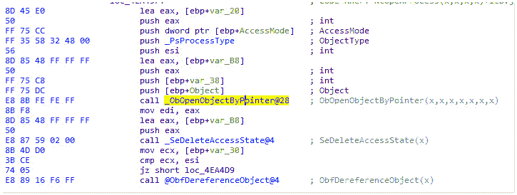
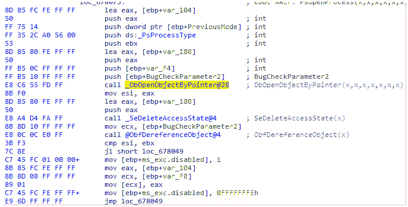
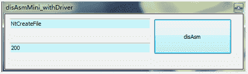
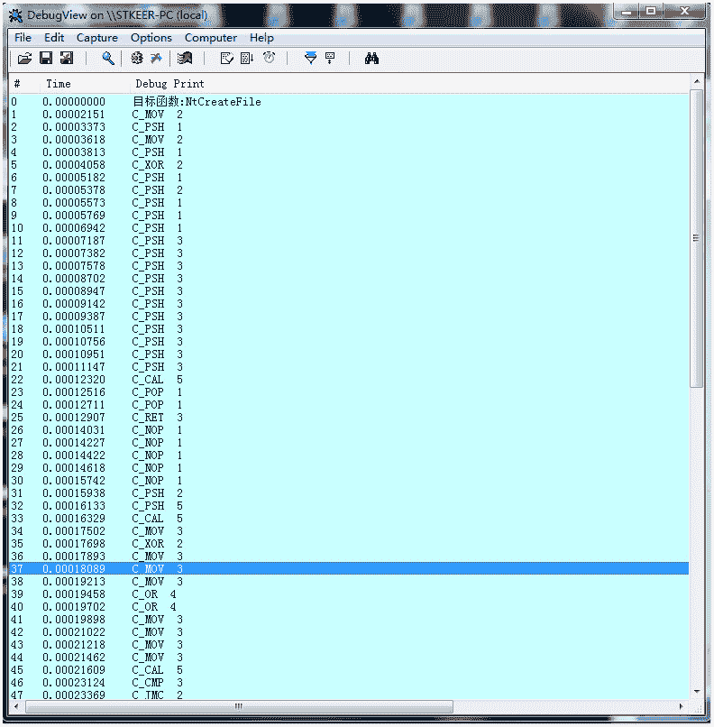
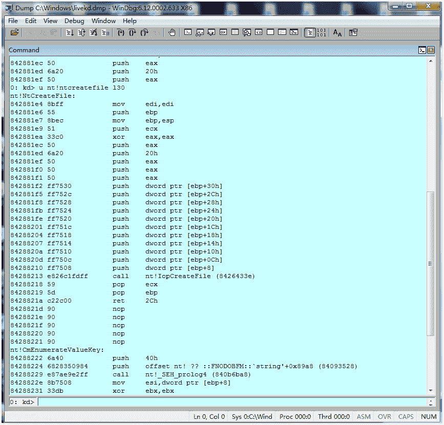

# 为你的驱动挂上外挂 - 嵌入反汇编引擎

> 原文：[`www.pediy.com/kssd/pediy12/140587.html`](https://www.pediy.com/kssd/pediy12/140587.html)

  
  
首先来看两段 IDA 中的代码  
  
  
  
  
上面的图是 win xp 下 NtOpenProcess 中的代码片段  
下面的图是 win 7 下 PsOpenProcess 中的代码片段,win 7 中 NtOpenProcess 成了包装函数,由 PsOpenProcess 真正完成打开进程的操作  
  
两个系统中打开某一进程时的指令执行路径上都会经过 ObOpenObjectByPointer 函数,  
该函数在这里传进进程的 EPROCESS 结构,返回相应的进程句柄,该句柄最终返回给我们  
  
可见如果在这里 inline hook 了 ObOpenObjectByPointer 函数,并通过比对 EPROCESS 来过滤自身的话,  
就能防止被其他进程打开访问自己的进程  
  
那么我们如果想修复这个 inline hook 的话,首先想到的方法就是定位到 hook 的指令处,  
然后通过取得真实的 ObOpenObjectByPointer 函数地址来进行修复  
  
但是,这条指令位于函数比较深层的位置,在函数头 500+以后的偏移地址,如果用通常的搜索特征码的方式进行定位难度比较大,  
而且也不容易做到多系统兼容:xp 下的 ObOpenObjectByPointer 前后的指令与 win7 下 ObOpenObjectByPointer 前后的指令长度并不相符,  
当然你可以选择针对不同的系统,使用多套特征码进行搜寻定位,但这与反汇编引擎比起来通用性,安全性都不在一个级别  
  
前段时间一直在想找个比较小巧的反汇编引擎,我的要求比较简单,能测出指令长度和指令类型就行,  
不过找了几个都不理想<也可能自己愚笨,没搞懂怎么使用>  
  
以前在 RING3 层的时候一直在使用 OD 的反汇编引擎,不过把 OD 的上百 KB 的引擎嵌入我区区几十 KB 的驱动有点喧宾夺主了,  
于是自己花了点时间精简了一下 OD 的反汇编引擎,效果上还算比较理想  
  
精简之后去掉了所有字串相关操作,也就是将不会有字串形式的参考信息;  
指令表那里去掉了 C\_NOW,C\_MMX,C\_FLT 这样至少我用不着的指令,如果大家需要的话可以自己添加上;  
定义了一组指令类型,基本包含了所有的常见指令,当然大家也是可以自己进行添加的.  
需要注意的只有这里:  
代码:

```
typedef struct \_CmdData {
  ULONG          mask;
  ULONG          code;
  UCHAR          len;
  UCHAR          bits;
  UCHAR          arg1,arg2,arg3;
  UCHAR          type;     //指令类型
}CmdData, \*PCmdData;

```

原版的 OD 引擎将指令类型定义为了 UCHAR,限制了指令的细分数量,大家可以根据需要自己调整一下,  
因为自己这样已经够用了,也就没有扩展  
  
  
另外主函数和返回结构也进行了消减:  
代码:

```
typedef struct \_Disasm {
  ULONG  cmdtype;   //指令类型
  ULONG  error;         //错误信息
  ULONG  warnings;  //警告信息
}Disasm,\*PDisasm;

ULONG DisasmCode(PUCHAR Src,ULONG SrcSize,PDisasm pDisasm);

Src:要反汇编的指令地址
SrcSize:指令长度
pDisasm:返回结构

```

使用上是与原版的 OD 相同的  
  
  
\*\*\*\*\*\*\*\*\*\*\*\*\*\*\*\*\*\*\*\*\*\*\*\*\*\*\*\*\*\*\*\*\*\*\*\*\*\*\*\*\*\*\*\*\*\*\*\*  
\*\*\*\*\*\*\*\*\*\*\*\*\*\*\*\*\*\*\*\*\*\*\*\*\*\*\*\*\*\*\*\*\*\*\*\*\*\*\*\*\*\*\*\*\*\*\*\*  
测试的时候写了一个小程序,效果如下:  
输入指定函数名称和反汇编长度:  
  
  
通过 DebugView 可以看到反汇编的结果<指令类型+指令长度>:  
  
  
与 livekd 对比一下,没有异常:  
  
  
  
下面简单说一下使用方法,应用层就不在这里讨论了,只看一下驱动方面:  
代码:

```
#ifndef DISASMMAIN\_H
#define DISASMMAIN\_H
#endif

#include <ntddk.h>
#include "disasm.h"

//与 RING3 层通讯结构
typedef struct \_myStruct{
  ULONG  Length;      //反汇编长度
  PWCHAR pFuncName\[100\];  //要反汇编的函数名称
}myStruct,\*PMyStruct;


DRIVER\_INITIALIZE DriverEntry;
NTSTATUS DriverEntry(PDRIVER\_OBJECT pDriverObject, PUNICODE\_STRING pRegPath);

\_\_drv\_dispatchType(IRP\_MJ\_DEVICE\_CONTROL)
DRIVER\_DISPATCH DispatchDeviceIoControl;
NTSTATUS DispatchDeviceIoControl(PDEVICE\_OBJECT pDeviceObject, PIRP pIrp);

\_\_drv\_dispatchType\_other
DRIVER\_DISPATCH DispatchCompletion;
NTSTATUS DispatchCompletion(PDEVICE\_OBJECT pDeviceObject, PIRP pIrp);

DRIVER\_UNLOAD Unload;
VOID Unload(PDRIVER\_OBJECT pDriverObject);

```

头文件只引用 disasm.h 即可  
  
  
代码:

```
#include "disAsmMain.h"

#pragma alloc\_text (INIT,DriverEntry)
#pragma alloc\_text (PAGE,DispatchDeviceIoControl)
#pragma alloc\_text (PAGE,Unload)
#pragma alloc\_text (PAGE,DispatchCompletion)

#define DEVICE\_NAME L"\\\\Device\\\\disAsm"
#define DEVICE\_SYMBOLICLINK\_NAME L"\\\\DosDevices\\\\disAsmSymLink"

#define IOCTL\_DISASM\_SPECIAL\_FUNCTION (CTL\_CODE(FILE\_DEVICE\_UNKNOWN,0x801,FILE\_ANY\_ACCESS,METHOD\_BUFFERED))


NTSTATUS
DispatchDeviceIoControl(PDEVICE\_OBJECT pDeviceObject, PIRP pIrp)
{
  ULONG                ulIoControlCode;     //控制代码
  PVOID                pvBuf = NULL;
  PIO\_STACK\_LOCATION   pIrpStatck = NULL;
  NTSTATUS             status = STATUS\_UNSUCCESSFUL;

  PMyStruct       pFuncInfo;
  PVOID         pFuncAddress = NULL;
  UNICODE\_STRING     destString;
  ULONG  DecodedLength = 0;
  ULONG  dw;
  Disasm  dis;

  pIrpStatck      = IoGetCurrentIrpStackLocation(pIrp);
  ulIoControlCode = pIrpStatck->Parameters.DeviceIoControl.IoControlCode;
  pvBuf           = pIrp->AssociatedIrp.SystemBuffer; 
  pIrp->IoStatus.Status = status;
  pIrp->IoStatus.Information = 0;

  pFuncInfo = (PMyStruct)pvBuf;
  KdPrint(("目标函数:%S",(PWCHAR)pFuncInfo->pFuncName));

  switch ( ulIoControlCode )
  {
  case IOCTL\_DISASM\_SPECIAL\_FUNCTION:

    if ( pFuncInfo->Length == 0 ) break;
    RtlInitUnicodeString(&destString,(PWCHAR)pFuncInfo->pFuncName);

    pFuncAddress = MmGetSystemRoutineAddress(&destString);
    if (pFuncAddress == NULL)
    {
      KdPrint(("未发现指定函数"));
      break;
    }

    while ( DecodedLength < pFuncInfo->Length )
    {
      dw = DisasmCode((PUCHAR)((ULONG)pFuncAddress+DecodedLength),pFuncInfo->Length - DecodedLength,&dis);
      DecodedLength = DecodedLength + dw;

      switch ( dis.cmdtype )
      {
      case C\_NOP: KdPrint(("C\_NOP  %d",dw)); break;
      case C\_TST: KdPrint(("C\_TST  %d",dw)); break;
      case C\_CMP: KdPrint(("C\_CMP  %d",dw)); break;
      case C\_CMPS: KdPrint(("C\_CMPS  %d",dw)); break;
      case C\_CMPSB: KdPrint(("C\_CMPSB  %d",dw)); break;
      case C\_CMPSW: KdPrint(("C\_CMPSW  %d",dw)); break;
      case C\_CMPSD: KdPrint(("C\_CMPSD  %d",dw)); break;

      case C\_MOV: KdPrint(("C\_MOV  %d",dw)); break;
      case C\_MOVS: KdPrint(("C\_MOVS  %d",dw)); break;
      case C\_MOVSX: KdPrint(("C\_MOVSX  %d",dw)); break;
      case C\_MOVSB: KdPrint(("C\_MOVSB  %d",dw)); break;
      case C\_MOVSW: KdPrint(("C\_MOVSW  %d",dw)); break;
      case C\_MOVSD: KdPrint(("C\_MOVSD  %d",dw)); break;
      case C\_MOVZX: KdPrint(("C\_MOVZX  %d",dw)); break;

      case C\_JMP: KdPrint(("C\_JMP  %d",dw)); break;
      case C\_JMC: KdPrint(("C\_JMC  %d",dw)); break;
      case C\_CAL: KdPrint(("C\_CAL  %d",dw)); break;
      case C\_RET: KdPrint(("C\_RET  %d",dw)); break;

      case C\_XOR: KdPrint(("C\_XOR  %d",dw)); break;
      case C\_AND: KdPrint(("C\_AND  %d",dw)); break;
      case C\_OR: KdPrint(("C\_OR  %d",dw)); break;
      case C\_NOT: KdPrint(("C\_NOT  %d",dw)); break;

      case C\_PSH: KdPrint(("C\_PSH  %d",dw)); break;
      case C\_POP: KdPrint(("C\_POP  %d",dw)); break;
      case C\_PSHA: KdPrint(("C\_PSHA  %d",dw)); break;
      case C\_POPA: KdPrint(("C\_POPA  %d",dw)); break;
      case C\_PSHF: KdPrint(("C\_PSHF  %d",dw)); break;
      case C\_POPF: KdPrint(("C\_POPF  %d",dw)); break;

      case C\_ADD: KdPrint(("C\_ADD  %d",dw)); break;
      case C\_ADC: KdPrint(("C\_ADC  %d",dw)); break;
      case C\_SBB: KdPrint(("C\_SBB  %d",dw)); break;
      case C\_SUB: KdPrint(("C\_SUB  %d",dw)); break;
      case C\_INC: KdPrint(("C\_INC  %d",dw)); break;
      case C\_DEC: KdPrint(("C\_DEC  %d",dw)); break;
      case C\_MUL: KdPrint(("C\_MUL  %d",dw)); break;
      case C\_IMUL: KdPrint(("C\_IMUL  %d",dw)); break;
      case C\_DIV: KdPrint(("C\_DIV  %d",dw)); break;
      case C\_IDIV: KdPrint(("C\_IDIV  %d",dw)); break;

      case C\_NEG: KdPrint(("C\_NEG  %d",dw)); break;
      case C\_LEA: KdPrint(("C\_LEA  %d",dw)); break;
      case C\_XCHG: KdPrint(("C\_XCHG  %d",dw)); break;
      
      case C\_SHR: KdPrint(("C\_SHR  %d",dw)); break;
      case C\_SHL: KdPrint(("C\_SHL  %d",dw)); break;
      case C\_ROL: KdPrint(("C\_ROL  %d",dw)); break;
      case C\_ROR: KdPrint(("C\_ROR  %d",dw)); break;
      case C\_RCL: KdPrint(("C\_RCL  %d",dw)); break;
      case C\_RCR: KdPrint(("C\_RCR  %d",dw)); break;
      case C\_SAR: KdPrint(("C\_SAR  %d",dw)); break;
      case C\_SAL: KdPrint(("C\_SAK  %d",dw)); break;

      case C\_CLI: KdPrint(("C\_CLI  %d",dw)); break;
      case C\_STI: KdPrint(("C\_STI  %d",dw)); break;
      case C\_ENTER: KdPrint(("C\_ENTER  %d",dw)); break;
      case C\_LEAVE: KdPrint(("C\_LEAVE  %d",dw)); break;
      case C\_INT: KdPrint(("C\_INT  %d",dw)); break;
      case C\_INT3: KdPrint(("C\_INT3  %d",dw)); break;
      case C\_SYSENTER: KdPrint(("C\_SYSENTER  %d",dw)); break;
      case C\_SYSEXIT: KdPrint(("C\_SYSEXIT  %d",dw)); break;

      default:
         KdPrint(("C\_UNKNOW  %d",dw)); break;
      }
    }

    pIrp->IoStatus.Information = 0;
    pIrp->IoStatus.Status = status = STATUS\_SUCCESS;

    KdPrint(("打完收工"));

    break;
    
  default:
    KdPrint(("接收到非法命令\\n"));
    pIrp->IoStatus.Information = 0;
    pIrp->IoStatus.Status = status = STATUS\_INVALID\_DEVICE\_REQUEST;

    break;
  }

  IoCompleteRequest(pIrp,IO\_NO\_INCREMENT);
  return status;
}


VOID
Unload(PDRIVER\_OBJECT pDriverObject)
{
  UNICODE\_STRING    SymLinkName;

  RtlInitUnicodeString(&SymLinkName,DEVICE\_SYMBOLICLINK\_NAME);
  IoDeleteSymbolicLink(&SymLinkName);
  IoDeleteDevice(pDriverObject->DeviceObject);
}

NTSTATUS
DispatchCompletion(PDEVICE\_OBJECT pDeviceObject, PIRP pIrp)
{
  pIrp->IoStatus.Status = STATUS\_SUCCESS;
  pIrp->IoStatus.Information = 0;
  IoCompleteRequest(pIrp,IO\_NO\_INCREMENT);

  return STATUS\_SUCCESS;
}


DriverEntry(PDRIVER\_OBJECT pDriverObject, PUNICODE\_STRING pRegPath)
{
  PDEVICE\_OBJECT     pMyDeviceObject = NULL;
  UNICODE\_STRING     SymLinkName;
  UNICODE\_STRING     MyDeviceName;
  NTSTATUS           status = STATUS\_SUCCESS;
  ULONG              i;

  for(i=0; i<IRP\_MJ\_MAXIMUM\_FUNCTION; i++)
    pDriverObject->MajorFunction\[i\] = DispatchCompletion;

  pDriverObject->MajorFunction\[IRP\_MJ\_DEVICE\_CONTROL\] = DispatchDeviceIoControl;
  pDriverObject->DriverUnload = Unload;

  //创建设备对象
  RtlInitUnicodeString(&MyDeviceName,DEVICE\_NAME);
  status = IoCreateDevice(pDriverObject,0,&MyDeviceName,FILE\_DEVICE\_UNKNOWN,FILE\_DEVICE\_SECURE\_OPEN,FALSE,&pMyDeviceObject);
  if (!NT\_SUCCESS(status)){
    KdPrint(("创建设备对象失败\\n"));
    return status;
  }

  //创建符号链接
  RtlInitUnicodeString(&SymLinkName,DEVICE\_SYMBOLICLINK\_NAME);
  status = IoCreateSymbolicLink(&SymLinkName,&MyDeviceName);
  if (!NT\_SUCCESS(status)){
    IoDeleteDevice(pMyDeviceObject);
    KdPrint(("创建符号链接失败\\n"));
    return status;
  }

  pMyDeviceObject->Flags |= DO\_BUFFERED\_IO;
  pMyDeviceObject->Flags  = pMyDeviceObject->Flags & ~ DO\_DEVICE\_INITIALIZING;

  return status;
}

```

解析指令时 dw 将返回被解析的字节长度,正常情况下也就是一条指令的长度,  
DecodedLength 用来累加已被解析的长度  
  
这只是最简单的一个小应用,如何让它在驱动中发挥更大的作用全在你的想象力~~  
想想前面的搜索调用 ObOpenObjectByPointer 的指令地址,使用反汇编引擎可以很容易得实现  
  
  
精简之后 checked 编译这个驱动大小为 17KB,还是能接受的  
  
由于水平所限,难免出现 BUG,如果各位朋友在使用过程中发现了什么问题,请一定要告诉我啊~  
我的 QQ:2575439022  
  
  
下面附上精简的 OD 反汇编引擎源文件,另外我也写了一份 delphi 版本的精简引擎,方便喜欢用 delphi 的朋友,一并上传了.  
  
C 精简版              :DisAsm\_Mini\_C.rar  
DELPHI 精简版     :DisAsm\_Mini\_delphi.rar  
  
C 原版                                                       :DisAsm\_C.rar  
DELPHI 原版修改版<适用 UNICODE 编码>      :DisAsm\_delphi.rar