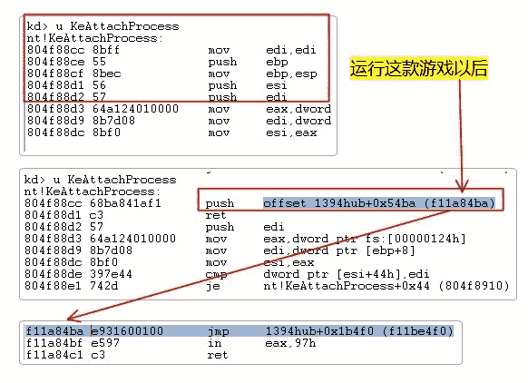
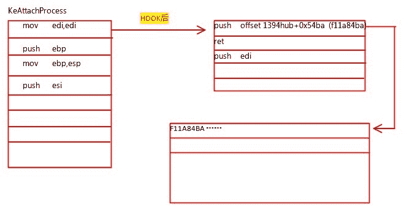
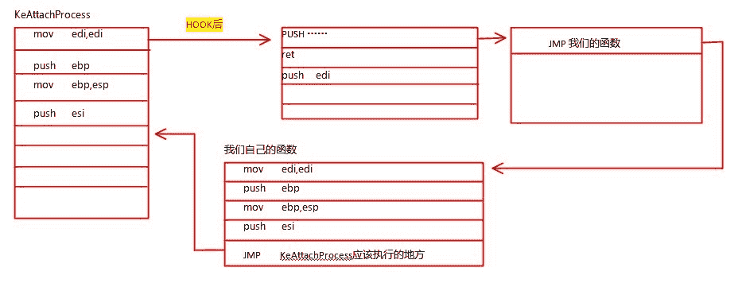

# 猥琐的恢复 InLineHOOK

> 原文：[`www.pediy.com/kssd/pediy11/124674.html`](https://www.pediy.com/kssd/pediy11/124674.html)

话说来看雪注册已半个月有余了，可是天天在线也不见 KX 增长。  
老话说狗急了跳墙，人急了就会自己动手了。  
说一个恢复 InlineHook 的方法，但是比较猥琐。而且高手直接飘过吧~~~~~~  
咱就以某个游戏的保护措施为列吧，看好了这里不是讲如何过这个保护的，而是对她猥琐一下。  
这个游戏在内核中 HOOK 了很多函数，就以 KeAttachProcess 为例。  
在没运行游戏之前  

代码:

```
kd> u KeAttachProcess
nt!KeAttachProcess:
804f88cc  8bff  mov  edi,edi
804f88ce  55  push  ebp
804f88cf  8bec  mov  ebp,esp
804f88d1  56  push  esi
804f88d2  57  push  edi

```

运行游戏之后被修改成……请看图  
  
很明显它是在 KeAttachProcess 函数开头进行了 HOOK 并且转到的地址仍然是一条  
JMP 语句跳到另外一个地方，至于它为什么这么做。我分析可能是用一条线程不停的写  
最后那条 JMP 语句比较方便。扯远了……  
那么我们怎么恢复 KeAttachProcess 呢，正常的情况下只要将它头部的几条重新写进去就可以了  
可我们今天要猥琐一点，偏要脱裤子放屁。 有时候脱裤子放屁也是一种艺术。  
不废话了，图解它的 HOOK 原理  
  
而我们要做的呢，看下图  
  
好了，整个原理都看过图了。下面上代码就 OK 了  
代码:

```
//Driver.c
#include <ntddk.h>
#include <wdm.h>
#include <windef.h>

#define NAKED \_\_declspec(naked)    //定义裸体函数
#define PAGEDCODE code\_seg("PAGE")  //分页
#define LOCKEDCODE code\_seg()    //非分页
#define INITCODE code\_seg("INIT")  //初始化时载入内存而后卸载
//保存被 HOOK 函数开头的前 5 条指令
#pragma pack(1)
typedef struct \_TOP5CODE
{
  UCHAR  instruction;  //指令
  ULONG  address;    //地址
}TOP5CODE,\*PTOP5CODE;
#pragma pack( )

BYTE  \*KeAttachProcessAddress      = NULL;  //AttachProcess 函数地址

//卸载函数
VOID  DriverUnload(IN PDRIVER\_OBJECT  pDriverObject)
{
  KdPrint(("Enter DriverUnload\\n"));
}

//获取函数地址
ULONG MyGetFunAddress( IN PCWSTR FunctionName)
{
  UNICODE\_STRING UniCodeFunctionName;
  RtlInitUnicodeString( &UniCodeFunctionName, FunctionName );
  return (ULONG)MmGetSystemRoutineAddress( &UniCodeFunctionName );   
}

//中继函数
#pragma LOCKEDCODE
static NAKED VOID  MyKeAttachProcessRelay()
{
  \_\_asm
  {
    mov  edi,edi
    push  ebp
    mov  ebp,esp
    push  esi
    mov  eax,KeAttachProcessAddress
    add  eax,6
    jmp  eax  
  }
}

//入口函数
NTSTATUS DriverEntry( IN PDRIVER\_OBJECT DriverObject, IN PUNICODE\_STRING RegistryPath )
{
  TOP5CODE    \*top5code  = NULL;
  BYTE      \*jmpAddress  = NULL;              //保存 GPK 修改内容的地址
  BYTE      JmpMyAttachProcess\[5\]  = {0xE9,0,0,0,0};  //跳转到 HOOK 函数的地址
  KIRQL      Irql;

  //获取函数地址
  KeAttachProcessAddress  = (BYTE\*)MyGetFunAddress(L"KeAttachProcess");
  //将指针指向 AttachProcessAddress 函数头部
  top5code = (TOP5CODE\*)KeAttachProcessAddress;
  jmpAddress = (BYTE\*)top5code->address;
  //计算 jmpAddress 与 MyKeAttachProcess 的相对地址
  \*(ULONG \*)(JmpMyAttachProcess+1)=(ULONG)MyKeAttachProcessRelay-((ULONG)jmpAddress+5);

  \_\_asm
  {
    cli
      mov eax,cr0
      and eax,not 10000h
      mov cr0,eax
  }
  //提升 IRQL 中断级
  Irql=KeRaiseIrqlToDpcLevel();
  //写入 JMP 语句
  RtlCopyMemory((BYTE\*)jmpAddress,JmpMyAttachProcess,5);
  //恢复 Irql
  KeLowerIrql(Irql);
  \_\_asm
  {
    mov    eax,cr0
    or    eax,10000h
    mov    cr0,eax
    sti
  }

  //设置卸载函数
  DriverObject->DriverUnload = DriverUnload;
  
  return STATUS\_SUCCESS;
}

```

当然这种猥琐也可以用在 SSDT HOOK 上面。  
就是到被修改的地址开始出写一句 JMP 跳转回原始函数的开始处。