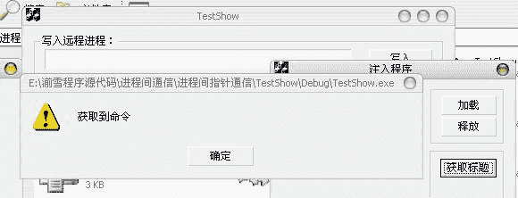

# 一种注入进程，获得完全操控的方法之一

> 原文：[`www.pediy.com/kssd/pediy09/pediy09-338.htm`](https://www.pediy.com/kssd/pediy09/pediy09-338.htm)

> 好长时间没贴东西了，今天就来贴点东西，废话就不说了直接进入主题，喜欢的就支持，不喜欢的就看乐和！！  
>   今天说点什么呢~我们今天就说 HOOK，实际提到这个大家都知道它的功用，如果要是抓取消息那肯定是用下面的函数：  
> //----------------------------------------------------------------------  
> ::SetWindowsHookA(int nFilterType,HOOKPROC pfnFilterProc);  
> ::CallNextHookEx(HHOOK hhk,int Code,WPARAM wParam,LPARAM lParam);  
> ::UnhookWindowsHook(int nCode,HOOKPROC pfnFilterProc);  
>   
> //它们的参数我就不说了，实在是太多了！！  
> //---------------------------------------------------------------------------  
>   
>   今天我就给大家说一种别的方法来抓取 WINDOWS 消息的方法，这种方法虽然有点局限性，但是我感觉很不错的哦！用我  
>   
> 的方法，可以抓取一个进程中的所有窗口的消息。不信就跟我一体来试试，如果看不太明白，那只好去学学相关知识了。我们  
>   
> 选择的方法就是 HOOK API 的方法。很多朋友都说网络上流传的 HOOK API 的很多，但是我碰到的都是 HOOK 那个 MessageBoxA 函数，  
>   
> 没什么意思，今天我就给大家一个全能的方法，我们不用了解太多 PE 结构，非要在 IAT 表中修改，我们先来看看我们要处理的  
>   
> API 为：  
>   
> /\*------------------------------------------------------------------------------------  
>  函数原型：LRESULT CallWindowProc(WNDPROC lpPrevWndFunc，HWND hWnd．UINT Msg，WPARAM wParam，LPARAM IParam);  
>     参数：  
>     lpPrevWndFunc：指向前一个窗口过程的指针。如果该值是通过调用 GetWindowLong 函数，并将该函数中的 nlndex 参数设为  
>   
> GWL\_WNDPROC 或 DWL\_DLGPROC 而得到的，那么它实际上要么是窗口或者对话框的地址，要么就是代表该地址的句柄。  
>     hWnd：指向接收消息的窗口过程的句柄。  
>     Msg：指定消息类型。  
>     wParam：指定其余的、消息特定的信息。该参数的内容与 Msg 参数值有关。  
>     IParam：指定其余的、消息特定的信息。该参数的内容与 Msg 参数值有关。  
>     返回值：返回值指定了消息处理结果，它与发送的消息有关  
>   
> \-----------------------------------------------------------------------------------\*/  
>   
> 我想一般对这个函数，比较陌生点，用的人就不多了，就像我有时用 ntdll.dll 中 LdrGetDllHandle 这类函数一样。因为它的功  
>   
> 能很多时候都不用知道的:)。  
>   
>   我们为了能抓到消息，而且不用 HOOK 这类 API 函数，我们要在这个函数上做手脚，或许可以对 DefWindowProc()这个函  
>   
> 数也做手脚，但是我想我要一个就可以了呵呵！因为我这里举例是用自定义消息为例子的，为什么要用自定义消息呢！我还想  
>   
> 说明一点问题就是远程注入进程。  
>   
>   实际对于一个进程来讲，只要给它放个 DLL 那么它就不得不听你的了，我们可以给这个 DLL 发送一些命令，让它按照命  
>   
> 令来操作我们的目标进程。有的时候我就特别的喜欢‘该死’，他做的系统就给我们一个空间，也就是 0x400-0x7FF 是为用户自  
>   
> 定义的消息，我们就可以用如下的方法来设置命令：  
> #define WM\_CMD\_EXIT  WM\_USER+100   //退出进程  
> #define WM\_CMD\_GETHWND  WM\_USER+101   //获取 HWND 句柄  
> #define WM\_CMD\_GETCAPTION WM\_USER+102 //获取窗口名称  
>   
> ……等等，我们还可以调用进程的内部函数，让进程做我们想让它做的。实际就举个例子来将，发给命令过去，让 QQ 不断显示  
>   
> 广告，或定时显示广告，我们几乎就完全操作了进程了。如果没道德，想抓取别人的隐私，那也是顺手而已。可是我在发这篇  
>   
> 贴的时候，还是想过是否要发，因为我觉得我手里的东西就是把双刃剑，能杀这边，也能杀那边。希望学会的朋友都不要把它  
>   
> 用于搞破坏上。  
>   
> 注入进程的方法太多了，我就不说了，我把它写了一个类，大家就可以拿去直接用了。  
>   
> //注意的是，路径是绝对路径，才能给其它进程注入。  
> //----------------------------------------------------------------------------  
> // RemoteShell.h: interface for the CRemoteShell class.  
> //  
> //////////////////////////////////////////////////////////////////////  
>   
> #if !defined(AFX\_REMOTESHELL\_H\_\_6242FFA8\_B8E3\_4F9A\_BE7D\_197F76A78D03\_\_INCLUDED\_)  
> #define AFX\_REMOTESHELL\_H\_\_6242FFA8\_B8E3\_4F9A\_BE7D\_197F76A78D03\_\_INCLUDED\_  
>   
> #if \_MSC\_VER > 1000  
> #pragma once  
> #endif // \_MSC\_VER > 1000  
>   
>   
> #include "tlhelp32.h"  
> #pragma comment(lib,"th32.lib")  
>   
> class CRemoteShell    
> {  
> public:  
>   CRemoteShell();  
>   virtual ~CRemoteShell();  
> public:  
> public:  
>   CString          m\_dllPath;  
>   
>   DWORD            pId;  
>   DWORD            dwSize;  
>   LPVOID           pDll;  
>   HANDLE       hDll;  
>   HANDLE           hToken;  
>   HANDLE           hProcess;  
>     LUID             Luid;  
>   TOKEN\_PRIVILEGES tp;  
>   
> public:  
>   int    Release(DWORD procId=NULL);  
>   int    Load(LPCTSTR dllpath,DWORD pId=NULL); //进程注入  
>   int    Load(LPCTSTR dllpath,HWND hWnd);      //窗口注入  
>   HANDLE GetDllHandle(LPCTSTR path,DWORD pid);  
> };  
>   
> #endif // !defined(AFX\_REMOTESHELL\_H\_\_6242FFA8\_B8E3\_4F9A\_BE7D\_197F76A78D03\_\_INCLUDED\_)  
>   
>   
> //-------------------------------------------------------------------------------------------  
> // RemoteShell.cpp: implementation of the CRemoteShell class.  
> //  
> //////////////////////////////////////////////////////////////////////  
>   
> #include "stdafx.h"  
> #include "注入程序.h"  
> #include "RemoteShell.h"  
>   
> #ifdef \_DEBUG  
> #undef THIS\_FILE  
> static char THIS\_FILE\[\]=\_\_FILE\_\_;  
> #define new DEBUG\_NEW  
> #endif  
>   
> //////////////////////////////////////////////////////////////////////  
> // Construction/Destruction  
> //////////////////////////////////////////////////////////////////////  
>   
> CRemoteShell::CRemoteShell()  
> {  
>   hToken  =NULL;  
>   hProcess=NULL;  
>   memset(&tp,0,sizeof(TOKEN\_PRIVILEGES));  
>   
>   //取得句柄的令牌:  
>     if (!OpenProcessToken(GetCurrentProcess(), //是要修改访问权限的进程句柄  
>     TOKEN\_ADJUST\_PRIVILEGES|TOKEN\_QUERY,   //指定你所需要的操作类型  
>     &hToken))                              //是返回的访问令牌指针  
>     {  
>           return ;  
>     }  
>       
>   //获取权限的 LUID 值:  
>   if (!LookupPrivilegeValue(NULL,           //系统的名称，如果是本地系统只要指明为 NULL 就可以了  
>     SE\_DEBUG\_NAME,                        //指明了权限的名称  
>     &Luid))                               //返回 LUID 的指针  
>     {  
>           return ;  
>     }  
>   
>     tp.PrivilegeCount = 1;  
>     tp.Privileges\[0\].Attributes = SE\_PRIVILEGE\_ENABLED;  
>     tp.Privileges\[0\].Luid = Luid;  
>       
>   //访问令牌进行修改:  
>   if (!AdjustTokenPrivileges(hToken,        //访问令牌的句柄  
>     0,                                    //决定是进行权限修改还是除能(Disable)所有权限  
>     &tp,                                  //指明要修改的权限,指向 TOKEN\_PRIVILEGES 结构的指针，该结构  
>   
> 包含一个数组，数据组的每个项指明了权限的类型和要进行的操作  
>     sizeof(TOKEN\_PRIVILEGES),             //是结构 PreviousState 的长度，如果 PreviousState 为空，该参  
>   
> 数应为 NULL  
>     NULL,                                 //参数也是一个指向 TOKEN\_PRIVILEGES 结构的指针，存放修改前  
>   
> 的访问权限的信息，可空  
>     NULL))                                //实际 PreviousState 结构返回的大小  
>     {  
>           return ;  
>     }  
> }  
>   
> CRemoteShell::~CRemoteShell()  
> {  
>   if(hToken!=NULL){::CloseHandle(hToken);}  
>   if(hProcess!=NULL){::CloseHandle(hProcess);}  
> }  
>   
> //注入给指定进程:  
> int CRemoteShell::Load(LPCTSTR dllpath,DWORD pId)  
> {  
>   hProcess   =NULL;  
>   pDll       =NULL;  
>   m\_dllPath  =dllpath;  
>   
>   //如果指定进程 ID 为 NULL,就注入给自己.  
>   if(pId==NULL){pId=::GetCurrentProcessId();}  
>   
>   //打开进程:  
>   hProcess=::OpenProcess(PROCESS\_CREATE\_THREAD|PROCESS\_VM\_WRITE|PROCESS\_VM\_OPERATION,1,pId);  
>   if(hProcess==NULL){return -20;}  
>     
>   //分配内存:  
>     pDll=::VirtualAllocEx(hProcess,NULL,strlen(dllpath),MEM\_COMMIT,PAGE\_READWRITE);  
>   if(pDll==NULL){return -21;}  
>   
>   //注入 DLL:  
>     BOOL bRe=::WriteProcessMemory(hProcess,pDll,(void\*)dllpath,strlen(dllpath),NULL);  
>   if(bRe==FALSE){return -22;}  
>   
>   //获取 LoadLibraryA 函数地址:  
>     FARPROC pLoadDll=GetProcAddress(GetModuleHandle("kernel32.dll"),"LoadLibraryA");  
>   if(pLoadDll==NULL){return -23;}  
>   
>   //创建线程:  
>     HANDLE hRemote=CreateRemoteThread(hProcess,NULL,0,(LPTHREAD\_START\_ROUTINE)pLoadDll,pDll,NULL,0);   
>   //等待线程结束:  
>   ::WaitForSingleObject(hRemote,INFINITE);  
>   
>   if(hRemote!=NULL){::CloseHandle(hRemote);}  
>   if(hProcess!=NULL){::CloseHandle(hProcess);}  
>   return 0;  
> }  
>   
> //注入给指定程序句柄的进程:  
> int CRemoteShell::Load(LPCTSTR dllpath,HWND hWnd)  
> {  
>   hProcess   =NULL;  
>   pDll       =NULL;  
>   pId        =NULL;  
>   m\_dllPath  =dllpath;  
>   
>   if(hWnd!=NULL){::GetWindowThreadProcessId(hWnd,&pId);}  
>   
>   //如果指定进程 ID 为 NULL,就注入给自己.  
>   if(pId==NULL){pId=::GetCurrentProcessId();}  
>   
>   //打开进程:  
>   hProcess=::OpenProcess(PROCESS\_CREATE\_THREAD|PROCESS\_VM\_WRITE|PROCESS\_VM\_OPERATION,1,pId);  
>   if(hProcess==NULL){return -20;}  
>     
>   //分配内存:  
>     pDll=::VirtualAllocEx(hProcess,NULL,strlen(dllpath),MEM\_COMMIT,PAGE\_READWRITE);  
>   if(pDll==NULL){return -21;}  
>   
>   //注入 DLL:  
>     BOOL bRe=::WriteProcessMemory(hProcess,pDll,(void\*)dllpath,strlen(dllpath),NULL);  
>   if(bRe==FALSE){return -22;}  
>   
>   //获取 LoadLibraryA 函数地址:  
>     FARPROC pLoadDll=::GetProcAddress(::GetModuleHandle("kernel32.dll"),"LoadLibraryA");  
>   if(pLoadDll==NULL){return -23;}  
>   
>   //创建线程:  
>   HANDLE hRemote=CreateRemoteThread(hProcess,NULL,0,(LPTHREAD\_START\_ROUTINE)pLoadDll,pDll,NULL,0);   
>   
>   //等待线程结束:  
>   ::WaitForSingleObject(hRemote,INFINITE);  
>   
>   hDll=GetDllHandle(dllpath,pId);  
>   if(hRemote!=NULL){::CloseHandle(hRemote);}  
>   if(hProcess!=NULL){::CloseHandle(hProcess);}  
>   return 0;  
> }  
>   
> int CRemoteShell::Release(DWORD procId)  
> {  
>   DWORD id=NULL;  
>     
>   if(hDll==NULL){return -1;}  
>   if(pId!=NULL){id=pId;}  
>   if(procId!=NULL){id=procId;}  
>   
>   if(id!=NULL){  
>   
>   //打开进程:  
>   hProcess=::OpenProcess(PROCESS\_CREATE\_THREAD|PROCESS\_VM\_WRITE|PROCESS\_VM\_OPERATION,1,pId);  
>   if(hProcess==NULL){return -20;}  
>   
>   //FARPROC pGetDllHandle=GetProcAddress(GetModuleHandle("ntdll.dll"),"LdrGetDllHandle");  
>   
>   //获取 FreeLibraryA 函数地址:  
>     FARPROC pFreeDll=GetProcAddress(GetModuleHandle("kernel32.dll"),"FreeLibrary");  
>   if(pFreeDll==NULL){return -23;}  
>   
>   //创建线程:  
>     HANDLE hRemote=::CreateRemoteThread(hProcess,NULL,0,  
>                    (LPTHREAD\_START\_ROUTINE)  
>   
> pFreeDll,hDll,NULL,0);   
>   //等待线程结束:  
>   ::WaitForSingleObject(hRemote,INFINITE);  
>   
>   ::VirtualFreeEx(hProcess,pDll,0,MEM\_RELEASE);  
>   if(hRemote!=NULL){::CloseHandle(hRemote);}  
>   if(hProcess!=NULL){::CloseHandle(hProcess);}  
>   }else{AfxMessageBox("进程号为空!无法释放!");}  
>     
>   return 0;  
> }  
>   
> HANDLE CRemoteShell::GetDllHandle(LPCTSTR path,DWORD pid)  
> {  
>   if(pid==NULL){pid=::GetCurrentProcessId();}  
>     
>   //打开进程:  
>   int num=0;  
>   BOOL   bRe=FALSE;  
>   HANDLE hModule=NULL;  
>     MODULEENTRY32\* minfo=new MODULEENTRY32;  
>   
>   if(NULL!=pid)  
>     {  
>     hModule=CreateToolhelp32Snapshot(TH32CS\_SNAPMODULE,pid);  
>   
>     bRe=Module32First(hModule, minfo);  
>     for(;bRe!=0;num++)  
>     {  
>       if(lstrcmp(minfo->szExePath,path)==0||lstrcmp(minfo->szModule,path)==0)  
>       {return minfo->modBaseAddr;}  
>       bRe=::Module32Next(hModule,minfo);  
>     }  
>   
>     }  
>   ::CloseHandle(hModule);  
>   return NULL;  
> }  
>   
>   
> //----------------------------------------------------------------------------------------------  
>   
> 我们用上面的类就可以轻松的把一个 DLL 注入到别的进程，并且还可以轻松的释放。做到不知不觉。  
> 话归前题，我们要怎么样才能对 CallWindowProc 这个 API 做手脚了。我们可以看到这个函数的入口地方很简单：  
>   
> //-------------------------------------------------------------  
> 77D1E8EA >  8BFF            mov     edi, edi  
> 77D1E8EC    55              push    ebp  
> 77D1E8ED    8BEC            mov     ebp, esp  
> 77D1E8EF    6A 01           push    1        ;只是和前面不一样多了个参数 1  
> 77D1E8F1    FF75 18         push    dword ptr \[ebp+18\]  
> 77D1E8F4    FF75 14         push    dword ptr \[ebp+14\]  
> 77D1E8F7    FF75 10         push    dword ptr \[ebp+10\]  
> 77D1E8FA    FF75 0C         push    dword ptr \[ebp+C\]  
> 77D1E8FD    FF75 08         push    dword ptr \[ebp+8\]  
> 77D1E900    E8 E9DCFFFF     call    77D1C5EE  
> 77D1E905    5D              pop     ebp  
> 77D1E906    C2 1400         retn    14  
>   
> //-----------------------------------------------------------------------  
>   
> 我们定义了一个函数类型：  
> typedef  LRESULT (\*CALLPROC)(WNDPROC,HWND,UINT,WPARAM,LPARAM,int);  
> 这样我们就可以轻松的调用这个函数了。  
> 我们只需要把：  
> 77D1E900    E8 E9DCFFFF     call    77D1C5EE  
> 改为我们自己的就可以了。  
>   
> 分析好以后，我们就在我们准备好的 DLL 中加入我们代替它的回调函数：  
> //----------------------------------------------------------------------------------------------------  
> LRESULT CALLBACK pnCallWindowProc(IN WNDPROC lpPrevWndFunc,  
>           IN HWND hWnd,IN UINT Msg,  
>           IN WPARAM wParam,IN LPARAM lParam,IN int unk)  
> {  
>   switch(Msg)  
>   {  
>   case WM\_CMD\_EXIT:  
>     {       //这里是我们自己定义给进程的命令，也就是自定义消息：  
>       AfxMessageBox("获取到命令");return TRUE;  
>     }  
>   default:{break;}  
>   }  
>   //返回到原来的地址:  
>   return lpSrcCallProc(lpPrevWndFunc,hWnd,Msg,wParam,lParam,unk);  
> }  
> //-------------------------------------------------------------------------------------------------------  
>   
> 我们在 DLL 加载时，把上面那个地方改掉就可以了。  
>   
> //----------------------------------------------------------------------------------------------  
> void CMyRemoteDllApp::SetHookApiCallBack()  
> {  
>   //获取回调函数地址:  
>   hModule=::GetModuleHandle("User32.dll");  
>   FARPROC  fpCallWindowProc=::GetProcAddress(hModule,"CallWindowProcA");  
>   
>   //这里需要做说明了，最好大家不要用虚拟绝对地址，建议用虚拟相对地址，这样即使 user32.dll 的版本不一样  
>   //也不会影响到我们的 DLL，我这里都是通过计算得到的。  
>   //声明结构对象，为了方便修改，我写了个结构来处理:  
>   \_ASM\_CALL \_call;  
>   \_call.\_01cmd =0xE8;  
>   DWORD dword=(DWORD)&pnCallWindowProc-((DWORD)fpCallWindowProc+0x16)-5;  
>   memcpy((PDWORD)\_call.\_02dat,&dword,4);  
>   
>   //获取当前内存块的保护类型，由于是系统 DLL 只给 R 的权限，我们必须把 R 改成 RW 才能把我们的函数替换进去:  
>   MEMORY\_BASIC\_INFORMATION \_base;  
>   ::VirtualQuery((LPVOID)((DWORD)hModule+0x1000),&\_base,sizeof(MEMORY\_BASIC\_INFORMATION));  
>     
>   //保存原始入口地址，我们处理的是自定义消息，我们不需要处理全部，所以其他的都转给原来的地址:  
>   //做到这里就想起病毒~~~，所以再三请大家不要用于它途  
>   lpSrcCallProc=(CALLPROC)(\*(PDWORD)((DWORD)fpCallWindowProc+0x17));  
>   lpSrcCallProc=(CALLPROC)((DWORD)fpCallWindowProc+0x16+(DWORD)lpSrcCallProc+5);  
>     
>   //处理为读写类型:  
>   ::VirtualProtect(\_base.BaseAddress,\_base.RegionSize,PAGE\_READWRITE,&\_base.Protect);  
>   memcpy((LPVOID)((DWORD)fpCallWindowProc+0x16),&\_call,5);  
>   
>   //处理完成后,恢复保护类型:  
>   DWORD dwProctect=NULL;  
>   ::VirtualProtect(\_base.BaseAddress,\_base.RegionSize,\_base.Protect,&dwProctect);  
>   
> }  
>   
> //-------------------------------------------------------------------------------------------------------  
>   
> 只加载不算完啊，我们要在 DLL 退出前把它再改回来的，要不程序会不正常的。  
>   
> //-----------------------------------------------------------------------------------------  
> int CMyRemoteDllApp::ExitInstance()   
> {  
>   // TODO: Add your specialized code here and/or call the base class  
>     
>   //获取回调函数地址:  
>   hModule=::GetModuleHandle("User32.dll");  
>   FARPROC  fpCallWindowProc=::GetProcAddress(hModule,"CallWindowProcA");  
>   
>   //获取当前内存块的保护类型:  
>   MEMORY\_BASIC\_INFORMATION \_base;  
>   ::VirtualQuery((LPVOID)((DWORD)hModule+0x1000),&\_base,sizeof(MEMORY\_BASIC\_INFORMATION));  
>       
>   DWORD dword=(DWORD)lpSrcCallProc-((DWORD)fpCallWindowProc+0x16)-5;  
>   
>   //声明结构对象:  
>   \_ASM\_CALL \_call;  
>   \_call.\_01cmd =0xE8;  
>   memcpy((PDWORD)\_call.\_02dat,&dword,4);  
>   
>   //处理为读写类型:  
>   ::VirtualProtect(\_base.BaseAddress,\_base.RegionSize,PAGE\_READWRITE,&\_base.Protect);  
>   memcpy((LPVOID)((DWORD)fpCallWindowProc+0x16),&\_call,5);  
>   
>   //处理完成后,恢复保护类型:  
>   DWORD dwProctect=NULL;  
>   ::VirtualProtect(\_base.BaseAddress,\_base.RegionSize,\_base.Protect,&dwProctect);  
>   
>   return CWinApp::ExitInstance();  
> }  
> //-----------------------------------------------------------------------------------------  
>   在回调函数前必须加 CALLBACK，请大家要注意了，因为加与不加在汇编语言里是完全不一样的：  
> //加了的：  
> //---------------------------------------------------------------------------------------------  
> 1000129C    55              push    ebp  
> 1000129D    8BEC            mov     ebp, esp  
> 1000129F    51              push    ecx  
> 100012A0    8B45 10         mov     eax, dword ptr \[ebp+10\]  
> 100012A3    8945 FC         mov     dword ptr \[ebp-4\], eax  
> 100012A6    817D FC 6404000>cmp     dword ptr \[ebp-4\], 464  
> 100012AD    74 02           je      short 100012B1  
> 100012AF    EB 15           jmp     short 100012C6  
> 100012B1    6A 00           push    0  
> 100012B3    6A 00           push    0  
> 100012B5    68 64300010     push    10003064  
> 100012BA    E8 A7010000     call    10001466                         ; jmp 到 MFC42.#1200  
> 100012BF    B8 01000000     mov     eax, 1  
> 100012C4    EB 21           jmp     short 100012E7  
> 100012C6    8B4D 1C         mov     ecx, dword ptr \[ebp+1C\]  
> 100012C9    51              push    ecx  
> 100012CA    8B55 18         mov     edx, dword ptr \[ebp+18\]  
> 100012CD    52              push    edx  
> 100012CE    8B45 14         mov     eax, dword ptr \[ebp+14\]  
> 100012D1    50              push    eax  
> 100012D2    8B4D 10         mov     ecx, dword ptr \[ebp+10\]  
> 100012D5    51              push    ecx  
> 100012D6    8B55 0C         mov     edx, dword ptr \[ebp+C\]  
> 100012D9    52              push    edx  
> 100012DA    8B45 08         mov     eax, dword ptr \[ebp+8\]  
> 100012DD    50              push    eax  
> 100012DE    FF15 D4310010   call    dword ptr \[100031D4\]             ; USER32.77D1C5EE  
> 100012E4    83C4 18         add     esp, 18  
> 100012E7    8BE5            mov     esp, ebp  
> 100012E9    5D              pop     ebp  
> 100012EA    C2 1800         retn    18  
> //---------------------------------------------------------------------------------------------  
> 没加的，类似如下，没加会在堆栈溢出，必须手动修改 ESP，才能正常：  
> //-------------------------------------------------------------------------------------------------  
> 100017A1    55              push    ebp  
> 100017A2    8BEC            mov     ebp, esp  
> 100017A4    53              push    ebx  
> ……  
> 10001831    8945 0C         mov     dword ptr \[ebp+C\], eax  
> 10001834    8B45 0C         mov     eax, dword ptr \[ebp+C\]  
> 10001837    5F              pop     edi  
> 10001838    5E              pop     esi  
> 10001839    5B              pop     ebx  
> 1000183A    5D              pop     ebp  
> 1000183B    C2 0C00         retn    0C  
>   
>   
> //--------------------------------------------------------------------------------------------------  
>   
> 再需要说明一下：  
> Call 地址不是实际地址是要算的哦  
> 目的地址-当前地址-5  
> 就是 CALL 的值，这个是个简单点的公式！！！大家用的着哦！  
>   
> 如果，大家要是在，DLL 中加入了窃取信息的代码，那么它就是个木马了，只要发个消息它就工作，或者设定在收到某个消息后才工作，我想要比那些网上的木马高明点，但是我还希望大家不要这么做，因为，这样做的后果是可怜的哦:)。还有就是不要拿系统进程做实验，容易死机:)       
>   
> 好了，到现在我们所做的就完工了，还算是基本完美吧！大家发给消息给被注入进程，可以看到有如下图的提示
> 
>   
> 以后，再给大家说，怎么调用进程内部函数，这一篇就算结束了 886~~~  
>   
>   
>   
>   
>   
>   
>             -By EasyStudy For PhantomNet 

> 看到了我的之一，我想大家会很清楚，因为这个方法的最大的 BUG 就是在回调函数之后来处理，如果前面已经处理了，  
> 那么我们就无法处理了。而且又要修改系统 DLL，比较不完美。我最近又发现了两种方法：  
>   一、修改 RegisterClassA：  
>   相对前面的方法来说，这个方法很好用，因为，我们可以很容易把回掉函数改掉。类似如下代码：  
> //---------------------------------------------------------------------------  
> int CMuGame::InitRegClass()  
> {    
>   //获取模块句柄:  
>   HINSTANCE hModule=::GetModuleHandle("User32.dll");  
>   //获取原始函数地址:  
>   fpsRegisterClassA=(REGWINCLASS)::GetProcAddress(hModule,"RegisterClassA");  
>   
>   //获取当前内存块的保护类型:  
>   MEMORY\_BASIC\_INFORMATION \_base;  
>   ::VirtualQuery((LPVOID)((DWORD)hModule+0x1000),&\_base,sizeof(MEMORY\_BASIC\_INFORMATION));  
>   
>   //处理为读写类型:  
>   ::VirtualProtect(\_base.BaseAddress,\_base.RegionSize,PAGE\_READWRITE,&\_base.Protect);  
>   
>   //获得导出表的地址和大小:  
>   DWORD   dwExportSize=NULL;  
>   PDWORD  pdwExportAddr=NULL;  
>   
>   appfun.Load(hModule);  
>   appfun.GetExportTable(&dwExportSize,&pdwExportAddr);  
>   
>   //查找 RegisterClassA 函数地址:  
>   for(DWORD i=0;i<dwExportSize;i++,pdwExportAddr++)  
>   {  
>     if((\*pdwExportAddr+(DWORD)hModule)==(DWORD)fpsRegisterClassA)  
>     {  
>       //计算跳转地址:  
>       DWORD  dword=(DWORD)fpnRegisterClassA-(DWORD)fpsRegisterClassA;  
>       
>       //声明结构对象:  
>       \_ASM\_JMP \_jmp;  
>       \_jmp.\_01cmd =0xE9;  
>       memcpy((PDWORD)\_jmp.\_02dat,&dword,4);  
>       memcpy((LPVOID)((DWORD)fpsRegisterClassA-5),&\_jmp,5);  
>   
>       //修改导出表地址:  
>       DWORD  dwAddr=\*pdwExportAddr-5;  
>       memcpy(pdwExportAddr,&dwAddr,4);  
>   
>       break;  
>     }  
>   }  
>   
>   //处理完成后,恢复保护类型:  
>   DWORD dwProctect=NULL;  
>   ::VirtualProtect(\_base.BaseAddress,\_base.RegionSize,\_base.Protect,&dwProctect);  
>   return NULL;  
> }  
> //----------------------------------------------------------------------------  
>   
>   
>   
>   当然，我们可以修改 IAT 表来实现，但是我们大家都明白，IAT 表很不确定，有的程序还没有 IAT 表，我们必须找个通用  
> 的方法，那就是直接把 User32.dll 的导出表修改掉，因此，我们让程序正常调用 RegisterClassA 这个之后，千万没想到的是，现  
> 在的导处 API 函数的地址已经被修改，而在中途转到我们的 DLL 中，然后再回到真正的函数地址入口：  
>   
> //-----------------------------------------------------------------------------  
>   
> ATOM WINAPI fpnRegisterClassA(WNDCLASS \*lpWndClass)  
> {  
>   //替换"XX"窗口的回调函数:  
>   if(lstrcmp(lpWndClass->lpszClassName,"XX")==0) //如果是我们要替换的窗口，就替换，不是就不替换  
>   {  
>     fpsWndProc=lpWndClass->lpfnWndProc;  
>     lpWndClass->lpfnWndProc=fpnWndProc;  
>   }  
>   ATOM  atom=fpsRegisterClassA(lpWndClass);  
>   return atom;  
> }  
>   
> LRESULT CALLBACK fpnWndProc(HWND hDlg,UINT message,WPARAM wParam,LPARAM lParam)  
> {  
>   switch(message)  
>   {  
>   case WM\_INITDIALOG:  
>     {  
>       //保存窗口句柄:  
>       theApp.game.hWnd=hDlg;  
>       //修改标题,方便我们调用:  
>       ::SetWindowText(hDlg,\_T("\[PhantomNet\] XX"));  //我们把标题修改掉，方便通信，可以不修改的。  
>       break;  
>     }  
>   case WM\_CMD:   //自定义命令：  
>     {  
>       if((DWORD)wParam==0x01){PostQuitMessage(0);} //收到命令，我们直接用 API 让程序结束。  
>       if((DWORD)wParam==0x02){}   //……什么操作都可以  
>       break;  
>     }  
>   default:{break;}  
>   }  
>   //转到游戏的回调函数:  
>   return fpsWndProc(hDlg,message,wParam,lParam);  
> }  
>   
>   
> //----------------------------------------------------------------------------------------  
>   
>   
> 上面的代码就是实现修改 RegisterClassA 注册类，来转到我们的回调函数的。我们的回调函数，是在真正的回调函数  
> 之前就被执行的，我们可以截获部分消息，让真正的回调函数收不到，因为，我们事先已经替它处理了事件。这样就避免了部  
> 分消息收不到，但是这样的方法，是在程序没有启动，而随程序启动而加载……，我们就没办法对现有的进程进行操作。  
>   
>   
>   二、直接替换回调函数：  
>   怎么能直接替换呢？很多朋友都会想改这个改那个，实际 KS 给我们 4 个函数来让我们做这个工作。但是局限在同一进程，  
> //----------------------------------------------  
> GetClassLong(HWND hWnd,int Index);  
> GetWindowLong(HWND hWnd,int Index);  
> SetClassLong(HWND hWnd,int nIndex,LONG dwNewLong);  
> SetWindowLong(HWND hWnd,int nIndex,LONG dwNewLong);  
> //----------------------------------------------  
>   有必要对这两类函数做说明，GetClassLong 和 SetClassLong 在 RegisterClassA 这个函数运行时才起作用，而 GetWindowLong  
> 和 SetWindowLong 在 CreateWindowA 后才有作用。我们完全可以不用 CreateRemoteThread 这个来触发，我们的程序。我们在替换回调  
> 函数时可以在其他进程对目标进程处理，我们只需要把程序写入到目标进程，我们没必要专门去创建一条线程来加载 DLL，我们直接  
> 把它写进去后，再让某个消息来触发加载。那样就会隐蔽点，这里简要说一下，为了安全期间不贴代码了。  
>   
> //--------------------------------------------------  
>   
> int CMgMuAssistantApp::LoadMain()  
> {  
>   //初始化 SOCKET:  
>   if (!AfxSocketInit())  
>   {  
>     AfxMessageBox("Error InitSocket!");  
>   }  
>   //查找窗口是否存在:  
>   pWnd=CWnd::FindWindow(NULL,"XX");  
>   if(pWnd!=NULL)  
>   {  
>     //由于窗口有可能在创建前被找到,所以我们完善期间不用 GetWindowLong,  
>     //保存原始窗口回调函数:  
>     fpsWndProc=(WNDPROC)::GetClassLong(pWnd->m\_hWnd,GCL\_WNDPROC);  
>   
>     //由于 SetClassLong 只在注册类时起作用,我们必须用 SetWindowLong;  
>     //修改回调函数:  
>     ::SetWindowLong(pWnd->m\_hWnd,GWL\_WNDPROC,(LONG)fpnWndProc);    
>   
>     //修改 Socket 函数:  
>     hooksocket.InitHookApi(::GetModuleHandle(NULL),0x00376000,0x0568);  
>   
>     //装载 OpenGL:  
>     PDWORD pdwAddr=(PDWORD)((DWORD)::GetModuleHandle(NULL)+0x00375A00);  
>     \*pdwAddr=(DWORD)fpnRender;  
>     pdwAddr  =(PDWORD)((DWORD)::GetModuleHandle(NULL)+0x002B5E69);  
>     \*pdwAddr=(DWORD)((DWORD)::GetModuleHandle(NULL)+0x00375A00);  
>   }  
>   
>   return 0;  
> }  
>   
> //---------------------------------------------------  
>   上面的代码是我针对某个游戏做的，由于游戏是基于 OpenGL 的，所以我就把 OpenGL 的 Render 修改下来，来处理我的代码  
> 比如，我们要用到程序内部函数：  
>   
> //-----------------------------------------------------------  
> //原程序是如下的调用方法：  
> 00664B75  |.  50            push    eax  
> 00664B76  |.  8D55 8C       lea     edx, dword ptr \[ebp-74\]  
> 00664B79  |.  52            push    edx  
> 00664B7A  |.  A1 181E9E07   mov     eax, dword ptr \[79E1E18\]  
> 00664B7F  |.  83C0 14       add     eax, 14  
> 00664B82  |.  50            push    eax  
> 00664B83  |.  8B0D 141E9E07 mov     ecx, dword ptr \[79E1E14\]  
> 00664B89  |.  83C1 23       add     ecx, 23  
> 00664B8C  |.  51            push    ecx  
> 00664B8D  |.  E8 8E7CF2FF   call    0058C820  
>   
> //我把它做成 C 函数调用，这样我们就可以直接用这个函数来调用程序内部函数了：  
> int CMgMuAssistantApp::SetMainText(int x,int y,LPSTR str,int unk1,int unk2,int unk3)  
> {  
>   ShowText=(MAINTEXT)0x0058C820;  
>   ShowText(x,y,str,unk1,unk2,unk3);  
>   return 0;  
> }  
>   
> //---------------------------------------------------------------------  
>   
>   
> 下面是我的回调函数，我们发现我们再发送命令给目标程序时，目标程序就乖乖的按我们说的做，让它放那，它就放那，让  
> 它返回什么，它就乖乖返回什么，我们可以设置更多的命令来对程序操作：  
> //--------------------------------------------------------------------  
> LRESULT CALLBACK fpnWndProc(HWND hDlg,UINT message,WPARAM wParam,LPARAM lParam)  
> {  
>   //保存窗口句柄:  
>   theApp.game.hWnd=hDlg;  
>   
>   switch(message)  
>   {  
>   case WM\_INITDIALOG:{break;}  
>   case WM\_PAINT:{break;}  
>   case WM\_CMD:  
>     {  
>       if((DWORD)wParam==0x01){PostQuitMessage(0);}  
>       //返回的是主程序句柄:  
>       if((DWORD)wParam==0x02){  
>         //保存主程序句柄:  
>         theApp.m\_hWndMainApp=(HWND)lParam;  
>         //返回游戏句柄:  
>         ::SendMessage(theApp.m\_hWndMainApp,WM\_CMD,0x02,(LPARAM)hDlg);  
>       }  
>       if((DWORD)wParam==0x08){  
>         //连接主程序，这里我创建了 SOCKET 来网络传输数据:  
>         theApp.m\_uPortMainApp=(UINT)lParam;  
>         pClient=new CClient;  
>         pClient->Close();  
>         pClient->Create();  
>         if(lstrcmp(theApp.m\_strAddrMainApp,"")==0)  
>         {  
>           //获取主机地址:  
>           char hostname\[MAX\_PATH\]={0};  
>           ::gethostname(hostname,MAX\_PATH);  
>           hostent \*addr=::gethostbyname(hostname);  
>           theApp.m\_strAddrMainApp=inet\_ntoa(\*(struct in\_addr \*)addr->h\_addr\_list\[0\]);  
>         }  
>         if(pClient->Connect(theApp.m\_strAddrMainApp,theApp.m\_uPortMainApp)==FALSE)  
>         {  
>           ::SendMessage(theApp.m\_hWndMainApp,WM\_CMD,0x08,(LPARAM)-1);  
>         }else{::SendMessage(theApp.m\_hWndMainApp,WM\_CMD,0x08,(LPARAM)1);}  
>       }  
>       if((DWORD)wParam==0x10){      
>         //修改标题,方便我们调用:  
>         ::SetWindowText(hDlg,\_T("\[MG\] MU"));  
>       }  
>       if((DWORD)wParam==0x11){  
>         CRect rect;  
>         //获取窗口矩形:  
>         ::GetWindowRect(hDlg,&rect);  
>         //移动窗口:  
>         ::MoveWindow(hDlg,LOWORD(lParam),HIWORD(lParam),rect.Width(),rect.Height(),TRUE);  
>       }  
>       return TRUE; //直接返回,不让游戏回调处理,这个是我们的命令机密不能让程序知道:  
>     }  
>   case WM\_COPYDATA:  //我们替我们的目标程序处理进程间通信消息，为了方便点:)  
>     {  
>       //wParam:窗口句柄  
>       //lParam:数据  
>       theApp.OnCopyData(CWnd::FromHandle((HWND)wParam),(COPYDATASTRUCT\*)lParam); return TRUE;  
>     }  
>   default:{break;}  
>   }  
>   //转到游戏的回调函数:  
>   return fpsWndProc(hDlg,message,wParam,lParam);  
> }  
>   
> //-----------------------------------------------------------------------------------------------  
>   
>   实际这回是在上回的基础而来的，我们总结一下就知道，当我们完全操作了回调函数时，一个应用程序就几乎成了你  
> 手中的蛋糕，想怎么样吃就怎么样吃:).KS 在进程的通信和相互性上没做多少，我们很多时候都要用 CreateRemoteThread 这个  
> 函数来做 DLL 的加载，实际不用它的方法还是有很多的，只是没有被人发现而已，同过前面的说明，我想大家都会明白了，怎么  
> 样把一个程序完全操控，但是回过头来一想，如果我们对一个进程做了完全操作，我们可以再用这个进程操作其它的进程，那么  
> 会是烦琐点，但是是件很让人恐怖的事。前面的这个回调函数处理的事情很少，因为，我没把它做的有多强，我不想把它做多强  
> 实际，当一个进程的回调函数交给你来处理，那么我们就可以做很多我们想做的事。当我们将 DLL 放入某个进程时，我们就可以  
> 调用它的任意一个函数，来为我们工作，我们只需要做影射，把我们要调用的函数和地址影射到我们的 DLL 中，然后再加工~~~~  
>   
>   
> :)^^^^  
>   
>                                                    -By EasyStudy For PhantomNet 

 

 4dd466d0e1e0cc123afbe504da2462ca