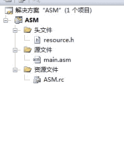
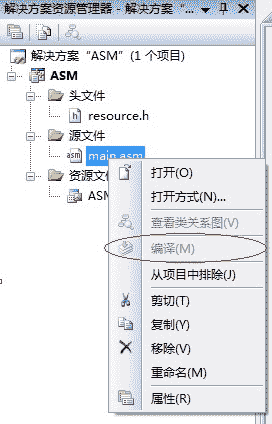
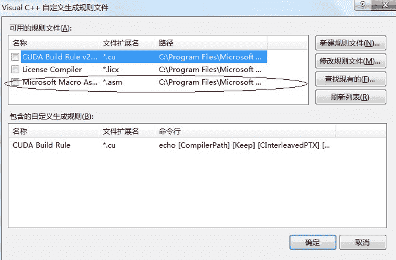
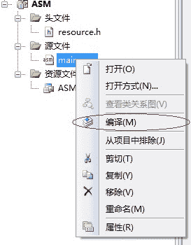

# 用 Vs2008 搭建 Win32 汇编环境

> 原文：[`www.pediy.com/kssd/pediy11/123891.html`](https://www.pediy.com/kssd/pediy11/123891.html)

小弟新手，最近在学习罗的 win32 汇编，感觉 masm32 不是怎么的方便，不太习惯，如果能用 Vs2008 做汇编的 IDE 就好了！后来突然想到在以前浏览 VS 的安装目录时发现里面有个 asm 的 rules 文件（masm.rules)，哈哈，有了这个东西我们就直接可以在 vs 里面编译 asm 文件了。  
  
1.安装 masm32，因为需要里面的 inc 和 lib 文件，并且将 include 目录路径加到 vs 的包含目录中  去，lib 目录先暂时别加，后面做我会做说明。  
2.在 vs 里面建一个 win32 工程，然后新建一个.asm 文件。如下图：  
此时我们在 asm 文件上单击右键发现“编译”是灰色的，说明现在还不能自己编译 asm 文件。  
3。添加 masm.rules 规则文件。现在右键单击上面建的项目，在菜单中选择 “自定义生成规则”，选择后将弹出如下对话框，我们选择 asm 那一项，然后确定，现在我们的 vs 就能够编译 asm 文件了。  
  
  
4。现在我们来说说 lib 库文件，在 vs 中我们可以发现 vs 的包含库路径中已经有了，但是他是 vs2008 的，这些中的某些库文件和以前的版本不一样，比如 vc 运行库等。所以如果我们的汇编中使用了 c 函数，程序在运行时就会报错。（具体原因我也搞不清楚）。所以如果我们使用了 c 函数，那么我在汇编的 includelib 中我们直接加上 masm32 库的绝对路径，如：includelib E:\\masm32\\lib\\msvcrt.lib。这样的话错误就没有了。  
  
  
哈哈，现在我们来做点其他的----让 vs 高亮显示 asm 的某些关键字  
1。打开 vs 的安装目录，找到 IDE 文件夹，我的路径是 C:\\Program Files\\Microsoft Visual Studio 9.0\\Common7\\IDE，在这个目录中看看是否已经存在 usertype.dat 这个文件，如果存在则用记事本打开，若不存在，就新建一个。  
2。打开后将你想要高亮显示的关键字输进去，一关键字占一行。  
3。输完后保存。  
4。然后再选择 vs 的 工具--选项--文本编辑器--文件扩展名，在右边的扩展名输入框中输入 asm，并选择 Microsoft Visual C++，然后添加，并确定。  
5。重启 vs，这样就能高亮显示我们自定义的关键字了。  
  
小弟第一次发帖，写得不好请见谅，别骂我，希望对大家有所帮助。