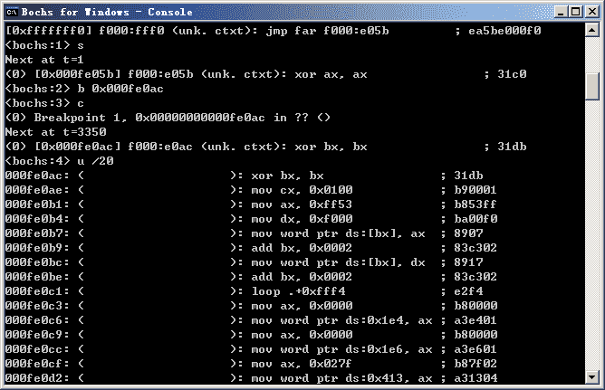
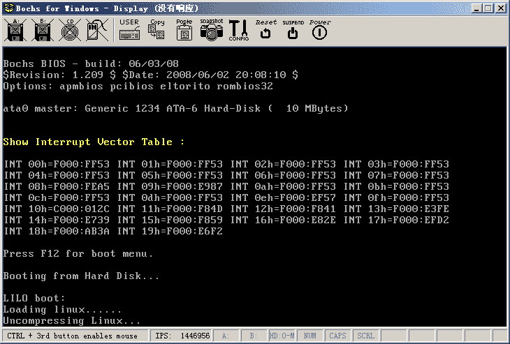
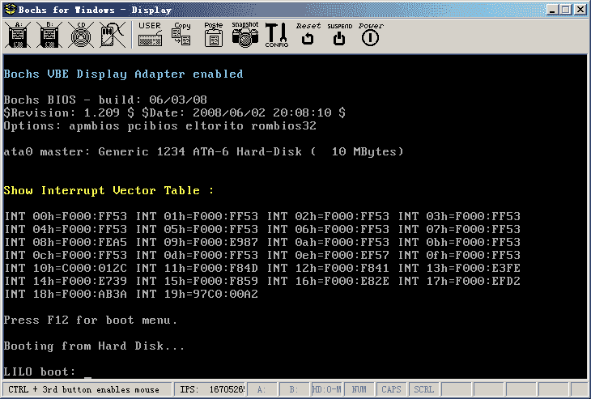

# BIOS Rootkit 实现分析与检测技术研究系列之－－IVT Hook 3

> 原文：[`www.pediy.com/kssd/pediy10/78933.html`](https://www.pediy.com/kssd/pediy10/78933.html)

**BIOS Rootkit 实现分析与检测技术研究系列之－－IVT Hook 3**  
  
  
本节目录  
1. 引言  
2. 寻找原始 IVT  
3. 实现 IVT Hook 检测  
4. 小结  
  
  

引言  
    通过前面两篇文章的叙述，现在我们对实模式下的 IVT 有了比较清楚的认识（文章可在“论坛资料导航”模块里找到）。在这篇文章中，我们将会实现一个具体的 IVT Hook 检测程序，来检测 BIOS Rootkit 的存在。  
  
  
寻找原始 IVT  
    在前面文章中，我们分析了 IceLord 的实现过程。通过 Bochs 调试功能，我们了解到 IceLord 进行 Hook int 19h 的操作。我们发现 ISA 模块 leaving.bin hook 过的中断处理函数入口变为 0x00097ca2，这显然和初始的中断处理函数地址不同。如果我们预先知道系统初始化时中断处理函数的地址，即 IVT 的实际初始值。那么，我们就可以通过对现有 IVT 进行比对，发现不同值，就可以确定 IVT 被进行了 hook 操作。  
    可如何确定 IVT 的初始值呢？在文献《BIOS Boot Specification》、《Intel 64 and IA-32 Architectures Software Developer’s Manual Volume 3A: System Programming Guide, Part 1》和《Intel Corporation. Intel 64 and IA-32 Architectures Software Developer’s Manual Volume 1: Basic Architecture》中，都没有 IVT 初始值的相关说明，看来我们只能自己动手进行研究分析了。  
    使用 Bochs 进行调试分析。采用默认.bxrc 文件配置进行调试。根据调试分析（通过 s 单步执行和 xp 查看内存指令不断观察），发现 BIOS 对于 IVT 的初始化开始于地址 0x000fe0ac 处（Bochs 数据）。在 0x000fe0ac 处下断：b 0x000fe0ac。然后运行 c，调试器运行至此断下。输入 u /20 查看，如图：  
  
  
  
    程序从 0x000fe0ac 开始，主要工作就是初始化内存。从 0000:0000（ds:bx）开始共 0x0100（mov cx,0x0100），即 256 个字节，也就是 IVT 的地址。初始化的值为：f000:ff53。从 0x000fe0c3 后开始，程序将对个别常用的中断号重新指定中断处理函数的地址。如 int 19h 中断的中断处理向量为：f000:e6f2。有了第一手数据，下面我们就可以编写程序来实现 IVT 的检测了。  
  
  
实现 IVT Hook 检测  
      Martin 开发的 ROMOS（http://rayer.ic.cz/romos/romos.htm）是一个非常优秀的 BIOS 项目，它能在 BIOS 中以 ISA 模块形式嵌入数据并完成从 BIOS 启动 FreeDOS 的功能。并且这个项目是开源的（感谢作者）。我们将在这个基础上设计我们的 IVT Hook 检测程序。  
    程序使用 NASM 编写，采用标准 ISA 模块格式，显示 IVT 程序如下：  
  
;--------------------------------------------------------------  
;  
; ShowIVT.asm ver 1.0.0  
;   
; by Jacky Peng 2008.8.8  
;  
; ShowIVT(Interrupt Vector Table) 检测 IVT Hook 是否存在  
;  
;--------------------------------------------------------------  
  
;org head  
    org  0  
  
;isa rom head  
    dw 0aa55h  
    db 02h  
  
;jmp begin of program  
    jmp  begin  
  
  
;---------------------------- 字符串常量 ------------------------------  
msgShow    db  'Show Interrupt Vector Table :',0      
;----------------------------------------------------------------------  
  
  
;-------------------------------- 实用子程序 来自 romos 项目 ----------------------------  
  
;----------------------------- 打印 16 进制（字）--------------------  
whexw:    
  xchg  dh,dl      
  call  whexb      
  xchg  dh,dl      
  call  whexb      
  ret        
  
;----------------------------- 打印 16 进制（字节）------------------  
whexb:    
  push  ax      
  push  dx  
  pushf  
  mov  dh,dl  
  and  dl,00fh     
  and  dh,0f0h     
  ror  dh,4      
  call  @whb1      
  mov  dh,dl  
  call  @whb1      
  popf  
  pop  dx  
  pop  ax  
  ret  
@whb1:    
  cmp  dh,0ah    
  jc  @whb2      
  add  dh,7      
@whb2:    
  add  dh,'0'      
  mov  ah,0eh      
  mov  al,dh      
  int  10h      
  ret        
  
;----------------------------- 打印字符串 ------------------------  
write:    
  pusha        
  pushf        
  push  bx      
  call  wherexy     
  mov  ah,9      
  xor  cx,cx      
  xchg  cl,bh      
  and  cl,7fh      
@wri1:    
  mov  al,\[cs:si\]    
  cmp  al,0      
  je  @wri2      
  int  10h      
  inc  si      
  inc  dl      
  call  gotoxy      
  jmp  short @wri1    
@wri2:    
  pop  bx      
  cmp  bh,80h      
  js  @wri3      
  popf        
  popa        
wcrlf:    
  pusha        
  pushf        
  mov  ax,0e0dh    
  xor  bl,bl      
  int  10h      
  mov  al,0ah      
  int  10h      
@wri3:    
  popf        
  popa        
  ret        
  
;----------------------------- 调整光标位置-----------------------  
wherexy:  
  push  ax      
  push  bx  
  push  cx  
  mov  ah,3      
  mov  bh,0      
  int  10h      
  pop  cx      
  pop  bx  
  pop  ax  
  ret        
  
  
;----------------------------- 调整光标位置-----------------------  
gotoxy:   
  push  ax      
  push  bx      
  mov  ah,2      
  mov  bh,0      
  int  10h      
  pop  bx  
  pop  ax  
  ret        
  
  
;----------------------------- 延迟函数 -----------------------    
delay:          
  sti        
  push  ax      
  push  es      
  pushf  
  push  byte 0      
  pop  es      
  mov  al,\[es:046ch\]    
  add  ah,al      
@dly1:    
  mov  al,\[es:046ch\]    
  cmp  ah,al      
  jne  @dly1      
  popf  
  pop  es      
  pop  ax      
  ret        
  
;-------------------------------- 实用子程序完 来自 romos 项目 --------------------------  
  
;----------------------------- 自定义程序 用于显示 IVT -----------------------  
wmem:    
  pusha        
  pushf  
  
  
  mov  ax,0  
  mov  di,0  
  mov  dx,0  
  mov  ds,ax  
  
  mov  cx,1ah      
  mov  si,memstr    
  
  @wmem1:  
  mov  bx,0107h    
  call  write    
  
  mov  ax,0e3dh    
  xor  bl,bl      
  INT  10h    ; show sign '='  
  
  push  dx  
  
  mov  dx,\[ds:(di+2)\]  
    call  whexw  
    mov  al,':'  
    INT  10h  
    mov  dx,\[ds:di\]  
    call  whexw    ; show info segment:offset  
  
  mov  al,' '    
  INT  10h    ; show space  
  
  add  di,4  
  add  si,8  
  
  pop  dx  
  inc  dx  
  cmp  dx,4  
  jz  @prINTenter  
  jmp  @go  
  @prINTenter:  
    call  wcrlf  
    xor  dx,dx  ; return to another line if print 5 'INT' strings  
  @go:  
    loop  @wmem1     
  
  call  wcrlf      
  
  popf  
  popa  
  
  ret        
memstr    
  db  'INT 00h',0  
  db  'INT 01h',0  
  db  'INT 02h',0  
  db  'INT 03h',0  
  db  'INT 04h',0  
  db  'INT 05h',0  
  db  'INT 06h',0  
  db  'INT 07h',0  
  db  'INT 08h',0  
  db  'INT 09h',0  
  db  'INT 0ah',0  
  db  'INT 0bh',0  
  db  'INT 0ch',0  
  db  'INT 0dh',0  
  db  'INT 0eh',0  
  db  'INT 0fh',0  
  db  'INT 10h',0  
  db  'INT 11h',0  
  db  'INT 12h',0  
  db  'INT 13h',0  
  db  'INT 14h',0  
  db  'INT 15h',0  
  db            'INT 16h',0  
  db  'INT 17h',0  
  db  'INT 18h',0  
  db  'INT 19h',0  
;----------------------------------------------------------------  
  
  
;----------------------------- 主程序 ----------------------------  
  
begin:  
  pushf  
  pusha  
  
  ; 显示字符串    
  call  wcrlf  
  mov  si,msgShow  
  mov  bx,810eh  
  call  write   
  mov  ah,20  
  call  delay  
  
  ; 显示 IVT  
  call  wcrlf  
  call  wmem  
  call  wcrlf  
  mov  ah,50  
  call  delay  
  
  popa  
  popf  
  
  retf    
  
;----------------------------- 主程序结束 --------------------------  
  
times  1024-($-$$) db 0  
;---------------------------------------------------------------------  
  
  
    下面我们用 ShowIVT 来测试一下。为了检测 ShowIVT 的运行情况，我们使用可运行的 BIOS Rootkit：IceLord 来进行测试。为了实验可行性，我们在 Bochs 虚拟机上进行实验。  
    首先进行未加载 IceLord 的实验，.bxrc 配置文件核心内容如下：  
  
#-------------------------------------------------------------------  
加载 IceLord 前的 Bochs 配置信息    
#-------------------------------------------------------------------  
# filename of ROM images  
romimage: file=../BIOS-bochs-latest  
optromimage1: file=showivt.bin, address=0xd0000  
vgaromimage: file=../VGABIOS-lgpl-latest    
#-------------------------------------------------------------------  
    加载 ShowIVT 检测程序，查看原始 IVT 数据。Bochs 运行后，效果如下：  
  
  
  
    可以看到，将被此时的 int 19h 的原始中断向量值为：  
  
\-------------------------------------------------------------------  
加载 IceLord 前的结果显示    
\-------------------------------------------------------------------  
INT 13H = F000:E3FE  
INT 19H = F000:E6F2    
\-------------------------------------------------------------------  
    接下来，我们修改.bxrc 配置文件，这次同时加载 IceLord 的 BIOS 核心模块 leaving.bin，还有检测模块 ShowIVT。修改内容如下：  
  
#-------------------------------------------------------------------  
加载 IceLord 后的 Bochs 配置信息    
#-------------------------------------------------------------------  
# filename of ROM images  
romimage: file=../BIOS-bochs-latest  
optromimage1: file=leaving.bin, address=0xd0000  
optromimage2: file=showivt.bin, address=0xd8000  
vgaromimage: file=../VGABIOS-lgpl-latest    
#-------------------------------------------------------------------  
    这里使用两个 optromimage 选项，加载两个 ISA 模块。leaving.bin 为 IceLord 的 ISA 模块，showivt.bin 为我们的检测模块。在 3.3.2 节，我们分析过 leaving.bin。它控制 CPU 流程的核心技术就是 Hook IVT。leaving.bin 通过 hook int 19h 来取得系统的控制权。程序运行后，BIOS 会首先加载 leaving.bin 运行，然后加载检测程序 showivt.bin。这样，在我们的检测结果中就能体现出被 leaving.bin 修改过的 IVT 的情况。Bochs 运行后的情况如下：  
  
  
  
    这时的 int 13h 和 int 19h 的中断向量值为：  
  
\-------------------------------------------------------------------  
加载 IceLord 后的结果显示    
\-------------------------------------------------------------------  
INT 19H = 97C0:00A2    
\-------------------------------------------------------------------  
    综合比较加载 BIOS Rootkit 核心文件 leaving.bin 前后的结果如下：  
  
\-------------------------------------------------------------------  
结果比较    
\-------------------------------------------------------------------  
加载 leaving.bin 之前  INT 19H = F000:E6F2  
加载 leaving.bin 之后  INT 19H = 97C0:00A2        
\-------------------------------------------------------------------  
    从比较结果我们可以看出，int 19h 的中断向量已被篡改。leaving.bin 对 int 19h 中断进行 hook，使其中断向量指向自定义程序所在地址 97C0:00A2，即物理内存地址 0x00097ca2 处。这和我们在前两篇文章中调试的结果完全相符。  
  
    到这里，大家都会发现：ShowIVT 这个 IVT Hook 检测程序，仅仅是如实的把 IVT 的数据进行简单显示，甚至都没有加入字符串比较的功能。因此，只是一种检测思路的验证程序。如果你有兴趣在此基础上进行了扩充增强，请把你的代码发一份给我，谢谢。^\_^  
      针对 ShowIVT 程序的检测思路，如果在 Hook 了 IVT 后，进行原始数据的写回，是不是可以欺骗过 ShowIVT 呢。答案是：可以也不可以。可以，是指大部分的 Hook IVT 操作后，都可以进行原始数据的写回，比如这样操作：  
  
;------------------------------------------------------------------  
                pushf  
  pusha  
  
  mov  ax,0  
  mov  es,ax  
  
  mov  si,19h\*4  
  mov  di,old\_int19h  
  
  mov  cx,\[es:si\]  
  mov  \[es:di\],cx  
  mov  dx,\[es:si+2\]  
  mov  \[es:di+2\],dx    ; 保存  
  
  mov  \[es:di-1\],byte 0eah  
  mov  \[es:si\],word OurInt19h  
  mov  \[es:si+2\],cs    ; hook  
  
  
  
  mov  cx,\[es:di\]  
  mov  \[es:si\],cx  
  mov  dx,\[es:di+2\]  
  mov  \[es:si+2\],dx    ; 恢复  
  
  popa  
  popf  
  
  retf    
;------------------------------------------------------------------  
  
      看来，我们的 ShowIVT 是名不副实了。:p  
      刚才说可以也不可以。不可以，指的就是，并不是所有的 IVT 向量被 Hook 后，都能进行原始数据写回操作的。比如：int 19h。  
    如果这个中断向量也写回的话，那整个 BIOS Rootkit 会无法正常执行，大家可以想想原因。这样看来，我们的 ShowIVT 还是有点用。^\_^  
  
  
小结  
  
    这一小节是 IVT Hook 专题的最后一篇。在前两篇的基础上，我们设计了一个自己的显示 IVT 数值的程序，通过和原始 IVT 数值进行比对，以判断是否存在 BIOS Rootkit。当然 ShowIVT 只是一个概念性验证程序，功能还很弱，在这里只是抛砖引玉，希望有兴趣的朋友继续完善。而突破 ShowIVT 的检测并不是不可能，这个问题我们放到下一篇文章中进行讨论。感谢大家对这个系列文章的关注。:)  
  
  
                                              ppanger 2008.12.18