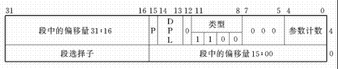
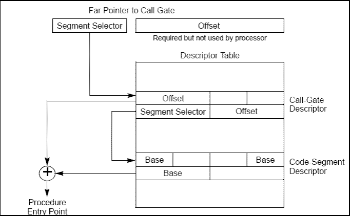
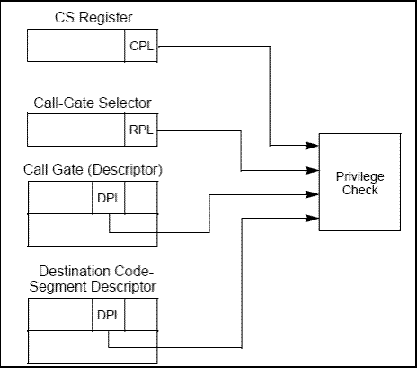
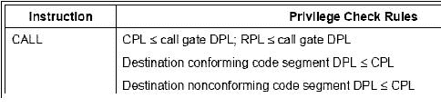

# rootkit ring3 进 ring0 之门系列\[一\] -- 调用门

> 原文：[`www.pediy.com/kssd/pediy10/62263.html`](https://www.pediy.com/kssd/pediy10/62263.html)

今天我们来谈谈保护模式下的调用门。从而开始了我们的门系列内容。  
先谈谈程序转移.,程序转移分为两种: 近转移和远转移 ,其中近转移中又分为相对地址转移和绝对地址转移. 而远转移只有绝对地址转移.。可以通俗的讲，cs 发生变化的转移称为远转移，cs 不变的转移，我们称为近转移。例如：windows  ring3 下 cs 是 0x1b , ring0 下 cs 通常是 0x08.。 对于近转移，我们不需要进行特权级检查。由于 windows 是保护模式的操作系统，对于远转移如果跨层则需要进行特权级检查，看是否允许其调用。  
  
为了在不同特权级的代码段之间进行控制访问，处理器特别提供了一组称为门描述符的描述符。我们可以通过这组门描述符中的任何一个进行远转移。门提供了受保护的间接调用，为任务内的特权转移提供了安全可靠的方法。  
  
今天我们讲的调用门，就是这组门描述符中的一个。为了搞清楚调用门，我们需要看下调用门描述符的结构：  
  
对应的结构体是：  
    typedef struct  
    {  
        unsigned short  offset\_0\_15;  
        unsigned short  selector;  
  
        unsigned char    param\_count : 4;  
        unsigned char    some\_bits   : 4;  
  
        unsigned char    type        : 4;  
        unsigned char    app\_system  : 1;  
        unsigned char    dpl         : 2;  
        unsigned char    present     : 1;  
      
        unsigned short  offset\_16\_31;  
    } CALLGATE\_DESCRIPTOR;   
  
  
调用门描述符可以放在 GDT、LDT 中，但是不能放在 IDT 中。在 WINDOWS XP 中，没有 LDT.  
在这里，我们举例说明其在 GDT 中的情况。尽管 windows 提供了多种不同的描述符，但是每种描述符中都有 present 位代表该描述符是否存在。它在每个描述符中的位置都是一样的，因此我们可以根据这个 present 位来在 GDT 中找出一个空白位置，在这个位置里面添加我们自己定义的描述符。内核中 GDT 的位置，我们可以用 WINDBG 看下：  
lkd> !PCR  
KPCR for Processor 0 at ffdff000:  
    Major 1 Minor 1  
  NtTib.ExceptionList: b1fa5c7c  
      NtTib.StackBase: b1fa5df0  
     NtTib.StackLimit: b1fa2000  
   NtTib.SubSystemTib: 00000000  
        NtTib.Version: 00000000  
    NtTib.UserPointer: 00000000  
        NtTib.SelfTib: 7ffde000  
  
              SelfPcr: ffdff000  
                 Prcb: ffdff120  
                 Irql: 00000000  
                  IRR: 00000000  
                  IDR: ffffffff  
        InterruptMode: 00000000  
                  IDT: 8003f400  
                  GDT: 8003f000  
                  TSS: 80042000  
  
        CurrentThread: 88899020  
           NextThread: 00000000  
           IdleThread: 80552d20  
  
可以看到我本机 GDT 的位置是 GDT: 8003f000  
  
调用门的工作原理如图所示。  
首先进行特权检查  
根据 selector,在 GDT 中找出 CS 段的范围。  
根据 offset\_0\_15 和 offset\_16\_31 求出段中的偏移。  
跳转到地址中执行。  
  
特权检查需要检查的内容包括：CPL,RPL,调用门 DPL 和目标段描述符 DPL.  
  
特权检查的规则：  
  
最后简单介绍下 demo 的做法：  
 1）根据 present 位是否为 0，我们遍历 GDT 中的表，找到一个 present 为 0 的位置。  
 2）在该位置添加调用门。  
 3）记下该位置对应的选择子。由于需要在 ring3 下调用，  
    因此选择子 CallGate\_Sel = 索引值 or 0x03. 其中 0x03 代表我们设置的 RPL.  
 4） 通过指令 call FWORD ptr CallGate\_Sel 执行调用门。  
  
本例中，我们添加的调用门在 gdt 中的偏移值是 0x48, 我们设置 RPL = 3,因此对应的选择子应该是 CallGate\_Sel = 0x48 | 0x03 = 0x4b.  
  
代码附上：  
.386  
.model flat, stdcall  
option casemap:none  
  
include myCallGate.inc  
.const  
CCOUNTED\_UNICODE\_STRING  "\\\\Device\\\\MYCALLGATE",g\_usDeviceName,4  
CCOUNTED\_UNICODE\_STRING  "\\\\??\\\\MYCALLGATE",g\_usSymbolicLinkName,4  
  
GDT\_LIMIT  = 03ffh  
GATE\_TYPE  = 0ECH  
  
  
.code  
Ring0Fun proc  
  pushad  
  pushfd  
  cli  
  invoke DbgPrint, $CTA0("mycallgate function executed\\n")  
  ;add your code here, you can do anything if you like.   
  sti  
  popfd  
  popad  
  retf  
Ring0Fun endp  
  
AddCallGate proc FuncAddr:ULONG  
    pushfd  
    pushad  
      
  push esi  
  sgdt \[esp-2\]  
  pop esi  
    
  mov eax,8  
  .while eax < GDT\_LIMIT  
       lea edx,\[esi+eax\]  
       assume edx:ptr CALLGATE  
       test \[edx\].GTYPE,80h  
      .if ZERO?  
         mov ebx,FuncAddr  
         mov \[edx\].OFFSETL,bx  
         mov \[edx\].SELECTOR,08h  
         mov \[edx\].DCOUNT,0  
         mov \[edx\].GTYPE,GATE\_TYPE  
         shr ebx,16  
         mov \[edx\].OFFSETH,bx       
          .break  
     .endif     
      assume edx:nothing  
     add eax,8  
  .endw  
       
  popad  
    popfd  
  ret  
  
AddCallGate endp  
  
DispatchControl proc uses esi edi pDeviceObject:PDEVICE\_OBJECT,pIrp:PIRP  
    
  mov esi,pIrp  
  assume esi:ptr \_IRP  
  mov \[esi\].IoStatus.Status ,STATUS\_SUCCESS  
  and \[esi\].IoStatus.Information,0  
  invoke IoCompleteRequest,pIrp,0  
  mov eax,\[esi\].IoStatus.Status  
  assume esi:nothing  
  ret  
  
DispatchControl endp  
  
DriverUnload proc pDriverObject:PDRIVER\_OBJECT  
    
  invoke IoDeleteSymbolicLink,addr g\_usSymbolicLinkName  
  mov eax,pDriverObject  
  invoke IoDeleteDevice,(DRIVER\_OBJECT PTR\[eax\]).DeviceObject  
  ret  
  
DriverUnload endp  
  
DriverEntry proc pDriverObject:PDRIVER\_OBJECT,pusRegistryPath:PUNICODE\_STRING  
  
    LOCAL status:NTSTATUS  
    LOCAL pDeviceObject:PDEVICE\_OBJECT  
      
    mov status,STATUS\_DEVICE\_CONFIGURATION\_ERROR  
    invoke IoCreateDevice,pDriverObject,0,addr g\_usDeviceName,FILE\_DEVICE\_UNKNOWN,0,FALSE,addr pDeviceObject  
    .if eax == STATUS\_SUCCESS  
        invoke IoCreateSymbolicLink ,addr g\_usSymbolicLinkName,addr g\_usDeviceName  
        .if eax == STATUS\_SUCCESS              
        mov eax,pDriverObject  
        assume eax:ptr DRIVER\_OBJECT  
        mov ecx,IRP\_MJ\_MAXIMUM\_FUNCTION + 1  
        .while ecx  
            dec ecx  
            mov \[eax\].MajorFunction\[ecx \* (sizeof PVOID)\],offset DispatchControl  
        .endw   
        mov \[eax\].DriverUnload,offset DriverUnload  
        assume eax:nothing  
             invoke AddCallGate,offset Ring0Fun  
            mov status,STATUS\_SUCCESS  
        .else  
          invoke IoDeleteDevice,pDeviceObject  
        .endif  
    .endif  
    
    mov eax,status  
    ret  
  
DriverEntry endp  
  
end DriverEntry  
  
最后友情提示：  
    由于添加调用门的位置，我们事先并不知道，如果你想做的智能些的话，可以通过注册表，共享区，或者直接 deviceiocontrol 等等的方式通知 ring3 程序选择子是多少。

上传的附件
|  || myCallGate.rar  
 |
|  || test.rar  
 |