# VC8 中打造 512 字节超小应用程序\[图文\]【原创】

> 原文：[`www.pediy.com/kssd/pediy08/pediy8-707.htm`](https://www.pediy.com/kssd/pediy08/pediy8-707.htm)

大家都是 VC6 研究的多，但是 VC8 中有些变化。我配了图文给大家说明：

我们任意新建一个 WIN32 程序：

自动生成的代码 ，我们用 Release 模式编译:

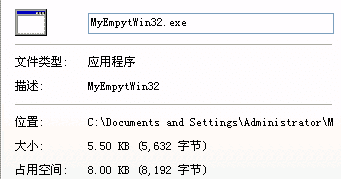

但是注意了，如果我们把这个程序拷贝到其它机器是肯定无法运行的，原因是没有 VC 的运行时 8.0 的库。要让我们的程序可以共享，我们必须静态连接：

 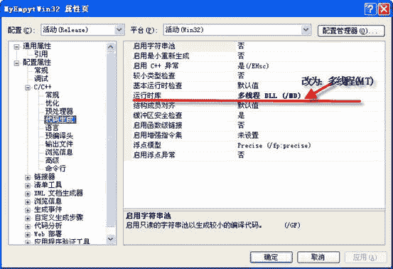

编译以后会发现应用程序：

 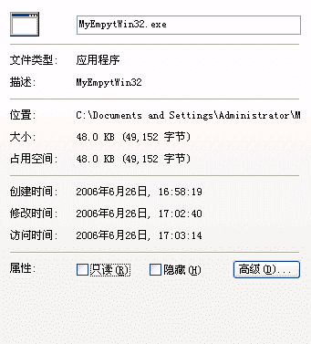

这当然让我们不能够容忍，一个纯 WIN32 应用程序，居然这么大。。。还没有用 MFC 呢？

怎么办呢：让我们一步一步地来，首先摆脱掉运行库。

 

1.取消对运行库的依赖：

 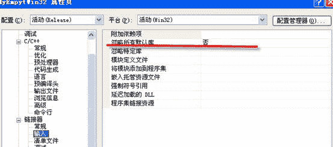

改为是

编译一下：

会出现编译错误：

1>------ 已启动生成: 项目: MyEmpytWin32, 配置: Release Win32 ------

1>正在链接...

1>LINK : error LNK2001: 无法解析的外部符号\_\_tmain

1>MyEmpytWin32.obj : error LNK2001: 无法解析的外部符号@\_\_security\_check\_cookie@4

1>C:\\Documents and Settings\\Administrator\\My Documents\\Visual Studio 2005\\Projects\\MyEmpytWin32\\Release\\MyEmpytWin32.exe : fatal error LNK1120: 2 个无法解析的外部命令

1>生成时间 0:00

 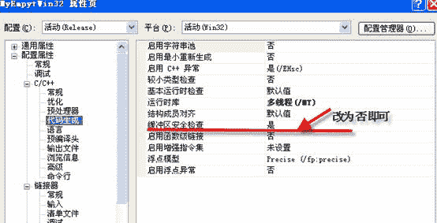

继续编译会出现编译器错误：

1>正在链接...

1>LINK : error LNK2001: 无法解析的外部符号\_mainCRTStartup

1>      C:\\Documents and Settings\\Administrator\\My Documents\\Visual Studio 2005\\Projects\\MyEmpytWin32\\Release\\MyEmpytWin32.exe : fatal error LNK1120: 1 个无法解析的外部命令

设置入口点首先我们改一下代码，把默认的 Vc Runtime Main 函数改动一下：

像这样子：

#include "stdafx.h"

int main()

{

     return 0;

}

并设置入口点：

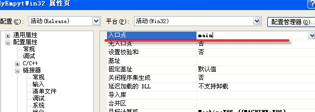

编译成功以后：

 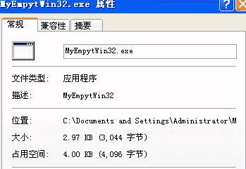

会发现程序小了好多。但是超小的话我们还得做一些处理：

1.合并区段

察看区段

 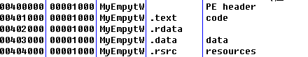

 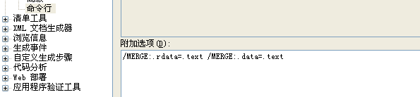

添加下面的命令行（！VC8 不允许将资源区段合并到任何区段！）

1>已完成代码的生成

1>LINK : warning LNK4254: 节“.data”(C0000040)合并到具有不同属性的“.text”(60000020)

1>      正在嵌入清单...

出现警告，我们不必理会！

 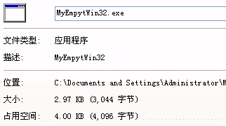

已经比较小了，不过用 OD 打开看 1000 字节对齐还浪费了不少字节！

打开 MSDN 找到对齐的相关帮助：

#  /ALIGN\[:number\]

其中： number 对齐

我们这里设置为 1024（小于将无法被 windows 加载器加载，，）

**！下面我们来打造小于****512****字节的超小应用程序！**

 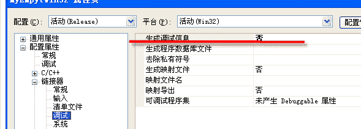

去除调试信息：

 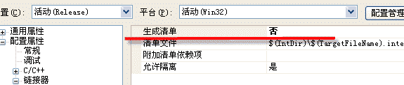

去除清单文件

现在在编译器一下：

 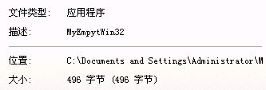

怎么样？满意了吧。我们为了让我这个程序有点实际意义：

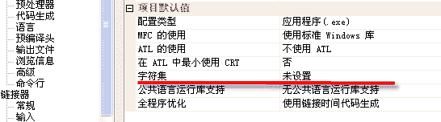

去掉默认的 Unicode 支持 毕竟 Unicode 是 16 bits 一个字符，不合算：）

 

#include "stdafx.h"

#include <windows.h>

 

int main()

     {

     MessageBox(NULL,"Hello World~\\n This is a smallest app","你好",MB\_ICONINFORMATION);

     return 0;

     }

代码像这样

 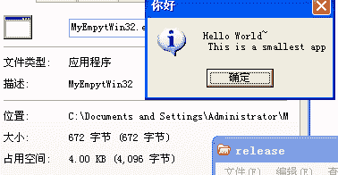

大小和运行时截图唯一的遗憾就是.text 节里面还剩余字节但是却超过了 512 字节：（。。

下一篇文章我将介绍更有实用价值的，毕竟 VC 的运行库在很多地方还是很方便的，而且如果不使用 Runtime 就无法进行浮点运算。。这在写注册机之类的操作当然不允许的。 

继续我们的话题\-VC8 中打造超小应用程序。

上次说到了如何摆脱 Runtime

但是又遇到了新问题，关于浮点计算的问题，而且里面的一些库函数不用也太可惜了

这里有一种变通方法：

 

我们知道 VC6 的库是自带的，，不过我们又不想用 VC6 的 IDE 和编译器。毕竟比起 VC8 来说还是相差两个版本。但是由于在 VC8 中浮点到整数型的类型转换是由 SSE2 指令，换句话来说默认的编译器是无法通过编译器的，如果我们使用 VC6 的库，因为缺少一个函数！

具体的我们下面再说，在这之前，我们要做几个准备工作。

1.       准备 VC6 的 Runtime 动态链接库的 LIB 文件。

2.       准备 INTER FOR VS2005 编译器。这个要花些时间，去下载一个精简版吧。

先新建一个项目，然后在属性里面选择忽略所有默认库。我以前说过如果设置，这里就不说了。

接下来，关键：

** 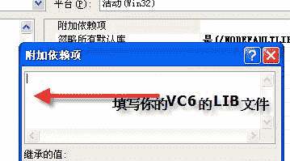**

并设置

** 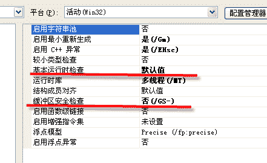**

然后我们就可以开始编译了

随便输入一个函数吧

int main(int argc, \_TCHAR\* argv\[\])

     {

     printf("i Love You! PeDiy");

     return 0;

     }

 

很显然程序成功执行了

** 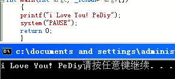**

我们看一下汇编代码吧还是。

** 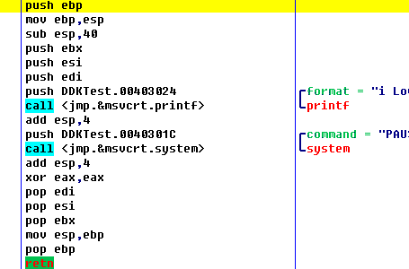**

不错，用的是自带的动态链接库，但是确实是 VC8 的编译器的代码。

好了，下面来说说浮点运算：

我们为了避免用效率低下的 MSVCRT 也就是说我们想用 VC8 的 SSE2 优化。我们只得这样子办!

** 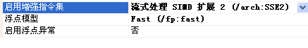**

但是编译代码显然会出错：

1>DDKTest.obj : error LNK2001: 无法解析的外部符号\_\_\_libm\_sse2\_sin

1>      C:\\Documents and Settings\\Administrator\\My Documents\\Visual Studio 2005\\Projects\\DDKTest\\Release\\DDKTest.exe : fatal error LNK1120: 1 个无法解析的外部命令

2>      另外进行类型转换也是会出错的！

好了，这就是我为什么要大家下载 INTER 编译器的原因。

我们都知道它编译的代码很强悍。而且重要的是本身这个编译器就可以工作在 VC6~8 所有版本里面，当然就可以通过这个要绕过我们非常麻烦的问题，从而做到体积和速度的平衡点。

这里注意一下：其实还有一种解决方案，就是通过对比 VC6 和 VC8 的 exports 的不同，手动创建所需要的代码，不过工作量稍微大了一点，我有时间我会写一个库的。。。

 

我们切换到 Inter 编译器状态

**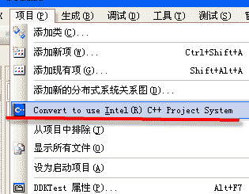**

进入属性

**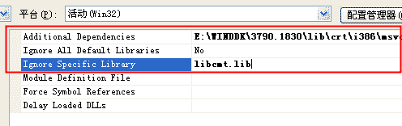**

**我们要更改一下，首先不能够忽略所有的默认库，会把我们的 INTER****库也给忽略的，**

**另外添加特定的也就是我们的静态库 VC8Runtime****忽略/**

**在编译一下。成功了。我们反汇编看看代码吧。/**

** 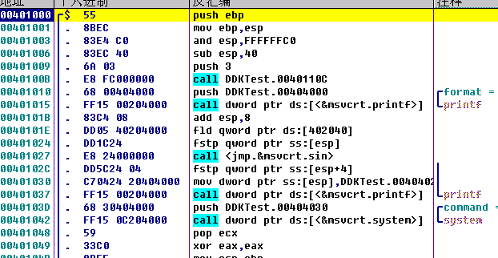**

程序大小为 3.5KB。如果合并一下区段的话会比较小的 1.62 KB (1,664 字节)

而且所有的函数都基本上没有问题

int main(int argc, \_TCHAR\* argv\[\])

     {

     printf("i Love You! PeDiy\\n");

     double a;

     int b;

     a=1.1;

     a=sin(a);

     b=int(a);

     printf("运算结果为%f 整数为%d",a,b);

     system("PAUSE");

     return 0;

     }

 

成功编译，解决了在 VC8 的编译器上无法编译的问题。

顺利实现在 VC8 的 IDE 上面做到控制体积的。至此基本完美完成了我们打造超小应用程序 IN VC8 的任务。

当然了 唯一的遗憾就是如果 INTER 编译器打开 SSE3 优化的话会使得体积增加 16KB。

当然了基本任务已经完成了。现在给你一个程序，很有可能你不知道到底是哪个编译器编译的。毕竟使用了 VC6 的 RUNTIME。

                                                       By Fox 

                                 Thanks for your consideration

 #BeginLibraryItem "/Library/copyright.lbi" CLASS="p9z"  

| 

* * *

 |
| --- |
| 

|  ||  ||  ©2000-2007 [**PEdiy.com**](http://www.pediy.com/) All rights reserved.   
By PEDIY  |
| --- | --- | --- |

 |

 #EndLibraryItem