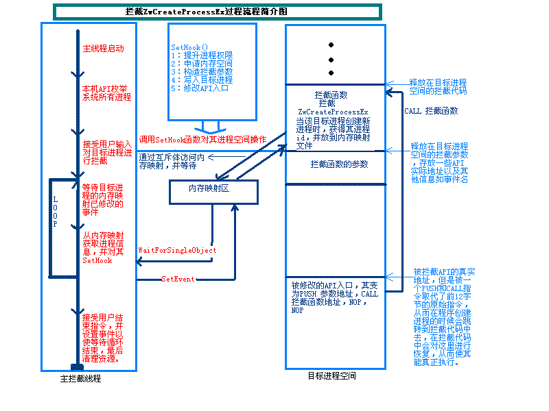

# winxp 下简单实现注册表修改、进程创建监控

> 原文：[`www.pediy.com/kssd/pediy08/pediy8-717.htm`](https://www.pediy.com/kssd/pediy08/pediy8-717.htm)

原本想写个监控所有进程的注册表添加的程序,但是在进行到快结束的时候,发现在我们平时的操作中注册表操作太多了,过多的报警,反而觉得不好.最终是列出所有进程列表,从控制台接受用户输入进程 id 来实现对进程及其子进程的注册表修改以及进程创建的监控.  
  
    该程序在用户层下 Hook 了 ZwCreateProcessEx 和 ZwSetValueKey 两个 API,具体原理就不多说了,目标进程申请内存、代码释放、修改 api 入口、跳转实现 hook.感兴趣的就看看吧..  
  
    原先想实现的自动监控的功能没有实现,不过大模块已经完成了,原理很简单,写起代码起来却是很烦躁,动一发牵全身,实在有点痛苦,不愿意再去改这改那了,或许交给希望了解的人去测试,效果会好些^\_^,最后请原谅代码中出现的一些写得非常糟糕的地方,我真的是不敢再去看自己的代码了   
  
    测试方法:程序运行后,输入你想要监视的进程 ID,这时该进程,以及该进程所创建的任何进程都将被监视,并且在其修改注册表的时候弹出对话框询问是否允许进行该次注册表修改操作,点'y'允许操作,否则拒绝操作. (刚刚修改了一下,可以查看进程 id 和名称,同时从控制台接受进程 id 的输入,从而对指定的进程监控)  
简单图示:   
  
 编译环境:winxp sp2 + vc6    
  
#include <stdio.h>  
#include <windows.h>  
  
#define STATUS\_SUCCESS  (0)  
#define ObjectNameInformation  (1)  
#define BLOCKSIZE (0x1000)  
#define CurrentProcessHandle             ((HANDLE)(0xFFFFFFFF))  
#define NT\_PROCESS\_LIST                  5  
#define STATUS\_INFO\_LEN\_MISMATCH         0xC0000004  
  
  
typedef unsigned long NTSTATUS;  
typedef unsigned long SYSTEM\_INFORMATION\_CLASS;  
typedef unsigned long OBJECT\_INFORMATION\_CLASS;  
  
typedef struct{  
    USHORT Length;  
    USHORT MaxLen;  
    USHORT \*Buffer;  
}UNICODE\_STRING, \* PUNICODE\_STRING;  
  
typedef struct \_OBJECT\_NAME\_INFORMATION { // Information Class 1  
UNICODE\_STRING Name;  
} OBJECT\_NAME\_INFORMATION, \*POBJECT\_NAME\_INFORMATION;  
  
typedef struct \_RemoteParam{  
    LPVOID          lpFunAddr;  
    DWORD           dwParamSize;  
    LPVOID          lpHeapAlloc;  
    LPVOID          lpGetProcessHeap;  
    LPVOID          lpHeapReAlloc;  
    LPVOID          lpHeapFree;  
    LPVOID          lpwsprintf;  
    LPVOID          lpZwQueryObject;  
    LPVOID          lpMessageBox;  
    LPVOID          lpWriteProcessMemory;  
    wchar\_t         wProcessName\[36\];  
    unsigned char   szOldCode\[12\];  
    unsigned char   szNewCode\[12\];  
    LPVOID          lpResumeThread;  
    LPVOID          lpCreateEvent;  
    LPVOID          lpOpenEvent;  
    LPVOID          lpOpenFileMapping;  
    LPVOID          lpMapViewOfFile;  
    LPVOID          lpUnMapViewOfFile;  
    LPVOID          lpOpenMutex;  
    LPVOID          lpWaitForSingleObject;  
    LPVOID          lpSetEvent;  
    LPVOID          lpReleaseMutex;  
    LPVOID          lpCloseHandle;  
    LPVOID          lpGetProcessId;  
    LPVOID          lpGetLastError;  
}RemoteParam, \* PRemoteParam;  
  
typedef struct \_SYSTEM\_PROCESSES{  
  ULONG            NextEntryDelta;        //构成结构序列的偏移量；  
  ULONG            ThreadCount;        //线程数目；  
  ULONG            Reserved1\[6\];  
  LARGE\_INTEGER    CreateTime;        //创建时间；  
  LARGE\_INTEGER    UserTime;                  //用户模式(Ring 3)的 CPU 时间；  
  LARGE\_INTEGER    KernelTime;                //内核模式(Ring 0)的 CPU 时间；  
  UNICODE\_STRING   ProcessName;               //进程名称；  
  ULONG            BasePriority;              //进程优先权；  
  ULONG            ProcessId;                 //进程标识符；  
}SYSTEM\_PROCESSES, \* PSYSTEM\_PROCESSES;  
  
typedef  
NTSTATUS  
(\_\_stdcall \* NTQUERYSYSTEMINFORMATION)(   
IN  SYSTEM\_INFORMATION\_CLASS,   
OUT PVOID,   
IN  ULONG,   
OUT PULONG);  
  
typedef  
BOOL  
(\_\_stdcall \* PFN\_WRITEPROCESSMEMORY)(  
IN  HANDLE hProcess,  
IN  LPVOID lpBaseAddress,  
IN  LPCVOID lpBuffer,  
IN  SIZE\_T nSize,  
OUT SIZE\_T\* lpNumberOfBytesWritten  
);  
  
typedef  
int  
(\_\_stdcall \* PFN\_MESSAGEBOX)(  
IN  HWND hWnd,  
IN  LPCWSTR lpText,  
IN  LPCWSTR lpCaption,  
IN  UINT uType  
);  
  
typedef  
int  
(\_\_cdecl \* PFN\_WSPRINTF)(  
IN  LPWSTR lpOut,  
IN  LPCWSTR lpFmt,  
...);  
  
typedef  
HANDLE  
(\_\_stdcall \* PFN\_GETPROCESSHEAP)(void);  
  
typedef  
LPVOID  
(\_\_stdcall \* PFN\_HEAPALLOC)(  
IN  HANDLE hHeap,  
IN  DWORD dwFlags,  
IN  SIZE\_T dwBytes  
);  
  
typedef  
LPVOID  
(\_\_stdcall \* PFN\_HEAPREALLOC)(  
IN  HANDLE hHeap,   
IN  DWORD dwFlags,   
IN  LPVOID lpMem,   
IN  DWORD dwBytes   
);  
  
typedef  
BOOL  
(\_\_stdcall \* PFN\_HEAPFREE)(  
IN  HANDLE hHeap,  
IN  DWORD dwFlags,  
IN  LPVOID lpMem  
);  
  
typedef  
NTSTATUS  
(\_\_stdcall \* PFN\_ZWSETVALUEKEY)(  
IN  HANDLE KeyHandle,  
IN  PUNICODE\_STRING ValueName,  
IN  ULONG TitleIndex,  
IN  ULONG type1,  
IN  PVOID Data,  
IN  ULONG DataSize  
);  
  
typedef  
NTSTATUS  
(\_\_stdcall \* PFN\_ZWQUERYOBJECT)(  
IN  HANDLE ObjectHandle,  
IN  OBJECT\_INFORMATION\_CLASS ObjectInformationClass,  
OUT PVOID ObjectInformation,  
IN  ULONG ObjectInformationLength,  
OUT PULONG ReturnLength  
);  
  
  
typedef  
NTSTATUS  
(\_\_stdcall \* PFN\_ZWCREATEPROCESSEX)(  
OUT PHANDLE ProcessHandle,  
IN  ACCESS\_MASK DesiredAccess,  
IN  LPVOID ObjectAttributes,  
IN  HANDLE InheritFromProcessHandle,  
IN  BOOLEAN InheritHandles,  
IN  HANDLE SectionHandle,  
IN  HANDLE DebugPort,  
IN  HANDLE ExceptionPort,  
IN  HANDLE reserv  
);  
  
typedef  
BOOL  
(\_\_stdcall \* PFN\_CREATEPROCESSW)(  
IN  LPCTSTR pszApplicationName,  
IN  PTSTR pszCommandLine,  
IN  PSECURITY\_ATTRIBUTES psaProcess,  
IN  PSECURITY\_ATTRIBUTES psaThread,  
IN  BOOL bInheritHandles,  
IN  DWORD fdwCreate,  
IN  PVOID pvEnvironment,  
IN  LPCTSTR pszCurDir,  
OUT LPSTARTUPINFO psiStartInfo,  
OUT PPROCESS\_INFORMATION ppiProcInfo  
);  
  
typedef  
DWORD  
(\_\_stdcall \* PFN\_RESUMETHREAD)(  
IN  HANDLE hThread  
);  
  
typedef  
HANDLE  
(\_\_stdcall \* PFN\_CREATEEVENT)(  
IN  LPSECURITY\_ATTRIBUTES lpEventAttributes,  
IN  BOOL bManualReset,  
IN  BOOL bInitialState,  
IN  LPCTSTR lpName  
);  
  
typedef  
HANDLE  
(\_\_stdcall \* PFN\_OPENEVENT)(  
IN  DWORD dwDesiredAccess,  
IN  BOOL bInheritHandle,  
IN  LPCTSTR lpName  
);  
  
typedef  
HANDLE  
(\_\_stdcall \* PFN\_OPENFILEMAPPING)(  
IN  DWORD dwDesiredAccess,  
IN  BOOL bInheritHandle,  
IN  LPCTSTR lpName  
);  
  
typedef  
LPVOID  
(\_\_stdcall \* PFN\_MAPVIEWOFFILE)(  
IN  HANDLE hFileMappingObject,  
IN  DWORD dwDesiredAccess,  
IN  DWORD dwFileOffsetHigh,  
IN  DWORD dwFileOffsetLow,  
IN  SIZE\_T dwNumberOfBytesToMap  
);  
  
typedef  
BOOL   
(\_\_stdcall \* PFN\_UNMAPVIEWOFFILE)(   
IN  LPCVOID lpBaseAddress  
);  
  
typedef  
HANDLE  
(\_\_stdcall \* PFN\_OPENMUTEX)(  
IN  DWORD dwDesiredAccess,  
IN  BOOL bInheritHandle,  
IN  LPCTSTR lpName  
);  
  
typedef  
DWORD  
(\_\_stdcall \* PFN\_WAITFORSINGLEOBJECT)(  
IN  HANDLE hHandle,   
IN  DWORD dwMilliseconds   
);   
  
typedef  
BOOL  
(\_\_stdcall \* PFN\_SETEVENT)(  
IN  HANDLE hEvent  
);  
  
typedef  
BOOL  
(\_\_stdcall \* PFN\_RELEASEMUTEX)(  
IN  HANDLE hMutex  
);  
  
typedef  
BOOL  
(\_\_stdcall \* PFN\_CLOSEHANDLE)(  
IN  HANDLE hObject  
);  
  
typedef  
DWORD  
(\_\_stdcall \* PFN\_GETPROCESSID)(  
IN  HANDLE Process  
);  
  
typedef  
DWORD  
(\_\_stdcall \* PFN\_GETLASTERROR)(void);  
  
  
  
//////////////////////////////////////////////////////////////////////////  
//Hook CreateProcessW  
//Returns True  
//////////////////////////////////////////////////////////////////////////  
void HookCreateProcessW(LPVOID lParam)  
{  
    RemoteParam\* Rpm = (RemoteParam\*)lParam;  
  
    PFN\_CREATEPROCESSW pfnCreateProcessW = (PFN\_CREATEPROCESSW)Rpm->lpFunAddr;  
    PFN\_WRITEPROCESSMEMORY pfnWriteProcessMemory = (PFN\_WRITEPROCESSMEMORY)Rpm->lpWriteProcessMemory;  
    PFN\_MESSAGEBOX pfnMessageBox = (PFN\_MESSAGEBOX)Rpm->lpMessageBox;  
    PFN\_RESUMETHREAD pfnResumeThread = (PFN\_RESUMETHREAD)Rpm->lpResumeThread;  
      
    LPCTSTR pszApplicationName = NULL;  
    PTSTR pszCommandLine = NULL;  
    PSECURITY\_ATTRIBUTES psaProcess = NULL;  
    PSECURITY\_ATTRIBUTES psaThread = NULL;  
    BOOL bInheritHandles = TRUE;  
    DWORD fdwCreate = 0;  
    PVOID pvEnvironment = NULL;  
    LPCTSTR pszCurDir = NULL;  
    LPSTARTUPINFO psiStartInfo = NULL;  
    PPROCESS\_INFORMATION ppiProcInfo = NULL;  
      
  
    BOOL Retvalue = TRUE; //定义要拦截的 api 的默认返回植  
    DWORD NextIpAddr = 0;  
    DWORD dwParamaAddr = 0;  
  
    long temp1 = 0;  
      
    \_\_asm   
    {  
        MOV EAX, \[EBP + 12\]  
        MOV \[NextIpAddr\], EAX  
        MOV EAX, \[EBP + 16\]  
        MOV \[pszApplicationName\], EAX  
        MOV EAX, \[EBP + 20\]  
        MOV \[pszCommandLine\], EAX  
        MOV EAX, \[EBP + 24\]  
        MOV \[psaProcess\], EAX  
        MOV EAX, \[EBP + 28\]  
        MOV \[psaThread\], EAX  
        MOV EAX, \[EBP + 32\]  
        MOV \[temp1\], EAX  
        MOV EAX, \[EBP + 36\]  
        MOV \[fdwCreate\], EAX          
        MOV EAX, \[EBP + 40\]  
        MOV \[pvEnvironment\], EAX  
        MOV EAX, \[EBP + 44\]  
        MOV \[pszCurDir\], EAX  
        MOV EAX, \[EBP + 48\]  
        MOV \[psiStartInfo\], EAX      
        MOV EAX, \[EBP + 52\]  
        MOV \[ppiProcInfo\], EAX  
    }  
  
    bInheritHandles = (BOOL)temp1;  
//    fdwCreate = fdwCreate | CREATE\_SUSPENDED;   
  
    //这里可以做你的事情了，比如我只想弹出一个对话框,其实也可以在让 api 完成之后再做些东西  
        
  
    pfnWriteProcessMemory(CurrentProcessHandle, Rpm->lpFunAddr, (LPCVOID)Rpm->szOldCode, 12, NULL);  
    //让 api 真正执行  
    Retvalue = pfnCreateProcessW(  
        pszApplicationName,  
        pszCommandLine,  
        psaProcess,  
        psaThread,  
        bInheritHandles,  
        fdwCreate,  
        pvEnvironment,  
        pszCurDir,  
        psiStartInfo,  
        ppiProcInfo);   
  
  
    //再次恢复对他的拦截  
    pfnWriteProcessMemory(CurrentProcessHandle, Rpm->lpFunAddr, (LPCVOID)Rpm->szNewCode, 12, NULL);  
    pfnMessageBox(NULL, Rpm->wProcessName, Rpm->wProcessName, 0);  
//    pfnResumeThread(ppiProcInfo->hThread);  
     
    DWORD dwStackSize = 12 + Rpm->dwParamSize;  
     
    //这里对拦截函数堆栈的恢复  
    \_\_asm  
    {  
       POP EDI       
       POP ESI       
       POP EBX  
       MOV ECX, \[dwStackSize\]  
       MOV EDX, \[NextIpAddr\]  
       MOV EAX, \[Retvalue\]  
       MOV ESP, EBP  
       POP EBP  
       ADD ESP, ECX   //恢复堆栈  
       PUSH EDX  
       RET  
    }  
}  
  
//////////////////////////////////////////////////////////////////////////  
//Hook ZwCreateProcessEx  
//Returns STATUS\_SUCCESS or an error status, such as STATUS\_ACCESS\_DENIED or  
//STATUS\_INVALID\_HANDLE.  
//////////////////////////////////////////////////////////////////////////  
void HookZwCreateProcessEx(LPVOID lParam)  
{  
    RemoteParam\* Rpm = (RemoteParam\*)lParam;  
  
    PFN\_ZWCREATEPROCESSEX pfnZwCreateprocessEx = (PFN\_ZWCREATEPROCESSEX)Rpm->lpFunAddr;  
    PFN\_WRITEPROCESSMEMORY pfnWriteProcessMemory = (PFN\_WRITEPROCESSMEMORY)Rpm->lpWriteProcessMemory;  
    PFN\_MESSAGEBOX pfnMessageBox = (PFN\_MESSAGEBOX)Rpm->lpMessageBox;  
    PFN\_WSPRINTF pfnwsprintf = (PFN\_WSPRINTF)Rpm->lpwsprintf;  
//    wchar\_t wOut\[32\] = {'\\0'};  
//    wchar\_t wFmr\[3\] = {'%', 'x', '\\0'};  
    PFN\_CREATEEVENT pfnCreateEvent = (PFN\_CREATEEVENT)Rpm->lpCreateEvent;  
    PFN\_OPENEVENT pfnOpenEvent = (PFN\_OPENEVENT)Rpm->lpOpenEvent;  
    PFN\_OPENFILEMAPPING pfnOpenFileMapping = (PFN\_OPENFILEMAPPING)Rpm->lpOpenFileMapping;  
    PFN\_MAPVIEWOFFILE pfnMapViewOfFile = (PFN\_MAPVIEWOFFILE)Rpm->lpMapViewOfFile;  
    PFN\_UNMAPVIEWOFFILE pfnUnMapViewOfFile = (PFN\_UNMAPVIEWOFFILE)Rpm->lpUnMapViewOfFile;  
    PFN\_OPENMUTEX pfnOpenMutex = (PFN\_OPENMUTEX)Rpm->lpOpenMutex;  
    PFN\_WAITFORSINGLEOBJECT pfnWaitForSingleObject = (PFN\_WAITFORSINGLEOBJECT)Rpm->lpWaitForSingleObject;  
    PFN\_SETEVENT pfnSetEvent = (PFN\_SETEVENT)Rpm->lpSetEvent;  
    PFN\_RELEASEMUTEX pfnReleaseMutex = (PFN\_RELEASEMUTEX)Rpm->lpReleaseMutex;  
    PFN\_CLOSEHANDLE pfnCloseHandle = (PFN\_CLOSEHANDLE)Rpm->lpCloseHandle;  
    PFN\_GETPROCESSID pfnGetProcessId = (PFN\_GETPROCESSID)Rpm->lpGetProcessId;  
    PFN\_GETLASTERROR pfnGetLastError = (PFN\_GETLASTERROR)Rpm->lpGetLastError;  
  
    HANDLE hHookMainAliveEvent = NULL;  
    HANDLE hMapFileOperateMutex = NULL;  
    HANDLE hMapFileModifiedEvent = NULL;  
    HANDLE hHookNewProcessDoneEvent = NULL;  
    HANDLE hMapFileToNewProcessId = NULL;  
    LPVOID lpMapFileToNewProcessId = NULL;  
  
    char szHookMainAliveEvent\[20\] = {'H', 'o', 'o', 'k', 'M', 'a', 'i', 'n', 'A',  
                                     'l', 'i', 'v', 'e', 'E', 'v', 'e', 'n', 't', '\\0'};  
    char szMapFileOperateMutex\[21\] = {'M', 'a', 'p', 'F', 'i', 'l', 'e', 'O', 'p', 'e',  
                                      'r', 'a', 't', 'e', 'M', 'u', 't', 'e', 'x', '\\0'};  
    char szMapFileModifiedEvent\[22\] = {'M', 'a', 'p', 'F', 'i', 'l', 'e', 'M', 'o', 'd',  
                                       'i', 'f', 'i', 'e', 'd', 'E', 'v', 'e', 'n', 't', '\\0'};  
    char szHookNewProcessDoneEvent\[25\] = {'H', 'o', 'o', 'k', 'N', 'e', 'w', 'P', 'r', 'o', 'c',  
                                          'e', 's', 's', 'D', 'o', 'n', 'e', 'E', 'v', 'e', 'n', 't', '\\0'};  
    char szMapFileToNewProcessId\[23\] ={'M', 'a', 'p', 'F', 'i', 'l', 'e', 'T', 'o', 'N', 'e',  
                                       'w', 'P', 'r', 'o', 'c', 'e', 's', 's', 'I', 'd', '\\0'};  
  
    PHANDLE ProcessHandle = NULL;   
    ACCESS\_MASK DesiredAccess = 0;  
    LPVOID ObjectAttributes = NULL;  
    HANDLE InheritFromProcessHandle = NULL;  
    BOOLEAN InheritHandles = TRUE;  
    HANDLE SectionHandle = NULL;  
    HANDLE DebugPort = NULL;  
    HANDLE ExceptionPort = NULL;  
    HANDLE reserv = NULL;  
      
  
    NTSTATUS Retvalue = STATUS\_SUCCESS; //定义要拦截的 api 的默认返回植  
    DWORD NextIpAddr = 0;  
    DWORD dwParamaAddr = 0;  
  
    DWORD temp1 = 0;  
      
    \_\_asm   
    {  
        MOV EAX, \[EBP + 12\]  
        MOV \[NextIpAddr\], EAX  
        MOV EAX, \[EBP + 16\]  
        MOV \[ProcessHandle\], EAX  
        MOV EAX, \[EBP + 20\]  
        MOV \[DesiredAccess\], EAX  
        MOV EAX, \[EBP + 24\]  
        MOV \[ObjectAttributes\], EAX  
        MOV EAX, \[EBP + 28\]  
        MOV \[InheritFromProcessHandle\], EAX  
        MOV EAX, \[EBP + 32\]  
        MOV \[temp1\], EAX  
        MOV EAX, \[EBP + 36\]  
        MOV \[SectionHandle\], EAX          
        MOV EAX, \[EBP + 40\]  
        MOV \[DebugPort\], EAX  
        MOV EAX, \[EBP + 44\]  
        MOV \[ExceptionPort\], EAX  
        MOV EAX, \[EBP + 48\]  
        MOV \[reserv\], EAX          
    }  
  
    InheritHandles = (BOOLEAN)temp1;  
        
    pfnWriteProcessMemory(CurrentProcessHandle, Rpm->lpFunAddr, (LPCVOID)Rpm->szOldCode, 12, NULL);  
    //让 api 真正执行  
    Retvalue = pfnZwCreateprocessEx(ProcessHandle,  
                                    DesiredAccess,  
                                    ObjectAttributes,  
                                    InheritFromProcessHandle,  
                                    InheritHandles,  
                                    SectionHandle,  
                                    DebugPort,  
                                    ExceptionPort,  
                                    reserv);  
    DWORD dwStackSize = 12 + Rpm->dwParamSize;  
  
      
//新进程已经创建，此时进程空间中仅仅加载 ntdll.dll 和进程映象本身，主线程也尚未启动，  
//这里把返回的进程句柄转换成进程 id 放到内存映射文件中去，交由主拦截进程对其进行拦截，  
//此时该创建处于 block 状态，等待主拦截进程拦截完毕的对象消息，然后再恢复进程的创建。  
    hHookMainAliveEvent = pfnCreateEvent(NULL, TRUE, TRUE, szHookMainAliveEvent);  
    if(pfnGetLastError() == ERROR\_ALREADY\_EXISTS)   
    {  
        //再次恢复对他的拦截  
        pfnWriteProcessMemory(CurrentProcessHandle, Rpm->lpFunAddr, (LPCVOID)Rpm->szNewCode, 12, NULL);  
          
        hMapFileToNewProcessId = pfnOpenFileMapping(FILE\_MAP\_ALL\_ACCESS, NULL, szMapFileToNewProcessId);  
        if(hMapFileToNewProcessId == NULL)  
        {  
            \_\_asm  
            {  
                POP EDI       
                POP ESI       
                POP EBX  
                MOV ECX, \[dwStackSize\]  
                MOV EDX, \[NextIpAddr\]  
                MOV EAX, \[Retvalue\]  
                MOV ESP, EBP  
                POP EBP  
                ADD ESP, ECX   //恢复堆栈  
                PUSH EDX  
                RET  
            }  
        }  
        lpMapFileToNewProcessId = pfnMapViewOfFile(hMapFileToNewProcessId, FILE\_MAP\_ALL\_ACCESS, 0, 0, 0);  
        if(lpMapFileToNewProcessId == NULL)  
        {  
            pfnCloseHandle(hMapFileToNewProcessId);  
            \_\_asm  
            {  
                POP EDI       
                POP ESI       
                POP EBX  
                MOV ECX, \[dwStackSize\]  
                MOV EDX, \[NextIpAddr\]  
                MOV EAX, \[Retvalue\]  
                MOV ESP, EBP  
                POP EBP  
                ADD ESP, ECX   //恢复堆栈  
                PUSH EDX  
                RET  
            }  
        }  
        hMapFileOperateMutex = pfnOpenMutex(MUTEX\_MODIFY\_STATE, FALSE, szMapFileOperateMutex);  
        if(hMapFileOperateMutex == NULL)  
        {  
            pfnUnMapViewOfFile(lpMapFileToNewProcessId);  
            pfnCloseHandle(hMapFileToNewProcessId);  
            \_\_asm  
            {  
                POP EDI       
                POP ESI       
                POP EBX  
                MOV ECX, \[dwStackSize\]  
                MOV EDX, \[NextIpAddr\]  
                MOV EAX, \[Retvalue\]  
                MOV ESP, EBP  
                POP EBP  
                ADD ESP, ECX   //恢复堆栈  
                PUSH EDX  
                RET  
            }  
        }  
        DWORD dwPid = pfnGetProcessId(\*ProcessHandle);  
        if(dwPid == 0)  
        {  
            pfnUnMapViewOfFile(lpMapFileToNewProcessId);  
            pfnCloseHandle(hMapFileToNewProcessId);  
            pfnCloseHandle(hMapFileOperateMutex);  
            \_\_asm  
            {  
                POP EDI       
                POP ESI       
                POP EBX  
                MOV ECX, \[dwStackSize\]  
                MOV EDX, \[NextIpAddr\]  
                MOV EAX, \[Retvalue\]  
                MOV ESP, EBP  
                POP EBP  
                ADD ESP, ECX   //恢复堆栈  
                PUSH EDX  
                RET  
            }  
        }  
        pfnWaitForSingleObject(hMapFileOperateMutex, INFINITE);  
        DWORD \* temp2 = (DWORD\*)lpMapFileToNewProcessId;  
        \*temp2 = dwPid;  
        pfnUnMapViewOfFile(lpMapFileToNewProcessId);  
        pfnCloseHandle(hMapFileToNewProcessId);  
          
        hMapFileModifiedEvent = pfnOpenEvent(EVENT\_MODIFY\_STATE, NULL, szMapFileModifiedEvent);  
        if(hMapFileModifiedEvent == NULL)  
        {  
            pfnReleaseMutex(hMapFileOperateMutex);  
            pfnCloseHandle(hMapFileOperateMutex);  
            \_\_asm  
            {  
                POP EDI       
                POP ESI       
                POP EBX  
                MOV ECX, \[dwStackSize\]  
                MOV EDX, \[NextIpAddr\]  
                MOV EAX, \[Retvalue\]  
                MOV ESP, EBP  
                POP EBP  
                ADD ESP, ECX   //恢复堆栈  
                PUSH EDX  
                RET  
            }  
        }  
        pfnSetEvent(hMapFileModifiedEvent);  
        hHookNewProcessDoneEvent = pfnOpenEvent(EVENT\_MODIFY\_STATE, NULL, szHookNewProcessDoneEvent);  
         if(hHookNewProcessDoneEvent == NULL)  
        {  
            pfnReleaseMutex(hMapFileOperateMutex);  
            pfnCloseHandle(hMapFileOperateMutex);  
            pfnCloseHandle(hMapFileModifiedEvent);  
            \_\_asm  
            {  
                POP EDI       
                POP ESI       
                POP EBX  
                MOV ECX, \[dwStackSize\]  
                MOV EDX, \[NextIpAddr\]  
                MOV EAX, \[Retvalue\]  
                MOV ESP, EBP  
                POP EBP  
                ADD ESP, ECX   //恢复堆栈  
                PUSH EDX  
                RET  
            }  
        }  
        pfnWaitForSingleObject(hHookNewProcessDoneEvent, INFINITE);  
        pfnCloseHandle(hMapFileModifiedEvent);  
        pfnCloseHandle(hHookNewProcessDoneEvent);  
        pfnReleaseMutex(hMapFileOperateMutex);  
        pfnCloseHandle(hMapFileOperateMutex);  
    }  
    else  
    {  
        pfnCloseHandle(hHookMainAliveEvent);  
    }  
    //这里对拦截函数堆栈的恢复  
    \_\_asm  
    {  
       POP EDI       
       POP ESI       
       POP EBX  
       MOV ECX, \[dwStackSize\]  
       MOV EDX, \[NextIpAddr\]  
       MOV EAX, \[Retvalue\]  
       MOV ESP, EBP  
       POP EBP  
       ADD ESP, ECX   //恢复堆栈  
       PUSH EDX  
       RET  
    }      
}  
  
//////////////////////////////////////////////////////////////////////////  
//Hook ZwSetValueKey  
//Returns STATUS\_SUCCESS or an error status, such as STATUS\_ACCESS\_DENIED,  
//STATUS\_INVALID\_HANDLE, STATUS\_KEY\_DELETED, or STATUS\_NO\_LOG\_SPACE.  
//////////////////////////////////////////////////////////////////////////  
void HookZwSetValueKey(LPVOID lParam)  
{  
    RemoteParam\* Rpm = (RemoteParam\*)lParam;  
  
    PFN\_ZWSETVALUEKEY pfnZwSetValueKey = (PFN\_ZWSETVALUEKEY)Rpm->lpFunAddr;  
    PFN\_WRITEPROCESSMEMORY pfnWriteProcessMemory = (PFN\_WRITEPROCESSMEMORY)Rpm->lpWriteProcessMemory;  
    PFN\_MESSAGEBOX pfnMessageBox = (PFN\_MESSAGEBOX)Rpm->lpMessageBox;  
    PFN\_ZWQUERYOBJECT pfnZwQueryObject = (PFN\_ZWQUERYOBJECT)Rpm->lpZwQueryObject;  
    PFN\_WSPRINTF pfnwsprintf = (PFN\_WSPRINTF)Rpm->lpwsprintf;  
    PFN\_GETPROCESSHEAP pfnGetProcessHeap = (PFN\_GETPROCESSHEAP)Rpm->lpGetProcessHeap;  
    PFN\_HEAPALLOC pfnHeapAlloc = (PFN\_HEAPALLOC)Rpm->lpHeapAlloc;  
    PFN\_HEAPREALLOC pfnHeapReAlloc = (PFN\_HEAPREALLOC)Rpm->lpHeapReAlloc;  
    PFN\_HEAPFREE pfnHeapFree = (PFN\_HEAPFREE)Rpm->lpHeapFree;  
  
    PFN\_CREATEEVENT pfnCreateEvent = (PFN\_CREATEEVENT)Rpm->lpCreateEvent;  
    PFN\_GETLASTERROR pfnGetLastError = (PFN\_GETLASTERROR)Rpm->lpGetLastError;  
    PFN\_CLOSEHANDLE pfnCloseHandle = (PFN\_CLOSEHANDLE)Rpm->lpCloseHandle;  
  
      
    HANDLE KeyHandle = NULL;  
    PUNICODE\_STRING ValueName = NULL;  
    ULONG TitleIndex = 0;  
    ULONG type1 = 0;  
    PVOID Data = NULL;  
    ULONG DataSize = 0;  
      
  
    NTSTATUS Retvalue = STATUS\_SUCCESS; //定义要拦截的 api 的默认返回植  
    DWORD NextIpAddr = 0;  
    DWORD dwParamaAddr = 0;  
    DWORD dwStackSize = 12 + Rpm->dwParamSize;  
  
    \_\_asm   
    {  
        MOV EAX, \[EBP + 12\]  
        MOV \[NextIpAddr\], EAX  
        MOV EAX, \[EBP + 16\]  
        MOV \[KeyHandle\], EAX  
        MOV EAX, \[EBP + 20\]  
        MOV \[ValueName\], EAX  
        MOV EAX, \[EBP + 24\]  
        MOV \[TitleIndex\], EAX  
        MOV EAX, \[EBP + 28\]  
        MOV \[type1\], EAX  
        MOV EAX, \[EBP + 32\]  
        MOV \[Data\], EAX  
        MOV EAX, \[EBP + 36\]  
        MOV \[DataSize\], EAX              
    }  
  
    HANDLE hHeap = pfnGetProcessHeap();  
    DWORD retSize = 0;  
    POBJECT\_NAME\_INFORMATION pName = (POBJECT\_NAME\_INFORMATION)pfnHeapAlloc(hHeap, HEAP\_ZERO\_MEMORY, BLOCKSIZE);      
    NTSTATUS ns = pfnZwQueryObject(KeyHandle, ObjectNameInformation, (PVOID)pName, BLOCKSIZE, &retSize);  
    DWORD i = 1;  
    while(ns == STATUS\_INFO\_LEN\_MISMATCH)  
    {  
        pName = (POBJECT\_NAME\_INFORMATION)pfnHeapReAlloc(hHeap, HEAP\_ZERO\_MEMORY, (LPVOID)pName, BLOCKSIZE \* i);  
        ns = pfnZwQueryObject(KeyHandle, ObjectNameInformation, (PVOID)pName, BLOCKSIZE, NULL);  
        i++;  
    }  
    char szHookMainAliveEvent\[20\] = {'H', 'o', 'o', 'k', 'M', 'a', 'i', 'n', 'A',  
                                     'l', 'i', 'v', 'e', 'E', 'v', 'e', 'n', 't', '\\0'};     
    wchar\_t wObjectPath\[260\] = {'\\0'};  
    wchar\_t wFmr1\[21\] = {'%', 's', '\\', '%', 's', ' ', ' ', 'v', 'a', 'l', 'u', 'e', ':', '%',  
                         's', ' ', 'Y', '/', 'N', '?', '\\0'};  
    wchar\_t wFmr2\[27\] = {'%', 's', '\\', '%', 's', ' ', ' ', 'v', 'a', 'l', 'u', 'e', ':', '%',  
                         'd', '(', '0', 'X', '%', 'X', ')', ' ', 'Y', '/', 'N', '?', '\\0'};  
    wchar\_t wFmr3\[27\] = {'%', 's', '\\', '%', 's', ' ', ' ', 't', 'y', 'p', 'e', ':', 'R', 'E',  
                         'G', '\_', 'B', 'I', 'N', 'A', 'Y', ' ', 'Y', '/', 'N', '?', '\\0'};  
    wchar\_t wFmr4\[35\] = {'%', 's', '\\', '%', 's', ' ', ' ', 't', 'y', 'p', 'e', ':', 'R', 'E',  
                         'G', '\_', 'R', 'E', 'S', 'O', 'U', 'R', 'C', 'E', '\_', 'L', 'I', 'S',   
                         'T', ' ', 'Y', '/', 'N', '?', '\\0'};  
  
    if(type1 == 4 || type1 == 5 || type1 == 11)  
        pfnwsprintf(wObjectPath, wFmr2, pName->Name.Buffer, ValueName->Buffer, \*(DWORD\*)Data, \*(DWORD\*)Data);  
    else if(type1 == 3)  
        pfnwsprintf(wObjectPath, wFmr3, pName->Name.Buffer, ValueName->Buffer);  
    else if(type1 == 8)  
        pfnwsprintf(wObjectPath, wFmr4, pName->Name.Buffer, ValueName->Buffer);  
    else  
        pfnwsprintf(wObjectPath, wFmr1, pName->Name.Buffer, ValueName->Buffer, Data);  
    pfnHeapFree(hHeap, HEAP\_ZERO\_MEMORY, pName);  
      
    HANDLE hHookMainAliveEvent = pfnCreateEvent(NULL, TRUE, TRUE, szHookMainAliveEvent);  
    DWORD dwBeHooked = 0;  
    if(pfnGetLastError() == ERROR\_ALREADY\_EXISTS)  
    {  
        dwBeHooked = 1;  
        int allowFlag = pfnMessageBox(NULL, wObjectPath, Rpm->wProcessName, MB\_ICONINFORMATION | MB\_YESNO);  
        if(allowFlag != IDYES)  
        {  
            \_\_asm  
            {  
                POP EDI       
                POP ESI       
                POP EBX  
                MOV ECX, \[dwStackSize\]  
                MOV EDX, \[NextIpAddr\]  
                MOV EAX, \[Retvalue\]  
                MOV ESP, EBP  
                POP EBP  
                ADD ESP, ECX //恢复堆栈  
                PUSH EDX  
                RET  
            }  
        }  
    }      
    pfnWriteProcessMemory(CurrentProcessHandle, Rpm->lpFunAddr, (LPCVOID)Rpm->szOldCode, 12, NULL);  
      
    //让 api 真正执行  
    Retvalue = pfnZwSetValueKey(  
        KeyHandle,  
        ValueName,  
        TitleIndex,  
        type1,  
        Data,  
        DataSize);  
    //如果主监视进程存活则再次恢复对他的拦截  
    if(dwBeHooked == 1)  
        pfnWriteProcessMemory(CurrentProcessHandle, Rpm->lpFunAddr, (LPCVOID)Rpm->szNewCode, 12, NULL);  
    pfnCloseHandle(hHookMainAliveEvent);  
    //这里对拦截函数堆栈的恢复  
    \_\_asm  
    {  
       POP EDI       
       POP ESI       
       POP EBX  
       MOV ECX, \[dwStackSize\]  
       MOV EDX, \[NextIpAddr\]  
       MOV EAX, \[Retvalue\]  
       MOV ESP, EBP  
       POP EBP  
       ADD ESP, ECX //恢复堆栈  
       PUSH EDX  
       RET  
    }  
}  
  
  
//////////////////////////////////////////////////////////////////////////  
//\*\*\*\*\*\*\*\*\*\*\*\*\*\*\*\*\*\*\*\*\*\*\*\*\*\*\*\*\*\*\*\*\*\*\*\*\*\*\*\*\*\*\*\*\*\*\*\*\*\*\*\*\*\*\*\*\*\*\*\*\*\*\*\*\*\*\*\*\*\*\*\*  
//模块名字：AdjustProcessPrivileges(LPCSTR)  
//模块功能：修改调用进程的权限  
//返回数值：成功返回 TRUE，失败返回 FALSE  
//参数选项：   
// #define SE\_BACKUP\_NAME        TEXT("SeBackupPrivilege")  
// #define SE\_RESTORE\_NAME       TEXT("SeRestorePrivilege")  
// #define SE\_SHUTDOWN\_NAME      TEXT("SeShutdownPrivilege")  
// #define SE\_DEBUG\_NAME         TEXT("SeDebugPrivilege")  
//////////////////////////////////////////////////////////////////////////  
  
BOOL AdjustProcessPrivileges(LPCSTR lpPrivilegesName)  
{  
    HANDLE hToken;   
    TOKEN\_PRIVILEGES tkp;  
    if(!OpenProcessToken(CurrentProcessHandle,  
        TOKEN\_ADJUST\_PRIVILEGES | TOKEN\_QUERY, &hToken))  
    {  
        return FALSE;  
    }  
  
    if(!LookupPrivilegeValue(NULL, lpPrivilegesName, &tkp.Privileges\[0\].Luid))  
    {  
        CloseHandle(hToken);  
        return FALSE;  
    }  
      
    tkp.PrivilegeCount = 1;  
    tkp.Privileges\[0\].Attributes = SE\_PRIVILEGE\_ENABLED;  
  
    if(!AdjustTokenPrivileges(hToken, FALSE, &tkp, sizeof(tkp), NULL, NULL))  
    {  
        CloseHandle(hToken);  
        return FALSE;  
    }  
  
    CloseHandle(hToken);  
    return TRUE;  
}  
  
  
  
int SetHook(DWORD dwPid, LPWSTR lpProcessName, LPCTSTR lpApiName, LPCTSTR lpExportDllName,DWORD dwParamNum, DWORD dwHookFunSize, LPVOID lpHookFunAddr)  
{  
    if(!AdjustProcessPrivileges(SE\_DEBUG\_NAME))  
    {  
        printf("-----AdjustProcessPrivileges error..\\n");  
        return -1;  
    }  
    printf("1:AdjustProcessPrivileges ok\\n");  
      
    //获取要拦截的 api 的地址  
    HMODULE hExportDll = LoadLibrary(lpExportDllName);  
    if(hExportDll == NULL)  
    {  
        printf("-----LoadLibrary error..\\n");  
        return -1;  
    }  
  
      
    LPVOID lpApiAddr = GetProcAddress(hExportDll, lpApiName);  
    if(lpApiAddr == NULL)  
    {  
        printf("-----GetProcAddress %s error..\\n", lpApiName);  
        FreeLibrary(hExportDll);  
        return -1;  
    }  
      
    //打开进程句柄  
    HANDLE hTargetProcess = OpenProcess(PROCESS\_VM\_OPERATION | PROCESS\_VM\_WRITE | PROCESS\_VM\_READ,  
                                        FALSE, dwPid);  
    if(hTargetProcess == NULL)  
    {  
        printf("-----OpenProcess %d error..\\n", dwPid);  
        FreeLibrary(hExportDll);  
        return -1;  
    }  
      
    //申请拦截函数内存空间  
    LPVOID lpFunAddr = VirtualAllocEx(hTargetProcess, NULL, dwHookFunSize,   
                                      MEM\_COMMIT | MEM\_RESERVE, PAGE\_EXECUTE\_READWRITE);  
    if(lpFunAddr == NULL)  
    {  
        printf("-----VirtualAllocEx for remotefuction error..\\n");  
        FreeLibrary(hExportDll);  
        CloseHandle(hTargetProcess);  
        return -1;  
    }  
      
    //申请远程参数空间  
    LPVOID lpParamaAddr = VirtualAllocEx(hTargetProcess, NULL, sizeof(RemoteParam),   
                                         MEM\_COMMIT | MEM\_RESERVE, PAGE\_EXECUTE\_READWRITE);  
    if(lpParamaAddr == NULL)  
    {  
        printf("-----VirtualAllocEx for remoteparam error..\\n");  
        FreeLibrary(hExportDll);  
        VirtualFreeEx(hTargetProcess, lpFunAddr, 0, MEM\_RELEASE);  
        CloseHandle(hTargetProcess);  
        return -1;  
    }  
  
    printf("2:Alloc remote memory for the hook fuction and param ok\\n");  
      
      
    //设置远程参数，下一步要把参数写入要拦截的远程进程地址空间  
    RemoteParam RParam;  
    ZeroMemory(&RParam, sizeof(RParam));  
    wcscpy(RParam.wProcessName, lpProcessName);  
      
    unsigned char oldcode\[12\];  
    unsigned char newcode\[12\];  
    DWORD dwError = 0;  
    if(!ReadProcessMemory(CurrentProcessHandle,  
        lpApiAddr,  
        oldcode,  
        12,  
        &dwError))  
    {  
        printf("-----ReadProcessMemory from lpApiName error..\\n");  
        FreeLibrary(hExportDll);  
        VirtualFreeEx(hTargetProcess, lpFunAddr, 0, MEM\_RELEASE);  
        VirtualFreeEx(hTargetProcess, lpParamaAddr, 0, MEM\_RELEASE);  
        CloseHandle(hTargetProcess);  
        return -1;  
    }  
    //生成跳转指令，这将覆盖要拦截的 api 的前十个字节   
    int praadd = (int)lpParamaAddr;  
    int threadadd = (int)lpFunAddr;  
    newcode\[4\] = praadd>>24;  
    newcode\[3\] = (praadd<<8)>>24;  
    newcode\[2\] = (praadd<<16)>>24;  
    newcode\[1\] = (praadd<<24)>>24;  
    newcode\[0\] = 0x68;  //PUSH lpParamaAddr  
  
    int offsetaddr = threadadd - (int)lpApiAddr - 10 ;  
    newcode\[9\] = offsetaddr>>24;  
    newcode\[8\] = (offsetaddr<<8)>>24;  
    newcode\[7\] = (offsetaddr<<16)>>24;  
    newcode\[6\] = (offsetaddr<<24)>>24;  
    newcode\[5\] = 0xE8;  //CALL lpFunAddr  
  
    newcode\[10\] = 0x90;  
    newcode\[11\] = 0x90;  
      
    for(int j = 0; j < 12; j++)  
    {  
        RParam.szOldCode\[j\] = oldcode\[j\];  
        RParam.szNewCode\[j\] = newcode\[j\];  
    }  
    RParam.lpFunAddr = lpApiAddr;  
    RParam.dwParamSize = dwParamNum \* 4;  
      
    HMODULE hKernel32 = LoadLibrary("Kernel32.dll");  
    if(hKernel32 == NULL)  
    {  
        printf("-----LoadLibrary Kernel32.dll error..\\n");  
        FreeLibrary(hExportDll);  
        VirtualFreeEx(hTargetProcess, lpFunAddr, 0, MEM\_RELEASE);  
        VirtualFreeEx(hTargetProcess, lpParamaAddr, 0, MEM\_RELEASE);  
        CloseHandle(hTargetProcess);  
        return -1;  
    }  
      
    RParam.lpWriteProcessMemory = GetProcAddress(hKernel32, "WriteProcessMemory");  
    if(RParam.lpWriteProcessMemory == NULL)  
    {  
        printf("-----GetProcAddress WriteProcessMemory from Kernel32.dll error..\\n");  
        FreeLibrary(hExportDll);  
        VirtualFreeEx(hTargetProcess, lpFunAddr, 0, MEM\_RELEASE);  
        VirtualFreeEx(hTargetProcess, lpParamaAddr, 0, MEM\_RELEASE);  
        CloseHandle(hTargetProcess);  
        FreeLibrary(hKernel32);  
        return -1;  
    }  
    RParam.lpGetProcessHeap = GetProcAddress(hKernel32, "GetProcessHeap");  
    if(RParam.lpGetProcessHeap == NULL)  
    {  
        printf("-----GetProcAddress GetProcessHeap from Kernel32.dll error..\\n");  
        FreeLibrary(hExportDll);  
        VirtualFreeEx(hTargetProcess, lpFunAddr, 0, MEM\_RELEASE);  
        VirtualFreeEx(hTargetProcess, lpParamaAddr, 0, MEM\_RELEASE);  
        CloseHandle(hTargetProcess);  
        FreeLibrary(hKernel32);  
        return -1;  
    }  
    RParam.lpHeapAlloc = GetProcAddress(hKernel32, "HeapAlloc");  
    if(RParam.lpHeapAlloc == NULL)  
    {  
        printf("-----GetProcAddress HeapAlloc from Kernel32.dll error..\\n");  
        FreeLibrary(hExportDll);  
        VirtualFreeEx(hTargetProcess, lpFunAddr, 0, MEM\_RELEASE);  
        VirtualFreeEx(hTargetProcess, lpParamaAddr, 0, MEM\_RELEASE);  
        CloseHandle(hTargetProcess);  
        FreeLibrary(hKernel32);  
        return -1;  
    }  
    RParam.lpHeapReAlloc = GetProcAddress(hKernel32, "HeapReAlloc");  
    if(RParam.lpHeapReAlloc == NULL)  
    {  
        printf("-----GetProcAddress HeapReAlloc from Kernel32.dll error..\\n");  
        FreeLibrary(hExportDll);  
        VirtualFreeEx(hTargetProcess, lpFunAddr, 0, MEM\_RELEASE);  
        VirtualFreeEx(hTargetProcess, lpParamaAddr, 0, MEM\_RELEASE);  
        CloseHandle(hTargetProcess);  
        FreeLibrary(hKernel32);  
        return -1;  
    }  
    RParam.lpHeapFree = GetProcAddress(hKernel32, "HeapFree");  
    if(RParam.lpHeapFree == NULL)  
    {  
        printf("-----GetProcAddress HeapFree from Kernel32.dll error..\\n");  
        FreeLibrary(hExportDll);  
        VirtualFreeEx(hTargetProcess, lpFunAddr, 0, MEM\_RELEASE);  
        VirtualFreeEx(hTargetProcess, lpParamaAddr, 0, MEM\_RELEASE);  
        CloseHandle(hTargetProcess);  
        FreeLibrary(hKernel32);  
        return -1;  
    }  
  
    RParam.lpResumeThread = GetProcAddress(hKernel32, "ResumeThread");  
    if(RParam.lpHeapFree == NULL)  
    {  
        printf("-----GetProcAddress ResumeThread from Kernel32.dll error..\\n");  
        FreeLibrary(hExportDll);  
        VirtualFreeEx(hTargetProcess, lpFunAddr, 0, MEM\_RELEASE);  
        VirtualFreeEx(hTargetProcess, lpParamaAddr, 0, MEM\_RELEASE);  
        CloseHandle(hTargetProcess);  
        FreeLibrary(hKernel32);  
        return -1;  
    }  
      
    RParam.lpCreateEvent = GetProcAddress(hKernel32, "CreateEventA");  
    if(RParam.lpCreateEvent == NULL)  
    {  
        printf("-----GetProcAddress CreateEventA from Kernel32.dll error..\\n");  
        FreeLibrary(hExportDll);  
        VirtualFreeEx(hTargetProcess, lpFunAddr, 0, MEM\_RELEASE);  
        VirtualFreeEx(hTargetProcess, lpParamaAddr, 0, MEM\_RELEASE);  
        CloseHandle(hTargetProcess);  
        FreeLibrary(hKernel32);  
        return -1;  
    }  
    RParam.lpOpenEvent = GetProcAddress(hKernel32, "OpenEventA");  
    if(RParam.lpOpenEvent == NULL)  
    {  
        printf("-----GetProcAddress OpenEventA from Kernel32.dll error..\\n");  
        FreeLibrary(hExportDll);  
        VirtualFreeEx(hTargetProcess, lpFunAddr, 0, MEM\_RELEASE);  
        VirtualFreeEx(hTargetProcess, lpParamaAddr, 0, MEM\_RELEASE);  
        CloseHandle(hTargetProcess);  
        FreeLibrary(hKernel32);  
        return -1;  
    }  
      
    RParam.lpOpenFileMapping = GetProcAddress(hKernel32, "OpenFileMappingA");  
    if(RParam.lpOpenFileMapping == NULL)  
    {  
        printf("-----GetProcAddress OpenFileMappingA from Kernel32.dll error..\\n");  
        FreeLibrary(hExportDll);  
        VirtualFreeEx(hTargetProcess, lpFunAddr, 0, MEM\_RELEASE);  
        VirtualFreeEx(hTargetProcess, lpParamaAddr, 0, MEM\_RELEASE);  
        CloseHandle(hTargetProcess);  
        FreeLibrary(hKernel32);  
        return -1;  
    }  
      
    RParam.lpMapViewOfFile = GetProcAddress(hKernel32, "MapViewOfFile");  
    if(RParam.lpMapViewOfFile == NULL)  
    {  
        printf("-----GetProcAddress MapViewOfFile from Kernel32.dll error..\\n");  
        FreeLibrary(hExportDll);  
        VirtualFreeEx(hTargetProcess, lpFunAddr, 0, MEM\_RELEASE);  
        VirtualFreeEx(hTargetProcess, lpParamaAddr, 0, MEM\_RELEASE);  
        CloseHandle(hTargetProcess);  
        FreeLibrary(hKernel32);  
        return -1;  
    }  
  
    RParam.lpUnMapViewOfFile = GetProcAddress(hKernel32, "UnmapViewOfFile");  
    if(RParam.lpUnMapViewOfFile == NULL)  
    {  
        printf("-----GetProcAddress UnMapViewOfFile from Kernel32.dll error..\\n");  
        FreeLibrary(hExportDll);  
        VirtualFreeEx(hTargetProcess, lpFunAddr, 0, MEM\_RELEASE);  
        VirtualFreeEx(hTargetProcess, lpParamaAddr, 0, MEM\_RELEASE);  
        CloseHandle(hTargetProcess);  
        FreeLibrary(hKernel32);  
        return -1;  
    }  
      
    RParam.lpOpenMutex = GetProcAddress(hKernel32, "OpenMutexA");  
    if(RParam.lpOpenMutex == NULL)  
    {  
        printf("-----GetProcAddress OpenMutexA from Kernel32.dll error..\\n");  
        FreeLibrary(hExportDll);  
        VirtualFreeEx(hTargetProcess, lpFunAddr, 0, MEM\_RELEASE);  
        VirtualFreeEx(hTargetProcess, lpParamaAddr, 0, MEM\_RELEASE);  
        CloseHandle(hTargetProcess);  
        FreeLibrary(hKernel32);  
        return -1;  
    }  
      
    RParam.lpWaitForSingleObject = GetProcAddress(hKernel32, "WaitForSingleObject");  
    if(RParam.lpWaitForSingleObject == NULL)  
    {  
        printf("-----GetProcAddress WaitForSingleObject from Kernel32.dll error..\\n");  
        FreeLibrary(hExportDll);  
        VirtualFreeEx(hTargetProcess, lpFunAddr, 0, MEM\_RELEASE);  
        VirtualFreeEx(hTargetProcess, lpParamaAddr, 0, MEM\_RELEASE);  
        CloseHandle(hTargetProcess);  
        FreeLibrary(hKernel32);  
        return -1;  
    }  
      
    RParam.lpSetEvent = GetProcAddress(hKernel32, "SetEvent");  
    if(RParam.lpSetEvent == NULL)  
    {  
        printf("-----GetProcAddress SetEvent from Kernel32.dll error..\\n");  
        FreeLibrary(hExportDll);  
        VirtualFreeEx(hTargetProcess, lpFunAddr, 0, MEM\_RELEASE);  
        VirtualFreeEx(hTargetProcess, lpParamaAddr, 0, MEM\_RELEASE);  
        CloseHandle(hTargetProcess);  
        FreeLibrary(hKernel32);  
        return -1;  
    }  
      
    RParam.lpReleaseMutex = GetProcAddress(hKernel32, "ReleaseMutex");  
    if(RParam.lpReleaseMutex == NULL)  
    {  
        printf("-----GetProcAddress ReleaseMutex from Kernel32.dll error..\\n");  
        FreeLibrary(hExportDll);  
        VirtualFreeEx(hTargetProcess, lpFunAddr, 0, MEM\_RELEASE);  
        VirtualFreeEx(hTargetProcess, lpParamaAddr, 0, MEM\_RELEASE);  
        CloseHandle(hTargetProcess);  
        FreeLibrary(hKernel32);  
        return -1;  
    }  
      
    RParam.lpCloseHandle = GetProcAddress(hKernel32, "CloseHandle");  
    if(RParam.lpCloseHandle == NULL)  
    {  
        printf("-----GetProcAddress CloseHandle from Kernel32.dll error..\\n");  
        FreeLibrary(hExportDll);  
        VirtualFreeEx(hTargetProcess, lpFunAddr, 0, MEM\_RELEASE);  
        VirtualFreeEx(hTargetProcess, lpParamaAddr, 0, MEM\_RELEASE);  
        CloseHandle(hTargetProcess);  
        FreeLibrary(hKernel32);  
        return -1;  
    }  
  
    RParam.lpGetProcessId = GetProcAddress(hKernel32, "GetProcessId");  
    if(RParam.lpGetProcessId == NULL)  
    {  
        printf("-----GetProcAddress GetProcessId from Kernel32.dll error..\\n");  
        FreeLibrary(hExportDll);  
        VirtualFreeEx(hTargetProcess, lpFunAddr, 0, MEM\_RELEASE);  
        VirtualFreeEx(hTargetProcess, lpParamaAddr, 0, MEM\_RELEASE);  
        CloseHandle(hTargetProcess);  
        FreeLibrary(hKernel32);  
        return -1;  
    }  
  
    RParam.lpGetLastError = GetProcAddress(hKernel32, "GetLastError");  
    if(RParam.lpGetLastError == NULL)  
    {  
        printf("-----GetProcAddress GetLastError from Kernel32.dll error..\\n");  
        FreeLibrary(hExportDll);  
        VirtualFreeEx(hTargetProcess, lpFunAddr, 0, MEM\_RELEASE);  
        VirtualFreeEx(hTargetProcess, lpParamaAddr, 0, MEM\_RELEASE);  
        CloseHandle(hTargetProcess);  
        FreeLibrary(hKernel32);  
        return -1;  
    }  
    FreeLibrary(hKernel32);  
      
    //以上皆为必须，下面可以为自己的拦截函数中所需要用的一些变量以及系统 api 放到参数中去  
    HMODULE hUser32 = LoadLibrary("User32.dll");  
    if(hUser32 == NULL)  
    {  
        printf("-----LoadLibrary User32.dll error..\\n");  
        FreeLibrary(hExportDll);  
        VirtualFreeEx(hTargetProcess, lpFunAddr, 0, MEM\_RELEASE);  
        VirtualFreeEx(hTargetProcess, lpParamaAddr, 0, MEM\_RELEASE);  
        CloseHandle(hTargetProcess);  
        return -1;  
    }  
      
    RParam.lpMessageBox = GetProcAddress(hUser32, "MessageBoxW");  
    if(RParam.lpMessageBox == NULL)  
    {  
        printf("-----GetProcAddress MessageBoxA from User32.dll error..\\n");  
        FreeLibrary(hExportDll);  
        VirtualFreeEx(hTargetProcess, lpFunAddr, 0, MEM\_RELEASE);  
        VirtualFreeEx(hTargetProcess, lpParamaAddr, 0, MEM\_RELEASE);  
        CloseHandle(hTargetProcess);  
        FreeLibrary(hUser32);  
        return -1;  
    }  
  
    RParam.lpwsprintf = GetProcAddress(hUser32, "wsprintfW");  
    if(RParam.lpwsprintf == NULL)  
    {  
        printf("-----GetProcAddress wsprintf from User32.dll error..\\n");  
        FreeLibrary(hExportDll);  
        VirtualFreeEx(hTargetProcess, lpFunAddr, 0, MEM\_RELEASE);  
        VirtualFreeEx(hTargetProcess, lpParamaAddr, 0, MEM\_RELEASE);  
        CloseHandle(hTargetProcess);  
        FreeLibrary(hUser32);  
        return -1;  
    }      
    FreeLibrary(hUser32);  
  
    HMODULE hNtdll = LoadLibrary("ntdll.dll");  
    if(hNtdll == NULL)  
    {  
        printf("-----LoadLibrary ntdll.dll error..\\n");  
        FreeLibrary(hExportDll);  
        VirtualFreeEx(hTargetProcess, lpFunAddr, 0, MEM\_RELEASE);  
        VirtualFreeEx(hTargetProcess, lpParamaAddr, 0, MEM\_RELEASE);  
        CloseHandle(hTargetProcess);  
        return -1;  
    }  
    RParam.lpZwQueryObject = GetProcAddress(hNtdll, "ZwQueryObject");  
    if(RParam.lpwsprintf == NULL)  
    {  
        printf("-----GetProcAddress ZwQueryObject from ntdll.dll error..\\n");  
        FreeLibrary(hExportDll);  
        VirtualFreeEx(hTargetProcess, lpFunAddr, 0, MEM\_RELEASE);  
        VirtualFreeEx(hTargetProcess, lpParamaAddr, 0, MEM\_RELEASE);  
        CloseHandle(hTargetProcess);  
        FreeLibrary(hNtdll);  
        return -1;  
    }      
    FreeLibrary(hNtdll);  
      
    printf("3:Generate remoteparam ok\\n");      
      
    //下面为必须部分  
    //把参数写入要拦截的远程进程地址空间  
    if(!WriteProcessMemory(hTargetProcess, lpParamaAddr, (LPVOID)&RParam, sizeof(RParam), &dwError))  
    {  
        printf("-----WriteProcessMemory for remoteparam error..\\n");  
        FreeLibrary(hExportDll);  
        VirtualFreeEx(hTargetProcess, lpFunAddr, 0, MEM\_RELEASE);  
        VirtualFreeEx(hTargetProcess, lpParamaAddr, 0, MEM\_RELEASE);  
        CloseHandle(hTargetProcess);  
        return -1;  
    }  
    printf("4:WriteProcessMemory for remoteparam ok\\n");  
    //把拦截函数体写入目标进程地址空间  
    if(!WriteProcessMemory(hTargetProcess, lpFunAddr, lpHookFunAddr, dwHookFunSize, &dwError))  
    {  
        printf("-----WriteProcessMemory for remotefuction error..\\n");  
        FreeLibrary(hExportDll);  
        VirtualFreeEx(hTargetProcess, lpFunAddr, 0, MEM\_RELEASE);  
        VirtualFreeEx(hTargetProcess, lpParamaAddr, 0, MEM\_RELEASE);  
        CloseHandle(hTargetProcess);  
        return -1;  
    }  
    printf("5:WriteProcessMemory for remotefuction ok\\n");  
    //把新的跳转指令写入要拦截的目标进程的要拦截的 api 的函数的前十字节  
    if(!WriteProcessMemory(hTargetProcess, lpApiAddr , (LPVOID)newcode, 12, &dwError))  
    {  
        printf("-----Modify remote api error..\\n");  
        FreeLibrary(hExportDll);  
        VirtualFreeEx(hTargetProcess, lpFunAddr, 0, MEM\_RELEASE);  
        VirtualFreeEx(hTargetProcess, lpParamaAddr, 0, MEM\_RELEASE);  
        CloseHandle(hTargetProcess);  
        return -1;  
    }  
    printf("6:Modify remote api %s ok\\n", lpApiName);  
  
    //show..  
    printf("---------------------------------------------------------------------------\\n"  
           "You hava hooked pid: %d ,and the infomation of this hooking are as follows:\\n"  
           "API name: %s\\n"  
           "API addr: 0x%.8x\\n"  
           "API Parm: %d\\n"  
           "Module name: %s\\n"  
           "Module addr: 0x%.8x\\n"  
           "Remote parama addr: 0x%.8x\\n"  
           "Remote thread addr: 0x%.8x\\n"  
           "RemoteParam.lpFunAddr: 0x%.8x\\n"  
           "RemoteParam.lpWriteProcessMemory: 0x%.8x\\n"  
           "RemoteParam.lpMessageBox: 0x%.8x\\n"  
           "RemoteParam.lpGetProcessHeap: 0x%.8x\\n"  
           "RemoteParam.lpHeapAlloc: 0x%.8x\\n"  
           "RemoteParam.lpHeapReAlloc: 0x%.8x\\n"  
           "RemoteParam.lpHeapFree: 0x%.8x\\n"  
           "RemoteParam.lpwsprintf: 0x%.8x\\n"  
           "RemoteParam.lpZwQueryObject: 0x%.8x\\n"  
           "RemoteParam.lpResumeThread: 0x%.8x\\n"  
           "RemoteParam.lpCreateEvent: 0x%.8x\\n"  
           "RemoteParam.lpOpenEvent: 0x%.8x\\n"  
           "RemoteParam.lpOpenFileMapping: 0x%.8x\\n"  
           "RemoteParam.lpMapViewOfFile: 0x%.8x\\n"  
           "RemoteParam.lpUnMapViewOfFile: 0x%.8x\\n"  
           "RemoteParam.lpOpenMutex: 0x%.8x\\n"  
           "RemoteParam.lpWaitForSingleObject: 0x%.8x\\n"  
           "RemoteParam.lpSetEvent: 0x%.8x\\n"  
           "RemoteParam.lpReleaseMutex: 0x%.8x\\n"  
           "RemoteParam.lpCloseHandle: 0x%.8x\\n"  
           "RemoteParam.lpGetProcessId: 0x%.8x\\n"  
           "RemoteParam.lpGetLastError: 0x%.8x\\n",  
           dwPid,  
           lpApiName,  
           lpApiAddr,  
           RParam.dwParamSize,  
           lpExportDllName,  
           hExportDll,  
           lpParamaAddr,  
           lpFunAddr,  
           RParam.lpFunAddr,  
           RParam.lpWriteProcessMemory,  
           RParam.lpMessageBox,  
           RParam.lpGetProcessHeap,  
           RParam.lpHeapAlloc,  
           RParam.lpHeapReAlloc,  
           RParam.lpHeapFree,  
           RParam.lpwsprintf,  
           RParam.lpZwQueryObject,  
           RParam.lpResumeThread,  
           RParam.lpCreateEvent,  
           RParam.lpOpenEvent,  
           RParam.lpOpenFileMapping,  
           RParam.lpMapViewOfFile,  
           RParam.lpUnMapViewOfFile,  
           RParam.lpOpenMutex,  
           RParam.lpWaitForSingleObject,  
           RParam.lpSetEvent,  
           RParam.lpReleaseMutex,  
           RParam.lpCloseHandle,  
           RParam.lpGetProcessId,  
           RParam.lpGetLastError);  
    wprintf(L"RemoteParam.wProcessName: %s\\n", RParam.wProcessName);  
      
    printf("OldCode:");  
    for(int i = 0; i < 12; i++)  
    {  
        printf("0x%.2x ", RParam.szOldCode\[i\]);  
    }  
  
    printf("\\nNewCode:");  
    for(i = 0; i < 12; i++)  
    {  
        printf("0x%.2x ", RParam.szNewCode\[i\]);  
    }  
  
    printf("\\n");  
    printf("---------------------------------------------------------------------------\\n\\n\\n");      
    //收工，清理资源  
    FreeLibrary(hExportDll);  
    CloseHandle(hTargetProcess);  
    return 0;  
}  
  
DWORD dwRunning = 1;  
  
DWORD WINAPI getExit(PHANDLE hExitEvent)  
{  
    char exitCode = '\\0';  
    DWORD dwCount = 0;  
    while(TRUE)  
    {  
        printf("Input q to exit the program...\\n");  
        scanf("%c", &exitCode);  
        if(exitCode == 'q')  
        {  
            dwRunning = 0;  
            SetEvent(\*hExitEvent);  
            break;  
        }  
    }  
    return 0;  
}  
  
void showProcesses(void)  
{  
  size\_t blocklen = 0;  
  PSYSTEM\_PROCESSES bufForProcessesInfo = NULL, bufNext = NULL;  
    NTSTATUS ns = 0;  
  DWORD dwPcount = 0;  
  HANDLE hHeap;  
  int i = 2;  
  
  HMODULE hNtdll = LoadLibrary(TEXT("NTDLL.DLL"));  
  if(hNtdll == NULL)  
  {  
    printf("LaodLibrary ntddl.dll error...\\n");  
    return;  
  
  }  
  NTQUERYSYSTEMINFORMATION NtQuerySystemInformation =   
    (NTQUERYSYSTEMINFORMATION)GetProcAddress(hNtdll, TEXT("NtQuerySystemInformation"));  
  if(NtQuerySystemInformation == NULL)  
  {  
    printf("GetProcAddress error...\\n");  
    return;  
  }  
    
  hHeap = GetProcessHeap();  
  if(hHeap == NULL)  
  {  
    printf("Get heap error...\\n");  
    FreeLibrary(hNtdll);  
    return;  
  }  
  bufForProcessesInfo = (PSYSTEM\_PROCESSES)HeapAlloc(hHeap, HEAP\_ZERO\_MEMORY, BLOCKSIZE);  
  if(bufForProcessesInfo == NULL)  
  {  
    printf("HeapAlloc error...\\n");  
    FreeLibrary(hNtdll);  
    return;  
  }  
  bufNext = bufForProcessesInfo;  
  ns = NtQuerySystemInformation(NT\_PROCESS\_LIST, bufForProcessesInfo, BLOCKSIZE, NULL);  
    while(ns == STATUS\_INFO\_LEN\_MISMATCH)  
  {  
    bufNext = (PSYSTEM\_PROCESSES)HeapReAlloc(hHeap, HEAP\_ZERO\_MEMORY, bufNext, BLOCKSIZE \* i);  
    if(bufForProcessesInfo == NULL)  
    {  
      printf("Relloc error..\\n");  
      HeapFree(hHeap, HEAP\_ZERO\_MEMORY, bufForProcessesInfo);  
            FreeLibrary(hNtdll);  
      return;  
    }  
    ns = NtQuerySystemInformation(NT\_PROCESS\_LIST, bufNext, BLOCKSIZE \* i, NULL);  
    i++;  
  }  
    
  while(bufNext->NextEntryDelta != 0)  
  {  
    wprintf(L"PID:%.4d   BasePriority:%.2d   %s\\n", bufNext->ProcessId, bufNext->BasePriority, bufNext->ProcessName.Buffer);  
    bufNext = (PSYSTEM\_PROCESSES)((BYTE\*)bufNext + bufNext->NextEntryDelta);  
    dwPcount ++;  
  }  
  printf("------------------------------------------------"\\  
       "\\nAll %d processes running...\\n", dwPcount);  
  
  HeapFree(hHeap, HEAP\_ZERO\_MEMORY, bufForProcessesInfo);  
  FreeLibrary(hNtdll);  
  return;  
}  
  
int main(void)  
{  
    HANDLE hHookMainAliveEvent = CreateEvent(NULL, TRUE, TRUE, "HookMainAliveEvent");  
    if(hHookMainAliveEvent == NULL)  
    {  
        printf("CreateEvent hHookMainAliveEvent error..\\n");  
        return -1;  
    }  
  
    HANDLE hMapFileOperateMutex = CreateMutex(NULL, FALSE, "MapFileOperateMutex");  
    if(hMapFileOperateMutex == NULL)  
    {  
        printf("CreateMutex hMapFileOperateMutex error..\\n");  
        CloseHandle(hHookMainAliveEvent);  
        return -1;  
    }  
  
    HANDLE hMapFileModifiedEvent = CreateEvent(NULL, FALSE, FALSE, "MapFileModifiedEvent");  
    if(hMapFileModifiedEvent == NULL)  
    {  
        printf("CreateEvent hMapFileModifiedEvent error..\\n");  
        CloseHandle(hHookMainAliveEvent);  
        CloseHandle(hMapFileOperateMutex);  
        return -1;  
    }  
  
    HANDLE hHookNewProcessDoneEvent = CreateEvent(NULL, FALSE, FALSE, "HookNewProcessDoneEvent");  
    if(hHookNewProcessDoneEvent == NULL)  
    {  
        printf("CreateEvent hHookNewProcessDoneEvent error..\\n");  
        CloseHandle(hHookMainAliveEvent);  
        CloseHandle(hMapFileOperateMutex);  
        CloseHandle(hMapFileModifiedEvent);  
        return -1;  
    }  
  
    HANDLE hMapFileToNewProcessId = CreateFileMapping(  
        (HANDLE)0xFFFFFFFF,  
        NULL,  
        PAGE\_READWRITE,  
        0,  
        4,  
        "MapFileToNewProcessId");  
    if(hMapFileToNewProcessId == NULL)  
    {  
        printf("CreateFileMapping NewCreatedProcessId error..\\n");  
        CloseHandle(hHookMainAliveEvent);  
        CloseHandle(hMapFileOperateMutex);  
        CloseHandle(hMapFileModifiedEvent);  
        CloseHandle(hHookNewProcessDoneEvent);  
        return -1;  
    }  
  
    LPVOID lpMapFileToNewProcessId = MapViewOfFile(hMapFileToNewProcessId, FILE\_MAP\_READ, 0, 0, 0);  
    if(lpMapFileToNewProcessId == NULL)  
    {  
        printf("MapViewOfFile NewCreatedProcessId error..\\n");  
        CloseHandle(hMapFileToNewProcessId);  
        CloseHandle(hHookMainAliveEvent);  
        CloseHandle(hMapFileOperateMutex);  
        CloseHandle(hMapFileModifiedEvent);  
        CloseHandle(hHookNewProcessDoneEvent);  
        return -1;  
    }  
      
    DWORD \* Ppid = (PDWORD)lpMapFileToNewProcessId;  
    //在这里填入想要监控的进程 id，稍作修改，可以监控所有进程，程序没有作好，请原谅.  
    //这里还是觉得就这样，大家如果有兴趣可以在自己的机器上测试，因为做到现在，忽然发现似乎功能的  
    //真正实现不是那么重要了。  
  DWORD dwPid = 0;  
  wchar\_t wName\[32\] = {'\\0'};  
  showProcesses();  
  printf("输入想要监视的进程 ID:");  
  scanf("%d", &dwPid);  
  wsprintfW(wName, L"PID:%d\\0", dwPid);  
    SetHook(dwPid, wName, "ZwCreateProcessEx", "ntdll.dll", 9, 4096 \* 10,  &HookZwCreateProcessEx);  
    SetHook(dwPid, wName, "ZwSetValueKey", "ntdll.dll", 6, 4096 \* 5, &HookZwSetValueKey);  
   
    DWORD dwExitThread = 0;  
    HANDLE hExitThread = CreateThread(NULL, 0, (LPTHREAD\_START\_ROUTINE)&getExit, &hMapFileModifiedEvent, 0, &dwExitThread);  
      
    while(dwRunning == 1)  
    {  
        WaitForSingleObject(hMapFileModifiedEvent, INFINITE);  
        if(dwRunning == 0)  
            break;  
        DWORD dwPid = \* Ppid;  
        //这里的传递的进程名字只是用来测试用，可以编程实现获取进程名，并传递，注意这里为宽字符，  
        //抱歉本人没有完成这里的自动获取进程名字功能，写这个代码已经太烦躁了，请原谅.  
    memset(wName, 0, 32 \* sizeof(wchar\_t));  
        wsprintfW(wName, L"PID:%d\\0", dwPid);  
        SetHook(dwPid, wName, "ZwCreateProcessEx", "ntdll.dll", 9, 4096 \* 10,  &HookZwCreateProcessEx);  
        SetHook(dwPid, wName, "ZwSetValueKey", "ntdll.dll", 6, 4096 \* 5, &HookZwSetValueKey);  
        SetEvent(hHookNewProcessDoneEvent);  
    }  
      
    UnmapViewOfFile(lpMapFileToNewProcessId);  
    CloseHandle(hMapFileToNewProcessId);  
    CloseHandle(hHookMainAliveEvent);  
    CloseHandle(hMapFileOperateMutex);  
    CloseHandle(hMapFileModifiedEvent);  
    CloseHandle(hHookNewProcessDoneEvent);  
  
    CloseHandle(hExitThread);  
  
    return 0;  
} 

 4dd466d0e1e0cc123afbe504da2462ca