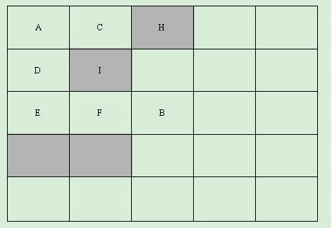

# 吃豆子问题的解法-《加密与解密》

> 原文：[`www.pediy.com/kssd/pediy12/136783.html`](https://www.pediy.com/kssd/pediy12/136783.html)

本人新手，最近在读《加密与解密》，看到 5.5.2 节中提到了吃豆子(peckme)的问题，根据图形，我们肉眼是很容易看出如何走到 X，但是总感觉缺点什么，于是参考迷宫的求解问题，写了一个大概的求解程序。本人新手，望轻拍（由于 VC 中中文注释有乱码我问题，只能用我憋足的英文加点注释了）  
    迷宫算法的思路：根据当前的位置，按上、右、下、左四个方向进行试探，如果其中一条路可以走通，则把可以走通的路记录下来(压栈)；  
      如果四条路都是走不通，那么当前节点是无法达到目的地的，将其删除(出栈)。其实是一种穷举的方式，下面举个例子进行说明  
  
  
图中阴影部分表示是墙，即不可通过。现假设现在我站在 A 点，要到 B 点。根据算法首先试探 A 的上面，是空的，然后试探 A 的右边是 C，OK，走到 C（C 进栈），C 按照规则发现没有方向可以行得通，退回来，返回到 A（C 出栈），A 已经探测过 C 了，下面探测 D，OK，走到 D（D 进栈），D 继续进行探测，探测到 E，E 探测到 F，F 探测到 B，OK，找到了。  

代码:

```
/\*\*\*\*\*\*\*\*\*\*\*\*\*\*\*\*\*\*\*\*\*\*\*\*\*\*\*\*\*\*\*\*\*\*\*\*\*\*\*\*
file:
     pec.c
purpose:
    find the way to taget
author:
    hdchild
date:
    2011-07-08
\*\*\*\*\*\*\*\*\*\*\*\*\*\*\*\*\*\*\*\*\*\*\*\*\*\*\*\*\*\*\*\*\*\*\*\*\*\*\*/

#include <stdio.h>


/\*\*<p>define the width and lenth of maz with MACRO</p>\*\*/

#define MAZ\_LENGTH  (16)
#define MAZ\_WIDTH   (sizeof(pec)/MAZ\_LENGTH)

/\*\*<p>define the direction of the current node can move to</p>\*/
#define DIRECT\_UP       1
#define DIRECT\_RIGHT    2
#define DIRECT\_DOWN     3
#define DIRECT\_LEFT     4

/\*\*<p>define the state of every node in maz, 0 means cann't go, 1 means can go and 2 means got it</p>\*/
#define MAZ\_BLOCK       0
#define MAZ\_PASS        1
#define MAZ\_TARGET      2

/\*\*define the stack node\*/
typedef struct stack\_node\_struct stack\_node\_t;
struct stack\_node\_struct
{
    int     i;          // the (i)th line , begin with zero
    int     j;          // the j th column, begin with zero;
    int     direct;     // the direction of the node, see the defination of MACRO DIRECT\_XXX
};


/\*\*here is the orginal maz\*\*/
char    pec\[\] = "C\*......\*...\*\*\*\*.\*.\*\*\*\*...\*....\*.\*..\*\*\*\*\*\*\*\*\*\*\\
.\*..\*....\*...\*...\*\*.\*\*\*\*.\*.\*..\\
.\*\*\*\*.\*....\*.\*\*\*\*\*\*\*..\*.\*\*\*..\*.\\
....\*.\*..\*\*\*.\*\*.\*\*\*.\*...\*\*\*\*.\\
...\*X..\*\*\*\*\*\*\*\*\*\*\*\*\*\*\*\*\*";

/\*\*<p>the state array of the maz</p>\*/
char    maz\[MAZ\_WIDTH\]\[MAZ\_LENGTH\]= {MAZ\_BLOCK};

/\*\*<p>the fallow is struct of my stack, include interface : pop, push, top etc</p>\*/
stack\_node\_t stack\[MAZ\_WIDTH \* MAZ\_LENGTH\];

int         stack\_top = 0;


stack\_node\_t\*
pop()
{
    stack\_top--;
    return &stack\[stack\_top\];
}

stack\_node\_t\*
top()
{
    return &stack\[stack\_top-1\];
}


int
is\_empty(
)
{
    return stack\_top == 0;
}

void
push(
    int     i,
    int     j
)
{
    stack\[stack\_top\].i = i;
    stack\[stack\_top\].j = j;
    stack\[stack\_top\].direct = 0;
    stack\_top++;
}


/\*\*<p>format the maz from the orginal pec</p>\*/
void
format\_maz()
{
    int     i, j;
    int     pec\_pos;
    char    apec;

    for (i = 0; i < MAZ\_WIDTH; i++)
    {
        for (j = 0; j < MAZ\_LENGTH; j++)
        {
            /\*\*calc the position in pec\*/
            pec\_pos = MAZ\_LENGTH \* i + j;
            apec = pec\[pec\_pos\];

            if (apec == '.' || apec == 'C')
            {
                maz\[i\]\[j\] = MAZ\_PASS;
            }
            else if (apec == 'X')
            {
                maz\[i\]\[j\] = MAZ\_TARGET;
            }
            else
                maz\[i\]\[j\] = MAZ\_BLOCK;
        }
    }

    /\*\*<p>just for test</p>\*/
    for (i = 0; i < MAZ\_WIDTH; i++)
    {
        for (j = 0; j < MAZ\_LENGTH; j++)
        {
            printf("%c ", (maz\[i\]\[j\] != MAZ\_BLOCK) ? (maz\[i\]\[j\] == MAZ\_TARGET? 'X' : '.') : '\*');
        }

        printf("\\n");
    }
}

int
maz\_can\_go(
    int     i,
    int     j
)
{
    if (i < 0 || i >= MAZ\_WIDTH)
        return 0;
    if (j < 0 || j >= MAZ\_LENGTH)
        return 0;

    return maz\[i\]\[j\];
}


/\*\*<p>find a way we can go to target</p>\*/
void
find\_wayout()
{
    stack\_node\_t\*       cur\_node;
    int                 i, j, direct;
    int                 found;

    while (stack\_top > 0)
    {
        cur\_node = top();
        i = cur\_node->i;
        j = cur\_node->j;
        
        /\*\*here we got the target, return \*/
        if (maz\[i\]\[j\] == MAZ\_TARGET)
            return;

        direct = cur\_node->direct;
        found  = 0;

        /\*\*traverse every direction \*/
        while (direct < DIRECT\_LEFT && !found)
        {
            direct++;
            switch (direct)
            {
            case DIRECT\_UP:
                i = cur\_node->i - 1;
                j = cur\_node->j;
                break;
            case DIRECT\_RIGHT:
                i = cur\_node->i;
                j = cur\_node->j + 1;
                break;
            case DIRECT\_DOWN:
                i = cur\_node->i + 1;
                j = cur\_node->j;
                break;
            case DIRECT\_LEFT:
                i = cur\_node->i;
                j = cur\_node->j - 1;
                break;
            default:
                break;
            }

            if (maz\_can\_go(i, j))
                found = 1;
        }

        /\*\*if found a way can go on, the push the current node 
        and make it state to BLOCK, to avoid circle\*/
        if (found)
        {
            maz\[cur\_node->i\]\[cur\_node->j\] = MAZ\_BLOCK;
            cur\_node->direct = direct;
            push(i, j);
        }
        else    //else there is no way to go ,pop the current node and make it state to PASS
        {
            maz\[cur\_node->i\]\[cur\_node->j\] = MAZ\_PASS;
            pop();
        }
    }
}

/\*\*<p>print the way we find </p>\*/
void
print\_way(         
)
{
    int     i;
    char    direct\[\]\[10\] = {"^", "->", "!", "<-"};

    if (stack\_top == 0)
    {
        printf("No Way!\\n");
    }
    else
    {
        printf("Note : \\n\\t\\t '^' means move up \\n\\t\\t '->' means move right \\n\\t\\t '!' means move down \\n\\t\\t '<-' means move left\\n");

        for (i = 0; i < stack\_top - 1; i++)
        {
            printf("The %d step : %s\\n", i,  direct\[stack\[i\].direct - 1\]);
        }
    }
}

int
main(void)
{
    format\_maz();

    /\*\*push the start node\*/
    push(0, 0);

    find\_wayout();

    print\_way();

    return 0;
}

```

参考了网上一个迷宫求解：http://hi.baidu.com/%C1%CB%C8%BB%D2%B2/blog/item/24661808b80df72f6b60fb91.html